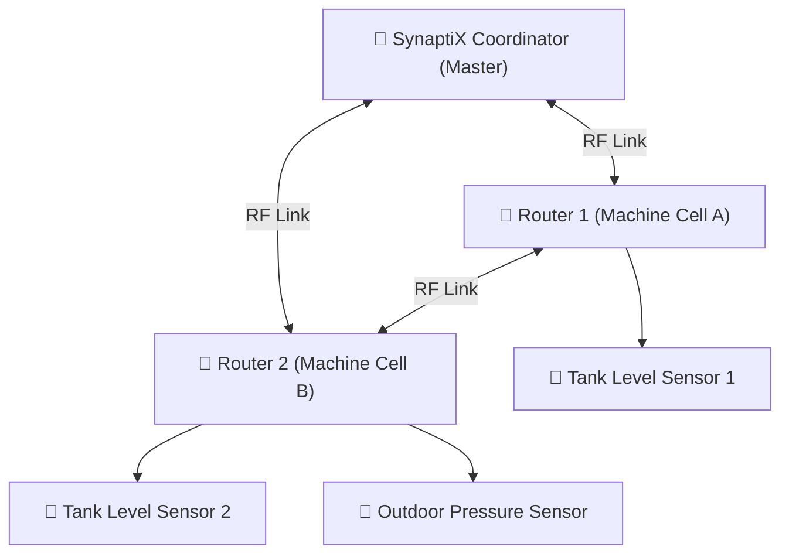

# Industrial Zigbee Mesh Network Configuration

  <strong>Document ID:</strong> SYNX-DOC-TOOL-007
  <strong>Chapter:</strong> 05. Engineering Tools &amp; Protocols
  <strong>Supported Hardware:</strong> SynaptiX Controller / Gateway with 2.4 GHz RF module
  <strong>Standard:</strong> IEEE 802.15.4 &bull; Zigbee PRO Industrial Specification

In large factory floors or tank farms where running RS-485 cables is physically challenging or costly, **SynaptiX IDE** supports **Industrial Zigbee Mesh** wireless communication. Featuring dynamic self-routing and automatic self-healing capabilities, Zigbee mesh allows distributed temperature, pressure, and level sensors to relay measurement data reliably back to the central controller around metal obstacles.

---

## 1. Network Device Roles

An industrial Zigbee mesh consists of three coordinated device roles:

| Device Role | Icon | System Placement | Operational Responsibility |
| :--- | :---: | :--- | :--- |
| **Coordinator** | 👑 | Central SynaptiX Controller | Creates the network, allocates 16-bit network addresses, manages the AES security key, and serves as the data gateway for the PLC runtime. |
| **Router** | 🔁 | Intermediate Control Panels | Performs local I/O while simultaneously acting as a wireless repeater to relay packets from remote sensors. Requires permanent power. |
| **End Device** | 📡 | Battery-powered field transmitters | Periodically wakes up, transmits measurement packets, and immediately returns to deep sleep to conserve battery. Does not relay traffic. |

---

## 2. Configuring Network Parameters in SynaptiX IDE

Access the configuration window via **Device -> Industrial Zigbee Wireless Configuration...**:

### 2.1. Network Identifier (Pan ID)
- **Pan ID (Personal Area Network ID):** A 16-bit hexadecimal number (ranging from `0x0001` to `0xFFFE`, e.g., `0x24A8`).
- **Rule:** All devices intended to communicate within the same facility zone must share **the exact same Pan ID**. Distinct facility areas must use unique Pan IDs to avoid overlapping packet collisions.

### 2.2. Selecting RF Channels to Avoid Plant Wi-Fi Interference (Channels 11..26)
Zigbee operates within the globally unlicensed 2.4 GHz ISM band alongside plant Wi-Fi. To ensure uninterrupted industrial transmission without drops, select Zigbee channels located in the guard bands between active Wi-Fi channels:

::: tip Optimal Industrial Channel Selection
- If factory Wi-Fi access points operate on standard Channels 1, 6, and 11:
  - Prefer **Zigbee Channel 15** (centered between Wi-Fi Channels 1 and 6).
  - Or select **Zigbee Channel 20** (centered between Wi-Fi Channels 6 and 11).
  - Or use **Zigbee Channel 25 / 26** (positioned at the outer edge, completely free from Wi-Fi spectral overlap).
:::

### 2.3. AES-128 Network Security Key
To safeguard industrial telemetry against unauthorized eavesdropping or rogue node injection, all wireless payloads are encrypted with an AES-128 key. Click **Generate Random Key** or enter a 32-character hexadecimal key provided by plant cybersecurity administrators.

---

## 3. Commissioning & Pairing Procedure (Permit Join)

To pair a new wireless sensor into an established mesh:
1. In SynaptiX IDE, click **Permit Join**. The controller's RF status LED pulses to indicate pairing mode is active for 60 seconds.
2. Press and hold the pairing button on the field sensor for 3 seconds.
3. Once successfully associated, the sensor name and network address appear in the Live Node Table alongside its **Received Signal Strength Indicator (RSSI in dBm)**.
4. After 60 seconds, the join window automatically closes for security.

---

## 4. Troubleshooting Field Issues

| Symptom | Probable Root Cause | Corrective Action |
| :--- | :--- | :--- |
| Sensor cannot discover network | Mismatched Pan ID or wrong RF channel | Verify that the sensor Pan ID and RF channel match the Coordinator settings. |
| Weak wireless link (`RSSI < -85 dBm`) | Excessive distance or heavy metal shielding | Add an intermediate **Router** node between the sensor and controller. |
| High packet latency or intermittent drops | Co-channel interference from plant Wi-Fi AP | Migrate the Zigbee network to **Channel 25** or **Channel 26**. |
