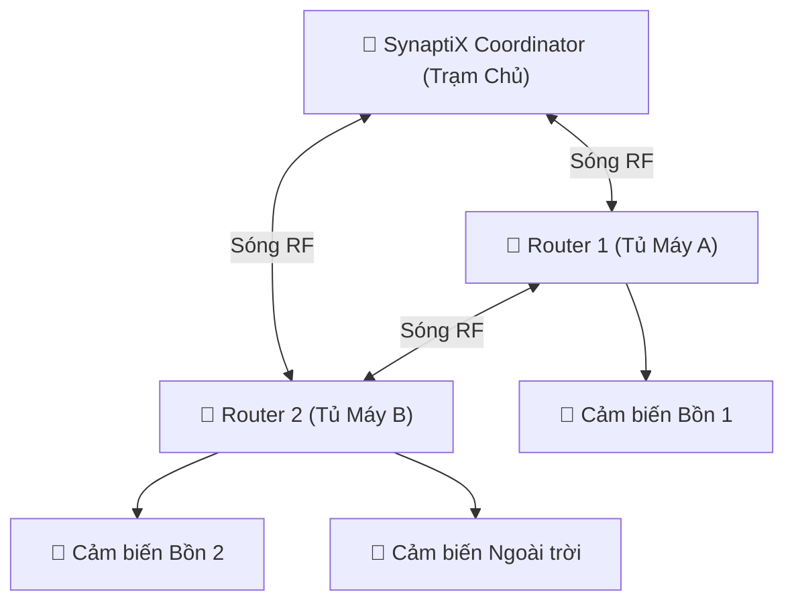

# Cấu hình Mạng Không dây Zigbee Mesh Công nghiệp

  <strong>Mã tài liệu:</strong> SYNX-DOC-TOOL-007
  <strong>Chương:</strong> 05. Công Cụ Kỹ Thuật &amp; Giao Thức
  <strong>Phần cứng Hỗ trợ:</strong> SynaptiX Controller / Gateway có mô-đun RF 2.4 GHz
  <strong>Tiêu chuẩn:</strong> IEEE 802.15.4 &bull; Zigbee PRO Industrial Specification

Trong các nhà xưởng diện tích rộng hoặc khu vực bồn bể khó đi dây cáp RS-485, **SynaptiX IDE** hỗ trợ thiết lập mạng truyền thông không dây công nghiệp **Zigbee Mesh**. Với đặc tính tự định tuyến và tự phục hồi (Self-Healing Mesh), mạng Zigbee cho phép các cảm biến nhiệt độ, độ ẩm, áp suất truyền dữ liệu về bộ điều khiển trung tâm xuyên qua các vật cản kim loại một cách ổn định và tin cậy.

---

## 1. Các Vai Trò Thiết Bị Trong Mạng (Device Roles)

Một mạng Zigbee công nghiệp gồm 3 loại vai trò thiết bị phối hợp với nhau:

| Vai trò Thiết bị | Biểu tượng | Vị trí trong Hệ thống | Nhiệm vụ Vận hành |
| :--- | :---: | :--- | :--- |
| **Trạm Điều phối (Coordinator)** | 👑 | Bộ điều khiển trung tâm SynaptiX | Khởi tạo mạng, cấp phát địa chỉ mạng cho các nốt con, quản lý khóa bảo mật và làm cầu nối thu thập dữ liệu về PLC. |
| **Trạm Chuyển tiếp (Router)** | 🔁 | Các tủ điều khiển trung gian | Vừa đo đạc I/O tại chỗ, vừa đóng vai trò trạm lặp chuyển tiếp gói tin không dây từ các cảm biến ở xa về trạm điều phối. Luôn cấp nguồn liên tục. |
| **Nốt Đầu cuối (End Device)** | 📡 | Cảm biến đo điểm lẻ, chạy pin | Chỉ gửi dữ liệu định kỳ và ngủ sâu (Sleep Mode) để tiết kiệm pin. Không tham gia chuyển tiếp gói tin của nốt khác. |

---

## 2. Hướng Dẫn Cấu Hình Tham Số Mạng Trên SynaptiX IDE

Nhấn vào menu **Thiết bị -> Cấu hình Mạng Không dây Zigbee...** để mở hộp thoại thiết lập:

### 2.1. Mã Định danh Mạng (Pan ID)
- **Pan ID (Personal Area Network ID):** Là một mã số 16-bit (từ `0x0001` đến `0xFFFE`, ví dụ: `0x24A8`).
- **Quy tắc:** Tất cả các thiết bị muốn giao tiếp với nhau trong cùng một phân xưởng bắt buộc phải cài **chung một mã Pan ID**. Các thiết bị thuộc phân xưởng khác phải đặt Pan ID khác để tránh lẫn sóng.

### 2.2. Chọn Kênh Tần số Tránh Can Nhiễu Wi-Fi (RF Channel 11..26)
Sóng Zigbee hoạt động ở dải tần số 2.4 GHz chung với mạng Wi-Fi văn phòng. Để đường truyền không bị chập chờn khi nhà xưởng có nhiều điểm phát Wi-Fi, hãy chọn các kênh Zigbee nằm ngoài dải phát của Wi-Fi:

::: tip Mẹo Chọn Kênh Tần Số Tối Ưu Cho Nhà Xưởng
- Nếu Wi-Fi nhà xưởng đang phát ở Kênh 1, 6, 11:
  - Hãy ưu tiên chọn **Kênh Zigbee 15** (nằm giữa Kênh Wi-Fi 1 và 6).
  - Hoặc chọn **Kênh Zigbee 20** (nằm giữa Kênh Wi-Fi 6 và 11).
  - Hoặc chọn **Kênh Zigbee 25 / 26** (nằm ở rìa ngoài cùng, hoàn toàn không bị Wi-Fi phủ lên).
:::

### 2.3. Mã Khóa Bảo Mật Mạng (AES-128 Encryption Key)
Để chống lại việc kẻ gian can thiệp hoặc gắn trạm giả mạo vào mạng điều khiển nhà máy, toàn bộ gói tin Zigbee được mã hóa bằng khóa bảo mật 128-bit. Nhấn nút **Tạo Khóa Ngẫu Nhiên (Generate Key)** hoặc nhập chuỗi 32 ký tự Hex do quản trị viên cấp.

---

## 3. Quy Trình Cho Phép Gia Nhập Mạng (Commissioning & Pairing)

Để thêm một cảm biến mới vào mạng:
1. Trên giao diện SynaptiX IDE, bấm nút **Mở Cửa Gia Nhập (Permit Join)**. Đèn LED chỉ báo trên bộ điều khiển sẽ nhấp nháy báo hiệu đang mở cửa nhận nốt mới trong vòng 60 giây.
2. Nhấn giữ nút ghép nối trên cảm biến trong 3 giây.
3. Khi cảm biến kết nối thành công, tên cảm biến và địa chỉ sóng sẽ xuất hiện trên danh sách nốt mạng kèm chỉ số cường độ tín hiệu **RSSI (dBm)**.
4. Hết thời gian 60 giây, cổng gia nhập tự động khóa lại để bảo đảm an toàn.

---

## 4. Xử Lý Sự Cố Thường Gặp (Troubleshooting)

| Hiện tượng | Nguyên nhân Khả dĩ | Biện pháp Khắc phục |
| :--- | :--- | :--- |
| Cảm biến không tìm thấy mạng | Sai mã Pan ID hoặc lệch kênh tần số | Kiểm tra lại thông số Pan ID và Kênh trên cảm biến cho khớp với Coordinator. |
| Tín hiệu sóng yếu (`RSSI < -85 dBm`) | Khoảng cách xa hoặc bị che khuất bởi bồn inox | Lắp thêm một trạm chuyển tiếp **Router** ở vị trí trung gian để tiếp sóng. |
| Gói tin bị trễ hoặc rớt chập chờn | Bị can nhiễu sóng từ bộ phát Wi-Fi công suất lớn | Đổi kênh Zigbee sang **Kênh 25** hoặc **Kênh 26**. |
