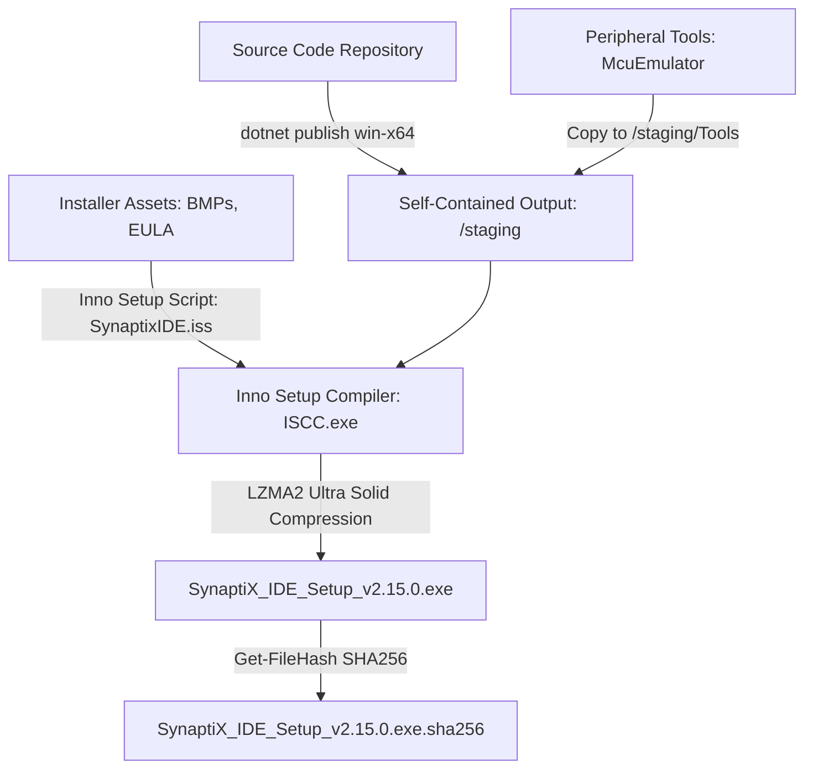

# 05-DESKTOP_INSTALLER_AND_PACKAGING_SPEC

> **Specification ID:** SPEC-PLT-005  
> **Title:** Desktop Application Packaging & Enterprise Installer Pipeline Specification  
> **Status:** APPROVED  
> **Target Version:** SynaptiX IDE v2.15.0+  
> **Standard Compliance:** IEC 62443-4-1 (Secure Product Lifecycle), Microsoft Desktop App Architecture, Inno Setup 6 Standards  
> **Audience:** DevOps Engineers, Release Managers, Industrial IT/OT Administrators

---

## 1. Executive Summary & Objective

SynaptiX IDE is designed for mission-critical industrial operational environments where deployment must be deterministic, auditable, and resilient. This specification governs the architecture and execution pipeline of the single-click desktop installer (`SynaptiX_IDE_Setup_v2.15.0.exe`).

The packaging pipeline achieves:
1. **Zero-Dependency Target Runtime:** Completely self-contained .NET 8 `win-x64` WPF deployment. No prerequisite .NET Desktop Runtime or SDK installations required on factory workstations.
2. **Integrated Tooling Bundle:** Automatically bundles peripheral engineering utilities, specifically `Tools/SimplePLC.McuEmulator.exe`, enabling out-of-the-box hardware-in-the-loop (HIL) simulation without physical microcontroller hardware.
3. **Enterprise Automation:** Full compliance with silent IT/OT deployment (`/VERYSILENT /SUPPRESSMSGBOXES /NORESTART`) for automated mass rollouts across factory LANs.
4. **Cryptographic Traceability:** Enforces SHA-256 manifest generation for supply-chain integrity verification.

---

## 2. Packaging Architecture

### 2.1. Compilation & Bundling Pipeline



### 2.2. Directory Layout of Deployed Installation

When the installer executes on target Windows hosts, it establishes the following filesystem structure under `{autopf}\Synaptix Automation\SynaptiX IDE`:

| Relative Path | Content Description | Permissions & Lifecycle |
|:---|:---|:---|
| `SynaptixIDE.exe` | Main WPF Desktop Application Host | Read/Execute for Users, Write for Admins |
| `*.dll` | Self-contained .NET 8 runtime & project libraries | Immutable binary payload |
| `Tools/SimplePLC.McuEmulator.exe` | Standalone virtual PLC & Modbus/Serial hardware emulator | Read/Execute for Engineers |
| `Styles/`, `Assets/` | Vector resources, theme dictionaries, syntax definitions | Application runtime assets |
| `unins000.exe`, `unins000.dat` | Deterministic uninstaller engine | Managed by Inno Setup engine |

---

## 3. Inno Setup Configuration Blueprint (`SynaptixIDE.iss`)

The installer is authored in Inno Setup 6 scripting language (`SynaptixIDE.iss`). Core technical parameters:

```ini
[Setup]
AppId={{9F6C8A21-7B3D-4E8F-A5C9-1D2E3F4A5B6C}
AppName=SynaptiX IDE
AppVersion=2.15.0
AppVerName=SynaptiX IDE v2.15.0
AppPublisher=Synaptix Automation
AppPublisherURL=https://synaptix-io.com/
AppSupportURL=https://synaptix-io.com/support
AppUpdatesURL=https://synaptix-io.com/downloads
DefaultDirName={autopf}\Synaptix Automation\SynaptiX IDE
DefaultGroupName=Synaptix Automation
DisableProgramGroupPage=yes
LicenseFile=..\LICENSE.txt
OutputDir=Output
OutputBaseFilename=SynaptiX_IDE_Setup_v2.15.0
SetupIconFile=..\SimplePLC.Studio\Assets\icon.ico
Compression=lzma2/ultra64
SolidCompression=yes
ArchitecturesInstallIn64BitMode=x64
PrivilegesRequired=admin
WizardStyle=modern
```

### 3.1. Registry Invariants & Protocol Associations
To allow industrial deep-linking and integration with enterprise asset management, the installer registers:
1. **Uninstall Entry:** `HKLM\Software\Microsoft\Windows\CurrentVersion\Uninstall\{AppId}` with version, publisher URL, and estimated disk footprint (~180 MB).
2. **Project File Association (`.splc`):**
   - Key: `HKCR\.splc` $\rightarrow$ `Synaptix.Project`
   - Command: `"{app}\SynaptixIDE.exe" "%1"`

---

## 4. Enterprise Silent Deployment & Unattended Automation

In regulated pharmaceutical, automotive, and power generation environments, software rollouts must execute silently via Microsoft Endpoint Configuration Manager (SCCM), InTune, or Group Policy Objects (GPO).

### 4.1. Supported CLI Flags

```powershell
# Unattended silent installation without user interaction or reboots
.\SynaptiX_IDE_Setup_v2.15.0.exe /VERYSILENT /SUPPRESSMSGBOXES /NORESTART /LOG="install.log"

# Custom installation directory specification
.\SynaptiX_IDE_Setup_v2.15.0.exe /VERYSILENT /DIR="D:\IndustrialApps\SynaptixIDE"

# Unattended clean uninstallation
"C:\Program Files\Synaptix Automation\SynaptiX IDE\unins000.exe" /VERYSILENT /SUPPRESSMSGBOXES /NORESTART
```

---

## 5. Automated Build Script (`installer/build-installer.ps1`)

The repository provides a single-click PowerShell pipeline:

```powershell
powershell -ExecutionPolicy Bypass -File installer/build-installer.ps1
```

### 5.1. Execution Gates in `build-installer.ps1`:
1. **Environment Detection:** Validates `ISCC.exe` presence in `C:\Program Files (x86)\Inno Setup 6\ISCC.exe`.
2. **Process Safety:** Terminates any active instances of `SynaptixIDE.exe` or `SimplePLC.McuEmulator.exe` to prevent assembly lockouts.
3. **Clean Publish:** Executes `dotnet publish SimplePLC.Studio/SimplePLC.Studio.csproj -c Release -r win-x64 --self-contained true -o installer/staging`.
4. **Tool Bundling:** Compiles `SimplePLC.McuEmulator` and copies the executable into `installer/staging/Tools/`.
5. **Inno Setup Invocation:** Compiles `SynaptixIDE.iss`.
6. **Checksum Generation:** Generates `SynaptiX_IDE_Setup_v2.15.0.exe.sha256` using `Get-FileHash -Algorithm SHA256`.

---

## 6. Audit & Traceability Matrix

| Requirement ID | Standard Reference | Architectural Fulfillment |
|:---|:---|:---|
| **REQ-PKG-001** | IEC 62443-4-1 §7.3 | Deterministic self-contained binary bundle with zero network pull during setup. |
| **REQ-PKG-002** | IEC 61508-3 §7.4.4 | Supply chain integrity verified via SHA-256 hash manifest. |
| **REQ-PKG-003** | ANSI/ISA-101 | Standard desktop ergonomics, modern high-DPI installer wizard artwork. |
| **REQ-PKG-004** | Windows Desktop Guidelines | Admin-elevation enforcement for protected `Program Files` directory write. |
