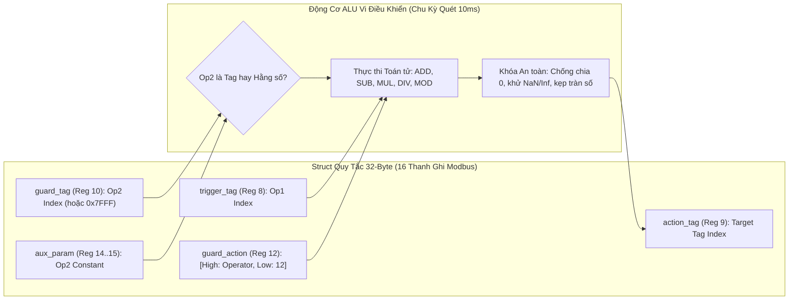

# TÀI LIỆU ĐẶC TẢ GIAO DIỆN PHẦN CỨNG & PHẦN SỤN (ICD)
## SPLC-SPEC-MATH-007: KHỐI TÍNH TOÁN TOÁN HỌC & ĐẠI SỐ TIỀN ĐỊNH (MATH_OP)

**Mã tài liệu:** `SPLC-SPEC-MATH-007`  
**Phiên bản:** `v2.0.0`  
**Ngày phát hành:** `2026-11-16`  
**Trạng thái:** `APPROVED / AUTHORITATIVE SPECIFICATION`  
**Phạm vi áp dụng:** Firmware vi điều khiển SimplePLC (STM32H5/G4/F4, ESP32-S3, RP2040, GD32), SynaptiX Runtime Engine, SynaptiX IDE Studio Compiler.

---

### 1. Tổng Quan Kiến Trúc (Architecture Overview)

Khối chức năng **`MATH_OP`** (Mã hành động: `SPLC_ACT_MATH_OP = 8`) cung cấp năng lực tính toán số học tiền định (Deterministic Arithmetic Logic Unit - ALU) chạy trực tiếp trong chu kỳ quét 10ms (100Hz) của vi điều khiển, không cấp phát heap động (Zero Heap Allocation):

$$\text{ActionTag} = \text{TriggerTag} \quad [\text{Operator}] \quad \text{Operand}_2$$

Trong đó:
1. **Toán hạng 1 ($\text{Op}_1$):** Luôn là một Tag biến trỏ bởi trường `trigger_tag` (Index `0..127`).
2. **Toán hạng 2 ($\text{Op}_2$):** 
   - Có thể là một Tag biến động trỏ bởi `guard_tag` (khi $\text{guard\_tag} \ne \text{0x7FFF}$).
   - Hoặc là một hằng số vô hướng (Scalar Constant) nạp từ trường `aux_param` (khi $\text{guard\_tag} == \text{0x7FFF}$).
3. **Kết quả ($\text{Out}$):** Ghi trực tiếp vào ô nhớ Tag trỏ bởi `action_tag`.
4. **Hỗ trợ định dạng số học song song:**
   - **Số nguyên bù hai 32-bit (`INT32`)**: Khi cờ `flags` (Reg 13 High) $= 0\text{x}00$.
   - **Số thực dấu chấm động đơn IEEE-754 (`REAL` / `Float32`)**: Khi cờ `flags` $= 0\text{x}03$ (`FLOAT_DATA`).



---

### 2. Bản Đồ Bộ Nhớ Thanh Ghi & Khế Ước Nhị Phân 32-Byte (Wire Contract)

Mỗi chỉ thị `MATH_OP` được đóng gói trong một cấu trúc **32-byte (16 thanh ghi Modbus Holding Registers)** đồng nhất với khế ước truyền thông `SPLC_RuleRecord_t`:

> [!IMPORTANT]
> **Quy chuẩn Endianness trên Bus Modbus RTU / TCP / CDC:**  
> Toàn bộ các thanh ghi Modbus Holding Registers đều là **Big-Endian**:
> - Dữ liệu 16-bit: High Byte truyền trước, Low Byte truyền sau.
> - Dữ liệu 32-bit (`int32_t`, `uint32_t`, `float` IEEE-754): Chiếm 2 thanh ghi liên tiếp với **High Word trước (Reg N), Low Word sau (Reg N+1)**.

| Thanh ghi Modbus | Byte Offset | Tên trường C | Kiểu dữ liệu | Diễn giải kỹ thuật & Phân bổ Byte cho Khối MATH |
| :---: | :---: | :--- | :---: | :--- |
| **`Reg 0..1`** | `0x00..0x03` | `threshold_lo` | `int32_t` / `float` | Ngưỡng dưới so sánh điều kiện Trigger. Cho phép vừa kiểm tra ngưỡng vừa tính toán. |
| **`Reg 2..3`** | `0x04..0x07` | `threshold_hi` | `int32_t` / `float` | Ngưỡng trên so sánh điều kiện Trigger (độc lập, không bị chiếm dụng). |
| **`Reg 4..5`** | `0x08..0x0B` | `for_ms` | `uint32_t` | Thời gian lọc trễ hoặc chu kỳ phát nhịp tính toán (ms). |
| **`Reg 6..7`** | `0x0C..0x0F` | `action_param` | `int32_t` / `float` | Tham số bổ trợ (ngưỡng kẹp bão hòa thứ 3 khi dùng `CLAMP`, hoặc hệ số tiền chia). |
| **`Reg 8`** | `0x10..0x11` | `trigger_tag` | `uint16_t` | **Chỉ số Tag Toán hạng 1 ($\text{Op}_1$)** (`0..127`). |
| **`Reg 9`** | `0x12..0x13` | `action_tag` | `uint16_t` | **Chỉ số Tag Lưu kết quả ($\text{Out}$)** (`0..127`). |
| **`Reg 10`** | `0x14..0x15` | `guard_tag` | `uint16_t` | **Chỉ số Tag Toán hạng 2 ($\text{Op}_2$)** khi nhận biến từ Tag khác. Ghi `0x7FFF` (`GuardTagNone`) nếu $\text{Op}_2$ là hằng số. |
| **`Reg 11`** | `0x16..0x17` | `enabled_trigger` | `uint16_t` | **High Byte:** `enabled` (1=Bật, 0=Tắt)<br>**Low Byte:** `trigger_type` (0=ON_CHANGE, 1=ON_RISE, 4=INTERVAL). |
| **`Reg 12`** | `0x18..0x19` | `guard_action` | `uint16_t` | **High Byte (Bits 15..8):** `compare_op` (Mã toán tử ALU `0..4`)<br>**Low Byte (Bits 7..0):** `action_type = 8` (`SPLC_ACT_MATH_OP`). |
| **`Reg 13`** | `0x1A..0x1B` | `flags_reserved` | `uint16_t` | **High Byte:** `flags` (`0x00`: Int32, `0x03`: Float32 IEEE-754)<br>**Low Byte:** `reserved_byte = 0x00`. |
| **`Reg 14..15`** | `0x1C..0x1F` | `aux_param` | `int32_t` / `float` | **Hằng số Toán hạng 2 ($\text{Op}_2$)** khi `guard_tag == 0x7FFF`. High Word tại Reg 14, Low Word tại Reg 15. |

---

### 3. Bảng Mã Toán Tử ALU (`compare_op` trong Reg 12 High)

Khi trường `action_type` mang giá trị `SPLC_ACT_MATH_OP (8)`, trường `compare_op` ở Byte Cao của thanh ghi 12 được tái sử dụng để chọn hàm tính toán:

| Mã số (`Hex`) | Ký hiệu | Tên hàm | Công thức Toán học | Quy tắc thực thi MCU |
| :---: | :---: | :--- | :--- | :--- |
| **`0` (`0x00`)** | `ADD` | Phép Cộng | $\text{Out} = \text{Op}_1 + \text{Op}_2$ | Cộng đại số bù hai hoặc cộng IEEE-754. |
| **`1` (`0x01`)** | `SUB` | Phép Trừ | $\text{Out} = \text{Op}_1 - \text{Op}_2$ | Trừ đại số: $\text{Op}_1$ trừ cho $\text{Op}_2$. |
| **`2` (`0x02`)** | `MUL` | Phép Nhân | $\text{Out} = \text{Op}_1 \times \text{Op}_2$ | Nhân 32-bit qua biến trung gian 64-bit chống tràn. |
| **`3` (`0x03`)** | `DIV` | Phép Chia | $\text{Out} = \text{Op}_1 / \text{Op}_2$ | Kích hoạt bộ phòng vệ chia cho 0 khi $\text{Op}_2 == 0$. |
| **`4` (`0x04`)** | `MOD` | Lấy Dư | $\text{Out} = \text{Op}_1 \pmod{\text{Op}_2}$ | Phép chia lấy phần dư (Int32 hoặc `fmodf`). |
| **`5` (`0x05`)** | `MIN` | Chọn Min | $\text{Out} = \min(\text{Op}_1, \text{Op}_2)$ | Chọn giá trị nhỏ hơn giữa 2 toán hạng. |
| **`6` (`0x06`)** | `MAX` | Chọn Max | $\text{Out} = \max(\text{Op}_1, \text{Op}_2)$ | Chọn giá trị lớn hơn giữa 2 toán hạng. |
| **`7` (`0x07`)** | `CLAMP`| Kẹp Biên | $\text{Out} = \text{clip}(\text{Op}_1, -\text{Op}_2, \text{Op}_2)$ | Kẹp đối xứng $\text{Op}_1$ trong dải $[-\text{Op}_2 \dots +\text{Op}_2]$. |

---

### 4. Quy Chuẩn An Toàn & Phòng Vệ Lỗi Phần Cứng (Firmware Hardening)

Tuân thủ nghiêm ngặt **IEC 61508-3 SIL2/SIL3**:

1. **Bộ Phòng Vệ Chia Cho 0 Tuyệt Đối (Hardware Divide-by-Zero Defense):**
   - Vi điều khiển **tuyệt đối không được phát sinh lỗi CPU Trap (`UsageFault` / `HardFault`)** khi gặp mẫu số bằng 0.
   - Khi phát hiện $|\text{Op}_2| < 10^{-6}$ trong phép `DIV` hoặc `MOD`:
     - MCU ghi cờ cảnh báo hệ thống: `SPLC_SYS_ERR_DIV_ZERO = 0x0008` vào thanh ghi chẩn đoán `0x0A24`.
     - Ngõ ra `action_tag` giữ nguyên giá trị chu kỳ trước (hoặc bão hòa tối đa `INT32_MAX` / `FLT_MAX` tùy cấu hình cờ).
2. **Khử Giá Trị Dấu Phẩy Động Bất Thường (NaN & Infinity Sanitization):**
   - Trước khi ghi giá trị dấu chấm động ra `action_tag`, vi điều khiển bắt buộc gọi kiểm tra:
     ```c
     if (isnan(out_f) || isinf(out_f)) {
         out_f = 0.0f;
         splc_set_system_error(SPLC_ERR_FLOAT_INVALID);
     }
     ```
3. **Chống Tràn Số Nguyên (Integer Saturation Clamping):**
   - Phép nhân `INT32` được tính trên biến tạm `int64_t`:
     ```c
     int64_t prod = (int64_t)op1_i * (int64_t)op2_i;
     if (prod > INT32_MAX) prod = INT32_MAX;
     if (prod < INT32_MIN) prod = INT32_MIN;
     out_i = (int32_t)prod;
     ```

---

### 5. Mã Nguồn Tham Chiếu Thực Thi Trên Vi Điều Khiển (C Implementation)

```c
/**
 * @brief Thực thi chỉ thị tính toán ALU MATH_OP trong chu kỳ quét 10ms.
 * @param rule Con trỏ tới bản ghi nhị phân 32-byte SPLC_RuleRecord_t.
 */
void splc_execute_math_op(const SPLC_RuleRecord_t *rule) {
    /* 1. Trích xuất Toán hạng 1 từ Trigger Tag */
    int32_t raw_op1 = splc_tag_read(rule->trigger_tag);
    
    /* 2. Trích xuất Toán hạng 2 (từ Guard Tag hoặc Aux Param) */
    int32_t raw_op2;
    if (rule->guard_tag != 0x7FFF) {
        raw_op2 = splc_tag_read(rule->guard_tag & 0x7FFF);
    } else {
        raw_op2 = rule->aux_param;
    }
    
    uint8_t op = rule->compare_op;
    bool is_float = (rule->flags & SPLC_RULE_FLAG_FLOAT_DATA) != 0;

    /* 3. Phân nhánh xử lý kiểu dữ liệu */
    if (is_float) {
        float f1 = *(float*)&raw_op1;
        float f2 = *(float*)&raw_op2;
        float res_f = 0.0f;

        switch (op) {
            case 0: res_f = f1 + f2; break;                         /* ADD */
            case 1: res_f = f1 - f2; break;                         /* SUB */
            case 2: res_f = f1 * f2; break;                         /* MUL */
            case 3:                                                 /* DIV */
                if (fabsf(f2) > 1e-6f) {
                    res_f = f1 / f2;
                } else {
                    res_f = f1; /* Giữ nguyên giá trị khi chia cho 0 */
                    splc_report_error(SPLC_ERR_DIV_ZERO);
                }
                break;
            case 4: res_f = fmodf(f1, f2); break;                   /* MOD */
            case 5: res_f = (f1 < f2) ? f1 : f2; break;             /* MIN */
            case 6: res_f = (f1 > f2) ? f1 : f2; break;             /* MAX */
            case 7: {                                               /* CLAMP */
                float bound = fabsf(f2);
                res_f = (f1 < -bound) ? -bound : (f1 > bound ? bound : f1);
                break;
            }
            default: res_f = f1; break;
        }

        if (isnan(res_f) || isinf(res_f)) res_f = 0.0f;
        splc_tag_write(rule->action_tag, *(int32_t*)&res_f);
    } else {
        int32_t res_i = 0;
        switch (op) {
            case 0: res_i = raw_op1 + raw_op2; break;               /* ADD */
            case 1: res_i = raw_op1 - raw_op2; break;               /* SUB */
            case 2: {                                               /* MUL */
                int64_t p = (int64_t)raw_op1 * (int64_t)raw_op2;
                res_i = (int32_t)SPLC_CLAMP(p, INT32_MIN, INT32_MAX);
                break;
            }
            case 3:                                                 /* DIV */
                if (raw_op2 != 0) {
                    res_i = raw_op1 / raw_op2;
                } else {
                    res_i = raw_op1;
                    splc_report_error(SPLC_ERR_DIV_ZERO);
                }
                break;
            case 4: res_i = (raw_op2 != 0) ? (raw_op1 % raw_op2) : 0; break; /* MOD */
            case 5: res_i = (raw_op1 < raw_op2) ? raw_op1 : raw_op2; break; /* MIN */
            case 6: res_i = (raw_op1 > raw_op2) ? raw_op1 : raw_op2; break; /* MAX */
            case 7: {                                               /* CLAMP */
                int32_t bound = abs(raw_op2);
                res_i = SPLC_CLAMP(raw_op1, -bound, bound);
                break;
            }
            default: res_i = raw_op1; break;
        }
        splc_tag_write(rule->action_tag, res_i);
    }
}
```
