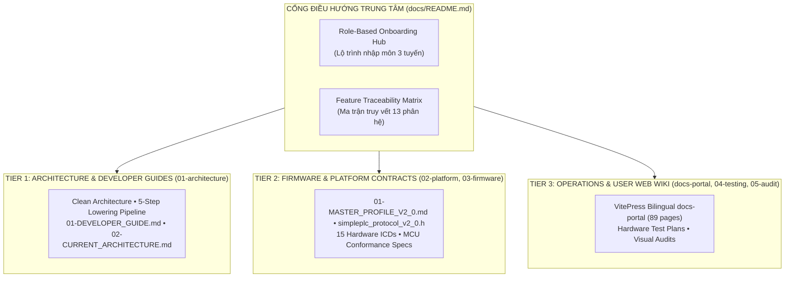

# SimplePLC / SynaptiX IDE Engineering Documentation Hub

Chào mừng đến với Cổng thông tin & Tài liệu Kỹ thuật chính thức của **SimplePLC / SynaptiX IDE Platform V2.0**.  
Hệ thống tài liệu này được kiến trúc và chuẩn hóa toàn diện theo các tiêu chuẩn quốc tế:
- **ISO/IEC/IEEE 26514:2022:** Tiêu chuẩn Quốc tế về Kiến trúc Thông tin và Quản lý Vòng đời Tài liệu Kỹ thuật Phần mềm.
- **IEC/IEEE 82079-1:2019:** Tiêu chuẩn Biên soạn Thông tin Sử dụng Sản phẩm Kỹ thuật & Công nghiệp.
- **IEEE 1016-2009:** Tiêu chuẩn Mô tả Thiết kế Phần mềm (Software Design Descriptions - SDD).
- **Interface Control Document (ICD) Standard:** Tiêu chuẩn khế ước giao tiếp nhị phân phần cứng/phần mềm.
- **Docs-as-Code & Living Documentation Doctrine:** Tài liệu là mã nguồn, phiên bản hóa đồng bộ với Git và tự động kiểm tra liên kết qua script.

---

## 🧭 1. Mô Hình Kiến Trúc Thông Tin 3 Phân Khu (3-Tier Information Architecture)

Toàn bộ kho tài liệu kỹ thuật được phân tầng rạch ròi thành các cấp độ thông tin độc lập, được đánh chỉ số tuần tự (`01-`, `02-`, `03-`, `04-`, `05-`) giúp việc định vị, phân biệt và sắp xếp hoàn toàn trong suốt:



| Tầng thông tin | Phân khu lưu trữ | Đối tượng phục vụ | Bản chất nội dung |
| :--- | :--- | :--- | :--- |
| **Tier 1: Architecture & Dev Guides** | [`docs/01-architecture/`](file:///g:/HoaNV/Projects/SimplePLC/docs/01-architecture/) | C# / .NET 8 / WPF / Compiler Dev | Clean Architecture, chu trình hạ cấp mã FBD, Bad-Data Defense, hướng dẫn viết Unit Test hermetic. |
| **Tier 2: Platform & Firmware Contracts** | [`docs/02-platform/`](file:///g:/HoaNV/Projects/SimplePLC/docs/02-platform/), [`docs/03-firmware/`](file:///g:/HoaNV/Projects/SimplePLC/docs/03-firmware/) | Embedded STM32 / MCU / Hardware Dev | Khế ước nhị phân Modbus RTU V2.0, C struct `#pragma pack(push, 1)`, 15 tài liệu ICD, checklist nghiệm thu CHKL. |
| **Tier 3: Operations, Testing & Portal** | [`docs-portal/`](file:///g:/HoaNV/Projects/SimplePLC/docs-portal/), [`docs/04-testing/`](file:///g:/HoaNV/Projects/SimplePLC/docs/04-testing/), [`docs/05-audit/`](file:///g:/HoaNV/Projects/SimplePLC/docs/05-audit/) | Kỹ sư Vận hành, Tích hợp Hiện trường (SI), QA | Cổng Web Wiki song ngữ 89 trang, kế hoạch kiểm thử phần cứng, báo cáo kiểm định UI/UX ANSI/ISA-101. |

---

## 🚀 2. START HERE: Lộ Trình Nhập Môn Theo Vai Trò (Role-Based Onboarding)

Để một kỹ sư mới có thể nắm bắt hệ thống và bắt tay vào triển khai mã nguồn trong vòng **15 – 30 phút**, hãy chọn đúng tuyến đường chuyên môn của bạn:

### 👨‍💻 Tuyến 1: Dành cho Lập trình viên C# / Desktop / Compiler (.NET 8 WPF)

```
[Bước 1: Clean Architecture] ──> [Bước 2: Lowering Pipeline] ──> [Bước 3: Bad-Data Defense] ──> [Bước 4: Build & Tests]
```

1. **Bước 1 — Nắm bắt Ranh giới Kiến trúc (10 phút):**
   * Đọc [`docs/01-architecture/01-DEVELOPER_GUIDE.md`](file:///g:/HoaNV/Projects/SimplePLC/docs/01-architecture/01-DEVELOPER_GUIDE.md) (Mục 1).
   * Ghi nhớ quy tắc ranh giới 5 tầng: `Domain` $\leftarrow$ `Application` $\leftarrow$ `Protocol` $\leftarrow$ `Infrastructure` $\leftarrow$ `Studio`. Tuyệt đối không cho phép dependency hướng ra ngoài.
2. **Bước 2 — Hiểu Chu trình Biên dịch Hạ cấp FBD (10 phút):**
   * Đọc Mục 2 trong `01-DEVELOPER_GUIDE.md`: Xem cách đồ thị trực quan FBD được hạ cấp tất định qua 5 bước thành bytecode nhị phân 32-byte (`RuleRecord`).
3. **Bước 3 — Nắm vững Học thuyết Phòng vệ Dữ liệu & UI/UX (5 phút):**
   * Đọc [`AGENTS.md`](file:///g:/HoaNV/Projects/SimplePLC/AGENTS.md) Mục 0 & Mục 1: Hiểu về Axiom 1 (Phần cứng là Chân lý), Axiom 2 (Chân lý Thị giác), Axiom 3 (FSM Ô nhập Drafting vs Committed), và Bảng màu công nghiệp không dùng mã màu Hex trực tiếp (`Colors.xaml`).
4. **Bước 4 — Thiết lập Môi trường & Chạy Kiểm thử (5 phút):**
   ```powershell
   # 1. Dừng ứng dụng cũ nếu đang chạy
   Stop-Process -Name SynaptixIDE -Force -ErrorAction SilentlyContinue

   # 2. Biên dịch toàn bộ Solution (Bắt buộc: 0 errors, 0 warnings)
   dotnet build SimplePLC.sln

   # 3. Chạy 2,224 Unit Tests Hermetic
   dotnet test SimplePLC.sln --no-build
   ```
5. **Bước 5 — Bắt tay vào Code:**
   * Xem hướng dẫn mẫu 6 bước tạo một Khối hàm FBD mới tại Mục 3 trong `01-DEVELOPER_GUIDE.md`.

---

### ⚡ Tuyến 2: Dành cho Kỹ sư Vi điều khiển & Firmware Nhúng (STM32 / ESP32)

```
[Bước 1: Master Profile Map] ──> [Bước 2: C Header 1:1] ──> [Bước 3: Tra cứu ICD Phân hệ] ──> [Bước 4: Checklist Nghiệm thu]
```

1. **Bước 1 — Nắm bắt Bản đồ Bộ nhớ Master & Cơ chế Tự mô tả (15 phút):**
   * Đọc bản đặc tả Master duy nhất: [`docs/02-platform/01-MASTER_PROFILE_V2_0.md`](file:///g:/HoaNV/Projects/SimplePLC/docs/02-platform/01-MASTER_PROFILE_V2_0.md).
   * Nắm cấu trúc `SPLC_DeviceDescriptor_t` (`0x0000`), cơ chế tự mô tả tài nguyên `DeviceResourceInfo` (`0x0020`), và 2 byte phân loại phần cứng: `device_class` và `device_variant`.
2. **Bước 2 — Tích hợp Mã nguồn C/C++ Header Chuẩn (5 phút):**
   * Nhúng trực tiếp file header chuẩn C99/C11 vào dự án STM32CubeIDE / Keil MDK: [`src/SimplePLC.Protocol/Firmware/simpleplc_protocol_v2_0.h`](file:///g:/HoaNV/Projects/SimplePLC/src/SimplePLC.Protocol/Firmware/simpleplc_protocol_v2_0.h) hoặc [`docs/03-firmware/98-splc_secure_wire.h`](file:///g:/HoaNV/Projects/SimplePLC/docs/03-firmware/98-splc_secure_wire.h).
   * Giữ nguyên các macro `_Static_assert` để trình biên dịch C bảo vệ kích thước struct nhị phân.
3. **Bước 3 — Tra cứu Đặc tả Giao diện Kỹ thuật (ICDs) khi Lập trình Phân hệ:**
   * Khi hiện thực phân hệ nào, tra cứu tài liệu ICD chuyên sâu tương ứng trong [`docs/03-firmware/`](file:///g:/HoaNV/Projects/SimplePLC/docs/03-firmware/) (xem Bảng Ma trận ở Mục 3 bên dưới).
4. **Bước 4 — Tự Nghiệm thu Firmware theo Tiêu chuẩn Công nghiệp:**
   * Đối soát firmware với bộ tiêu chí kiểm định tại [`docs/03-firmware/00-MCU_CONFORMANCE_SPECIFICATION_V2_0.md`](file:///g:/HoaNV/Projects/SimplePLC/docs/03-firmware/00-MCU_CONFORMANCE_SPECIFICATION_V2_0.md) (Checklists `CHKL-01` đến `CHKL-22`).

---

### 🏭 Tuyến 3: Dành cho Kỹ sư Tự động hóa, Tích hợp Hiện trường (SI) & Vận hành

```
[Bước 1: Khởi động Web Wiki] ──> [Bước 2: Tra cứu Tính năng & Khối FBD] ──> [Bước 3: Đấu nối & Thử nghiệm Sống]
```

1. **Bước 1 — Mở Cổng Tra Cứu Web Wiki Song ngữ:**
   * Dự án cung cấp trang Web Wiki chuẩn VitePress tại thư mục [`docs-portal/`](file:///g:/HoaNV/Projects/SimplePLC/docs-portal/):
     ```powershell
     cd docs-portal
     npm run docs:dev
     ```
     Mở trình duyệt tại `http://localhost:5173` để tra cứu giao diện trực quan song ngữ Tiếng Việt & Tiếng Anh.
2. **Bước 2 — Tra cứu Sổ tay & Tài liệu Trực quan:**
   * Hướng dẫn Tiếng Việt: [`docs-portal/vi/index.md`](file:///g:/HoaNV/Projects/SimplePLC/docs-portal/vi/index.md).
   * Hướng dẫn Tiếng Anh: [`docs-portal/en/index.md`](file:///g:/HoaNV/Projects/SimplePLC/docs-portal/en/index.md).
3. **Bước 3 — Thao tác Hiện trường & Giám sát Trực tiếp:**
   * Sử dụng công cụ **Modbus Live Test Inspector** và **Live Watch Grid** để kiểm tra đáp ứng của cảm biến trước khi chạy dây chuyền chính thức.

---

## 🗺️ 3. Ma Trận Truy Vết Tính Năng Toàn Diện (Feature Traceability Matrix)

Bảng ma trận truy xuất 1:1 kết nối tất cả các khía cạnh kỹ thuật của từng phân hệ — từ Địa chỉ thanh ghi Modbus, Mã nguồn C#, Đặc tả nhị phân Firmware ICD, đến Cổng Web Wiki và Bộ kiểm thử:

| Phân hệ / Tính năng | Vùng nhớ Modbus V2.0 | Tầng Kiến trúc C# / ViewModels | Đặc tả Firmware MCU (ICD) | Cổng Web Wiki Vận Hành | Bộ Kiểm thử Tự động (Tests) |
| :--- | :---: | :--- | :--- | :--- | :--- |
| **Định danh & Tự mô tả** | `0x0000..0x0029` | [`SupportedDeviceProfile.cs`](file:///g:/HoaNV/Projects/SimplePLC/src/SimplePLC.Application/Models/SupportedDeviceProfile.cs) | [`01-MASTER_PROFILE_V2_0.md`](file:///g:/HoaNV/Projects/SimplePLC/docs/02-platform/01-MASTER_PROFILE_V2_0.md#L280) | [Ecosystem Overview](file:///g:/HoaNV/Projects/SimplePLC/docs-portal/vi/concepts/ecosystem-overview.md) | `SelfDescribingDeviceConnectionTests.cs` |
| **Logic Engine & Staging**| `0x9000..0xA001` | [`RuleCompiler.cs`](file:///g:/HoaNV/Projects/SimplePLC/src/SimplePLC.Application/Logic/Compilation/RuleCompiler.cs) | [`01-MASTER_PROFILE_V2_0.md`](file:///g:/HoaNV/Projects/SimplePLC/docs/02-platform/01-MASTER_PROFILE_V2_0.md#L260) | [Logic Editor Canvas](file:///g:/HoaNV/Projects/SimplePLC/docs-portal/vi/fbd-editor/canvas-navigation.md) | `RuleCompilerTests.cs` |
| **System Tags & Đồng hồ** | `0x0820..0x0827` | [`TagCatalog.cs`](file:///g:/HoaNV/Projects/SimplePLC/src/SimplePLC.Domain/Models/TagCatalog.cs) | [`01-SPLC_SPEC_SYSTEM_TAGS_006_ICD.md`](file:///g:/HoaNV/Projects/SimplePLC/docs/03-firmware/01-SPLC_SPEC_SYSTEM_TAGS_006_ICD.md) | [Data Models & Tags](file:///g:/HoaNV/Projects/SimplePLC/docs-portal/vi/concepts/data-model-and-types.md) | `SystemTagsIntegrationTests.cs` |
| **Chẩn đoán Lỗi Diag** | `0x0A20..0x0A24` | [`DiagnosticBlockDto.cs`](file:///g:/HoaNV/Projects/SimplePLC/src/SimplePLC.Protocol/Dto/DiagnosticBlockDto.cs) | [`01-MASTER_PROFILE_V2_0.md`](file:///g:/HoaNV/Projects/SimplePLC/docs/02-platform/01-MASTER_PROFILE_V2_0.md#L415) | [Diagnostics Guide](file:///g:/HoaNV/Projects/SimplePLC/docs-portal/vi/tools/diagnostics.md) | `DeviceHealthReaderTests.cs` |
| **Modbus Master Đọc (MB_READ)**| `0x1000..0x10FF` | [`ModbusMasterReadBlockDto.cs`](file:///g:/HoaNV/Projects/SimplePLC/src/SimplePLC.Protocol/Dto/ModbusMasterReadBlockDto.cs) | [`06-SPLC_SPEC_MODBUS_MASTER_001_READ_ICD.md`](file:///g:/HoaNV/Projects/SimplePLC/docs/03-firmware/06-SPLC_SPEC_MODBUS_MASTER_001_READ_ICD.md) | [Modbus Master Tool](file:///g:/HoaNV/Projects/SimplePLC/docs-portal/vi/tools/modbus-master.md) | `ModbusMasterReadCodecTests.cs` |
| **Modbus Master Ghi (MB_WRITE)**| `0x1100..0x11FF` | [`ModbusMasterWriteBlockDto.cs`](file:///g:/HoaNV/Projects/SimplePLC/src/SimplePLC.Protocol/Dto/ModbusMasterWriteBlockDto.cs) | [`07-SPLC_SPEC_MODBUS_MASTER_002_WRITE_ICD.md`](file:///g:/HoaNV/Projects/SimplePLC/docs/03-firmware/07-SPLC_SPEC_MODBUS_MASTER_002_WRITE_ICD.md) | [Modbus Master Tool](file:///g:/HoaNV/Projects/SimplePLC/docs-portal/vi/tools/modbus-master.md) | `ModbusMasterWriteCodecTests.cs` |
| **Phát xung DO (PULSE_OUT)**| `0x1200..0x12FF` | [`PulseOutBlockDto.cs`](file:///g:/HoaNV/Projects/SimplePLC/src/SimplePLC.Protocol/Dto/PulseOutBlockDto.cs) | [`08-SPLC_SPEC_DIRECT_WRITE_003_ICD.md`](file:///g:/HoaNV/Projects/SimplePLC/docs/03-firmware/08-SPLC_SPEC_DIRECT_WRITE_003_ICD.md) | [Hardware Actuators](file:///g:/HoaNV/Projects/SimplePLC/docs-portal/vi/tools/hardware-actuators.md) | `PulseOutBlockCodecTests.cs` |
| **Wi-Fi Module ST67** | `0x1300..0x13FF` | [`WifiConfigViewModel.cs`](file:///g:/HoaNV/Projects/SimplePLC/SimplePLC.Studio/ViewModels/WifiConfigViewModel.cs) | [`09-SPLC_SPEC_WIFI_004_ICD.md`](file:///g:/HoaNV/Projects/SimplePLC/docs/03-firmware/09-SPLC_SPEC_WIFI_004_ICD.md) | [Network Configuration](file:///g:/HoaNV/Projects/SimplePLC/docs-portal/vi/tools/network-configuration.md) | `WifiSubsystemIntegrationTests.cs` |
| **Đa cổng RS-485 Router** | `0x1400..0x143F` | [`HardwareDevicePreset.cs`](file:///g:/HoaNV/Projects/SimplePLC/SimplePLC.Studio/Models/HardwareDevicePreset.cs) | [`05-SPLC_SPEC_HARDWARE_AWARE_RS485...`](file:///g:/HoaNV/Projects/SimplePLC/docs/01-architecture/05-SPLC_SPEC_HARDWARE_AWARE_RS485_AUTO_SYNC.md) | [RS-485 Configuration](file:///g:/HoaNV/Projects/SimplePLC/docs-portal/vi/tools/rs485-and-scada-slave.md) | `MultiPortRs485RoutingTests.cs` |
| **Modbus Slave Cố định** | `SLAVE-001` | [`ModbusRegisterMap.cs`](file:///g:/HoaNV/Projects/SimplePLC/src/SimplePLC.Protocol/Constants/ModbusRegisterMap.cs) | [`11-SPLC_SPEC_SLAVE_001_FIXED_MEMORY_MAP_ICD.md`](file:///g:/HoaNV/Projects/SimplePLC/docs/03-firmware/11-SPLC_SPEC_SLAVE_001_FIXED_MEMORY_MAP_ICD.md) | [RS-485 & SCADA Slave](file:///g:/HoaNV/Projects/SimplePLC/docs-portal/vi/tools/rs485-and-scada-slave.md) | `FixedSlaveMemoryMapTests.cs` |
| **DTU Gateway (Net/Serial)**| `0x1600..0x16BF` | [`DtuGatewayViewModel.cs`](file:///g:/HoaNV/Projects/SimplePLC/SimplePLC.Studio/ViewModels/DtuGatewayViewModel.cs) | [`12-SPLC_SPEC_DTU_001_ROUTING_AND_GATEWAY_ICD.md`](file:///g:/HoaNV/Projects/SimplePLC/docs/03-firmware/12-SPLC_SPEC_DTU_001_ROUTING_AND_GATEWAY_ICD.md) | [DTU Gateway Guide](file:///g:/HoaNV/Projects/SimplePLC/docs-portal/vi/tools/dtu-gateway.md) | `DtuRoutingServiceTests.cs` |
| **Zigbee Wireless Mesh** | `0x1700..0x173F` | [`ZigbeeConfigViewModel.cs`](file:///g:/HoaNV/Projects/SimplePLC/SimplePLC.Studio/ViewModels/ZigbeeConfigViewModel.cs) | [`13-SPLC_SPEC_ZIGBEE_006_ICD.md`](file:///g:/HoaNV/Projects/SimplePLC/docs/03-firmware/13-SPLC_SPEC_ZIGBEE_006_ICD.md) | [Zigbee Mesh Config](file:///g:/HoaNV/Projects/SimplePLC/docs-portal/vi/tools/zigbee-mesh-config.md) | `ZigbeeStudioIntegrationTests.cs` |
| **IIoT MQTT (Pub/Sub/TLS)**| `0x0C00..0x0F43` | [`MqttBrokerConfigViewModel.cs`](file:///g:/HoaNV/Projects/SimplePLC/SimplePLC.Studio/ViewModels/MqttBrokerConfigViewModel.cs) | [`02-SPLC_SPEC_MQTT_001..004_ICD.md`](file:///g:/HoaNV/Projects/SimplePLC/docs/03-firmware/02-SPLC_SPEC_MQTT_001_TELEMETRY_ICD.md) | [MQTT Edge Broker](file:///g:/HoaNV/Projects/SimplePLC/docs-portal/vi/tools/mqtt-broker.md) | `MqttPayloadTemplateParsingTests.cs` |
| **Toán học & Biểu thức (Math)**| FBD Logic | [`MathMacroLowering.cs`](file:///g:/HoaNV/Projects/SimplePLC/src/SimplePLC.Application/Logic/Compilation/MacroLowering/MathMacroLowering.cs) | [`14-SPLC_SPEC_MATH_007_ICD.md`](file:///g:/HoaNV/Projects/SimplePLC/docs/03-firmware/14-SPLC_SPEC_MATH_007_ICD.md) | [Math Function Blocks](file:///g:/HoaNV/Projects/SimplePLC/docs-portal/vi/fbd-editor/math-blocks.md) | `MathNodeLoweringTests.cs` |

---

## 📁 4. Danh Mục Tài Liệu Chi Tiết Theo Thư Mục

### 4.1. [`docs/01-architecture/`](file:///g:/HoaNV/Projects/SimplePLC/docs/01-architecture/) — Tài liệu Thiết kế & Kiến trúc Phần mềm
* [`01-DEVELOPER_GUIDE.md`](file:///g:/HoaNV/Projects/SimplePLC/docs/01-architecture/01-DEVELOPER_GUIDE.md): **[BẮT BUỘC CHO DEV]** Cẩm nang phát triển toàn diện, Clean Architecture, Lowering Pipeline 5 bước, và Bad-Data Defense.
* [`02-CURRENT_ARCHITECTURE.md`](file:///g:/HoaNV/Projects/SimplePLC/docs/01-architecture/02-CURRENT_ARCHITECTURE.md): Kiến trúc tổng thể hệ thống, phân bổ trách nhiệm 5 tầng, chiến lược kiểm thử và nạp an toàn 2 pha.
* [`03-ARCHITECTURE_LAYERS.md`](file:///g:/HoaNV/Projects/SimplePLC/docs/01-architecture/03-ARCHITECTURE_LAYERS.md): Phân ranh trách nhiệm chi tiết và cơ chế Inversion of Control (IoC).
* [`04-IDE_FEATURE_ARCHITECTURE_REVIEW.md`](file:///g:/HoaNV/Projects/SimplePLC/docs/01-architecture/04-IDE_FEATURE_ARCHITECTURE_REVIEW.md): Báo cáo đối soát tính năng SynaptiX IDE với chuẩn CODESYS V3.5 và Siemens TIA Portal V19.
* [`05-SPLC_SPEC_HARDWARE_AWARE_RS485_AUTO_SYNC.md`](file:///g:/HoaNV/Projects/SimplePLC/docs/01-architecture/05-SPLC_SPEC_HARDWARE_AWARE_RS485_AUTO_SYNC.md): Đặc tả cơ chế nhận thức phần cứng tự động đồng bộ số cổng RS-485.
* [`06-SPLC_SPEC_IEC61131_DATA_TYPES_AND_MQTT_STANDARDIZATION.md`](file:///g:/HoaNV/Projects/SimplePLC/docs/01-architecture/06-SPLC_SPEC_IEC61131_DATA_TYPES_AND_MQTT_STANDARDIZATION.md): Chuẩn hóa kiểu dữ liệu công nghiệp IEC 61131-3 và truyền thông MQTT.
* [`07-SPLC_SPEC_MATH_BLOCK_ARCHITECTURE.md`](file:///g:/HoaNV/Projects/SimplePLC/docs/01-architecture/07-SPLC_SPEC_MATH_BLOCK_ARCHITECTURE.md): Kiến trúc khối hàm tính toán toán học mở rộng (ADD, SUB, MUL, DIV, MOD, ABS).
* [`08-NEXTGEN_AI_COPILOT_SPECIFICATION.md`](file:///g:/HoaNV/Projects/SimplePLC/docs/01-architecture/08-NEXTGEN_AI_COPILOT_SPECIFICATION.md): Đặc tả hệ thống trợ lý AI Copilot thế hệ mới cho lập trình FBD.

### 4.2. [`docs/02-platform/`](file:///g:/HoaNV/Projects/SimplePLC/docs/02-platform/) — Khế ước Nền tảng & Cấu trúc Nhị phân V2.0
* 🌟 [`01-MASTER_PROFILE_V2_0.md`](file:///g:/HoaNV/Projects/SimplePLC/docs/02-platform/01-MASTER_PROFILE_V2_0.md): **[BẢN ĐẶC TẢ MASTER CHUẨN CỐT LÕI DUY NHẤT]**  
  Tài liệu bao trọn 100% kiến trúc, Master Memory Map V2.0 (`0x0000..0x173F`, `0x9000..0xA001`), tất cả C binary structs, quy chuẩn an toàn Diag `0x0A20`, phân vùng đa cổng `0x1400`, Zigbee `0x1700`, checklist nghiệm thu và code mẫu C.
* [`02-CONTRACT_CHANGELOG.md`](file:///g:/HoaNV/Projects/SimplePLC/docs/02-platform/02-CONTRACT_CHANGELOG.md): Lịch sử phiên bản và nhật ký thay đổi khế ước truyền thông nhị phân.
* [`03-STANDARD_RELEASE_PROCEDURE_SOP.md`](file:///g:/HoaNV/Projects/SimplePLC/docs/02-platform/03-STANDARD_RELEASE_PROCEDURE_SOP.md): Quy trình thao tác chuẩn (SOP) cho việc phát hành và đóng gói phiên bản.
* [`04-DEVELOPMENT_AND_RELEASE_WORKFLOW.md`](file:///g:/HoaNV/Projects/SimplePLC/docs/02-platform/04-DEVELOPMENT_AND_RELEASE_WORKFLOW.md): Quy trình phát triển, phối hợp nhánh Git và quy chuẩn kiểm thử tích hợp.
* [`05-DESKTOP_INSTALLER_AND_PACKAGING_SPEC.md`](file:///g:/HoaNV/Projects/SimplePLC/docs/02-platform/05-DESKTOP_INSTALLER_AND_PACKAGING_SPEC.md): Đặc tả kiến trúc đóng gói Inno Setup 6, bộ cài đặt tự động 1-click và triển khai im lặng (/VERYSILENT).

### 4.3. [`docs/03-firmware/`](file:///g:/HoaNV/Projects/SimplePLC/docs/03-firmware/) — Đặc tả Giao diện Kỹ thuật Firmware (ICDs)
Tập hợp 15 Interface Control Documents (ICD) nhị phân chi tiết:
* [`00-MCU_CONFORMANCE_SPECIFICATION_V2_0.md`](file:///g:/HoaNV/Projects/SimplePLC/docs/03-firmware/00-MCU_CONFORMANCE_SPECIFICATION_V2_0.md): Tiêu chuẩn kiểm định và bảng đối soát nghiệm thu firmware MCU (Checklists CHKL-01..22).
* [`01-SPLC_SPEC_SYSTEM_TAGS_006_ICD.md`](file:///g:/HoaNV/Projects/SimplePLC/docs/03-firmware/01-SPLC_SPEC_SYSTEM_TAGS_006_ICD.md): 8 Thẻ Hệ thống thời gian thực `SYS_TAG_*` (`0x0820..0x0827`).
* [`02-SPLC_SPEC_MQTT_001_TELEMETRY_ICD.md`](file:///g:/HoaNV/Projects/SimplePLC/docs/03-firmware/02-SPLC_SPEC_MQTT_001_TELEMETRY_ICD.md): Phân hệ phát viễn trắc MQTT Telemetry (`0x0C00..0x0D7F`, `0x0E00`).
* [`03-SPLC_SPEC_MQTT_002_SUBSCRIBE_ICD.md`](file:///g:/HoaNV/Projects/SimplePLC/docs/03-firmware/03-SPLC_SPEC_MQTT_002_SUBSCRIBE_ICD.md): Phân hệ nhận bản tin Inbound MQTT Subscribe (`0x0D80..0x0DFF`).
* [`04-SPLC_SPEC_MQTT_003_TLS_CERTIFICATE_WIRE_ICD.md`](file:///g:/HoaNV/Projects/SimplePLC/docs/03-firmware/04-SPLC_SPEC_MQTT_003_TLS_CERTIFICATE_WIRE_ICD.md): Khế ước nạp phân đoạn chứng chỉ bảo mật X.509 Root CA (`0x0F00..0x0F43`).
* [`05-SPLC_SPEC_MQTT_004_LAST_WILL_ICD.md`](file:///g:/HoaNV/Projects/SimplePLC/docs/03-firmware/05-SPLC_SPEC_MQTT_004_LAST_WILL_ICD.md): Cấu hình bản tin di chúc Last Will & Testament (`0x0E60..0x0E7F`).
* [`06-SPLC_SPEC_MODBUS_MASTER_001_READ_ICD.md`](file:///g:/HoaNV/Projects/SimplePLC/docs/03-firmware/06-SPLC_SPEC_MODBUS_MASTER_001_READ_ICD.md): Kênh Modbus RTU Master đọc cảm biến `MB_READ` (`0x1000..0x10FF`).
* [`07-SPLC_SPEC_MODBUS_MASTER_002_WRITE_ICD.md`](file:///g:/HoaNV/Projects/SimplePLC/docs/03-firmware/07-SPLC_SPEC_MODBUS_MASTER_002_WRITE_ICD.md): Kênh Modbus RTU Master điều khiển chấp hành `MB_WRITE` (`0x1100..0x11FF`).
* [`08-SPLC_SPEC_DIRECT_WRITE_003_ICD.md`](file:///g:/HoaNV/Projects/SimplePLC/docs/03-firmware/08-SPLC_SPEC_DIRECT_WRITE_003_ICD.md): Khối phát xung phần cứng và chấp hành trực tiếp ngõ ra số `PULSE_OUT` (`0x1200..0x12FF`).
* [`09-SPLC_SPEC_WIFI_004_ICD.md`](file:///g:/HoaNV/Projects/SimplePLC/docs/03-firmware/09-SPLC_SPEC_WIFI_004_ICD.md): Phân hệ Wi-Fi công nghiệp ST67W611M1 (`0x1300..0x13FF`).
* [`10-SPLC_SPEC_MODBUS_TCP_005_ICD.md`](file:///g:/HoaNV/Projects/SimplePLC/docs/03-firmware/10-SPLC_SPEC_MODBUS_TCP_005_ICD.md): Phân hệ Modbus TCP Master/Client qua mạng IP.
* [`11-SPLC_SPEC_SLAVE_001_FIXED_MEMORY_MAP_ICD.md`](file:///g:/HoaNV/Projects/SimplePLC/docs/03-firmware/11-SPLC_SPEC_SLAVE_001_FIXED_MEMORY_MAP_ICD.md): Bản đồ bộ nhớ cố định cho SCADA/HMI đọc/ghi trực tiếp RAM O(1).
* [`12-SPLC_SPEC_DTU_001_ROUTING_AND_GATEWAY_ICD.md`](file:///g:/HoaNV/Projects/SimplePLC/docs/03-firmware/12-SPLC_SPEC_DTU_001_ROUTING_AND_GATEWAY_ICD.md): Phân hệ Gateway DTU chuyển đổi nối tiếp / mạng HTTP, TCP, MQTT (`0x1600..0x16BF`).
* [`13-SPLC_SPEC_ZIGBEE_006_ICD.md`](file:///g:/HoaNV/Projects/SimplePLC/docs/03-firmware/13-SPLC_SPEC_ZIGBEE_006_ICD.md): Phân hệ truyền thông vô tuyến Zigbee Wireless Modbus Mesh (`0x1700..0x173F`).
* [`14-SPLC_SPEC_MATH_007_ICD.md`](file:///g:/HoaNV/Projects/SimplePLC/docs/03-firmware/14-SPLC_SPEC_MATH_007_ICD.md): Hạ cấp nhị phân và quy tắc xử lý số học cho các khối toán học FBD.
* [`15-SPLC_SPEC_SECURITY_001_SECURE_TRANSPORT_ICD.md`](file:///g:/HoaNV/Projects/SimplePLC/docs/03-firmware/15-SPLC_SPEC_SECURITY_001_SECURE_TRANSPORT_ICD.md): Tiêu chuẩn an ninh khép kín ChaCha20-Poly1305 và bắt tay ECDH P-256.
* [`98-splc_secure_wire.h`](file:///g:/HoaNV/Projects/SimplePLC/docs/03-firmware/98-splc_secure_wire.h): File định nghĩa cấu trúc C nhị phân bảo mật cho firmware MCU.
* [`99-GOLDEN_VECTORS_V2_0.md`](file:///g:/HoaNV/Projects/SimplePLC/docs/03-firmware/99-GOLDEN_VECTORS_V2_0.md): Bộ vector kiểm thử vàng cho các bản tin Modbus RTU và mã hóa nhị phân.

### 4.4. [`docs/04-testing/`](file:///g:/HoaNV/Projects/SimplePLC/docs/04-testing/) — Kế Hoạch & Kịch Bản Kiểm Thử Phần Cứng
* [`01-HARDWARE_INTEGRATION_TEST_PLAN.md`](file:///g:/HoaNV/Projects/SimplePLC/docs/04-testing/01-HARDWARE_INTEGRATION_TEST_PLAN.md): Kế hoạch kiểm thử tích hợp phần cứng toàn diện giữa SynaptiX IDE và MCU qua RS-485.
* [`02-HARDWARE_AWARE_RS485_TEST_PLAN.md`](file:///g:/HoaNV/Projects/SimplePLC/docs/04-testing/02-HARDWARE_AWARE_RS485_TEST_PLAN.md): Kịch bản kiểm thử tính năng tự động nhận diện phần cứng và cấu hình kênh truyền thông RS-485.

### 4.5. [`docs/05-audit/`](file:///g:/HoaNV/Projects/SimplePLC/docs/05-audit/) — Báo Cáo Kiểm Định UI/UX & Công Thái Học Công Nghiệp
* [`01-VISUAL_DESIGN_AUDIT_REPORT.md`](file:///g:/HoaNV/Projects/SimplePLC/docs/05-audit/01-VISUAL_DESIGN_AUDIT_REPORT.md): Báo cáo kiểm định thiết kế trực quan giao diện SynaptiX IDE theo tiêu chuẩn ANSI/ISA-101.
* [`02-VERIFIED_INDUSTRIAL_PALETTE_RUBRIC.md`](file:///g:/HoaNV/Projects/SimplePLC/docs/05-audit/02-VERIFIED_INDUSTRIAL_PALETTE_RUBRIC.md): Bộ tiêu chí và quy chuẩn bảng màu công nghiệp đã được kiểm định (Gray Principle 90/10).

### 4.6. [`docs-portal/`](file:///g:/HoaNV/Projects/SimplePLC/docs-portal/) — Cổng Web Wiki Vận Hành Song Ngữ (VitePress)
Chứa 89 trang wiki chia thành 6 chương tiêu chuẩn theo phong cách Sổ tay Kỹ sư Hiện trường:
- `getting-started/`: Cài đặt, kết nối cáp, tạo dự án đầu tiên.
- `concepts/`: Mô hình dữ liệu, kiểu dữ liệu IEC 61131-3, tổng quan hệ sinh thái.
- `fbd-editor/`: Thao tác trên Canvas logic, điều hướng, các khối toán học, bộ đếm, timer.
- `tools/`: Các công cụ tích hợp: Cấu hình Zigbee Mesh, Wi-Fi ST67, RS-485 Đa cổng, DTU Gateway, MQTT Edge Broker, Bộ chẩn đoán Diag.
- `protocols/`: Hướng dẫn kết nối Modbus RTU, Modbus TCP, MQTT và SCADA.
- `reference/`: Bảng tra cứu mã lỗi, phím tắt và thuật ngữ chuyên ngành tự động hóa.

---

## 🛠️ 5. Bộ Công Cụ Kiểm Tra Chất Lượng Tài Liệu (Automated Quality Gates)

Trước khi gửi bất kỳ Pull Request nào, kỹ sư bắt buộc chạy các lệnh thẩm định sau:

```powershell
# 1. Kiểm tra tính toàn vẹn tài liệu & Build Web Wiki VitePress (0 violations, 0 broken links)
powershell -ExecutionPolicy Bypass -File .agents/skills/synaptix-docs-techwriter/scripts/validate-docs.ps1

# 2. Kiểm tra tuân thủ ranh giới Clean Architecture
powershell -ExecutionPolicy Bypass -File .agents/skills/synaptix-backend-arch/scripts/validate-backend-arch.ps1

# 3. Kiểm tra chú thích tài liệu XML cho 100% Public APIs
powershell -ExecutionPolicy Bypass -File .agents/skills/synaptix-qa-tdd/scripts/validate-tdd-docs.ps1 -SkipTestRun

# 4. Kiểm thử toàn bộ 2,224 Unit Tests
dotnet test SimplePLC.sln --no-build
```

---
*Bản quyền & Phát triển bởi Đội ngũ Kỹ thuật SimplePLC & SynaptiX IDE — Tuân thủ tiêu chuẩn quốc tế IEC 61131-3, IEC 61508-3 SIL2/3, ISO/IEC/IEEE 26514 và IEC/IEEE 82079-1.*
