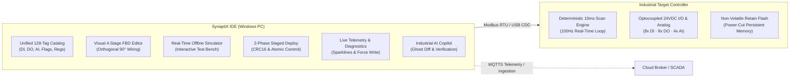
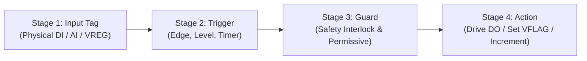
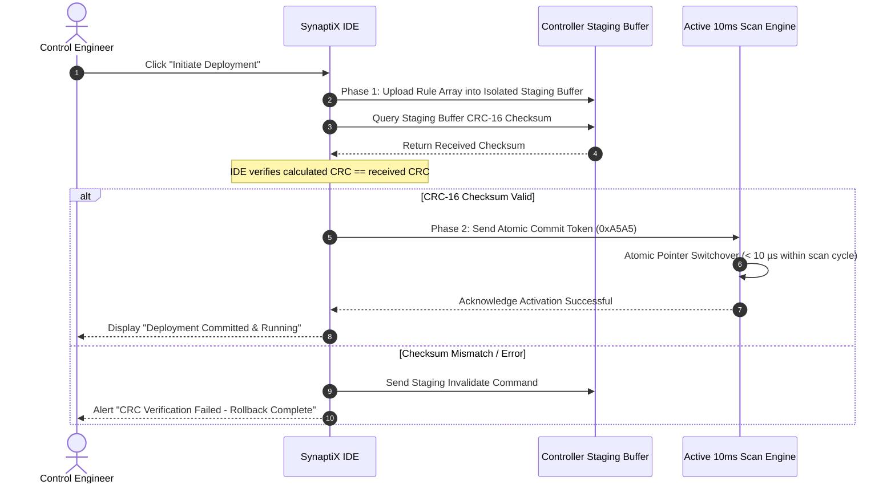
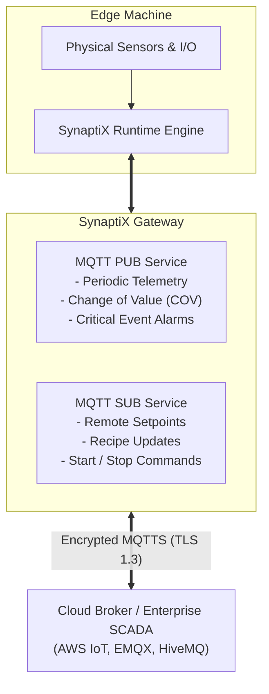

# SynaptiX IDE — Official User Manual
**Industrial PLC Programming, Simulation & Cloud Automation Environment**

*Document Reference:* **MAN-SPX-IDE-2026-V2.5**  
*Applicable Software Version:* **SynaptiX IDE v2.5.0 or later**  
*Release Date:* **October 2026**  
*Compliance & Safety Standards:* **IEC/IEEE 82079-1:2019, IEC 61131-3, SPLC-AF-003**

---

## Document Control & Revision History

| Version | Release Date | Author / Division | Summary of Changes |
| :---: | :---: | :---: | :--- |
| **1.0.0** | September 2026 | SynaptiX Industrial Systems Group | Initial commercial draft; 4-stage logic canvas and basic tag management. |
| **2.0.0** | October 2026 | SynaptiX Industrial Systems Group | Added MQTT IIoT Gateway (PUB/SUB), IEC Timers/Counters, and 2-Phase Staged Deployment. |
| **2.5.0** | October 2026 | SynaptiX Industrial Systems Group | Integrated Industrial AI Copilot, Ghost Diff Preview, Dynamic Contextual Suggestions, and Visual Design Ergonomics. |

---

## Table of Contents

- [1. Introduction & Overview](#1-introduction--overview)
  - [1.1 Purpose of this Manual](#11-purpose-of-this-manual)
  - [1.2 Target Audience & Required Knowledge](#12-target-audience--required-knowledge)
  - [1.3 Safety Symbols & Typographical Conventions](#13-safety-symbols--typographical-conventions)
  - [1.4 Key Product Capabilities](#14-key-product-capabilities)
- [2. System Requirements & Installation](#2-system-requirements--installation)
  - [2.1 Hardware & Operating System Requirements](#21-hardware--operating-system-requirements)
  - [2.2 Installing and Launching SynaptiX IDE](#22-installing-and-launching-synaptix-ide)
  - [2.3 USB Interface & COM Port Preparation](#23-usb-interface--com-port-preparation)
  - [2.4 Automatic Updates & Version Maintenance](#24-automatic-updates--version-maintenance)
- [3. Workspace & User Interface Tour](#3-workspace--user-interface-tour)
  - [3.1 Main Window Anatomy](#31-main-window-anatomy)
  - [3.2 Ribbon & Primary Navigation Bar](#32-ribbon--primary-navigation-bar)
  - [3.3 Active Context Status Pills & Header Indicators](#33-active-context-status-pills--header-indicators)
  - [3.4 Working with Project Files (.synx)](#34-working-with-project-files-synx)
  - [3.5 Keyboard Shortcuts Quick Reference](#35-keyboard-shortcuts-quick-reference)
- [4. Tag Catalog & Memory Management](#4-tag-catalog--memory-management)
  - [4.1 The Unified 128-Tag Architecture](#41-the-unified-128-tag-architecture)
  - [4.2 Tag Types & Operational Ranges](#42-tag-types--operational-ranges)
  - [4.3 Configuring Digital Inputs (DI) & Outputs (DO)](#43-configuring-digital-inputs-di--outputs-do)
  - [4.4 Analog Input (AI) Calibration: Scaling & Clamping](#44-analog-input-ai-calibration-scaling--clamping)
  - [4.5 Working with Internal Bit Flags (VFLAG) & Registers (VREG)](#45-working-with-internal-bit-flags-vflag--registers-vreg)
  - [4.6 Power-Loss Retained Registers (VREG_RETAIN)](#46-power-loss-retained-registers-vreg_retain)
- [5. Visual Logic Editor & Function Block Programming](#5-visual-logic-editor--function-block-programming)
  - [5.1 Visual Canvas Mechanics & Navigation](#51-visual-canvas-mechanics--navigation)
  - [5.2 The 4-Stage Logic Pipeline Architecture](#52-the-4-stage-logic-pipeline-architecture)
  - [5.3 Placing and Connecting Nodes (Orthogonal 90° Step Wiring)](#53-placing-and-connecting-nodes-orthogonal-90-step-wiring)
  - [5.4 Working with Standard Logic Gates & Comparators](#54-working-with-standard-logic-gates--comparators)
  - [5.5 Dedicated IEC 61131-3 Function Blocks](#55-dedicated-iec-61131-3-function-blocks)
    - [5.5.1 On-Delay Timer (TON)](#551-on-delay-timer-ton)
    - [5.5.2 Off-Delay Timer (TOF)](#552-off-delay-timer-tof)
    - [5.5.3 Pulse Timer (TP)](#553-pulse-timer-tp)
    - [5.5.4 Up-Counter (CTU) & Down-Counter (CTD)](#554-up-counter-ctu--down-counter-ctd)
    - [5.5.5 Linear Analog Signal Scaler (SCALE)](#555-linear-analog-signal-scaler-scale)
  - [5.6 Dual-View Rule Table & Real-Time Rule Compilation](#56-dual-view-rule-table--real-time-rule-compilation)
- [6. Industrial Automation Blueprints Library](#6-industrial-automation-blueprints-library)
  - [6.1 Overview of Pre-Engineered Blueprints](#61-overview-of-pre-engineered-blueprints)
  - [6.2 1-Click Instantiation & Automatic Tag Assignment](#62-1-click-instantiation--automatic-tag-assignment)
  - [6.3 Standard Blueprint Profiles Catalog](#63-standard-blueprint-profiles-catalog)
- [7. Offline Simulation & Virtual I/O Commissioning](#7-offline-simulation--virtual-io-commissioning)
  - [7.1 Entering Offline Simulation Mode](#71-entering-offline-simulation-mode)
  - [7.2 Virtual I/O Board Controls (Toggles, Sliders & Status LEDs)](#72-virtual-io-board-controls-toggles-sliders--status-leds)
  - [7.3 Real-Time Event Trace Log & Time-Step Execution](#73-real-time-event-trace-log--time-step-execution)
  - [7.4 Verifying Hardware Dwell & Bounce Filtering](#74-verifying-hardware-dwell--bounce-filtering)
- [8. Hardware Connection & Two-Phase Staged Deployment](#8-hardware-connection--two-phase-staged-deployment)
  - [8.1 Connecting to the Physical Controller](#81-connecting-to-the-physical-controller)
  - [8.2 Hardware Conformance & Device Information Inspection](#82-hardware-conformance--device-information-inspection)
  - [8.3 Real-Time Clock (RTC) Synchronization](#83-real-time-clock-rtc-synchronization)
  - [8.4 Two-Phase Safe Staged Deployment Procedure (SPLC-AF-003)](#84-two-phase-safe-staged-deployment-procedure-splc-af-003)
- [9. Live Watch & Online Diagnostics](#9-live-watch--online-diagnostics)
  - [9.1 Activating Live Watch Mode](#91-activating-live-watch-mode)
  - [9.2 Telemetry Grid & Data Quality Status Badges](#92-telemetry-grid--data-quality-status-badges)
  - [9.3 Real-Time Sparkline Trend Graphs](#93-real-time-sparkline-trend-graphs)
  - [9.4 Forcing Tags & Manual Output Overrides](#94-forcing-tags--manual-output-overrides)
- [10. IIoT Gateway & MQTT Integration](#10-iiot-gateway--mqtt-integration)
  - [10.1 MQTT IIoT Architecture Overview](#101-mqtt-iiot-architecture-overview)
  - [10.2 Configuring the System MQTT Broker](#102-configuring-the-system-mqtt-broker)
  - [10.3 Setting Up Telemetry Publishing (MQTT PUB)](#103-setting-up-telemetry-publishing-mqtt-pub)
  - [10.4 Setting Up Remote Ingestion & Control (MQTT SUB)](#104-setting-up-remote-ingestion--control-mqtt-sub)
- [11. Industrial AI Copilot Integration](#11-industrial-ai-copilot-integration)
  - [11.1 Accessing the AI Assistant Panel](#111-accessing-the-ai-assistant-panel)
  - [11.2 Consultative Engineering Q&A Mode](#112-consultative-engineering-qa-mode)
  - [11.3 Natural Language FBD Logic Synthesis](#113-natural-language-fbd-logic-synthesis)
  - [11.4 Ghost Diff Canvas Preview & Human Affirmation Gate](#114-ghost-diff-canvas-preview--human-affirmation-gate)
- [12. Troubleshooting & Operational Safety](#12-troubleshooting--operational-safety)
  - [12.1 Common Operational Faults and Solutions](#121-common-operational-faults-and-solutions)
  - [12.2 Communication & Download Error Diagnostics](#122-communication--download-error-diagnostics)
  - [12.3 Industrial Safety Best Practices (IEC 60204-1)](#123-industrial-safety-best-practices-iec-60204-1)
- [13. Appendix](#13-appendix)
  - [13.1 Glossary of Terms](#131-glossary-of-terms)
  - [13.2 Technical Support & Product Resources](#132-technical-support--product-resources)

---

# 1. Introduction & Overview

## 1.1 Purpose of this Manual
This manual provides comprehensive operational instructions for **SynaptiX IDE**, an industrial-grade engineering workbench designed for programming, simulating, deploying, and monitoring micro-PLC controllers and Industrial Internet of Things (IIoT) edge nodes.

By following this guide, control engineers and automation technicians will master:
- Project creation, tag architecture management, and signal conditioning.
- Visual Function Block Diagram (FBD) design using orthogonal 90° step connections.
- Offline logic verification using the integrated interactive simulator.
- Safe, zero-downtime application download via the **SPLC-AF-003 Two-Phase Staged Deployment** engine.
- Online telemetry tracking, forced overrides, and MQTT edge connectivity.
- Utilizing the built-in Senior Industrial AI Copilot for design synthesis and technical guidance.

## 1.2 Target Audience & Required Knowledge
This manual is prepared for:
- **Automation & Control Engineers:** Designing discrete and process machine automation sequences.
- **Electrical Technicians & Panel Builders:** Commissioning I/O wiring, sensors, actuators, and signal conditioners.
- **Maintenance & Plant Personnel:** Monitoring real-time telemetry, diagnosing faults, and overriding tags during maintenance cycles.
- **System Integrators:** Connecting shop-floor micro-controllers to SCADA, MES, or cloud MQTT infrastructure.

Readers should possess a foundational understanding of digital electronics (24VDC discrete signals, 4–20mA/0–10V analog signals) and basic industrial automation concepts (relay ladder rungs, logic gates, timers, and counters).

## 1.3 Safety Symbols & Typographical Conventions
To guarantee personal safety and prevent industrial equipment damage, standard warning alerts appear throughout this guide conforming to **ISO 3864** and **IEC 60204-1**:

> [!CAUTION]
> **DANGER / HIGH VOLTAGE**  
> Indicates an imminently hazardous situation which, if not avoided, will result in death, severe electric shock, or catastrophic machine damage.

> [!WARNING]
> **WARNING / SYSTEM INTEGRITY**  
> Indicates a potentially hazardous situation or operational mistake that could result in unintended machine motion, unexpected actuator firing, or production shutdown.

> [!IMPORTANT]
> **CRITICAL OPERATIONAL REQUIREMENT**  
> Highlights essential setup instructions, communication parameters, or deployment rules that must be strictly respected for predictable controller operation.

> [!NOTE]
> **ENGINEERING TIP & BEST PRACTICE**  
> Provides practical optimization recommendations, workflow shortcuts, or standard compliance guidelines.

### Text Formatting Conventions
- **Bold Text:** Software UI elements (buttons, menus, ribbons, dialog titles).
- `Monospace Text`: Tag names (`DI0`, `DO1`), register designations (`VREG_R0`), memory addresses, and file paths.
- *Italics:* Specialized terminology, engineering units, or cross-referenced document titles.

## 1.4 Key Product Capabilities



- **Visual 4-Stage Logic Pipeline:** Design logic clearly structured into *Input Tag* ➔ *Trigger Condition* ➔ *Guard Interlock* ➔ *Output Action*.
- **Live Continuous Compilation:** Logic errors and syntax conflicts are detected continuously as you wire nodes on screen—no manual compiler execution required.
- **Dedicated IEC 61131-3 Function Blocks:** Out-of-the-box hardware-timed TON, TOF, and TP timers, non-volatile CTU/CTD counters, and linear analog scaling.
- **Fail-Safe Two-Phase Deployment:** Prevents half-written logic states. The controller receives all logic into an isolated staging buffer, verifies the CRC-16 checksum, and performs an atomic switchover within a single 10ms cycle.
- **Integrated Offline Simulator:** Test and debug entire projects using virtual toggle switches, analog potentiometers, and real-time execution trace logs before touching physical hardware.
- **IIoT Ready:** Built-in dual-tier MQTT engine supporting automated outbound telemetry (Periodic/COV) and inbound remote command ingestion.
- **Industrial AI Copilot:** Built-in generative intelligence for standard industrial queries, automatic FBD synthesis, and ghost diff previews.

---

# 2. System Requirements & Installation

## 2.1 Hardware & Operating System Requirements

| Requirement | Minimum Specification | Recommended Specification |
| :--- | :--- | :--- |
| **Operating System** | Microsoft Windows 10 (64-bit, Build 19041+) | Microsoft Windows 11 (64-bit, Latest Release) |
| **Processor** | Intel Core i3 / AMD Ryzen 3 (Dual-Core, 2.0 GHz) | Intel Core i5 / AMD Ryzen 5 or higher (Quad-Core+) |
| **System Memory (RAM)** | 512 MB available RAM | 2 GB available RAM |
| **Storage Space** | 250 MB free disk space | 1 GB free SSD disk space |
| **Display Resolution** | 1280 × 720 (HD) | 1920 × 1080 (Full HD) or higher |
| **Hardware Interfaces** | 1x USB 2.0 Port (Type-A or Type-C) | 1x Dedicated High-Speed USB 3.0 / USB-to-RS485 Port |
| **Runtime Dependencies** | None (Self-contained .NET 8 WPF binary) | None |

## 2.2 Installing and Launching SynaptiX IDE
SynaptiX IDE is distributed as a **Portable, Single-File Executable**:

1. Download the latest official release executable `SimplePLC.Studio.exe` from the designated distribution portal or repository release page.
2. Place `SimplePLC.Studio.exe` in your preferred engineering directory (e.g., `C:\IndustrialAutomation\SynaptiX\`).
3. Double-click `SimplePLC.Studio.exe` to launch the application immediately.

> [!NOTE]
> SynaptiX IDE requires no administrator privileges, registry entries, or external runtime installations. It can run directly from a technician's USB service drive.

## 2.3 USB Interface & COM Port Preparation
The industrial controller connects to the engineering PC through a USB Type-C or Micro-USB port acting as a standard **USB CDC (Virtual COM Port)**:

1. Connect the controller to the engineering workstation using an industrial shielded USB cable.
2. Windows will automatically recognize the device as a standard **USB Serial Device (COMx)**.
3. Open Windows **Device Manager** ➔ expand **Ports (COM & LPT)** to verify the assigned COM port number (e.g., `COM3`, `COM5`, `COM7`).
4. Ensure no other supervisory software (e.g., serial monitors or terminal software) holds an active lock on that COM port.

## 2.4 Automatic Updates & Version Maintenance
SynaptiX IDE includes a built-in release verification system:


1. On startup (or via **Help** ➔ **Check for Updates**), the application checks GitHub Releases for new updates.
2. When an update is detected, an **Update Available** dialog displays the new version number, release date, and comprehensive Markdown changelog.
3. Clicking **Update Now** automatically retrieves the new executable, performs a hot-swap replacement, and restarts the environment with your active workspace intact.

---

# 3. Workspace & User Interface Tour

## 3.1 Main Window Anatomy
The user interface follows ergonomic industrial automation standards (inspired by Siemens TIA Portal and Beckhoff TwinCAT), maximizing canvas workspace while keeping diagnostics and tags within one-click reach:


*Figure 3.1: SynaptiX IDE Application Anatomy and Primary Navigation Workspace*

```
+-----------------------------------------------------------------------------------------+
| [LOGO] SynaptiX IDE v2.5.0  | Project: PackingLine_01.synx | [COM5: Connected] [Mode: RUN] |
+-----------------------------------------------------------------------------------------+
| [New] [Open] [Save] | [Logic Editor] [Tag Catalog] [Rule Table] [Blueprints] [Simulator]|
+-----------------------------------------------------------------------------------------+
| TOOLBOX / TAGS     |                VISUAL FBD CANVAS / WORKSPACE                       |
| - DI0..DI7         |                                                                    |
| - DO0..DO7         |   +---------+        +---------+        +---------+                |
| - AI0..AI3         |   | Tag:DI0 |=======>| Trigger |=======>| Act:DO0 |                |
| - VREG0..15        |   +---------+        +---------+        +---------+                |
| - IEC Function Blk |                                                                    |
|   [TON] [TOF] [CTU]|                                                                    |
+-----------------------------------------------------------------------------------------+
| STATUS: Valid AST | Active Rules: 14/100 | Staging: Clean | Copilot: Ready [Ask Copilot]|
+-----------------------------------------------------------------------------------------+
```

## 3.2 Ribbon & Primary Navigation Bar
The top navigation ribbon provides instant tab switching between functional workspaces:
- **Logic Editor:** The primary visual node-graph canvas where control strategies are assembled.
- **Tag Catalog:** Full spreadsheet-style editor for naming, scaling, and managing all 128 system tags.
- **Rule Table:** Side-by-side inspection of human-readable logic narratives and compiled rule parameters.
- **Blueprints:** Gallery of pre-engineered factory templates (E-Stop, Motor Starters, OEE Counters).
- **Simulator:** Offline virtual commissioning environment with toggle switches and live timing traces.
- **Deploy:** Hardware connection management, RTC synchronization, and safe two-phase staging commit.
- **Live Watch:** Online telemetry grid with real-time signal trends, sparklines, and tag forcing.

## 3.3 Active Context Status Pills & Header Indicators
The header bar displays real-time telemetry pills reflecting system health:
- **COM Port Pill (`COMx`):** Displays green when connected and synchronized; amber during handshake; gray when offline.
- **Scan Cycle Pill:** Indicates active controller scan frequency (typically `10.0 ms / 100 Hz`).
- **AST Compiler Pill:**
  - `Valid (Green)`: Logic rules conform strictly to industrial grammar and can be compiled.
  - `Syntax Error (Red)`: Highlights unconnected required pins, floating gates, or tag write-conflicts.
- **Rule Utilization Pill:** Displays active rule capacity (e.g., `12 / 100 Rules Allocated`).

## 3.4 Working with Project Files (.synx)
SynaptiX IDE stores entire engineering configurations inside a single structured XML/JSON file format with the `.synx` extension:
- **Save Project (`Ctrl + S`):** Serializes tag catalogs, canvas coordinates, wire routing, function block parameters, and MQTT configurations.
- **Open Project (`Ctrl + O`):** Loads existing automation topologies with zero loss of graphical layout or notes.
- **New Project (`Ctrl + N`):** Opens the project creation wizard with optional default I/O mappings.

## 3.5 Keyboard Shortcuts Quick Reference

| Shortcut | Scope | Action |
| :--- | :--- | :--- |
| `Ctrl + N` | Global | Create a New Project |
| `Ctrl + O` | Global | Open Existing Project File (`.synx`) |
| `Ctrl + S` | Global | Save Active Project |
| `Ctrl + Z` | Logic Canvas | Undo last node placement, wiring, or parameter change |
| `Ctrl + Y` | Logic Canvas | Redo previous undone operation |
| `Delete` / `Backspace` | Logic Canvas | Delete selected node, wire, or comment box |
| `F5` | Global | Start Offline Simulation Mode |
| `F6` | Global | Stop Simulation / Return to Design Canvas |
| `F7` | Deploy View | Open Two-Phase Download Dialog |
| `F9` | Live Watch | Toggle Online Live Watch Telemetry Mode |
| `Ctrl + Space` | AI Panel | Focus AI Copilot Chat Prompt |
| `Space + Click Drag` | Logic Canvas | Pan canvas view smoothly |
| `Mouse Wheel` | Logic Canvas | Zoom in / Zoom out of node canvas |

---

# 4. Tag Catalog & Memory Management

## 4.1 The Unified 128-Tag Architecture
Every sensor reading, actuator state, intermediate flag, and mathematical register in SynaptiX IDE is referenced through a **Unified 128-Tag Architecture**. Every tag possesses a standardized identifier, human-readable name, engineering unit, comment string, and current value.


## 4.2 Tag Types & Operational Ranges

| Tag Group | Range | Data Type | Physical / Memory Destination | Retention Behavior |
| :--- | :---: | :---: | :--- | :--- |
| **Digital Inputs (DI)** | `DI0` – `DI7` | Boolean (`0` or `1`) | 24VDC Optocoupled Terminal Block | Live sampled every 10ms |
| **Digital Outputs (DO)** | `DO0` – `DO7` | Boolean (`0` or `1`) | 24VDC Relay / Transistor Driver | Physical output driven every 10ms |
| **Analog Inputs (AI)** | `AI0` – `AI3` | 16-bit Int (`0`–`4095`) | 12-bit ADC (0–10V or 4–20mA) | Live sampled every 10ms |
| **Virtual Flags (VFLAG)** | `VFLAG0` – `VFLAG15` | Boolean (`0` or `1`) | Internal Controller RAM Bitfield | Volatile (Reset on power loss) |
| **Virtual Regs (VREG)** | `VREG0` – `VREG15` | 16-bit Signed Int | Internal Controller RAM Words | Volatile (Reset on power loss) |
| **Retained Regs (VREG_R)**| `VREG_R0` – `VREG_R15`| 16-bit Signed Int | Non-Volatile Flash Sector | **Persistent (Retained through power cuts)**|

## 4.3 Configuring Digital Inputs (DI) & Outputs (DO)
In the **Tag Catalog** tab:
1. Locate the target `DI` or `DO` row.
2. Enter a descriptive **Tag Name** (e.g., `PB_START`, `LS_HOME_POS`, `SOL_CLAMP`).
3. Set the **Hardware Dwell (Debounce)** duration in milliseconds:
   - For mechanical pushbuttons and limit switches, specify `20ms`–`50ms` to eliminate contact bounce.
   - For optical sensors and PNP proximity switches, specify `0ms`–`5ms`.
4. Add technical documentation in the **Description** column for field maintenance traceability.

## 4.4 Analog Input (AI) Calibration: Scaling & Clamping
Industrial transmitters output raw electrical signals (0–10V or 4–20mA) represented digitally as 0 to 4095 counts (12-bit resolution). The Tag Catalog enables direct linear signal conditioning:

$$\text{Scaled Value} = (\text{Raw ADC} \times \text{Gain}) + \text{Offset}$$

```
+---------------------------------------------------------------------------------+
| ANALOG INPUT SIGNAL CONDITIONING CONFIGURATION                                  |
+---------------------------------------------------------------------------------+
| Tag ID: AI0           Tag Name: TANK_PRESSURE_PT01                              |
| Raw Input Range:      0 - 4095 counts (4-20 mA)                                 |
| Scaled Engineering:   0.0 - 100.0 Bar                                           |
| Gain (Multiplier):    0.024414                                                  |
| Offset:               0.0                                                       |
| Clamp Limits:         [X] Enable Clamping | Min: 0.0 Bar | Max: 100.0 Bar       |
+---------------------------------------------------------------------------------+
```

- **Gain & Offset:** Converts electrical raw units to physical engineering units (e.g., Bar, °C, RPM, mm).
- **Signal Clamping:** Prevents mathematical underflows or sensor breakdown spikes by bounding output within strict `Min` and `Max` safety values.

## 4.5 Working with Internal Bit Flags (VFLAG) & Registers (VREG)
- **Virtual Flags (`VFLAG0`..`15`):** Act as internal relay coils (M-flags) to store sequence states, interlock conditions, or mode selections (e.g., `AUTO_MODE_ACTIVE`, `FAULT_LATCH`).
- **Virtual Registers (`VREG0`..`15`):** Store temporary calculation results, setpoints, or analog thresholds during active machine operation.

## 4.6 Power-Loss Retained Registers (VREG_RETAIN)
For values that must survive sudden plant power cuts without battery backup, allocate them to `VREG_R0` through `VREG_R15`:
- **Production Counters:** Good/Scrap piece totals.
- **Machine Operating Hours:** Maintenance runtime accumulators.
- **Recipe Parameters:** Calibrated stroke lengths and temperature setpoints.

The runtime controller writes changes to retained registers into dedicated non-volatile flash memory utilizing wear-leveling algorithms rated for >100,000 power cycles.

---

# 5. Visual Logic Editor & Function Block Programming

## 5.1 Visual Canvas Mechanics & Navigation
The **Logic Editor** provides an infinite 2D canvas with subtle grid alignment dots:


- **Pan:** Click and drag while holding the `Spacebar` or drag using the Middle Mouse Button.
- **Zoom:** Rotate the `Mouse Wheel` forward/backward to zoom in and out smoothly.
- **Multi-Select:** Click and drag a marquee bounding box around multiple nodes to move them collectively.
- **Context Menu:** Right-click anywhere on the empty canvas to summon the Quick Node Insertion Palette.

## 5.2 The 4-Stage Logic Pipeline Architecture
To eliminate confusing spaghetti wiring and ensure deterministic execution, SynaptiX IDE organizes control rules into an industrial **4-Stage Pipeline**:



1. **Stage 1 (Input Tag):** Selects which physical terminal or internal register sources the signal.
2. **Stage 2 (Trigger Condition):** Evaluates how the signal changes:
   - *Rising Edge ($\uparrow$):* Executes on transition from 0 to 1.
   - *Falling Edge ($\downarrow$):* Executes on transition from 1 to 0.
   - *Level True (1) / Level False (0):* Continuous state evaluation.
   - *Threshold Compare ($>, <, \ge, \le, ==$):* Evaluates numeric registers.
3. **Stage 3 (Guard Interlock):** Mandatory permissive condition. Even if the trigger fires, the action will not execute unless the guard condition evaluates to TRUE (e.g., `E_STOP_OK == 1` AND `GUARD_DOOR_CLOSED == 1`).
4. **Stage 4 (Action):** Executes the target actuation:
   - *Turn Output ON (`SET`)* or *Turn Output OFF (`RST`)*.
   - *Direct Drive (`OUT`):* Output mirrors the evaluated condition.
   - *Toggle (`TGL`):* Inverts current bit state.
   - *Math / Assign:* Updates target register value.

## 5.3 Placing and Connecting Nodes (Orthogonal 90° Step Wiring)
All connection wires in SynaptiX IDE use clean **Orthogonal 90° Step Routing** (`StepConnection`), maintaining visual alignment with zero angled diagonal cross-overs:

- **Creating a Wire:** Click any output pin (circular port on the right side of a node) and drag your cursor to a compatible input pin on a downstream node.
- **Straight Rung Alignment:** When input and output pins share the same Y-axis vertical position, the connection renders as a perfectly straight horizontal rung.
- **Disconnecting a Wire:** Hover over the wire until it turns vibrant cyan, then click to select and press `Delete`.

## 5.4 Working with Standard Logic Gates & Comparators
The toolbox includes standard Boolean logic blocks:
- **AND / OR / XOR / NOT Gates:** Supports multi-input Boolean combining.
- **Threshold Comparators (CMP):** Compares analog values (e.g., checks if `PRESSURE_AI0 >= 75.0 Bar`).

## 5.5 Dedicated IEC 61131-3 Function Blocks
SynaptiX IDE includes high-precision, standard-compliant Function Blocks:

### 5.5.1 On-Delay Timer (TON)
Delays turning on an output until the input condition has remained continuously TRUE for the specified preset duration ($PT$):

```
       +------------------+
       |       TON        |
IN ===>| IN            Q  |===> Output turns ON after PT
       | PT: 1500 ms   ET |===> Elapsed Time
       +------------------+
```
- **Typical Application:** Motor pre-lube dwell, conveyor jam detection delay.

### 5.5.2 Off-Delay Timer (TOF)
Keeps an output energized for a specified duration ($PT$) after the input condition transitions to FALSE:
- **Typical Application:** Cooling fan overrun after spindle shutdown, pneumatic purge cycle.

### 5.5.3 Pulse Timer (TP)
Generates an output pulse of exact duration ($PT$) regardless of whether the trigger input stays TRUE or returns to FALSE immediately:
- **Typical Application:** Solenoid ejector pulse, lube oil injection pulse.

### 5.5.4 Up-Counter (CTU) & Down-Counter (CTD)
Counts rising edge transitions on the count input (`CU` or `CD`):
- Features an adjustable preset target (`PV`).
- Can be directly bound to a **Retained Register** (`VREG_R0`..`15`), guaranteeing that production counts are never lost during power outages.

### 5.5.5 Linear Analog Signal Scaler (SCALE)
Applies hardware linear conversion:

$$Y = K \cdot X + B$$

With optional input clamping between `Min` and `Max` to filter out broken sensor wire faults.

## 5.6 Dual-View Rule Table & Real-Time Rule Compilation
To assist technicians who prefer textual verification over graphical nodes, click the **Rule Table** tab:

```
+----+---------------------------------------------------------------+---------------------+
| ID | Operational Rule Narrative                                    | Target / Operation  |
+----+---------------------------------------------------------------+---------------------+
| 01 | WHEN [DI0: PB_START] Rising Edge AND [DI1: E_STOP] == 1       | SET [DO0: MTR_RUN]  |
| 02 | WHEN [DI2: PB_STOP] Rising Edge                               | RST [DO0: MTR_RUN]  |
| 03 | WHEN [AI0: TANK_PRESS] >= 85.0 Bar                            | SET [DO1: ALM_HORN] |
| 04 | WHEN [TON_01: PRE_LUBE] Timer Expired (PT=3000ms)             | SET [VFLAG0: RDY]   |
+----+---------------------------------------------------------------+---------------------+
```

The table automatically updates in real time as nodes and wires are altered on the canvas.

---

# 6. Industrial Automation Blueprints Library

## 6.1 Overview of Pre-Engineered Blueprints
The **Blueprints** gallery contains factory-tested, production-ready control templates meeting standard industrial safety and operational patterns:


## 6.2 1-Click Instantiation & Automatic Tag Assignment
To instantiate an industrial blueprint:
1. Navigate to the **Blueprints** tab on the navigation ribbon.
2. Browse through the template cards.
3. Click **Instantiate Blueprint**.
4. The system automatically:
   - Reserves the required `DI`, `DO`, `AI`, and `VFLAG` tags in the Tag Catalog.
   - Generates fully wired 4-stage FBD logic onto the canvas.
   - Populates descriptive comments explaining the design rationale.

## 6.3 Standard Blueprint Profiles Catalog

| Blueprint Name | Primary Purpose | Allocated Tags & Logic |
| :--- | :--- | :--- |
| **E-Stop Dual Safety Circuit** | Meets safety circuit standards; requires positive reset after emergency stop. | `DI0` (E-Stop NC), `DI1` (Reset PB), `DO0` (Master Contactor). |
| **Motor Thermal Overheat Guard** | Trips motor contactor if overload thermal contact opens or temperature exceeds limit. | `DI2` (Thermal Relay), `DO0` (Contactor), `DO1` (Trip Lamp). |
| **High-Speed Retained Part Counter** | Counts parts via optical sensor; persists totals in retained flash. | `DI3` (Part Sensor), `CTU` Block, `VREG_R0` (Accumulator). |
| **Andon OEE 3-Color Tower Light** | Drives Red/Amber/Green indicators reflecting machine running/idle/fault status. | `VFLAG0` (Run), `VFLAG1` (Fault), `DO2`..`DO4` (Tower Lamps). |
| **Pneumatic Pressure Monitor** | Clamps analog pressure and triggers low/high alarms. | `AI0` (Transmitter), `DO5` (Dump Valve), `VFLAG2` (Alarm). |
| **Automatic Sump Pump Control** | Dual level switches (Low/High) with hysteresis latching. | `DI4` (Low Float), `DI5` (High Float), `DO6` (Pump Starter). |
| **Periodic Lubrication Timer** | Fires oil pump for 5 seconds every 60 minutes of run time. | `TON` Timer, `TP` Pulse Block, `DO7` (Lube Solenoid). |

---

# 7. Offline Simulation & Virtual I/O Commissioning

## 7.1 Entering Offline Simulation Mode
Before deploying logic to physical hardware, commission your logic using the **Offline Simulator**:
- Press `F5` or click **Simulator** in the ribbon navigation.
- The canvas transitions into a high-visibility simulation mode with active data wire glow.

## 7.2 Virtual I/O Board Controls (Toggles, Sliders & Status LEDs)
The simulation workspace presents an interactive virtual test bench:

```
+---------------------------------------------------------------------------------+
| VIRTUAL HARDWARE SIMULATION TEST BENCH                                          |
+---------------------------------------------------------------------------------+
| DIGITAL INPUTS (DI)          ANALOG INPUTS (AI)            DIGITAL OUTPUTS (DO) |
| [TOGGLE] DI0: [OFF]          AI0: [----|--------] 1200     (LED) DO0: [ OFF ]   |
| [TOGGLE] DI1: [ ON]          AI1: [--------|----] 3450     (LED) DO1: [  ON ]   |
| [TOGGLE] DI2: [OFF]          AI2: [---|---------]  850     (LED) DO2: [ OFF ]   |
| [TOGGLE] DI3: [OFF]          AI3: [----------|--] 4000     (LED) DO3: [ OFF ]   |
+---------------------------------------------------------------------------------+
```

- **Digital Input Toggles:** Click any `DI` toggle to switch between `0` (0VDC) and `1` (24VDC).
- **Analog Sliders:** Drag the slider to inject raw or scaled analog sensor values in real time.
- **Output Indicators:** Visual LEDs illuminate bright green when energized by logic rules.

## 7.3 Real-Time Event Trace Log & Time-Step Execution
- **Step Execution:** Pause continuous simulation and click **Step Cycle (+10ms)** to step through one scan iteration at a time.
- **Event Trace Log:** Displays a chronological log of all triggered rules, edge detections, and output energizations with millisecond timestamps.

## 7.4 Verifying Hardware Dwell & Bounce Filtering
Test pushbuttons with simulated contact bounce to verify that configured hardware dwell times successfully filter out chatter before activating downstream machine actuators.

---

# 8. Hardware Connection & Two-Phase Staged Deployment

## 8.1 Connecting to the Physical Controller
1. Connect the USB cable between the PC and the controller.
2. Navigate to the **Deploy** view.
3. Select the appropriate **Serial COM Port** from the dropdown menu (or click **Rescan Ports**).
4. Select the baud rate (default: `115200 bps`, 8 Data Bits, No Parity, 1 Stop Bit).
5. Click **Connect**. The status indicator will turn green once communications are established.

## 8.2 Hardware Conformance & Device Information Inspection
Click **Device Info** to query the attached controller:
- Microcontroller CPU Core (e.g., ARM Cortex-M33).
- Firmware ABI Conformance Version (e.g., v2.0).
- Physical I/O Channel Count (8 DI, 8 DO, 4 AI).
- Flash Wear-Leveling Status and Retained Memory Health.

## 8.3 Real-Time Clock (RTC) Synchronization
For controllers equipped with an onboard battery-backed RTC:
- Click **Sync RTC** in the Deploy tab.
- The PC's current UTC time is transmitted to the controller, synchronizing internal timers, alarm timestamps, and event logs.

## 8.4 Two-Phase Safe Staged Deployment Procedure (SPLC-AF-003)
To eliminate catastrophic risks associated with half-transferred logic or unexpected machine motion during programming, SynaptiX IDE strictly enforces standard **SPLC-AF-003**:




### Step-by-Step Deployment Instructions:
1. Click **Deploy Project** in the ribbon or press `F7`.
2. The IDE validates the canvas AST syntax.
3. **Phase 1 (Staging):** The IDE transmits rule records into the controller's isolated scratchpad RAM buffer. The active machine continues running its previous program undisturbed.
4. **CRC Verification:** The controller computes a CRC-16 checksum over the received staging buffer and returns it to the IDE.
5. **Phase 2 (Atomic Commit):** Upon checksum match, clicking **Commit Changes** transmits the atomic activation code (`0xA5A5`).
6. The controller swaps execution pointers in less than 10 microseconds at the boundary of its 10ms scan cycle, activating the new program with zero glitch or actuator flutter.

---

# 9. Live Watch & Online Diagnostics

## 9.1 Activating Live Watch Mode
Once logic is running on physical hardware, switch to **Live Watch** mode (press `F9`):


The IDE begins continuous polling of runtime registers over the communication link.

## 9.2 Telemetry Grid & Data Quality Status Badges
The Live Watch table displays all active tags alongside high-visibility **Quality Status Badges**:
- **GOOD (Green):** Telemetry received and validated within the expected scan window (< 50ms latency).
- **STALE (Amber):** Telemetry packet delayed or dropped; retaining last valid reading.
- **BAD / DISCONNECTED (Red):** Communication loss or sensor hardware line break detected.

## 9.3 Real-Time Sparkline Trend Graphs
Click any analog tag (`AI0`–`AI3` or `VREG`) in the Live Watch grid to reveal a dynamic **Sparkline Trend Graph**:
- Visualizes signal fluctuations over the past 60 seconds.
- Automatically scales the Y-axis to highlight noise, mechanical vibration, or gradual thermal drift.

## 9.4 Forcing Tags & Manual Output Overrides

> [!WARNING]
> **MACHINE MOVEMENT HAZARD**  
> Forcing a physical output (`DO`) or virtual flag bypasses all canvas logic guards and safety interlocks. Always verify that personnel are clear of moving machine parts before activating an override.

To force a tag during plant maintenance:
1. Locate the tag in the Live Watch grid.
2. Click the **Force** lock icon in the tag's row.
3. Enter the desired override state:
   - For Digital Outputs: Select `FORCE ON` or `FORCE OFF`.
   - For Registers: Enter the desired numeric value.
4. The tag displays an amber **[FORCED]** badge on both the watch table and logic canvas.
5. To restore normal automatic logic control, click **Release Force**.

---

# 10. IIoT Gateway & MQTT Integration

## 10.1 MQTT IIoT Architecture Overview
SynaptiX IDE includes a complete Industrial IoT Gateway supporting **MQTT v3.1.1** and **MQTT v5.0** over both standard TCP (`1883`) and encrypted TLS/MQTTS (`8883`):



## 10.2 Configuring the System MQTT Broker
In the **Settings** or **MQTT Config** dialog:
1. Enter the **Broker Host Address** (IP address or domain name, e.g., `mqtt.plantfloor.local`).
2. Specify the **Port** (`1883` for unencrypted local networks, `8883` for SSL/TLS encrypted links).
3. Specify **Client ID** (or click **Generate Unique GUID**).
4. Enter **Username** and **Password** if broker authentication is enabled.
5. Configure **Keep-Alive Interval** (default: `60 seconds`).
6. Click **Test Broker Connection** to verify end-to-end handshake.

## 10.3 Setting Up Telemetry Publishing (MQTT PUB)
To publish tag data from the controller to enterprise dashboards:
1. Click **Configure MQTT Publisher (PUB)**.
2. Select the publish trigger mode:
   - **Periodic:** Publishes telemetry on a fixed interval (e.g., every `1000 ms`).
   - **Change of Value (COV):** Publishes immediately when a tag value changes beyond a configured deadband threshold.
   - **Event Triggered:** Publishes immediately when a specific alarm flag (`VFLAG`) transitions to TRUE.
3. Define the destination topic (e.g., `factory/line1/cell04/telemetry`).
4. Select payload structure:
   - **Standard Flat JSON:** `{"timestamp": 1728980000, "tank_pressure": 45.2, "pump_running": 1}`
   - **Custom Templated JSON:** Define custom enterprise schema using variable tokens.

## 10.4 Setting Up Remote Ingestion & Control (MQTT SUB)
To accept remote setpoint adjustments or supervisory dispatch commands:
1. Click **Configure MQTT Subscriber (SUB)**.
2. Specify the subscription topic (e.g., `factory/line1/cell04/commands`).
3. Set the ingestion parsing strategy:
   - **Direct Tag Ingestion:** Extracts JSON fields and writes directly to target tags (`VREG_R1` Setpoint, `VFLAG5` Remote Start).
   - **Canvas FBD SUB Pin:** Adds an `MQTT_SUB` input node onto the logic canvas, permitting graphical validation of cloud commands against local safety interlocks.
4. **Fail-Safe Parsing:** If incoming JSON is corrupt or fields are missing, the parser rejects the message atomically without applying partial updates.

---

# 11. Industrial AI Copilot Integration

## 11.1 Accessing the AI Assistant Panel
SynaptiX IDE features an integrated **Senior Industrial AI Copilot** designed to assist control engineers in designing robust, compliant logic:
- Click the **AI Copilot** tab on the right sidebar or press `Ctrl + Space`.
- The assistant panel opens with dynamic suggestion chips tailored to your active canvas state.

## 11.2 Consultative Engineering Q&A Mode
Ask practical questions regarding industrial standards, electrical schematics, or PLC programming best practices:
- *"What are the safety circuit requirements under IEC 60204-1 for emergency stop circuits?"*
- *"How should I wire a 2-wire 4–20mA pressure sensor into an analog input module?"*
- *"What is the difference between a TON timer and a TP pulse timer in conveyor control?"*

The AI responds with detailed technical explanations, wiring formulas, and standard citations.

## 11.3 Natural Language FBD Logic Synthesis
You can command the AI Copilot to generate entire functional block diagrams directly from textual specifications:

> **Example Prompt:**  
> *"Create a motor start/stop control circuit using DI0 for Start PB, DI1 for Stop PB (normally closed), with DO0 driving the motor contactor. Add an interlock preventing start if DI2 thermal overload is tripped."*

The Copilot parses the specification, verifies safety conventions, and generates a structured candidate logic network.

## 11.4 Ghost Diff Canvas Preview & Human Affirmation Gate
To prevent accidental canvas corruption, AI-generated logic is never applied directly. Instead, it enters the **Ghost Diff Preview**:

```
+---------------------------------------------------------------------------------+
| CANVAS GHOST DIFF PREVIEW                                                       |
|                                                                                 |
|   Existing Nodes (Solid Dark Slate):                                            |
|   +-------------------+                                                         |
|   | DI1: E_STOP_NC    |                                                         |
|   +-------------------+                                                         |
|                                                                                 |
|   Ghost Proposed Nodes (Dashed Border, Slate Gray #475569):                     |
|   + - - - - - - - - - +       + - - - - - - - - - +       + - - - - - - - - - + |
|   | DI0: PB_START     |== - =>| AND GATE          |== - =>| DO0: MTR_RUN      | |
|   + - - - - - - - - - +       + - - - - - - - - - +       + - - - - - - - - - + |
|                                                                                 |
|   [ FLOATING ACTION BAR:   [ACCEPT PROPOSAL]    [REJECT & DISCARD] ]            |
+---------------------------------------------------------------------------------+
```

- **Ghost Canvas Rendering:** Proposed nodes appear in translucent slate gray with dashed wire routes. Connectors on ghost nodes are hit-test isolated to prevent accidental manual wiring while inspecting.
- **Human Affirmation Gate:** A floating action bar prompts the engineer:
  - **Accept Proposal:** Atomically commits ghost elements into live canvas nodes, registers necessary tags, and registers an undo snapshot (`Ctrl + Z`).
  - **Reject & Discard:** Cleans all ghost artifacts from memory, leaving your existing canvas completely untouched.

---

# 12. Troubleshooting & Operational Safety

## 12.1 Common Operational Faults and Solutions

| Symptom / Error | Probable Root Cause | Recommended Corrective Action |
| :--- | :--- | :--- |
| **COM Port Not Appearing** | USB cable disconnected or driver not initialized. | Check cable connection; ensure Windows recognizes USB Serial Device in Device Manager. |
| **Access Denied on COM Port** | Another application (terminal or IDE) is locking the serial port. | Close serial terminal utilities, Arduino IDE, or PuTTY sessions holding the port open. |
| **AST Compiler Syntax Error** | Unconnected node input pin or cyclic loop without a delay block. | Inspect canvas for red indicator badges; connect all required input ports. |
| **Output Does Not Energize** | Guard condition evaluates to FALSE or tag is forced. | Open Live Watch; verify all series permissive conditions are TRUE; check for active Force overrides. |
| **Analog Reading Fluctuates** | Electrical noise on signal cable or unshielded wiring. | Use shielded twisted-pair cables grounded at one end; increase Hardware Dwell / filtering. |
| **Retained Count Resets to 0** | Tag was accidentally assigned to `VREG` instead of `VREG_R`. | Reassign tag in Tag Catalog to retained group `VREG_R0`..`15` and re-deploy. |

## 12.2 Communication & Download Error Diagnostics
- **CRC-16 Checksum Mismatch:** Indicates electrical noise or packet corruption during USB/serial transit. SynaptiX IDE automatically aborts the download before activation. Verify physical cable shielding.
- **Staging Buffer Timeout:** Occurs if the controller watchdog resets during a massive packet transfer. Reduce deployment packet chunk size in advanced communications settings.
- **Write Conflict Invariant:** Triggered if two independent logic rules attempt to write contradictory states to the same physical `DO` output in the same scan cycle. Redesign logic to resolve outputs through an OR or selector gate.

## 12.3 Industrial Safety Best Practices (IEC 60204-1)

> [!CAUTION]
> **HARDWIRED SAFETY CIRCUIT MANDATE**  
> Under international safety standard **IEC 60204-1** (Safety of Machinery - Electrical Equipment of Machines), software-based controllers must NEVER be used as the sole safety mechanism for Emergency Stop functions or Personnel Protection Guards.

1. **Hardware E-Stop Master Relays:** Always route Emergency Stop pushbuttons and safety gate switches through dedicated, certified electromechanical safety relays (e.g., Category 4 / PLe).
2. **De-energize Actuator Power:** The safety relay must physically cut 24VDC actuator coil power or main 3-phase contactor power independently of the controller.
3. **Fail-Safe Sensor Wiring:** Always wire emergency pushbuttons and over-travel limit switches as **Normally Closed (NC)** contacts so that a broken wire is immediately recognized as an open safe fault condition.

---

# 13. Appendix

## 13.1 Glossary of Terms

- **ABI (Application Binary Interface):** The strict 32-byte binary data structure used by the controller runtime to execute rules without a virtual machine.
- **AST (Abstract Syntax Tree):** The internal real-time hierarchical representation of nodes and wires used by the compiler.
- **Atomic Commit:** A safe execution switchover completed instantaneously (<10 µs) at scan cycle boundaries, preventing intermediate machine states.
- **COV (Change of Value):** An MQTT telemetry publishing mode where messages are transmitted only when measured values deviate beyond a preset deadband.
- **Dwell Time:** Software or hardware debounce filter duration applied to digital inputs to eliminate mechanical contact bounce.
- **FBD (Function Block Diagram):** A graphical programming language conforming to IEC 61131-3 where logic is represented by interconnected functional blocks.
- **Optocoupler:** An electronic component that transfers electrical signals between isolated circuits using light, protecting sensitive microcontrollers from industrial voltage surges.
- **Scan Cycle:** The repetitive deterministic loop (10ms) executed by the controller: Read Inputs ➔ Evaluate Rules ➔ Drive Outputs.

## 13.2 Technical Support & Product Resources
- **Official Documentation Portal:** `https://github.com/hoanv-synaptix/SynaptiX-IDE-Releases`
- **Issue Tracker & Technical Inquiries:** GitHub Issues section of the official release repository.
- **Commercial Engineering Inquiries:** SynaptiX Industrial Automation Systems Group.

---
*End of User Manual — SynaptiX IDE v2.5.0*
