# SynaptiX IDE — Tài liệu Kỹ thuật Hướng dẫn Sử dụng
**Môi trường Lập trình PLC Tất định, Giả lập Thời gian thực & Tự động hóa IIoT Edge**

*Mã Định danh Tài liệu:* **MAN-SPX-IDE-2026-V2.5**  
*Phiên bản Phần mềm Áp dụng:* **SynaptiX IDE v2.5.0 trở lên**  
*Nền tảng Phần cứng Hỗ trợ:* **SynaptiX SYNX-RIO-884 / Modbus RTU & TCP Slaves**  
*Tiêu chuẩn Kỹ thuật Tuân thủ:* **IEC/IEEE 82079-1:2019, IEC 61131-3, SPLC-AF-003, ANSI Z535.6**  
*Ngày Phát hành Chính thức:* **Tháng 10/2026 / Bản Thương mại**  
*Cấp độ Bảo mật Lưu hành:* **Lưu hành Kỹ thuật & Khách hàng Doanh nghiệp**

---

## Kiểm soát Tài liệu & Lịch sử Sửa đổi

Tài liệu kỹ thuật này được biên soạn và kiểm soát phiên bản theo tiêu chuẩn quốc tế IEC/IEEE 82079-1:2019. Mọi thay đổi trong tính năng phần mềm, giao thức truyền thông hoặc giao diện an toàn đều được cập nhật vào phiên bản tài liệu tương ứng.

| Phiên bản | Ngày phát hành | Tác giả / Khối kỹ thuật | Phê duyệt bởi | Nội dung sửa đổi |
| :---: | :---: | :---: | :---: | :--- |
| **v1.0.0** | 09/2026 | Khối Kỹ thuật Phần mềm SynaptiX | Giám đốc Kỹ thuật | Bản phát hành đầu tiên; giao diện canvas 4 giai đoạn và quản lý Tag cơ bản. |
| **v2.0.0** | 10/2026 | Nhóm Hệ thống Công nghiệp | Kiến trúc sư Trưởng | Tích hợp IIoT MQTT Gateway (PUB/SUB), khối hàm IEC TON/TOF/CTU, nạp an toàn 2 pha. |
| **v2.5.0** | 10/2026 | Khối Tự động hóa & Trợ lý AI | Phó Chủ tịch Kỹ thuật | Tái cấu trúc 6 Module công việc, quy trình từng bước, bảng tra cứu giao diện và hộp thoại popup độc lập. |
| **v2.6.0** | 10/2026 | Khối Kỹ thuật Hệ thống | Giám đốc Kỹ thuật | Chuẩn hóa bảng màu công nghiệp ISA-101/IEC 60073, bổ sung khối MB_WRITE (Modbus RTU) & khối DIRECT_WRITE (Cọc DO0..DO7 cho dải LED UCS16703, PWM, Pulse Train) và Thư viện Dự án Mẫu SPX Logistics. |
| **v2.8.0** | 10/2026 | Khối Kỹ thuật Hệ thống | Giám đốc Kỹ thuật | Tích hợp Phân hệ Truyền thông Không dây Wi-Fi (0x1300..0x13FF, SPLC-SPEC-WIFI-004-ICD), Hộp thoại Cấu hình Wi-Fi Unified Flow trực quan (Ctrl+Shift+W) và giám sát Live Telemetry RSSI/IP/MAC. |

> [!NOTICE]
> **QUYỀN SỞ HỮU TRÍ TUỆ & BẢN QUYỀN**  
> SynaptiX IDE là sản phẩm phần mềm độc quyền thuộc sở hữu của SynaptiX Automation Systems Group. Mọi hành vi sao chép, dịch ngược mã máy, phân phối trái phép tệp thực thi hoặc tài liệu kỹ thuật khi chưa có văn bản chấp thuận chính thức đều cấu thành vi phạm pháp luật sở hữu trí tuệ quốc tế.

---

## Danh mục Hình ảnh Minh họa Kỹ thuật

| Mã hình | Tên hình ảnh minh họa kỹ thuật | Vị trí tham chiếu |
| :---: | :--- | :---: |
| **Figure 1-1** | Hộp thoại Nâng cấp Phiên bản Phần mềm Trực tuyến (OTA Software Update Dialog) | Mục 1.4 |
| **Figure 2-1** | Giải phẫu Giao diện Chính SynaptiX IDE và Không gian Điều hướng Ribbon | Mục 2.1 |
| **Figure 2-2** | Thuật sĩ Khởi tạo Dự án Mới & Thiết lập Hồ sơ Phần cứng Controller | Mục 2.2 |
| **Figure 2-3** | Bảng Quản lý 128 Tag Tập trung — Cấu hình Tín hiệu, Modbus & Bộ nhớ Retain | Mục 2.3 |
| **Figure 3-1** | Không gian Soạn thảo Logic 4 Giai đoạn với Dây nối Góc vuông 90° Manhattan | Mục 3.1 |
| **Figure 3-2** | Bảng Luật Logic Kép — Diễn giải Tiếng người & Mã máy Nhị phân Bytecode | Mục 3.2 |
| **Figure 3-3** | Thư viện Mẫu Thiết kế Tự động hóa Công nghiệp (Blueprints) & Khởi tạo Nhanh | Mục 3.3 |
| **Figure 4-1** | Bàn Thử nghiệm Giả lập trên Canvas — Bàn I/O Ảo, Force Table & Dòng vết Chu kỳ | Mục 4.1 |
| **Figure 4-2** | Trợ lý Kỹ sư Công nghiệp AI Copilot & Cơ chế Phê duyệt Bản nháp Ghost Diff | Mục 4.2 |
| **Figure 5-1** | Hộp thoại Kiểm định Phần cứng & Thông tin Định danh Controller | Mục 5.1 |
| **Figure 5-2** | Hộp thoại Đồng bộ Đồng hồ Phần cứng RTC theo Múi giờ Chuẩn | Mục 5.1 |
| **Figure 5-3** | Cổng Nạp An toàn 2 Pha SPLC-AF-003 & Xác thực CRC-16 Checksum | Mục 5.2 |
| **Figure 5-4** | Lưới Đo từ xa Trực tuyến (Live Watch), Thẻ Chất lượng & Đồ thị Sparkline | Mục 5.3 |
| **Figure 6-1** | Hộp thoại Cấu hình Máy chủ IIoT MQTT Broker TCP/TLS (1883/8883) | Mục 6.1 |
| **Figure 6-2** | Hộp thoại Cấu hình Kênh Truyền Đo xa (MQTT PUB) & Visual Field Builder | Mục 6.2 |
| **Figure 6-3** | Hộp thoại Cấu hình Kênh Đăng ký Nhận lệnh (MQTT SUB) & Chốt An toàn | Mục 6.3 |
| **Figure 6-4** | Hộp thoại Cấu hình Khối Đọc Cảm biến Modbus Master (MB_READ) & Bộ Giả lập Khung Tin Hex | Mục 6.4 |

---

## Mục lục Tổng quan

- [Phần 1: Tổng quan Hệ thống & Bắt đầu Nhanh](#phần-1-tổng-quan-hệ-thống--bắt-đầu-nhanh)
  - [1.1 Triết lý Hệ thống & Bốn Trụ cột Kiến trúc](#11-triết-lý-hệ-thống--bốn-trụ-cột-kiến-trúc)
  - [1.2 Thông số Kỹ thuật Phần cứng & Yêu cầu Máy trạm](#12-thông-số-kỹ-thuật-phần-cứng--yêu-cầu-máy-trạm)
  - [1.3 Khởi chạy Di động Portable & Cài đặt Driver USB](#13-khởi-chạy-di-động-portable--cài-đặt-driver-usb)
  - [1.4 Nâng cấp Phiên bản Phần mềm Trực tuyến (OTA Updates)](#14-nâng-cấp-phiên-bản-phần-mềm-trực-tuyến-ota-updates)
- [Phần 2: Không gian Làm việc & Quản lý Dữ liệu](#phần-2-không-gian-làm-việc--quản-lý-dữ-liệu)
  - [2.1 Giải phẫu Giao diện Chính & Điều hướng Ribbon](#21-giải-phẫu-giao-diện-chính--điều-hướng-ribbon)
  - [2.2 Thuật sĩ Khởi tạo Dự án Mới & Hồ sơ Phần cứng (.synx)](#22-thuật-sĩ-khởi-tạo-dự-án-mới--hồ-sơ-phần-cứng-synx)
  - [2.3 Bảng Quản lý 128 Tag Tập trung & Bản đồ Modbus](#23-bảng-quản-lý-128-tag-tập-trung--bản-đồ-modbus)
- [Phần 3: Soạn thảo Logic Điều khiển & Thư viện Hàm](#phần-3-soạn-thảo-logic-điều-khiển--thư-viện-hàm)
  - [3.1 Soạn thảo Logic 4 Giai đoạn Trực giao & Dây nối 90° Manhattan](#31-soạn-thảo-logic-4-giai-đoạn-trực-giao--dây-nối-90-manhattan)
  - [3.2 Bảng Luật Logic Kép & Trình Biên dịch Cú pháp AST](#32-bảng-luật-logic-kép--trình-biên-dịch-cú-pháp-ast)
  - [3.3 Thư viện Hàm Chuẩn & Kho Mẫu Thiết kế Blueprints](#33-thư-viện-hàm-chuẩn--kho-mẫu-thiết-kế-blueprints)
- [Phần 4: Giả lập Thời gian thực & Trợ lý Kỹ sư AI](#phần-4-giả-lập-thời-gian-thực--trợ-lý-kỹ-sư-ai)
  - [4.1 Bàn Thử nghiệm Giả lập Trực tiếp trên Canvas](#41-bàn-thử-nghiệm-giả-lập-trực-tiếp-trên-canvas)
  - [4.2 Trợ lý Kỹ sư Công nghiệp AI Copilot & Cơ chế Phê duyệt Ghost Diff](#42-trợ-lý-kỹ-sư-công-nghiệp-ai-copilot--cơ-chế-phê-duyệt-ghost-diff)
- [Phần 5: Nghiệm thu, Nạp An toàn & Đo từ xa](#phần-5-nghiệm-thu-nạp-an-toàn--đo-từ-xa)
  - [5.1 Chẩn đoán Phần cứng Controller & Đồng bộ RTC](#51-chẩn-đoán-phần-cứng-controller--đồng-bộ-rtc)
  - [5.2 Cổng Nạp An toàn 2 Pha SPLC-AF-003](#52-cổng-nạp-an-toàn-2-pha-splc-af-003)
  - [5.3 Đo xa Thời gian thực & Lưới Giám sát Live Watch](#53-đo-xa-thời-gian-thực--lưới-giám-sát-live-watch)
- [Phần 6: Tích hợp IIoT Edge & Bảo trì Hệ thống](#phần-6-tích-hợp-iiot-edge--bảo-trì-hệ-thống)
  - [6.1 Cấu hình Máy chủ IIoT MQTT Broker TCP/TLS](#61-cấu-hình-máy-chủ-iiot-mqtt-broker-tcptls)
  - [6.2 Bản tin Truyền dữ liệu Đo xa (MQTT PUB) & Visual Field Builder](#62-bản-tin-truyền-dữ-liệu-đo-xa-mqtt-pub--visual-field-builder)
  - [6.3 Bản tin Nhận lệnh Điều khiển Từ xa (MQTT SUB) & Chốt An toàn](#63-bản-tin-nhận-lệnh-điều-khiển-từ-xa-mqtt-sub--chốt-an-toàn)
  - [6.4 Thu thập Dữ liệu Cảm biến RS-485 Modbus Master (MB_READ)](#64-thu-thập-dữ-liệu-cảm-biến-rs-485-modbus-master-mb_read)
  - [6.5 Điều khiển Cơ Cấu Chấp Hành RS-485 Modbus Master (MB_WRITE)](#65-điều-khiển-cơ-cấu-chấp-hành-rs-485-modbus-master-mb_write)
  - [6.6 Bộ Phát Xung Tốc Độ Cao & Điều Khiển Chấp Hành (PULSE_OUT)](#66-bộ-phát-xung-tốc-độ-cao--điều-khiển-chấp-hành-pulse_out)
  - [6.7 Cấu Hình Truyền Thông Không Dây Wi-Fi (Wi-Fi Configuration Dialog)](#67-cấu-hình-truyền-thông-không-dây-wi-fi-wi-fi-configuration-dialog)
  - [6.8 Bảng Tra cứu Sự cố Chẩn đoán & Quy chuẩn An toàn Phần cứng](#68-bảng-tra-cứu-sự-cố-chẩn-đoán--quy-chuẩn-an-toàn-phần-cứng)
- [Phần 7: Thư Viện Dự Án Mẫu & Nghiên Cứu Điển Hình](#phần-7-thư-viện-dự-án-mẫu--nghiên-cứu-điển-hình)
  - [7.1 Dự Án SPX Express: Hệ Thống Phân Loại Bưu Kiện Sort-to-Light 18 Ô](#71-dự-án-spx-express-hệ-thống-phân-loại-bưu-kiện-sort-to-light-18-ô)
  - [7.2 Dự Án Trạm Bơm Tăng Áp Điều Áp Biến Tần VFD Khép Kín](#72-dự-án-trạm-bơm-tăng-áp-điều-áp-biến-tần-vfd-khép-kín)
  - [7.3 Dự Án Cổng Thông Minh Giám Sát Kho Lạnh Dược Phẩm GSP](#73-dự-án-cổng-thông-minh-giám-sát-kho-lạnh-dược-phẩm-gsp)
  - [7.4 Hướng Dẫn Mở & Chạy Mô Phỏng Dự Án Mẫu Trên Canvas](#74-hướng-dẫn-mở--chạy-mô-phỏng-dự-án-mẫu-trên-canvas)
- [Phụ lục Kỹ thuật & Tra cứu Nhanh](#phụ-lục-kỹ-thuật--tra-cứu-nhanh)
  - [Phụ lục A: Bảng Địa chỉ Modbus RTU / TCP Chi tiết](#phụ-lục-a-bảng-địa-chỉ-modbus-rtu--tcp-chi-tiết)
  - [Phụ lục B: Đặc tả Kỹ thuật Bytecode SPLC-AF-003](#phụ-lục-b-đặc-tả-kỹ-thuật-bytecode-splc-af-003)
  - [Phụ lục C: Bảng Phím tắt Thao tác Nhanh (Keyboard Shortcuts)](#phụ-lục-c-bảng-phím-tắt-thao-tác-nhanh-keyboard-shortcuts)

---

# Phần 1: Tổng quan Hệ thống & Bắt đầu Nhanh
*Thông số Phần cứng, Khởi chạy Portable & Kết nối Ban đầu*

### 1.1 Triết lý Hệ thống & Bốn Trụ cột Kiến trúc
SynaptiX IDE là môi trường kỹ thuật lập trình PLC chuyên nghiệp được thiết kế cho các máy công nghiệp trọng yếu và tự động hóa cạnh (Edge Automation). Nền tảng xây dựng trên 4 trụ cột cốt lõi:
- **Deterministic 10ms Engine:** Vòng lặp thời gian thực cứng 10ms (100 Hz) với độ trôi dưới micro-giây cho chu trình quét I/O.
- **4-Stage Orthogonal Pipeline:** Luồng tín hiệu đơn hướng nghiêm ngặt (Input -> Trigger -> Guard -> Action) cùng đường dây vuông góc 90°.
- **Dual AST Compiler:** Đồng thời biên dịch sơ đồ đồ họa thành diễn giải tiếng người rõ ràng và bản ghi mã máy 32-byte thực thi trực tiếp.
- **Edge IIoT Convergence:** Bộ truyền dữ liệu đo xa và nhận lệnh MQTT tích hợp sẵn kết nối tầng OT lên SCADA/Cloud không cần gateway phụ trợ.

### 1.2 Thông số Kỹ thuật Phần cứng & Yêu cầu Máy trạm
Bộ điều khiển phần cứng tiêu chuẩn (SynaptiX SYNX-RIO-884) sở hữu các thông số kỹ thuật công nghiệp sau:

| Phân hệ / Thông số | Thông số Kỹ thuật | Tiêu chuẩn |
| :--- | :--- | :--- |
| **Discrete Inputs (DI)** | 8 Kênh (DI0 - DI7), Cách ly quang 24VDC, 3.5mA Sink/Source | IEC 61131-2 Type 1/3 |
| **Discrete Outputs (DO)** | 8 Kênh (DO0 - DO7), Rơ-le 250VAC/5A hoặc Bán dẫn 24VDC/1A | IEC 61131-2 Standard |
| **Analog Inputs (AI)** | 4 Kênh (AI0 - AI3), 12-Bit ADC (0 - 10VDC hoặc 4 - 20mA) | Đơn vị Đo Kỹ thuật Chuẩn hóa |
| **Internal Retain Flash** | 32 Thanh ghi Lưu trữ (RETAIN0 - RETAIN31), Độ bền 100.000 chu kỳ ghi | Ferroelectric / Flash Emulated |
| **Real-Time Clock (RTC)** | Chip DS3231 thạch anh bù nhiệt TCXO, Pin dự phòng CR2032 (+/-2ppm) | Bus Giao tiếp I2C |
| **Truyền thông Nối tiếp** | Cổng RS-485 / USB CDC, Modbus RTU Slave, Tốc độ: 9600 - 115200 bps | EIA-485 / Modbus Spec |

### 1.3 Khởi chạy Di động Portable & Cài đặt Driver USB
SynaptiX IDE chạy dưới dạng ứng dụng di động không cần cài đặt (portable). Thực hiện các bước sau để chuẩn bị trạm kỹ thuật:
- **Bước 1: Giải nén Tệp tin —** Giải nén tệp `SynaptixIDE_v2.5.0_win-x64.zip` vào thư mục cục bộ (ví dụ: `C:\Automation\SynaptixIDE\`).
- **Bước 2: Kiểm tra Môi trường —** Đảm bảo máy đã cài đặt Microsoft .NET 8.0 Desktop Runtime (x64) trên Windows 10/11.
- **Bước 3: Kết nối Phần cứng —** Cắm cáp USB Type-C chống nhiễu từ Controller vào máy tính. Device Manager sẽ tự nhận `USB Serial Device (COMx)`.

### 1.4 Nâng cấp Phiên bản Phần mềm Trực tuyến (OTA Updates)
Khi có kết nối internet, SynaptiX IDE tự động kiểm tra bản dựng mới. Khi phát hiện bản phát hành mới, hộp thoại OTA Software Update sẽ hiển thị:

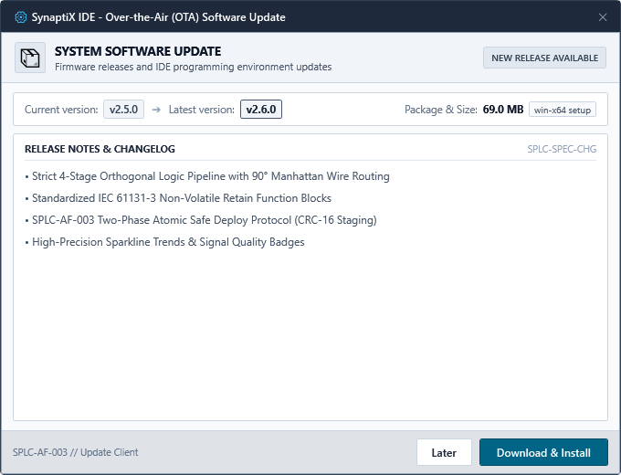
*Figure 1-1: Hộp thoại Nâng cấp Phiên bản Phần mềm Trực tuyến (OTA Software Update Dialog)*

| Thành phần Giao diện | Chức năng Thao tác |
| :--- | :--- |
| **Phiên bản Hiện tại & Mới** | Hiển thị phiên bản đang chạy đối chiếu với bản dựng mới được chứng thực. |
| **Khung Nhật ký Thay đổi** | Khung cuộn văn bản liệt kê chi tiết lỗi đã vá, tính năng mới và bản vá an toàn. |
| **Nút Tải & Cài đặt** | Tiến hành tải gói nhị phân an toàn, kiểm tra mã băm SHA-256 và khởi động lại app. |
| **Nút Bỏ qua Phiên bản** | Tắt thông báo cho bản phát hành này cho đến khi có bản cập nhật kế tiếp. |

---

# Phần 2: Không gian Làm việc & Quản lý Dữ liệu
*Điều hướng Ribbon, Tệp Dự án (.synx) & Bảng Quản lý 128 Tag*

### 2.1 Giải phẫu Giao diện Chính & Điều hướng Ribbon
Giao diện SynaptiX IDE được chia thành các khu vực công thái học chuẩn hóa, tối ưu cho vận hành liên tục trong phòng điều khiển nhà máy:

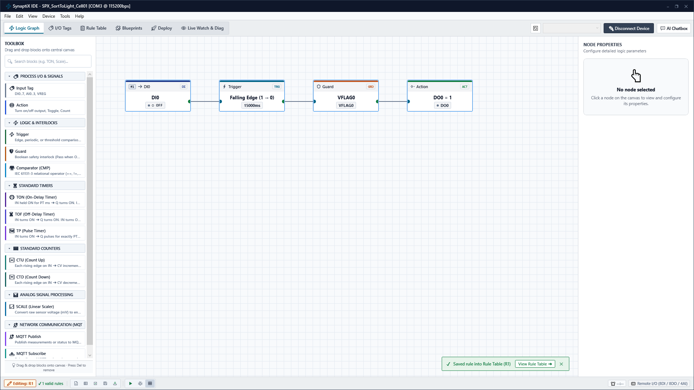
*Figure 2-1: Giải phẫu Giao diện Chính SynaptiX IDE và Không gian Điều hướng Ribbon*

| Khu vực Giao diện | Mô tả & Chức năng |
| :--- | :--- |
| **[1] Thanh Tiêu đề & Cổng COM** | Hiển thị tên tệp dự án, danh sách chọn cổng COM, tốc độ truyền và trạng thái kết nối. |
| **[2] Thanh Trình đơn (Menu)** | Truy cập các cụm chức năng File, Edit, View, Device, Tools và Trợ giúp. |
| **[3] Thanh Điều hướng Ribbon** | 6 tab chuyên biệt: Logic Graph, I/O Tags, Rule Table, Blueprints, Deploy, Live Watch. |
| **[4] Vùng Làm việc Trọng tâm** | Khu vực hiển thị canvas vẽ logic, bảng dữ liệu Tag hoặc lưới đo xa tương ứng với tab đang chọn. |
| **[5] Thanh Trạng thái Đáy** | Chu kỳ quét thời gian thực (SCAN: 9.8ms / TARGET: 10.0ms), thẻ báo lỗi AST và nhịp đập Heartbeat. |

#### 2.1.1 Tiêu Chuẩn Màu Sắc Công Nghiệp ISA-101 & IEC 60073 (Industrial Slate Palette)
Từ phiên bản v2.6.0, SynaptiX IDE áp dụng triệt để tiêu chuẩn quốc tế **ANSI/ISA-101.01-2015** (Human-Machine Interfaces for Process Automation Systems) và **IEC 60073** (Coding principles for indicators and actuators):
- **Nền Giao diện Xám Thép Phi Phản Xạ (Industrial Slate Gray):** Sử dụng các tông màu xám thép trung tính (`#0F172A`, `#1E293B`, `#334155`) làm dịu mắt kỹ sư vận hành trong ca trực dài, giảm mỏi mắt và tăng độ tập trung vào dữ liệu vận hành.
- **Màu Ngữ Nghĩa An Toàn (Semantic Safety Codes):**
  - **Xanh Lục Công Nghiệp (`#107C41` / `#166534`):** Chỉ dành cho trạng thái hoạt động bình thường, trực tuyến (RUN, Online, Active, Normal, Logic 1). Tuyệt đối loại bỏ các màu xanh neon/pastel web gây chói.
  - **Đỏ Cảnh Báo Nguy Hiểm (`#B91C1C` / `#DC2626`):** Chỉ dùng cho sự cố khẩn cấp, lỗi phần cứng, dừng máy (FAULT, Stop, Trip, CRC Error, Offline).
  - **Hổ Phách / Vàng Cam (`#C05621` / `#B45309`):** Cảnh báo suy giảm chất lượng dữ liệu, mất kết nối tạm thời hoặc cưỡng bức tín hiệu (Warning, Stale, Force Override).
  - **Xanh Dương Công Nghiệp (`#0284C7`):** Chỉ thị thông tin kỹ thuật, khối truyền thông RS-485 Modbus Master (`MB_READ`, `MB_WRITE`).
  - **Tím Thẫm Công Nghiệp (`#7C3AED`):** Khối tích hợp đám mây IIoT Edge MQTT (`MQTT_PUB`, `MQTT_SUB`).

### 2.2 Thuật sĩ Khởi tạo Dự án Mới & Hồ sơ Phần cứng (.synx)
Mọi dữ liệu dự án (tọa độ khối, dây nối 90°, danh mục Tag, luật AST và cấu hình MQTT) được đóng gói trong một tệp duy nhất `.synx`. Thực hiện các bước sau để tạo dự án mới:
- **Bước 1: Mở Thuật sĩ —** Chọn File -> New Project hoặc nhấn phím tắt Ctrl+N để mở Thuật sĩ Khởi tạo Dự án.
- **Bước 2: Nhập Thông tin —** Nhập Tên Dự án, Tên Kỹ sư / Đơn vị thực hiện và chọn thư mục lưu trữ cục bộ.
- **Bước 3: Chọn Hồ sơ Phần cứng —** Chọn hồ sơ phần cứng tương ứng (ví dụ: SYNX-RIO-884: 8 DI / 8 DO / 4 AI) và chu kỳ quét đích (10ms).
- **Bước 4: Khởi tạo Dự án —** Bấm nút 'Create Project' để khởi tạo tệp dự án và tự động nạp sẵn danh mục Tag vật lý mặc định.

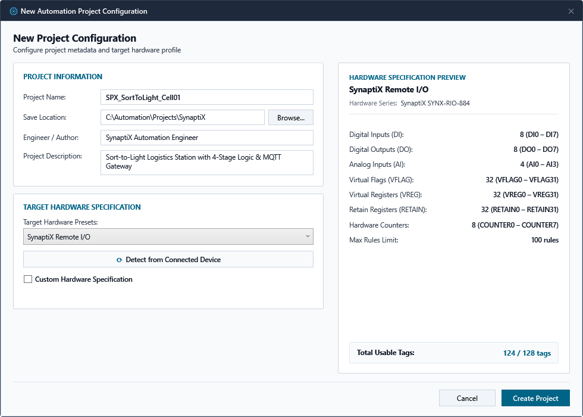
*Figure 2-2: Thuật sĩ Khởi tạo Dự án Mới & Thiết lập Hồ sơ Phần cứng Controller*

### 2.3 Bảng Quản lý 128 Tag Tập trung & Bản đồ Modbus
Tab 1 (I/O Tags) quản lý toàn bộ tín hiệu hệ thống qua vùng nhớ cố định 128 Tag không phân mảnh, ánh xạ trực tiếp sang Modbus Holding Registers (0x0900 - 0x097F):

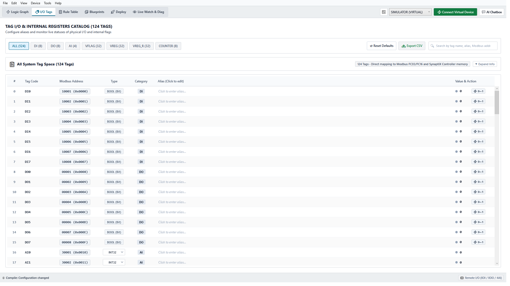
*Figure 2-3: Bảng Quản lý 128 Tag Tập trung — Cấu hình Tín hiệu, Modbus & Bộ nhớ Retain*

| Phân loại Tag | Dung lượng / Dải | Kiểu Dữ liệu | Địa chỉ Modbus Holding |
| :--- | :--- | :--- | :--- |
| **Discrete Inputs (DI)** | 8 Tag (DI0 - DI7) | Boolean (0 / 1) | 0x0900 - 0x0907 |
| **Discrete Outputs (DO)** | 8 Tag (DO0 - DO7) | Boolean (0 / 1) | 0x0908 - 0x090F |
| **Analog Inputs (AI)** | 4 Tag (AI0 - AI3) | Float32 (IEEE 754, 2 Thanh ghi/Tag) | 0x0910 - 0x0917 |
| **Virtual Registers (VREG)** | 32 Tag (VREG0 - VREG31) | Int32 / Float32 (Tạm thời) | 0x0918 - 0x0957 |
| **Retain Registers (RETAIN)** | 32 Tag (RETAIN0 - RETAIN31) | Int32 / Float32 (Lưu trữ Flash) | 0x0958 - 0x0997 |
| **Virtual Flags (VFLAG)** | 32 Tag (VFLAG0 - VFLAG31) | Boolean (Bit nội bộ) | 0x0998 - 0x09B7 |

> [!CAUTION]
> **GIỚI HẠN CHU KỲ GHI BỘ NHỚ LƯU TRỮ RETAIN**  
> Các thanh ghi RETAIN0..31 được lưu vào bộ nhớ Flash khi thay đổi giá trị. Dù có độ bền 100.000 lần ghi, tuyệt đối KHÔNG ĐƯỢC lập trình logic ghi liên tục vào biến Retain trong từng chu kỳ quét 10ms. Hãy sử dụng biến tạm VREG cho các phép tính tốc độ cao và chỉ cập nhật vào RETAIN khi chuyển đổi chế độ máy.

---

# Phần 3: Soạn thảo Logic Điều khiển & Thư viện Hàm
*Canvas 4 Giai đoạn, Bảng Luật Kép & Thư viện Thiết kế Blueprints*

### 3.1 Soạn thảo Logic 4 Giai đoạn Trực giao & Dây nối 90° Manhattan
Tab 0 (Logic Graph) áp dụng đường ống 4 giai đoạn trực giao nghiêm ngặt, trong đó tín hiệu di chuyển một chiều từ trái sang phải qua các đường dây vuông góc 90° Manhattan:

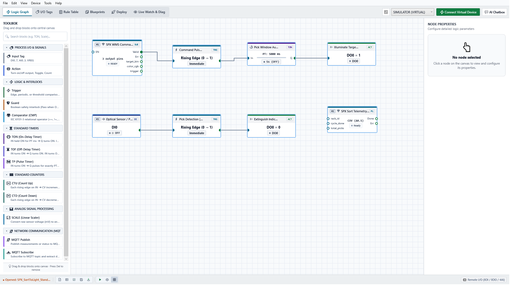
*Figure 3-1: Không gian Soạn thảo Logic 4 Giai đoạn với Dây nối Góc vuông 90° Manhattan*

| Giai đoạn Đường ống | Vai trò Chức năng & Thực thi |
| :--- | :--- |
| **Giai đoạn 1: Tín hiệu Vào** | Chọn tín hiệu ngõ vào vật lý (DI, AI), bộ đếm thời gian hoặc thanh ghi làm biến đo. |
| **Giai đoạn 2: Kích hoạt Logic** | Đánh giá biến thiên: Cạnh lên (ON_RISE), Cạnh xuống (ON_FALL), Mức logic hoặc So sánh ngưỡng (CMP). |
| **Giai đoạn 3: Chốt An toàn** | Chuỗi liên động bảo vệ an toàn. Đánh giá điều kiện cho phép (ví dụ E-Stop không bị nhấn, bảo vệ nhiệt tốt). |
| **Giai đoạn 4: Chấp hành Đầu ra** | Điều khiển chấp hành: Đóng rơ-le DO (SET), ngắt DO (RESET), đảo trạng thái, tăng bộ đếm hoặc ghi thanh ghi. |

#### Danh mục 13 Khối Chức năng Toàn diện (13 Function Blocks Master Catalog)

SynaptiX IDE hỗ trợ 13 khối chức năng chuẩn hóa, phân thành 4 nhóm chính theo chuẩn IEC 61131-3 và tự động hóa công nghiệp IIoT:

| STT | Tên Khối & Huy hiệu | Nhóm Chức năng | Cổng Nối (Pins In/Out) | Vai trò & Ứng dụng Điển hình |
| :---: | :--- | :--- | :--- | :--- |
| **1** | **`INPUT`** `[INPUT]` | Tín hiệu ngõ vào (Giai đoạn 1) | Ra: `Out` (Data) | Đọc giá trị ngõ vào vật lý DI0..DI7, AI0..AI3, biến nội bộ VREG0..31, bộ nhớ duy trì RETAIN0..31 hoặc hằng số. |
| **2** | **`TRIGGER`** `[TRIG]` | Kích hoạt sự kiện (Giai đoạn 2) | Vào: `In` (Data) Ra: `Trig` (Event) | Bắt sự kiện chuyển trạng thái: Cạnh lên (`ON_RISE`), Cạnh xuống (`ON_FALL`), Mức logic (`ON_HIGH`, `ON_LOW`), hoặc Khung giờ thực RTC (`TIME_WINDOW`). |
| **3** | **`COMPARATOR`** `[CMP]` | Đánh giá & So sánh (Giai đoạn 2) | Vào: `In` (Data) Ra: `Pass` (Logic) | So sánh giá trị số nguyên hoặc số thực Float32 với ngưỡng: `>`, `>=`, `==`, `!=`, `<=`, `<` (phù hợp giám sát áp suất, nhiệt độ, mức bồn). |
| **4** | **`GUARD`** `[GUARD]` | Chốt an toàn liên động (Giai đoạn 3) | Vào: `In` (Logic) Ra: `Permit` (Logic) | Chuỗi liên động bảo vệ an toàn (Safety Interlock). Cho phép tín hiệu đi qua khi điều kiện an toàn thỏa mãn (`E-Stop = 1`, `Cửa đóng = 1`, `Nhiệt độ OK`). |
| **5** | **`ACTION`** `[ACTION]` | Chấp hành đầu ra (Giai đoạn 4) | Vào: `Exec` (Event/Logic) Ra: Trạng thái DO/VREG | Thực thi thao tác điều khiển: `SET` (bật), `RESET` (tắt), `TOGGLE` (đảo) rơ-le DO0..DO7, gán giá trị số vào VREG hoặc tăng/giảm bộ đếm. |
| **6** | **`TIMER`** `[TON / TOF / TP]` | Định thời IEC 61131-3 | Vào: `IN`, `PT` (ms) Ra: `Q` (Logic), `ET` (ms) | Bộ định thời chuẩn: `TON` (Trễ bật cuộn dây), `TOF` (Trễ ngắt quạt làm mát), `TP` (Phát xung đơn định lượng thời gian cho van khí nén). |
| **7** | **`COUNTER`** `[CTU / CTD]` | Bộ đếm IEC 61131-3 | Vào: `CU`/`CD`, `R`/`LD`, `PV` Ra: `Q` (Logic), `CV` (Int) | Bộ đếm công nghiệp: `CTU` (Đếm tiến sản lượng đóng thùng), `CTD` (Đếm lùi phôi dập còn lại). Lưu trữ an toàn trong vùng Flash Retentive. |
| **8** | **`SCALE`** `[SCALE]` | Chuẩn hóa đo lường tuyến tính | Vào: `In` (Raw ADC) Ra: `Out` (Scaled Float) | Chuyển đổi tỉ lệ tuyến tính $y = k \cdot x + b$: Chuẩn hóa ADC 0..4095 hoặc dòng 4-20mA sang đơn vị kỹ thuật (0..10 bar, -20..80 °C, 0..100%). |
| **9** | **`PULSE_OUT`** `[PULSE]` | Phát xung cao tốc & Chấp hành | Vào: `Trig`, `In/Chan`, `En/Param` Ra: `Done`, `Err` | Điều khiển xung cao tốc & chấp hành cấp thấp trên DO0..DO7: DO Logic, PWM băm xung (1..20 kHz), PTO phát chuỗi xung động cơ bước, Bus 1-dây LED Sort-to-Light (1..18 ô). *(Tương thích ngược DIRECT_WRITE)*. |
| **10** | **`MB_READ`** `[MB_READ]` | Modbus RTU Master Đọc | Vào: `En` (Cho phép) Ra: `Done`, `Err`, `Data` (VREG) | Thu thập dữ liệu cảm biến RS-485 Modbus RTU qua FC01, FC02, FC03, FC04; ghi tự động vào thanh ghi đích VREG theo chu kỳ hoặc sự kiện. |
| **11** | **`MB_WRITE`** `[MB_WRITE]` | Modbus RTU Master Ghi | Vào: `Trig`, `In/Val` Ra: `Done`, `Err` | Điều khiển thiết bị RS-485 Modbus RTU (Biến tần, rơ-le thông minh) qua FC05, FC06, FC15, FC16; hỗ trợ chế độ đa kênh Sort-to-Light logistics. |
| **12** | **`MQTT_PUB`** `[MQTT_PUB]` | Xuất bản Viễn trắc IIoT | Vào: `Trig`, `In0..In3` (Data) Ra: `Done`, `Err` | Đóng gói dữ liệu đo lường thành bản tin JSON gửi lên MQTT Broker qua mạng LAN/Wi-Fi (QoS 0/1/2, Retain) chu kỳ tuần hoàn hoặc theo sự kiện. |
| **13** | **`MQTT_SUB`** `[MQTT_SUB]` | Đăng ký Lệnh Điều khiển IIoT | Ra: `Out0..Out3` (Data), `NewMsg` (Event) | Lắng nghe topic chỉ thị từ Cloud/WMS qua broker MQTT, trích xuất các trường dữ liệu JSON vào chân ngõ ra và phát xung thông báo bản tin mới. |

### 3.2 Bảng Luật Logic Kép & Trình Biên dịch Cú pháp AST
Tab 2 (Rule Table) hiển thị song song hai góc nhìn đồng bộ: Cột bên trái diễn giải câu lệnh kỹ thuật bằng tiếng người rõ ràng, cột bên phải là các tham số mã máy 32-byte nhị phân:

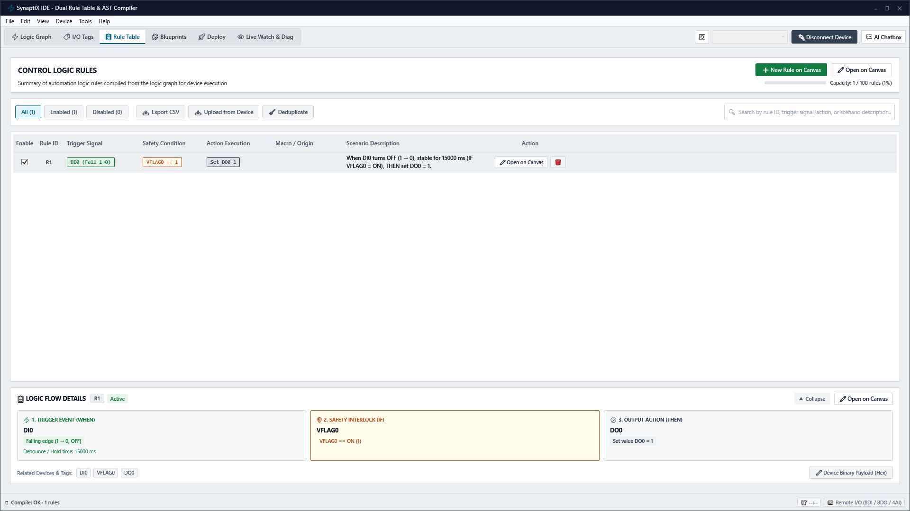
*Figure 3-2: Bảng Luật Logic Kép — Diễn giải Tiếng người & Mã máy Nhị phân Bytecode*

Động cơ phân tích cú pháp AST chạy ngầm liên tục kiểm tra tính toàn vẹn của sơ đồ. Nếu có chân kết nối bị bỏ trống hoặc xuất hiện vòng lặp kín trái phép, thẻ cảnh báo đỏ sẽ xuất hiện ở thanh trạng thái cùng liên kết trực tiếp tới vị trí lỗi để kỹ sư sửa chữa.

### 3.3 Thư viện Hàm Chuẩn & Kho Mẫu Thiết kế Blueprints
SynaptiX IDE cung cấp đầy đủ các khối lệnh tiêu chuẩn IEC 61131-3 (Bộ định thời TON/TOF/TP, bộ đếm CTU/CTD, hàm tỉ lệ SCALE và bộ so sánh CMP) cùng các khối truyền thông nâng cao (MQTT PUB/SUB, Modbus Master MB_READ/MB_WRITE). Tại Tab 3 (Blueprints), kỹ sư có thể nạp các mẫu thiết kế công nghiệp có sẵn chỉ với 1 cú nhấp chuột:

*Figure 3-3: Thư viện Mẫu Thiết kế Tự động hóa Công nghiệp (Blueprints) & Khởi tạo Nhanh*

#### Danh mục Mẫu Thiết kế Công nghiệp (Blueprints Catalog)

| Phân nhóm Mẫu | Số lượng | Các Mẫu Tiêu biểu & Ứng dụng |
| :--- | :---: | :--- |
| **Nhóm 1: Logic Số & Liên Khóa An Toàn** | 5 | Báo động Andon OEE, Đếm sản lượng Flash Retain, Gọi cấp liệu, Bơm thoát nước, Cửa an toàn Guard Đảo. |
| **Nhóm 2: Đảo Chiều Động Cơ & Khóa Chéo** | 3 | Khởi động trực tiếp DOL, Đảo chiều quay động cơ khóa chéo phần cứng/phần mềm, Khởi động Sao - Tam giác. |
| **Nhóm 3: Bộ Định Thời Thời Gian Thực TON/TOF/TP** | 3 | Trễ bật bơm bôi trơn (TON), Trễ ngắt quạt làm mát (TOF), Xung khí nén thổi phôi (TP). |
| **Nhóm 4: Bộ Đếm Sản Lượng & Đóng Thùng CTU/CTD** | 3 | Đóng thùng tự động đếm tiến (CTU), Đếm lùi phôi dập (CTD), Quản lý dung lượng bãi đỗ xe (CTUD). |
| **Nhóm 5: Chuẩn Hóa Đo Lường & Tỉ Lệ Tuyến Tính** | 5 | Đọc áp suất 4-20mA, Cảm biến nhiệt PT100/NTC, Can mức bồn chứa chất lỏng, Đo dòng động cơ CT. |
| **Nhóm 6: Truyền Thông Đám Mây & IIoT MQTT** | 2 | Xuất bản đo lường IIoT lên Broker (MQTT PUB), Điều phối lệnh điều khiển từ xa (MQTT SUB). |
| **Nhóm 7: Modbus RTU Master & Logistics SPX** | 3 | **Thu thập Cảm biến RS-485 (MB_READ)**: Đọc định kỳ FC04 áp suất vào VREG0. **Điều khiển Biến tần VFD (MB_WRITE)**: Ghi trực tiếp tần số 50.00 Hz qua FC06. **SPX Sort-to-Light 18 Ô**: Tích hợp MQTT SUB nhận mã ô và PULSE_OUT (DIRECT_WRITE) (Cọc DO3) điều phối dải LED 18 ô trực tiếp không cần Modbus ID. |

- **Bước 1: Chọn Mẫu Thiết kế —** Mở Tab 3 (Blueprints) và duyệt danh mục (Khóa chốt E-Stop, Trạm phân loại Sort-to-Light SPX, Đảo chiều động cơ, Biến tần VFD).
- **Bước 2: Nạp Mẫu vào Canvas —** Bấm nút 'Apply Blueprint' để tự động tạo lập toàn bộ mạng logic, gán Tag và thiết lập liên động lên canvas mà không cần vẽ thủ công từ đầu.

---

# Phần 4: Giả lập Thời gian thực & Trợ lý Kỹ sư AI
*Bàn Testbench trên Canvas, I/O Ảo HUD & Trợ lý AI Copilot*

### 4.1 Bàn Thử nghiệm Giả lập Trực tiếp trên Canvas
Tính năng giả lập trong SynaptiX IDE được tích hợp trực tiếp trên Canvas. Khi nhấn F5, giao diện soạn thảo chuyển thành bàn thử nghiệm tương tác sống động mà không cần chuyển màn hình:

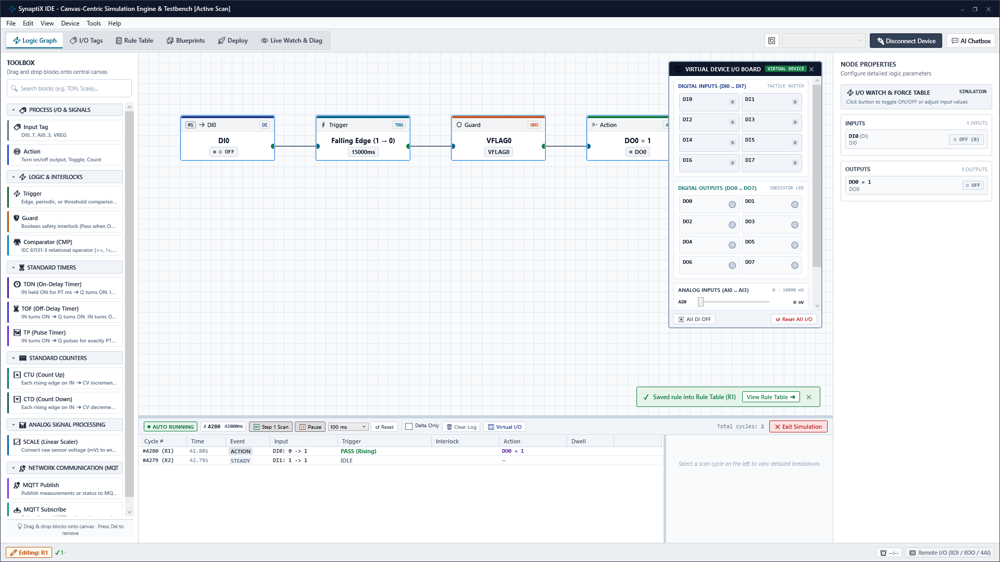
*Figure 4-1: Bàn Thử nghiệm Giả lập trên Canvas — Bàn I/O Ảo, Force Table & Dòng vết Chu kỳ*

| Thành phần Bàn Giả lập | Khả năng Vận hành |
| :--- | :--- |
| **Ngăn kéo Chẩn đoán (Phía dưới)** | Hiển thị vết thực thi chu kỳ quét 10ms, sự kiện kích hoạt, thời gian xử lý và độ trôi nhịp. |
| **Bàn I/O Ảo HUD (Trôi nổi)** | Cung cấp công tắc gạt DI, đèn LED DO và thanh trượt Analog để thử nghiệm kích tín hiệu thủ công. |
| **Lưới Watch & Force (Bên phải)** | Theo dõi trạng thái biến thời gian thực và cho phép cưỡng bức giá trị kiểm thử ngay khi đang chạy giả lập. |

- **Bước 1: Kích hoạt Giả lập —** Nhấn phím F5 hoặc bấm nút Simulation trên thanh công cụ. Canvas chuyển sang trạng thái chạy với đường dây sáng đèn.
- **Bước 2: Kích Tín hiệu Ngõ vào —** Gạt công tắc DI0 trên Bàn I/O Ảo để mô phỏng cảm biến vật cản phát hiện sản phẩm.
- **Bước 3: Quan sát Thực thi —** Kiểm tra đèn LED DO0 sáng lên trên HUD và xem nhật ký thực thi chu kỳ 10ms trong ngăn kéo chẩn đoán phía dưới.

### 4.2 Trợ lý Kỹ sư Công nghiệp AI Copilot & Cơ chế Phê duyệt Ghost Diff
Trợ lý AI Copilot hỗ trợ kỹ sư tự động hóa tổng hợp mạch logic từ ngôn ngữ tự nhiên, đồng thời áp dụng cơ chế phê duyệt an toàn thông qua bản nháp nét đứt Ghost Diff trực quan:

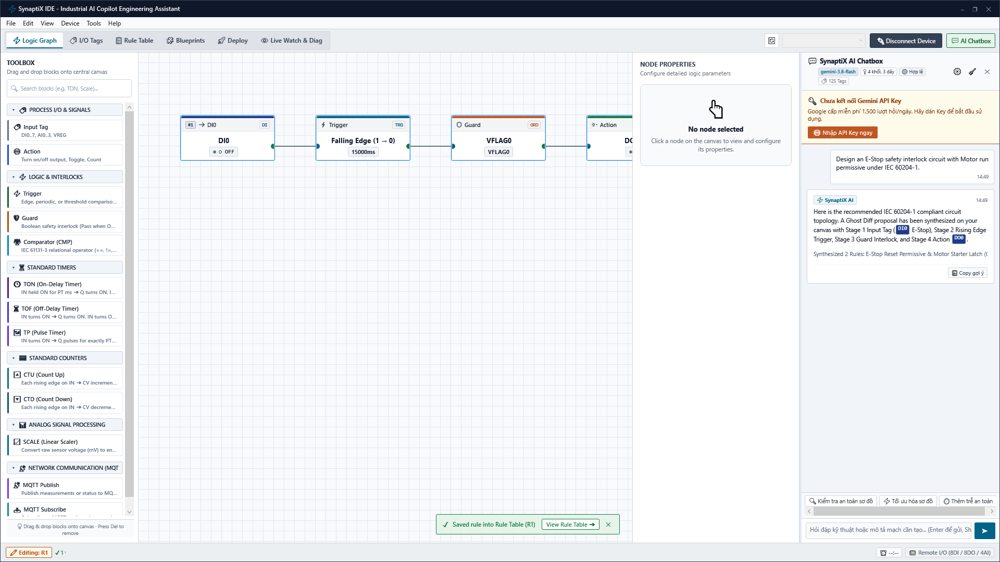
*Figure 4-2: Trợ lý Kỹ sư Công nghiệp AI Copilot & Cơ chế Phê duyệt Bản nháp Ghost Diff*

- **Bước 1: Mở Thanh Trợ lý AI —** Nhấp biểu tượng AI Copilot ở góc phải thanh Ribbon để mở khung thoại trợ lý kỹ thuật.
- **Bước 2: Nhập Yêu cầu Kỹ thuật —** Nhập yêu cầu (ví dụ: 'Tạo mạch chốt E-Stop điều khiển động cơ tuân thủ tiêu chuẩn IEC 60204-1') và nhấn Enter.
- **Bước 3: Kiểm tra Bản nháp Ghost Diff —** Quan sát các khối logic do AI tạo ra hiển thị dưới dạng khung viền nét đứt mờ (Ghost Diff) trực tiếp trên canvas.
- **Bước 4: Phê duyệt Bản nháp —** Bấm nút 'Accept Proposal' để chính thức hợp nhất khối vào sơ đồ, hoặc 'Reject' để hủy bỏ an toàn.

---

# Phần 5: Nghiệm thu, Nạp An toàn & Đo từ xa
*Chẩn đoán Thiết bị, Đồng bộ RTC & Cổng Nạp An toàn 2 Pha*

### 5.1 Chẩn đoán Phần cứng Controller & Đồng bộ RTC
Trước khi nạp chương trình vào máy thực tế, cần kiểm định phần cứng controller và hiệu chuẩn chip đồng hồ thời gian thực DS3231:

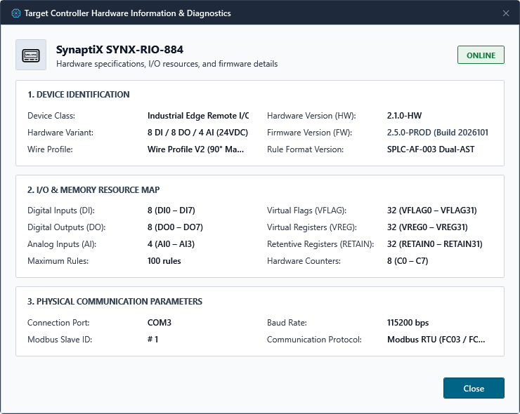
*Figure 5-1: Hộp thoại Kiểm định Phần cứng & Thông tin Định danh Controller*

Hộp thoại Device Info đọc số sê-ri vi điều khiển, bản dựng phần sụn firmware, hồ sơ định tuyến dây và tốc độ truyền baud rate thực tế.

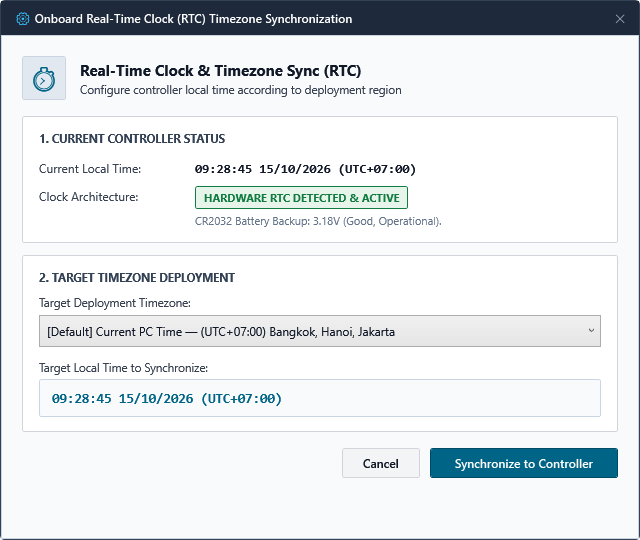
*Figure 5-2: Hộp thoại Đồng bộ Đồng hồ Phần cứng RTC theo Múi giờ Chuẩn*

Nhấp 'Sync RTC' để đồng bộ chip đồng hồ thời gian thực DS3231 trên Controller theo giờ UTC và múi giờ máy tính, đảm bảo độ chính xác thời gian cho nhật ký dữ liệu đo xa.

### 5.2 Cổng Nạp An toàn 2 Pha SPLC-AF-003 & Kiểm Tra Năng Lực Phần Cứng (0x0A08)
Ghi trực tiếp vào bộ nhớ khi máy đang chạy có nguy cơ gây giật rơ-le nghiêm trọng nếu đứt cáp giữa chừng. Tiêu chuẩn SPLC-AF-003 loại trừ triệt để nguy cơ này qua Giao thức Nạp 2 Pha kết hợp Cơ chế Kiểm định Năng lực Phần cứng Fail-Safe:

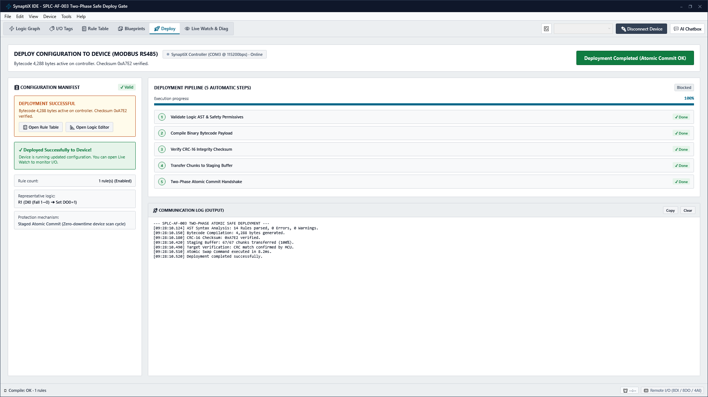
*Figure 5-3: Cổng Nạp An toàn 2 Pha SPLC-AF-003 & Xác thực CRC-16 Checksum*

- **Bước 0: Kiểm tra Năng lực Phần cứng (Hardware Capabilities - 0x0A08) & Chốt An toàn Fail-Fast:**
  - Trước khi nạp các cấu hình nâng cao (MQTT PUB, MQTT SUB, MQTT Broker), IDE gửi lệnh Modbus FC03 đọc 2 thanh ghi tại `0x0A08..0x0A09` để xác minh cờ hỗ trợ trên vi điều khiển (`SPLC_CAP_MQTT_PUB = 0x0010`, `SPLC_CAP_MQTT_SUB = 0x0020`).
  - **Triệt tiêu lỗi nạp ảo (No Silent Failure):** Nếu sơ đồ có khối MQTT mà việc đọc `0x0A08` bị lỗi (Timeout, CRC) hoặc MCU không kích hoạt cờ MQTT tương ứng, IDE lập tức **DỪNG NẠP**, trả về mã lỗi `UNSUPPORTED (0x0002)` và báo Deploy THẤT BẠI. IDE tuyệt đối không bỏ rơi cấu hình MQTT rồi tiếp tục nạp báo thành công ảo.
  - **Tương thích ngược:** Thiết bị cũ không hỗ trợ thanh ghi `0x0A08` (phản hồi Modbus Exception `0x02`) vẫn được phép nạp bình thường nếu sơ đồ không sử dụng các khối MQTT.
  - **Minh bạch hóa quá trình ghi:** IDE ghi log chi tiết từng frame Modbus truyền xuống (`[MQTT PUB] Writing 96 registers to 0x0C00...`, `[MQTT Broker] Writing 96 registers to 0x0E00...`) giúp kỹ sư dễ dàng đối soát với log của firmware gateway.
- **Bước 1: Pha 1: Tải vào Vùng đệm Staging —** Truyền mã máy 32-byte vào vùng đệm Staging RAM biệt lập trên vi điều khiển mà không ảnh hưởng đến vòng lặp điều khiển đang chạy.
- **Bước 2: Xác thực Mã kiểm tra CRC-16 —** Controller tự tính toán mã CRC-16 của vùng đệm và đối chiếu khớp 100% với gói tin IDE truyền xuống.
- **Bước 3: Pha 2: Hoán đổi Nguyên khối Atomic Swap —** Sau khi xác nhận hợp lệ, controller thực hiện hoán đổi con trỏ thực thi siêu tốc dưới 10ms tại đúng ranh giới chu kỳ quét.

### 5.3 Đo xa Thời gian thực & Lưới Giám sát Live Watch
Tab 5 (Live Watch & Diag) cung cấp lưới giám sát kỹ thuật thời gian thực quét toàn bộ 128 Tag với chu kỳ 200ms cùng đồ thị sóng Sparkline và thẻ chất lượng tín hiệu:

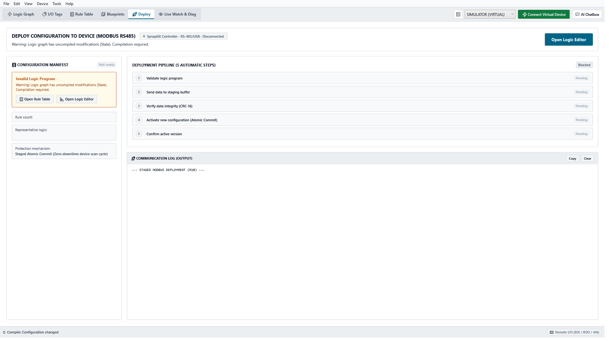
*Figure 5-4: Lưới Đo từ xa Trực tuyến (Live Watch), Thẻ Chất lượng & Đồ thị Sparkline*

| Thành phần Giám sát | Đặc tính Kỹ thuật |
| :--- | :--- |
| **Thẻ Chất lượng (GOOD / STALE / BAD)** | Xanh = Tín hiệu cập nhật tốt (<200ms); Hổ phách = Dữ liệu trôi quá chu kỳ; Đỏ = Lỗi truyền thông. |
| **Đồ thị Sóng Micro-Sparkline** | Đường cong 60 mẫu lịch sử hiển thị trực quan biến thiên tức thời của tín hiệu analog hoặc số. |
| **Cưỡng bức Tín hiệu Thủ công (Force)** | Cho phép kỹ sư cưỡng bức ngõ ra DO đóng/ngắt khi chạy thử. Được hiển thị bằng thẻ màu hổ phách. |

> [!WARNING]
> **BẮT BUỘC HỦY BỎ TRẠNG THÁI CƯỠNG BỨC (FORCE) TRƯỚC KHI VẬN HÀNH**  
> Việc duy trì trạng thái cưỡng bức ngõ ra sẽ vô hiệu hóa các liên động an toàn và điều kiện bảo vệ. Luôn kiểm tra và hủy bỏ toàn bộ lệnh Force chuyển về chế độ Tự động trước khi cho dây chuyền hoạt động.

---

# Phần 6: Tích hợp IIoT Edge & Bảo trì Hệ thống
*Cấu hình MQTT Broker, Truyền dữ liệu Đo xa (PUB) & Nhận lệnh An toàn (SUB)*

### 6.1 Cấu hình Máy chủ IIoT MQTT Broker TCP/TLS
Chọn Device -> MQTT Broker Configuration (Ctrl+Shift+M) để thiết lập kết nối tới máy chủ MQTT Broker của nhà máy:

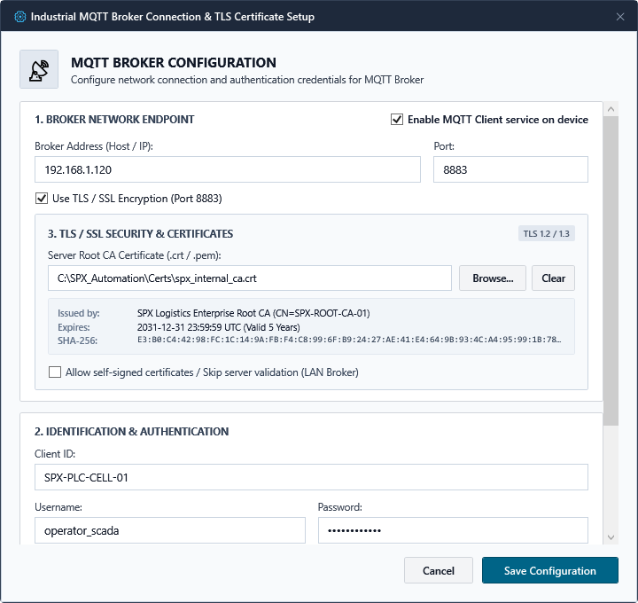
*Figure 6-1: Hộp thoại Cấu hình Máy chủ IIoT MQTT Broker TCP/TLS (1883/8883)*

- **Bước 1: Địa chỉ & Cổng kết nối —** Điền địa chỉ IP/Hostname của máy chủ MQTT và Cổng dịch vụ (cổng `1883` cho kết nối TCP tiêu chuẩn, hoặc tự động chuyển sang cổng `8883` khi kích hoạt tùy chọn bảo mật TLS).
- **Bước 2: Bảo mật Mã hóa TLS/SSL & Quản lý Chứng chỉ số (X.509) —**
  - Khi bật tùy chọn `Sử dụng mã hóa TLS / SSL (Port 8883)`, khối cấu hình bảo mật **3. BẢO MẬT TLS / SSL & CHỨNG CHỈ SỐ** sẽ hiển thị.
  - **Chọn tệp Root CA (`.crt`, `.pem`, `.cer`)**: Nhấp `Chọn tệp...` để nạp chứng chỉ gốc của tổ chức/nhà máy. IDE tự động phân tích ASN.1 X.509 và hiển thị huy hiệu thông tin chi tiết:
    - *Tổ chức cấp phát (Issuer)*: Ví dụ `CN=SPX-ROOT-CA-01`.
    - *Hạn sử dụng (Valid Until)*: Hiển thị ngày giờ hết hạn chứng chỉ.
    - *Mã băm định danh (SHA-256 Fingerprint)*: Chuỗi băm 32-byte định dạng hex có dấu hai chấm giúp kỹ sư đối chiếu với chứng chỉ máy chủ.
  - **Bỏ qua xác thực máy chủ (Allow Self-Signed Certificates)**: Tích chọn tùy chọn này nếu máy chủ MQTT Broker trong mạng nội bộ LAN dùng chứng chỉ tự ký hoặc chưa được cấu hình tên miền FQDN.
  - **Cơ chế Nạp Phân đoạn Struct (Chunked Struct Protocol - SPLC-SPEC-MQTT-003)**: Chứng chỉ PEM (dung lượng ~1.8 KB) được IDE tự động chia nhỏ thành các khối struct chuẩn **128 bytes (64 thanh ghi Modbus)** nạp qua vùng đệm Staging `0x0F00`. Mỗi khối có mã kiểm tra CRC-16 Modbus độc lập và được bắt tay xác nhận ACK (`0x0F40`) trước khi phát lệnh chốt nguyên tử Commit (`0x0F42` với giá trị `0xA5A5`), đảm bảo không nghẽn đường truyền Modbus RTU.
- **Bước 3: Định danh & Xác thực Tài khoản —** Điền Client ID định danh duy nhất của thiết bị trên Broker, Tên người dùng (Username), Mật khẩu (Password), và chu kỳ duy trì kết nối Keep-Alive (mặc định 60s).
- **Bước 4: Kiểm tra Bắt tay Thời gian thực & Lưu Cấu hình —** 
  - Nhấp `Kiểm tra kết nối`: Hệ thống sẽ mở socket TCP và thực hiện phiên bắt tay mã hóa TLS (`SslStream`) thời gian thực với Broker, trả về giao thức kết nối và bộ mã hóa (ví dụ: `Bắt tay TLS thành công! Giao thức: Tls13, Mã hóa: AesGcm256`).
  - Nhấp `Lưu cấu hình` để áp dụng toàn bộ tham số vào tệp dự án `.synx`.

### 6.2 Bản tin Truyền dữ liệu Đo xa (MQTT PUB) & Visual Field Builder
Nhấp đúp vào khối MQTT Publish để mở công cụ Visual Field Builder. Ánh xạ nhiều Tag dữ liệu vào một bản tin JSON có cấu trúc mà không cần viết mã lệnh:

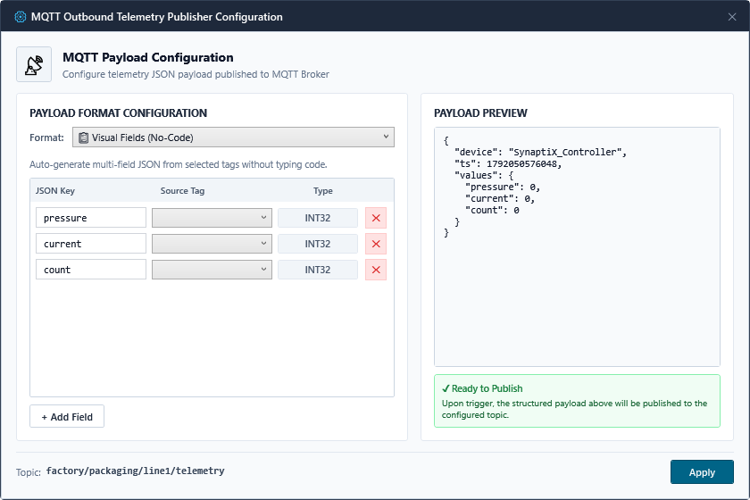
*Figure 6-2: Hộp thoại Cấu hình Kênh Truyền Đo xa (MQTT PUB) & Visual Field Builder*

Lựa chọn chế độ truyền bản tin: Theo sự kiện (khi có xung kích hoạt), Định kỳ (ví dụ mỗi 1000ms), hoặc Theo biến thiên giá trị (COV — chỉ gửi khi giá trị vượt ngưỡng thay đổi, giúp tối ưu băng thông mạng công nghiệp).

### 6.3 Bản tin Nhận lệnh Điều khiển Từ xa (MQTT SUB) & Chốt An toàn
Khối MQTT Subscribe trích xuất các lệnh điều khiển và thông số công thức từ bản tin JSON nhận được ra các chân động trên canvas:

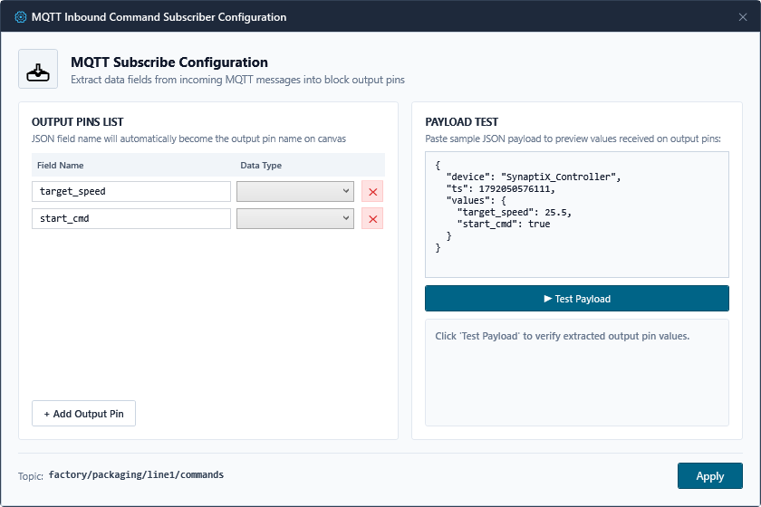
*Figure 6-3: Hộp thoại Cấu hình Kênh Đăng ký Nhận lệnh (MQTT SUB) & Chốt An toàn*

Bộ giải mã tuân thủ nguyên tắc All-or-Nothing: nếu có bất kỳ trường dữ liệu JSON nào bị lỗi hoặc vượt ngưỡng cho phép, toàn bộ gói tin sẽ bị hủy để bảo vệ an toàn tuyệt đối cho thanh ghi điều khiển.

### 6.4 Thu thập Dữ liệu Cảm biến RS-485 Modbus Master (MB_READ)
Khối **`MB_READ`** cho phép SimplePLC đóng vai trò Modbus RTU Master trên bus truyền thông RS-485, tự động gửi truy vấn định kỳ tới các cảm biến đo lường công nghiệp (nhiệt độ, độ ẩm, áp suất, đồng hồ điện năng) hoặc biến tần (VFD), trích xuất dữ liệu trả về và cập nhật trực tiếp vào đồ thị điều khiển FBD:

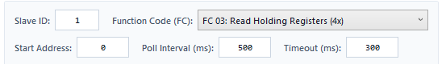
*Figure 6-4: Hộp thoại Cấu hình Khối Đọc Cảm biến Modbus Master (MB_READ) & Bộ Giả lập Khung Tin Hex*

#### 1. Cấu trúc Cổng Nối của Khối MB_READ trên Canvas:
- **Cổng vào `EN` (Enable):** Tín hiệu kích hoạt khối. Khi `EN` = TRUE, PLC duy trì chu kỳ quét Modbus định kỳ. Khi `EN` = FALSE, khối tạm ngưng phát lệnh để giải phóng đường truyền RS-485.
- **Cổng ra `Valid`:** Phát xung logic 1 chu kỳ quét khi nhận được khung phản hồi hợp lệ từ cảm biến và hoàn tất giải mã toàn bộ các chân ngõ ra.
- **Cổng ra `Err`:** Bật mức TRUE khi có sự cố truyền thông (mất kết nối, lỗi CRC, hoặc Slave phản hồi Exception).
- **Cổng ra `Err_Code`:** Xuất mã lỗi chẩn đoán:
  - `0`: Giao tiếp hoàn hảo (`ERR_NONE`).
  - `1`: Hết thời gian chờ (`ERR_TIMEOUT` — đứt cáp hoặc Slave không phản hồi).
  - `2`: Lỗi kiểm tra toàn vẹn (`ERR_CRC` — nhiễu đường truyền RS-485).
  - `3`: Slave từ chối (`ERR_EXCEPTION` — địa chỉ không hợp lệ hoặc sai hàm).
  - `4`: Sai lệch độ dài gói (`ERR_MALFORMED`).
- **Các chân ngõ ra động (Dynamic Output Pins):** Tối đa 4 chân trên mỗi khối, mang tên nhãn kỹ thuật (ví dụ `Temp`, `Humidity`, `Pressure`), tự động cập nhật giá trị số thực tế vào đồ thị logic.

#### 2. Cấu hình Tham số Chuẩn Quốc tế (Modbus.org):
- **Slave ID (1..247):** Địa chỉ định danh phần cứng của cảm biến Slave trên mạng RS-485.
- **Function Code:** Lựa chọn mã lệnh Modbus tiêu chuẩn:
  - `FC 03`: Read Holding Registers (Vùng 4x — Cảm biến & Biến tần).
  - `FC 04`: Read Input Registers (Vùng 3x — Đồng hồ đo & Đầu dò Analog).
  - `FC 01`: Read Coils (Vùng 0x — Trạng thái Rơ-le số).
  - `FC 02`: Read Discrete Inputs (Vùng 1x — Trạng thái Công tắc số).
- **Starting Address:** Địa chỉ thanh ghi bắt đầu trên thiết bị ngoại vi (hỗ trợ cả chuẩn 0-based và 1-based).
- **Quantity of Registers:** Số lượng thanh ghi/coil cần đọc trong một khung tin (1..125). Ô nhập liệu cho phép kỹ sư nhập tự do và có cơ chế **Auto-Fit thông minh**: tự động nâng số lượng nếu tổng Offset của các chân định nghĩa vượt quá phạm vi hiện tại.
- **Poll Interval (ms) & Timeout (ms):** Chu kỳ lặp lại việc gửi truy vấn (mặc định 500ms) và thời gian chờ tối đa trước khi báo lỗi Timeout (mặc định 1000ms).

#### 3. Bảng Cấu hình Chân Động (Pin Bindings Table):
- **Reg Offset:** Vị trí thanh ghi tương đối tính từ `Starting Address`.
- **Data Type:** Hỗ trợ đầy đủ các kiểu dữ liệu công nghiệp: `INT16`, `UINT16`, `REAL` (Float32 IEEE 754 — chiếm 2 thanh ghi), `INT32`, `UINT32` và `BOOL`.
- **Endianness (Thứ tự Byte):** Hỗ trợ chuyển đổi 4 chuẩn sắp xếp dữ liệu phổ biến:
  - `Big-Endian (ABCD)`: Chuẩn mạng truyền thống.
  - `Word-Swap (CDAB)`: Chuẩn hoán vị từ phổ biến nhất trên cảm biến Modbus RTU & PLC.
  - `Byte-Swap (BADC)`: Hoán vị byte nội bộ.
  - `Little-Endian (DCBA)`: Chuẩn vi xử lý x86/ARM.
- **Multiplier (Hệ số tỷ lệ):** Nhân giá trị đo với hệ số chuyển đổi tuyến tính (ví dụ cảm biến trả về số nguyên `255` tại độ phân giải $0.1^\circ\text{C}$, điền Multiplier = `0.1` để nhận kết quả `25.5`).

#### 4. Bàn Thử nghiệm Giải mã Khung Tin Hex Tức thời (Interactive Frame Inspector):
- Kỹ sư có thể dán chuỗi byte Hex phản hồi thực tế từ cảm biến (ví dụ `01 03 04 00 FA 03 E8 B9 AF`) hoặc nhấn nút **"Khung mẫu"**.
- Bấm **"Kiểm tra giải mã"** để SynaptiX IDE chạy thuật toán kiểm tra CRC-16, phân tách từng thanh ghi và hiển thị giá trị tức thời của từng chân ngay trên hộp thoại, giúp nghiệm thu tính đúng đắn trước khi nạp vào PLC thật.

---

### 6.5 Điều khiển Cơ Cấu Chấp Hành RS-485 Modbus Master (MB_WRITE)
Khối **`MB_WRITE`** cho phép SimplePLC chủ động phát lệnh ghi điều khiển qua cổng truyền thông RS-485 Modbus RTU tới các cơ cấu chấp hành ngoại vi (Biến tần VFD, Đèn chỉ thị thông minh Sort-to-Light, Module Relay mở rộng, Van điện từ Modbus):

#### 1. Cấu trúc Cổng Nối của Khối MB_WRITE trên Canvas:
- **Cổng vào `Trig` (hoặc `EN`):** Tín hiệu kích hoạt lệnh ghi theo chế độ đã cấu hình.
- **Cổng ra `Done`:** Phát xung logic 1 chu kỳ quét khi nhận được phản hồi ghi thành công (Acknowledge Echo) từ thiết bị ngoại vi Slave.
- **Cổng ra `Err`:** Bật mức TRUE khi quá trình ghi thất bại (Timeout, lỗi CRC hoặc Slave phản hồi Exception).
- **Cổng ra `Err_Code`:** Xuất mã lỗi chẩn đoán:
  - `0`: Ghi thành công (`ERR_NONE`).
  - `1`: Hết thời gian chờ (`ERR_TIMEOUT` — thiết bị ngoại vi không phản hồi).
  - `2`: Lỗi kiểm tra toàn vẹn (`ERR_CRC` — nhiễu đường truyền RS-485).
  - `3`: Slave từ chối (`ERR_EXCEPTION` — địa chỉ không hợp lệ hoặc sai hàm ghi).
  - `4`: Xung đột đường truyền (`ERR_BUS_BUSY`).
- **Các chân dữ liệu nguồn (Data Input Pins):** Tối đa 4 chân trên mỗi khối, nhận giá trị số từ đồ thị FBD hoặc Tag Store để ghi xuống thanh ghi Slave.

#### 2. Hai Chế Độ Ghi Linh Hoạt (Write Modes):
1. **Direct Registers (Ghi Thanh Ghi Trực Tiếp):**
   - Hỗ trợ các mã hàm Modbus tiêu chuẩn:
     - `FC 05`: Write Single Coil (Ghi 1 cuộn dây số).
     - `FC 06`: Write Single Register (Ghi 1 thanh ghi 16-bit — biến tần, rơ-le).
     - `FC 15`: Write Multiple Coils (Ghi nhiều cuộn dây).
     - `FC 16`: Write Multiple Registers (Ghi nhiều thanh ghi liên tiếp).
   - Thiết lập `Start Address` và `Point Count`, kèm cấu hình kiểu dữ liệu (`INT16`, `UINT16`, `REAL`, `INT32`), thứ tự Endianness và hệ số nhân nghịch đảo.
2. **Channel-Indexed Target (Điều Khiển Đa Kênh Tối Ưu Cho Logistics):**
   - Thiết kế chuyên biệt cho các ứng dụng cơ cấu chấp hành phân tán theo kênh như **Sort-to-Light (1..18 ô)**, dàn van khí nén hoặc module LED thanh.
   - Cấu hình địa chỉ cơ sở lệnh (`Base Command Address`, ví dụ `0x0100`) và địa chỉ cơ sở tham số (`Base Param Address`, ví dụ `0x0120` cho màu RGB).
   - **Cơ chế Độc quyền Kênh (`ExclusiveChannel`):** Khi cờ này được kích hoạt, hệ thống sẽ tự động gửi lệnh xóa/tắt tất cả các ô phân loại khác khi một ô mới được chọn, loại trừ hoàn toàn rủi ro thao tác sai của nhân viên khi nhiều đèn sáng cùng lúc.

#### 3. Chế Độ Kích Hoạt Lệnh Ghi (Trigger Modes):
- **On Trigger Rising Edge (Mặc định):** Chỉ phát lệnh ghi duy nhất 1 lần khi chân ngõ vào `Trig` chuyển từ 0 lên 1 (phù hợp với sự kiện nhả hàng, nút nhấn).
- **On Data Change:** Tự động phát lệnh ghi ngay khi có sự thay đổi giá trị của bất kỳ chân dữ liệu nguồn nào (tối ưu cho điều khiển tốc độ biến tần theo áp suất).
- **Cyclic:** Phát lệnh ghi tuần hoàn theo chu kỳ định thời `IntervalMs` (phù hợp cho các cơ cấu chấp hành yêu cầu nhịp tim duy trì an toàn).

---

### 6.6 Bộ Phát Xung Tốc Độ Cao & Điều Khiển Chấp Hành (PULSE_OUT)
Khối **`PULSE_OUT`** (ký hiệu huy hiệu `PULSE`) là khối chức năng phần cứng đặc biệt (Special Function / Pulse Generator) cho phép SynaptiX IDE điều khiển trực tiếp các chế độ phát xung tần số cao và tín hiệu chấp hành cấp thấp trên 8 ngõ ra số bo mạch (`DO0..DO7`) mà logic chu kỳ scan 10ms thông thường không thể thực hiện: điều chế xung PWM (1..20 kHz), phát chuỗi xung định lượng PTO cho động cơ bước, điều khiển dải đèn LED chia chọn Sort-to-Light (UCS16703/WS2812B), hoặc kích phát xung logic có kiểm soát bắt tay:

#### 1. Cấu Trúc Cổng Nối của Khối PULSE_OUT trên Canvas:
- **Cổng vào `Trig` (Event Input):** Tín hiệu kích hoạt chu trình phát xung (xung cạnh lên từ `MQTT_SUB`, cảm biến `DI` hoặc khối logic).
- **Cổng vào `In` / `Chan` (Data Input):** Giá trị logic, tỷ lệ băm xung Duty %, số lượng xung PTO hoặc chỉ số ô phân loại (1..18).
- **Cổng vào `En` / `Param` (Data Input):** Tín hiệu cho phép phát xung En, tần số phát Freq (Hz), hoặc mã màu RGB 24-bit cho dải LED.
- **Cổng ra `Done` (Event Output):** Phát xung logic 1 chu kỳ quét khi khối hoàn tất chu trình phát tín hiệu ra ngõ ra phần cứng.
- **Cổng ra `Err` (Event Output):** Bật mức TRUE khi có sự cố tham số phát xung ngoài dải an toàn hoặc quá tải phần cứng.

#### 2. Lựa Chọn Ngõ Ra Số Phần Cứng (Target Pin Selection):
Khối `PULSE_OUT` ánh xạ trực tiếp tới một trong các ngõ ra số phần cứng của bộ điều khiển:
- **`DO0` .. `DO7`:** Các cổng ngõ ra số vật lý trên bo mạch PLC (Transistor/MOSFET/Relay). Hệ thống tuân thủ nghiêm ngặt chuẩn định danh phần cứng công nghiệp `DO0..DO7`.

#### 3. Bốn Chế Độ Hoạt Động Chấp Hành (Actuator Modes):
1. **Ngõ Ra Số Logic Trực Tiếp (Digital Output - DO):**
   - Điều khiển ON/OFF trực tiếp các tải rơ-le, van điện từ, đèn báo, chuông còi.
   - Hỗ trợ cấu hình mức tích cực logic (`ActiveHigh`) và trạng thái an toàn ngắt sự cố (`FailSafeState`).
2. **Điều Chế Độ Rộng Xung (PWM Duty Cycle):**
   - Điều chế tỷ lệ độ rộng xung (0..100%) tại tần số cấu hình sẵn `PwmFrequencyHz` (ví dụ 1.000 Hz) để làm mờ đèn DC, điều tốc quạt/động cơ hoặc van tỉ lệ.
3. **Phát Chuỗi Xung Định Lượng (Pulse Train Output - PTO):**
   - Phát chuỗi xung chính xác với độ rộng xung `PulseWidthUs` ($\mu s$) để điều khiển động cơ bước (Stepper motor) hoặc cơ cấu đo lường.
4. **Cơ Cấu Chấp Hành Định Địa Chỉ Nối Tiếp (Addressable Actuator Bus):**
   - Điều khiển dải đèn LED chỉ thị hoặc cụm van số 1 dây (WS2812B, UCS16703).
   - Thiết lập số lượng kênh phân phối (`ChannelCount`, ví dụ 18 ô chia chọn Sort-to-Light).
   - **Cơ chế Độc quyền Kênh (`ExclusiveChannel`):** Tự động tắt tất cả các ô khác khi có ô mới sáng.
   - **Mã màu mặc định (`DefaultColorRgb`):** Màu sắc RGB định dạng 24-bit 0x00RRGGBB (ví dụ `0x00FF00` - Xanh lục).

#### 4. Chế Độ Kích Hoạt Thực Thi (Trigger Modes):
- **On Trigger Rising Edge (Mặc định):** Chỉ xuất lệnh duy nhất 1 lần khi chân `Trig` chuyển từ mức 0 lên 1.
- **On Data Change:** Tự động xuất lệnh ngay khi giá trị tại chân `Chan` hoặc `Param` thay đổi.
- **Continuous:** Duy trì xuất tín hiệu liên tục trong suốt thời gian chân `Trig` giữ mức TRUE.

---

### 6.7 Cấu Hình Truyền Thông Không Dây Wi-Fi (Wi-Fi Configuration Dialog)
Chọn menu **Thiết bị -> Cấu hình Wi-Fi... (Ctrl+Shift+W)** để mở hộp thoại quản trị và kết nối mạng Wi-Fi công nghiệp:

- **1. Giám sát Viễn trắc Trực tiếp (Live Telemetry):**
  - Hiển thị theo thời gian thực (chu kỳ cập nhật 1500ms): Trạng thái kết nối (`DISCONNECTED`, `CONNECTING`, `CONNECTED`, `GOT_IP`, `AUTH_FAILED`), Cường độ sóng vô tuyến (`RSSI dBm` kèm thanh tiến độ trực quan), Địa chỉ IP thực tế MCU đang hoạt động và Địa chỉ MAC phần cứng của module truyền thông.
- **2. Dò Sóng & Đăng Nhập Mạng (Scan & Credentials):**
  - Nhấp nút **"Quét mạng" (Scan)**: Bộ điều khiển kích hoạt quét sóng không đồng bộ trong nền (FreeRTOS Worker Task) mà không làm gián đoạn chu kỳ quét thời gian thực 10ms của PLC.
  - Bảng danh sách mạng lân cận hiển thị tối đa 8 Access Points kèm cường độ sóng và chuẩn mã hóa (WPA2/WPA3).
  - Nhấp đúp hoặc chọn một mạng trong bảng để tự động điền tên mạng vào ô **Tên mạng Wi-Fi (SSID)**.
  - Nhập **Mật khẩu** bảo mật WPA2/WPA3.
- **3. Cấu hình Cấp phát Địa chỉ IP (IP Addressing):**
  - **Tự động nhận IP (DHCP):** Mặc định kích hoạt, bộ điều khiển tự động nhận địa chỉ IPv4 từ router/switch mạng nhà máy.
  - **IP Tĩnh (Static IP):** Tắt tùy chọn DHCP để thiết lập cố định Địa chỉ IP, Mặt nạ mạng (Subnet Mask), Cổng mặc định (Gateway) và Máy chủ DNS cho các mạng cô lập OT/SCADA.
- **4. Thao tác Điều khiển:**
  - Nhấp **"Lưu & Kết nối"**: Ghi tham số cấu hình xuống thanh ghi `0x1300`, phát lệnh kết nối `0x0002` vào `0x1340`. Khi kết nối thành công, MCU tự động lưu SSID/Password vào Flash/NVS nội bộ để tự kết nối lại sau mỗi lần khởi động lại nguồn.
  - Nhấp **"Ngắt kết nối"**: Phát lệnh ngắt liên kết `0x0003` vào `0x1340` để chuyển trạng thái mạng về `DISCONNECTED`.

---

### 6.8 Bảng Tra cứu Sự cố Chẩn đoán & Quy chuẩn An toàn Phần cứng
Tra cứu bảng chẩn đoán sự cố dưới đây để xử lý nhanh các tình huống thực địa trong quá trình chạy máy:

| Hiện tượng Sự cố | Nguyên nhân Cốt lõi | Hành động Khắc phục Khuyến nghị |
| :--- | :--- | :--- |
| **Không tìm thấy cổng COM** | Cáp USB lỏng hoặc chưa cài driver USB CDC. | Kiểm tra cáp nối; mở Device Manager tại Ports (COM & LPT); cắm lại cáp. |
| **Lỗi từ chối truy cập COM (Access Denied)** | Cổng COM đang bị chiếm dụng bởi phần mềm khác (PuTTY). | Tắt các cửa sổ terminal hoặc trình theo dõi cổng serial đang chạy ngầm. |
| **Deploy báo FAILED: Hardware does not support MQTT** | Sơ đồ có dùng khối MQTT nhưng firmware MCU chưa bật cờ `SPLC_CAP_MQTT_PUB` (`0x0010`) hoặc `SPLC_CAP_MQTT_SUB` (`0x0020`) tại thanh ghi `0x0A08`. | Cập nhật firmware gateway với cờ build MQTT kích hoạt (`MQTT=1`), hoặc kiểm tra lại hàm đọc thanh ghi `0x0A08` trên MCU. |
| **Deploy báo lỗi đọc 0x0A08: Timeout / CRC** | Đường truyền RS-485 nhiễu, đứt dây hoặc gateway phản hồi chậm quá thời gian timeout. | Kiểm tra dây A/B RS-485, điện trở đầu cuối 120Ω và tốc độ Baud rate; quan sát log chi tiết `[CAPS]` trên tab Deploy. |
| **Thẻ đỏ báo lỗi AST trên Canvas** | Chân ngõ vào bị bỏ trống hoặc có vòng đệ quy kín. | Quan sát thẻ đỏ; kiểm tra nối dây vuông góc đầy đủ cho các chân bắt buộc. |
| **Ngõ ra DO không đóng rơ-le** | Điều kiện Guard chưa thỏa mãn hoặc đang bị Force OFF. | Mở Live Watch; kiểm tra điều kiện an toàn liên động; hủy lệnh Force. |
| **Tín hiệu Analog dao động chập chờn** | Nhiễu điện từ trường công nghiệp hoặc cáp không bọc giáp. | Sử dụng cáp xoắn đôi chống nhiễu (STP); tăng thời gian lọc nhiễu Dwell. |
| **Mất giá trị Retain sau khi khởi động** | Đang dùng biến tạm VREG thay vì dải RETAIN. | Gán lại biến sang dải RETAIN0..31 trong Tag Catalog và nạp lại chương trình. |

> [!DANGER]
> **BẮT BUỘC SỬ DỤNG MẠCH DỪNG KHẨN CẤP PHẦN CỨNG (IEC 60204-1)**  
> Căn cứ theo tiêu chuẩn quốc tế IEC 60204-1 về An toàn Máy móc — Thiết bị Điện, tuyệt đối KHÔNG ĐƯỢC sử dụng phần mềm điều khiển làm cơ chế an toàn duy nhất cho chức năng Dừng khẩn cấp (Emergency Stop) hoặc Hàng rào An toàn bảo vệ người. Các nút dừng khẩn cấp bắt buộc phải đấu qua Rơ-le An toàn phần cứng chuyên dụng độc lập để cắt trực tiếp nguồn cuộn dây khởi động từ.

---

# Phần 7: Thư Viện Dự Án Mẫu & Nghiên Cứu Điển Hình (Example Projects & Case Studies)
*Dự Án Thực Tế SPX Logistics, Vòng Lặp Biến Tần VFD & Kho Lạnh Dược Phẩm GSP*

Từ phiên bản v2.6.0, SynaptiX IDE cung cấp thư viện dự án mẫu tiêu chuẩn công nghiệp được kiểm thử đầy đủ trong thư mục `examples/`, cho phép kỹ sư tự động hóa nạp sẵn để học tập, tùy biến và triển khai thực địa:

### 7.1 Dự Án SPX Express: Hệ Thống Phân Loại Bưu Kiện Sort-to-Light 18 Ô
- **Tệp dự án:** `examples/SPX_Sort_To_Light_Logistics_Center.synx`
- **Bối cảnh Ứng dụng:** Giải pháp tự động hóa chia chọn bưu kiện thương mại điện tử tốc độ cao tại Trung tâm Khai thác Phân loại (Fulfillment Center / SOC) của SPX Express (Hà Nội Hub).
- **Kiến trúc Tích hợp:**
  - **Khối `MQTT_SUB`:** Lắng nghe chỉ thị từ hệ thống quản lý kho WMS qua topic `spx/hub_hn/rack_01/put_command`, giải mã JSON để trích xuất `bin_id` (1..18) vào `VREG0` và mã màu LED RGB `color_rgb` vào `VREG1`.
  - **Khối `PULSE_OUT` (tương thích `DIRECT_WRITE`) (Cọc DO3, Addressable Bus):** Điều phối trực tiếp dải đèn LED 18 ô (UCS16703/WS2812B) từ cọc ngõ ra số `DO3` mà không cần Modbus Slave ID hay bo đệm ngoài, kích hoạt cờ `ExclusiveChannel = True` để tự động tắt 17 ô còn lại khi một ô mới sáng.
  - **Khối `TON` (15s Watchdog):** Canh chừng thời gian thả hàng; nếu quá 15 giây nhân viên không thả bưu kiện, hệ thống tự động bật đèn tháp đỏ (`DO3: TOWER_RED_ALARM`) và báo cảnh báo về trung tâm.
  - **Cảm biến quang học xác nhận (`DI1: PE_BIN_CONFIRM`):** Đặt tại miệng mỗi giỏ hàng, nhận biết bưu kiện rơi qua và phát xung cạnh lên.
  - **Khối `CTU` (Shift Sorter Counter):** Đếm tổng số bưu kiện đã phân loại thành công trong ca trực, lưu trữ vào `VREG2`.
  - **Khối `MQTT_PUB`:** Đóng gói bản tin JSON đo xa gửi ngược về WMS qua topic `spx/hub_hn/rack_01/feedback` để xác nhận hoàn tất tác vụ nhả hàng.

### 7.2 Dự Án Trạm Bơm Tăng Áp Điều Áp Biến Tần VFD Khép Kín
- **Tệp dự án:** `examples/Modbus_RTU_Master_VFD_And_Sensor_Loop.synx`
- **Bối cảnh Ứng dụng:** Điều khiển vòng lặp kín áp suất đường ống cấp nước sạch công nghiệp.
- **Kiến trúc Tích hợp:**
  - **Khối `MB_READ`:** Đọc tín hiệu áp lực từ cảm biến áp suất qua RS-485 Modbus RTU (FC04 Input Register).
  - **Khối `SCALE`:** Hiệu chuẩn giá trị số nguyên sang đơn vị kỹ thuật `bar` (0.0..10.0 bar, hệ số nhân $k = 0.01$).
  - **Khối `MB_WRITE` (Direct Registers):** Khi áp suất đường ống sụt giảm và bể nước không bị cạn (`DI1: DRY_RUN_SENSOR = 1`), bộ điều khiển tự động ghi lệnh tăng tốc độ biến tần vào thanh ghi 40001 (FC06).

### 7.3 Dự Án Cổng Thông Minh Giám Sát Kho Lạnh Dược Phẩm GSP
- **Tệp dự án:** `examples/IIoT_Cold_Chain_Smart_Gateway.synx`
- **Bối cảnh Ứng dụng:** Giám sát liên tục nhiệt độ kho bảo quản vắc xin và thuốc sinh học (-20°C) theo tiêu chuẩn Thực hành tốt bảo quản thuốc (GSP).
- **Kiến trúc Tích hợp:**
  - Đọc tín hiệu nhiệt độ buồng từ đầu dò PT100 qua kênh `AI0` và độ ẩm qua `AI1`.
  - **Khối `MQTT_PUB`:** Xuất bản tin đo xa JSON chu kỳ 30 giây (QoS 1 có cờ `Retain` và nhãn thời gian thực ISO 8601 UTC) lên hệ thống SCADA Cloud.
  - **Khối `MQTT_SUB`:** Nhận cập nhật ngưỡng cảnh báo động (`temp_high_limit`) từ trung tâm quản lý mà không cần dừng vòng quét PLC.
  - Tự động kích hoạt còi báo động khẩn cấp (`DO2: TEMP_ALARM_SIREN`) khi nhiệt độ vượt ngưỡng liên tục quá 3 giây.

### 7.4 Hướng Dẫn Mở & Chạy Mô Phỏng Dự Án Mẫu Trên Canvas
1. Trên giao diện SynaptiX IDE, vào **File** $\rightarrow$ **Open Project...** (`Ctrl + O`).
2. Chọn thư mục `examples/` và mở bất kỳ tệp `.synx` nào.
3. Quan sát đồ thị FBD đã được bố trí dây nối 90° Manhattan và các nhãn giải thích kỹ thuật.
4. Bấm phím `F5` hoặc nút **Simulate** để kích hoạt chế độ mô phỏng vi điều khiển thời gian thực; kiểm tra sự lan truyền tín hiệu trực quan trên canvas.

---

## Phụ lục Kỹ thuật & Tra cứu Nhanh

### Phụ lục A: Bảng Địa chỉ Modbus RTU / TCP Chi tiết
Toàn bộ Holding Registers có thể truy xuất qua hàm Modbus FC03 (Đọc) và FC16 (Ghi nhiều thanh ghi). Thứ tự từ cho dữ liệu 32-bit là Big-Endian tiêu chuẩn công nghiệp:

| Địa chỉ Thanh ghi | Tag Tương ứng | Định dạng Dữ liệu | Quyền Truy xuất |
| :--- | :--- | :--- | :--- |
| **0x0900 - 0x0907** | DI0 - DI7 | Discrete Inputs (Bit 0 of 16-bit word) | Read-Only (FC03) |
| **0x0908 - 0x090F** | DO0 - DO7 | Discrete Outputs (Bit 0 of 16-bit word) | Read/Write (FC03/FC16) |
| **0x0910 - 0x0917** | AI0 - AI3 | Analog Inputs (Float32, 2 registers per channel) | Read-Only (FC03) |
| **0x0918 - 0x0957** | VREG0 - VREG31 | Virtual Calculation Registers (Int32 / Float32) | Read/Write (FC03/FC16) |
| **0x0958 - 0x0997** | RETAIN0 - RETAIN31 | Non-Volatile Flash Registers (Int32 / Float32) | Read/Write (FC03/FC16) |
| **0x0998 - 0x09B7** | VFLAG0 - VFLAG31 | Internal State Flags (Bit 0 of 16-bit word) | Read/Write (FC03/FC16) |

### Phụ lục B: Đặc tả Kỹ thuật Bytecode SPLC-AF-003
Mỗi quy tắc logic biên dịch gồm đúng 32 byte liên tục: Header (4 byte), Trigger (8 byte), Guard (8 byte), Action (8 byte), và CRC-16 (2 byte) + Dự phòng (2 byte). Cấu trúc cố định này đảm bảo tốc độ thực thi O(1) tất định trên vi điều khiển không cần thông dịch.

### Phụ lục C: Bảng Phím tắt Thao tác Nhanh (Keyboard Shortcuts)

| Phím tắt | Chức năng Thao tác | Phạm vi Áp dụng |
| :--- | :--- | :--- |
| **Ctrl+N** | Mở Thuật sĩ Khởi tạo Dự án Mới | Toàn bộ Ứng dụng |
| **Ctrl+S** | Lưu Dự án Hiện hành (.synx) | Toàn bộ Ứng dụng |
| **Ctrl+1 .. Ctrl+6** | Điều hướng Nhanh giữa 6 Tab Không gian Làm việc | Thanh Điều hướng |
| **F4** | Bật / Tắt Kết nối Controller | Kết nối Thiết bị |
| **F5** | Bật / Tắt Bàn Giả lập trên Canvas | Bàn Thử nghiệm |
| **Ctrl+F5** | Mở Cổng Nạp An toàn 2 Pha SPLC-AF-003 | Cổng Nạp |
| **Alt+G** | Căn chỉnh Toàn bộ Khối Logic theo Lưới 20px | Canvas Soạn thảo |
