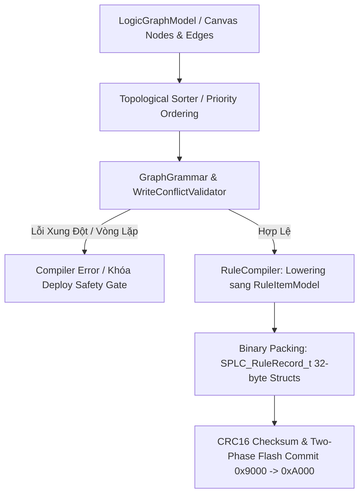

# Cẩm Nang Phát Triển Phần Mềm & Kiến Trúc SynaptiX IDE (Developer Guide)

**Mã tài liệu:** `SPLC-DOC-DEV-GUIDE-V1`  
**Đối tượng:** Lập trình viên C# / .NET 8 / WPF / Compiler / Runtime Engine  
**Tiêu chuẩn:** Clean Architecture &bull; SOLID &bull; Docs-as-Code &bull; IEC 61131-3 &bull; IEC 61508-3 SIL2/3  
**Tài liệu Master tham chiếu:** [`docs/platform/SimplePLC_App_MCU_Structs_v2.0_Self_Describing_Profile.md`](file:///g:/HoaNV/Projects/SimplePLC/docs/platform/SimplePLC_App_MCU_Structs_v2.0_Self_Describing_Profile.md)  

---

## 1. Kiến Trúc Phân Tầng Clean Architecture & Ranh Giới Bất Biến

Toàn bộ hệ thống mã nguồn C# được tổ chức theo **Clean Architecture (Onion Architecture)**. Chiều phụ thuộc bắt buộc **chỉ được phép hướng vào trong**:

```
┌────────────────────────────────────────────────────────────────────────┐
│                   SimplePLC.Studio (WPF Desktop IDE)                   │
├───────────────────────────────────┬────────────────────────────────────┤
│   SimplePLC.Infrastructure        │       SimplePLC.Protocol           │
│   (Serial Ports, Sockets, Sim)    │    (Bytecode, Frames, Codecs)      │
├───────────────────────────────────┴────────────────────────────────────┤
│                 SimplePLC.Application (Compilers, UseCases)             │
├────────────────────────────────────────────────────────────────────────┤
│                   SimplePLC.Domain (Core Invariants, Models)           │
└────────────────────────────────────────────────────────────────────────┘
```

### Các Quy tắc Ranh giới Bất biến (Strict Layer Invariants):
1. **`SimplePLC.Domain`:** Tầng lõi cốt lõi, **0 phụ thuộc bên ngoài** (chỉ dùng Base Class Library của C#).
   - Chứa định nghĩa kiểu dữ liệu IEC 61131-3 (`TagKind`, `TagDataType`), mô hình thiết bị phần cứng (`ProductDefinition`), hợp đồng dịch vụ trừu tượng.
   - **Tuyệt đối cấm:** Gọi `System.IO`, `System.Net`, `SerialPort`, `Dispatcher` hoặc bất kỳ API nào của hệ điều hành.
2. **`SimplePLC.Application`:** Tầng ứng dụng, chỉ tham chiếu `Domain`.
   - Chứa bộ giải ngữ pháp đồ thị (`GraphGrammarV1`), bộ phân tích xung đột biến (`WriteConflictValidator`), và trình biên dịch hạ cấp mã (`RuleCompiler`).
   - Mọi giao tiếp với phần cứng hay thời gian thực đều phải thông qua Interface (ví dụ `IClock`, `ISerialTransport`).
3. **`SimplePLC.Protocol`:** Tầng giao thức truyền thông nhị phân.
   - Chứa codec đóng/mở gói tin Modbus RTU/TCP, bộ tính CRC-16, và các struct ánh xạ trực tiếp sang firmware C (`simpleplc_protocol_v2_0.h`).
   - Hoạt động theo nguyên tắc **Zero-Allocation Hot Path**: Dùng `ReadOnlySpan<byte>` và `Span<byte>`, không cấp phát heap trong chu kỳ quét.
4. **`SimplePLC.Infrastructure`:** Tầng hạ tầng vật lý.
   - Chứa triển khai cổng COM thực tế, kết nối Socket, Client MQTT, và bộ mô phỏng tham chiếu vi điều khiển (`McuReferenceSimulator` / `McuEmulator`).
5. **`SimplePLC.Studio`:** Tầng hiển thị giao diện người dùng (WPF MVVM / .NET 8).
   - Quản lý Views, ViewModels, DataTemplate của Canvas đồ thị, và cơ chế bắt sự kiện giao diện.
   - Tuân thủ học thuyết thiết kế Microsoft Fluent 2 Desktop và ANSI/ISA-101.

### 1.1. Khế Ước Nhận Diện Thiết Bị & Khóa An Toàn Tương Thích (`DeviceClass` & `DeviceVariant`)

Để đảm bảo tính độc lập phần cứng và an toàn tuyệt đối khi triển khai hiện trường, hệ thống sử dụng cặp mã định danh nhị phân:
- **`device_class` (`uint16_t`, thanh ghi `0x0000`):** Nhóm chủng loại thiết bị (`REMOTE_IO = 1`, `DATALOGGER = 2`, `GATEWAY = 3`, `CONTROLLER = 4`, `DTU = 5`).
- **`device_variant` (`uint16_t`, thanh ghi `0x0001`):** Biến thể phần cứng/SKU chi tiết (ví dụ trong nhóm `REMOTE_IO`: `1 = 8DI_8DO_4AI`, `2 = 16DI_16DO`, `3 = 4DI_4DO`, `4 = 8DI_8DO Relay`).

**Cơ chế hoạt động trong mã nguồn C#:**
1. **Khám phá Tự động (Self-Describing Discovery):** Khi kết nối, `DeviceSessionCoordinator` đọc `DeviceDescriptorDto`. IDE tự động khớp với `HardwareDevicePreset.BuiltInPresets` để sinh ra đúng danh mục `TagCatalog` và số cổng RS-485 khả dụng.
2. **Xác thực Tương thích Trước khi Nạp (`StandardDeviceCompatibilityValidator`):** Trước khi nạp bytecode, validator đối chiếu profile dự án với `SupportedDeviceProfile.Matches(descriptor)`. Nếu người dùng lập trình trên biến thể 16 DI/DO nhưng lại nạp vào phần cứng 4 DI/DO (`DeviceVariant` không khớp), IDE lập tức khóa chốt `DeploySafetyGate` và báo lỗi `UnsupportedDeviceVariant`.
3. **Chân lý Thị giác (The Visual Truth):** ViewModel chuyển đổi `DeviceVariant` thành tên gọi thương mại trực quan (`DisplayName`) trên `DeviceInfoDialogView` và `NewProjectWizard`.

---

## 2. Chu Trình Biên Dịch Hạ Cấp Mã (Compilation Lowering Pipeline)

Trình biên dịch trong SynaptiX IDE chuyển đổi một sơ đồ khối chức năng FBD trực quan thành luồng bytecode 32-byte nhị phân để nạp xuống Flash MCU qua 5 bước tất định:



### Chi tiết 5 bước hạ cấp:
1. **Trích xuất Đồ thị (`LogicGraphModel`):** Duyệt tập hợp các khối `NodeModel` và các đường kết nối `ConnectionModel`.
2. **Sắp xếp Tô-pô (Topological Sort):** Xác định thứ tự thực thi hợp lý: Các khối đọc tín hiệu đầu vào (`INPUT`, `MB_READ`) và tính toán (`TON`, `SCALE`, `COMPARATOR`) luôn được định vị trước các khối chấp hành ngõ ra (`ACTION`, `MB_WRITE`, `DIRECT_WRITE`).
3. **Kiểm tra Ngữ pháp & Xung đột Ghi (`WriteConflictValidator`):**
   - Ngăn chặn tình trạng hai khối logic cùng ghi vào một biến đích (`DO` hoặc `VREG`) trong cùng một chu kỳ quét mà không qua cổng liên động (`GUARD`).
   - Phát hiện các vòng lặp hồi tiếp kín không có mắt xích trễ (Zero-delay cyclic loops).
4. **Hạ cấp thành Luật Chuẩn tắc (`RuleCompiler.Lowering`):**
   - Mỗi liên kết logic được hạ cấp thành một cấu trúc luật chuẩn 32-byte gồm: `TriggerTag` (Phát hiện sườn), `Condition` (Biểu thức quan hệ so sánh), `GuardTag` (Khóa liên động an toàn), và `ActionTag` (Lệnh thực thi đích: Set, Reset, Pulse, Direct Out).
5. **Đóng gói Nhị phân (Binary Serialization):** Nối các bản ghi Rule thành mảng byte với thứ tự Big-Endian, chuẩn bị nạp phân đoạn qua Modbus FC16 vào vùng nhớ Staging `0x9010`.

---

## 3. Hướng Dẫn 6 Bước Thêm Một Khối Hàm FBD Mới (From Scratch)

Khi cần phát triển thêm một khối hàm chức năng mới trong SynaptiX IDE (ví dụ: khối `PID_CONTROLLER` hoặc `BAND_PASS_FILTER`), lập trình viên thực hiện tuần tự 6 bước sau:

### Bước 1: Khai báo Định danh Node trong `SimplePLC.Application`
Mở [`src/SimplePLC.Application/Logic/Graph/LogicGraphModel.cs`](file:///g:/HoaNV/Projects/SimplePLC/src/SimplePLC.Application/Logic/Graph/LogicGraphModel.cs):
- Thêm giá trị mới vào enum `GraphNodeType` (ví dụ `PidController = 18`).
- Khai báo danh sách các chân ngõ vào (Inputs) và ngõ ra (Outputs) chuẩn của khối.

### Bước 2: Tạo ViewModel trong `SimplePLC.Studio`
Tạo file mới `SimplePLC.Studio/ViewModels/PidControllerNodeViewModel.cs`:
- Kế thừa từ `GraphNodeViewModel`.
- Khởi tạo danh sách `InputPins` và `OutputPins` với kiểu dữ liệu `TagKind` tương ứng (`BOOL`, `INT32`, `REAL`).
- Đặt thuộc tính cấu hình và xử lý lệnh mở hộp thoại tham số (nếu có).

### Bước 3: Định nghĩa Giao diện Visual DataTemplate trong XAML
Mở [`SimplePLC.Studio/Styles/NodeTemplates.xaml`](file:///g:/HoaNV/Projects/SimplePLC/SimplePLC.Studio/Styles/NodeTemplates.xaml):
- Tạo `<DataTemplate DataType="{x:Type vm:PidControllerNodeViewModel}">`.
- Sử dụng màu viền và tiêu đề theo token semantic `{DynamicResource ...}` trong `Colors.xaml` (CornerRadius="4", Padding chuẩn Fluent 2).
- Khai báo các điểm neo chân cắm (Pins) với `ConnectorItemControl`.

### Bước 4: Viết Quy tắc Hạ cấp trong `RuleCompiler`
Mở [`src/SimplePLC.Application/Logic/Compilation/RuleCompiler.cs`](file:///g:/HoaNV/Projects/SimplePLC/src/SimplePLC.Application/Logic/Compilation/RuleCompiler.cs):
- Thêm trường hợp xử lý trong phương thức `CompileNodeToLoweredRules(...)`.
- Chuyển đổi trạng thái chân cắm của khối thành các bản ghi `RuleItemModel` hoặc cấu hình thanh ghi phần cứng chuyên dụng.

### Bước 5: Cập nhật Nhân Mô phỏng Offline `RuntimeEngine`
Mở [`src/SimplePLC.Infrastructure/Simulator/McuReferenceSimulator.cs`](file:///g:/HoaNV/Projects/SimplePLC/src/SimplePLC.Infrastructure/Simulator/McuReferenceSimulator.cs):
- Cập nhật thuật toán tính toán của khối trong vòng lặp chu kỳ quét 10ms để kỹ sư có thể kiểm thử ngoại tuyến bằng phím `F5` mà không cần bo mạch thật.

### Bước 6: Viết Bộ Kiểm Thử Tự Động (IEC 61508-3 Triad Tests)
Tạo file unit test trong `SimplePLC.Studio.Tests/`:
- **Happy Path:** Khối tính toán đúng kết quả với dữ liệu chuẩn.
- **Boundary:** Khối xử lý an toàn khi tín hiệu đầu vào chạm ngưỡng cực trị (Min/Max).
- **Fault Injection:** Khối xử lý an toàn khi mất tín hiệu hoặc gặp biến rỗng (`NaN`, `Overflow`).

---

## 4. Động Cơ Phòng Vệ Dữ Liệu & First Principles (Bad-Data Defense)

### 4.1. Ba Tiên Đề Nền Tảng (Axiom 1, 2, 3)
Mọi dòng code xử lý dữ liệu nhập vào trong SynaptiX IDE bắt buộc phải thỏa mãn 3 tiên đề:
- **Axiom 1 (Hardware Ground Truth):** Thanh ghi số nguyên INT16/INT32 trong MCU là bù 2, về mặt vật lý **không bao giờ tồn tại số lẻ thập phân như `25.5`**. Nghiêm cấm để chuỗi số lẻ lọt vào tầng Domain đối với các biến kiểu số nguyên.
- **Axiom 2 (The Visual Truth):** Giao diện màn hình là hình ảnh phản chiếu trung thực 1:1 của bộ nhớ máy móc. Giao diện tuyệt đối không được nói dối người vận hành.
- **Axiom 3 (Input State Machine):** Quá trình nhập liệu gồm 2 pha riêng biệt:
  - *Pha A — Drafting State (Đang gõ):* Cho phép người dùng gõ tạm thời ký tự dở dang (`"-"`, `"10."`).
  - *Pha B — Committed State (LostFocus / Enter):* Buộc phải giải quyết dứt điểm: Tự động chuẩn hóa (Auto-Normalize) nếu hợp lệ, hoặc hoàn nguyên (Auto-Revert) về giá trị hợp lệ gần nhất nếu nhập sai.

### 4.2. Triển khai trong Code: `SmartInputParser` & `TextBoxBehaviors`
- [`SmartInputParser.TryParse(...)`](file:///g:/HoaNV/Projects/SimplePLC/SimplePLC.Studio/Services/SmartInputParser.cs): Phân tích cú pháp kiểu dữ liệu chặt chẽ.
  - INT32: `"100.0"` $\rightarrow$ chuẩn hóa thành `"100"`. Chuỗi `"25.5"` $\rightarrow$ trả về `false` (từ chối).
  - REAL: `"25"` $\rightarrow$ chuẩn hóa thành `"25.0"`.
  - BOOL: `"on"`, `"true"`, `"1"` $\rightarrow$ chuẩn hóa thành `"1"`.
- [`TextBoxBehaviors.cs`](file:///g:/HoaNV/Projects/SimplePLC/SimplePLC.Studio/Services/TextBoxBehaviors.cs): Lắng nghe sự kiện `LostFocus` và `KeyDown` (Enter/Escape) để kích hoạt FSM giải quyết chuỗi nhập liệu.

---

## 5. Cẩm Nang Kiểm Thử Cách Ly (Hermetic Testing Guidelines)

Để đảm bảo bộ kiểm thử chạy với tốc độ hàng nghìn test/giây và không bao giờ gặp lỗi ngẫu nhiên (flaky tests), dự án nghiêm cấm kết nối phần cứng thật trong unit test:

```csharp
[Fact]
public async Task Scan_WhenTimerReachesPreset_SetsOutputHigh()
{
    // 1. Arrange: Khởi tạo Fake Clock và Test Doubles (Zero Thread.Sleep!)
    var fakeTime = new Microsoft.Extensions.Time.Testing.FakeTimeProvider();
    var fakeModbus = new FakeModbusClient();
    var engine = new RuntimeEngine(fakeModbus, fakeTime);

    // 2. Act: Nhích đồng hồ ảo tiến 500ms
    fakeTime.Advance(TimeSpan.FromMilliseconds(500));
    await engine.ExecuteScanCycleAsync();

    // 3. Assert: Kiểm tra hợp đồng thực thi
    Assert.True(engine.GetTagValue(TagIndex.DO0));
}
```

### Các Test Doubles Chuẩn Trong Dự Án:
- **`FakeModbusClient`:** Thay thế kết nối COM RS-485, lưu trữ RAM buffer ảo.
- **`McuEmulator` / `McuReferenceSimulator`:** Thay thế bo mạch STM32 thật.
- **`FakeTimeProvider` / `SimulatedClock`:** Thay thế `DateTime.Now` và `Thread.Sleep`.
