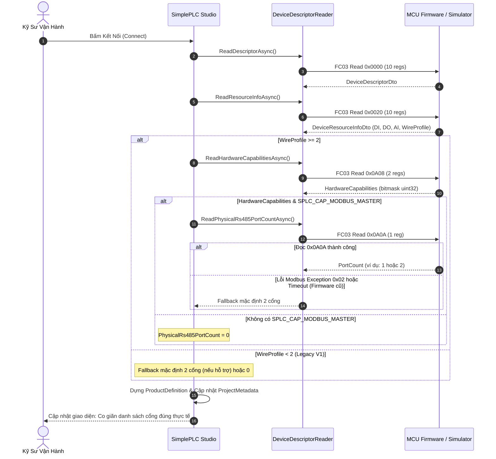

# SPLC-SPEC-HW-001: Hardware-Aware Dynamic RS-485 Port Auto-Synchronization

> **Phiên bản:** 1.0  
> **Trạng thái:** Chuẩn hóa kiến trúc (Approved)  
> **Tác giả:** Ban Kiến Trúc SimplePLC & SynaptiX Studio  
> **Tài liệu liên quan:** `docs/architecture/CURRENT_ARCHITECTURE.md`, `docs/architecture/ARCHITECTURE_LAYERS.md`, `simpleplc_protocol_v2_0.h`

---

## 1. Mục Đích & Nguyên Lý Thiết Kế

Trong các hệ thống tự động hóa công nghiệp (PLC/PAC), các dòng vi điều khiển hoặc bo mạch nhúng khác nhau có số lượng cổng giao tiếp RS-485 vật lý khác nhau tùy thuộc vào phần cứng (BOM) và thiết kế mạch:
- **Micro Form-Factor:** 1 cổng RS-485 (ví dụ: STM32F103/G0 với 1 chip thu phát MAX485/SN65HVD).
- **Standard Form-Factor:** 2 cổng RS-485 (ví dụ: STM32F4/ESP32 với 2 chip thu phát riêng biệt cho Channel 1 & Channel 2).
- **Gateway / High-Density Form-Factor:** 4 cổng RS-485 (modular hoặc expansion board).
- **Compute-Only / Remote I/O:** 0 cổng RS-485 (chỉ dùng USB CDC hoặc Modbus TCP qua Ethernet/Wi-Fi).

Nhằm tuân thủ nguyên lý **Zero-Silent-Failure** và **Hardware-Driven Discovery**, thiết bị SimplePLC MCU phải là **Nguồn Chân Lý Duy Nhất (Single Source of Truth)** về số lượng cổng RS-485 vật lý hiện hữu trên bo mạch, loại bỏ hoàn toàn việc phần mềm Host (Studio) suy đoán hoặc giả định cố định số cổng.

---

## 2. Đặc Tả Giao Thức & Bản Đồ Thanh Ghi Modbus (Register Map)

### 2.1. Thanh Ghi Khai Báo Số Lượng Cổng Vật Lý `0x0A0A`
Thanh ghi được đặt tại phân vùng System Handshake & Capabilities (`0x0A00..0x0A0F`), ngay sau 2 thanh ghi năng lực `HardwareCapabilities` (`0x0A08..0x0A09`):

```
+--------------------------------------------------------------------------+
| ĐỊA CHỈ: 0x0A0A | TÊN: SPLC_ADDR_HW_RS485_PORT_COUNT                     |
| LOẠI: 16-bit unsigned integer (uint16) | QUYỀN: Read-Only (Modbus FC03)  |
| ĐƠN VỊ: Số cổng (Ports)                | PHẠM VI HỢP LỆ: 0, 1, 2, 4       |
+--------------------------------------------------------------------------+
```

### 2.2. Ý Nghĩa Giá Trị
- **`0`**: Thiết bị không có chip thu phát RS-485 vật lý. Mọi cấu hình Polling Master qua cổng RS-485 sẽ bị từ chối.
- **`1`**: Thiết bị hỗ trợ duy nhất Cổng 1 (`PortIndex = 0`).
- **`2`**: Thiết bị hỗ trợ Cổng 1 & Cổng 2 (`PortIndex = 0, 1`). Đây là cấu hình mặc định chuẩn của SimplePLC.
- **`4`**: Thiết bị hỗ trợ Cổng 1 đến Cổng 4 (`PortIndex = 0, 1, 2, 3`).

### 2.3. Khai Báo C Header (`simpleplc_protocol_v2_0.h`)
```c
/* --- 2.5 System Commands, Capabilities & Hardware Discovery (0x0A00 - 0x0A24) --- */
#define SPLC_ADDR_SYSCOMMAND              0x0A00  /* 1 reg: SPLC_SystemCommand_t (FC06/FC16, WO) */
#define SPLC_LEN_SYSCOMMAND               1

#define SPLC_ADDR_SYSCOMMAND_RESULT       0x0A01  /* 2 regs: [0]=Status, [1]=ErrorCode (FC03, RO) */
#define SPLC_LEN_SYSCOMMAND_RESULT        2

#define SPLC_ADDR_HW_CAPABILITIES         0x0A08  /* 2 regs (4 B): SPLC_HardwareCapabilities_t (32-bit uint32, FC03, RO) */
#define SPLC_LEN_HW_CAPABILITIES          2

#define SPLC_ADDR_HW_RS485_PORT_COUNT     0x0A0A  /* 1 reg: Physical RS-485 port count (uint16, FC03, RO) */
#define SPLC_LEN_HW_RS485_PORT_COUNT      1
```

---

## 3. Trình Tự Bắt Tay (Handshake Sequence) & Cơ Chế Dự Phòng (Fallback)



---

## 4. Ràng Buộc An Toàn Kiến Trúc (Safety Gates)

### 4.1. Khóa An Toàn Trình Biên Dịch (Studio Compiler Gate)
Trong quá trình kiểm tra đồ thị FBD (`RuleCompiler`):
- Khi gặp khối `ModbusReadNodeViewModel` hoặc `ModbusWriteNodeViewModel`:
  - Nếu `node.PortIndex >= targetProduct.PhysicalRs485PortCount`:
    - Trình biên dịch tạo chẩn đoán mức lỗi nghiêm trọng:
      `DiagnosticSeverity.Error: Khối Modbus được gán cho Cổng {0}, vượt quá số cổng RS-485 vật lý hiện hữu ({1} cổng).`
    - Khóa nút nạp (Deploy Button Disabled), ngăn chặn việc sinh bytecode hoặc frame cấu hình không hợp lệ.

### 4.2. Khóa An Toàn Triển Khai (RuleTableWriter Gate)
Trước khi ghi dữ liệu Staging và thực hiện Atomic Commit:
- `RuleTableWriter` xác minh danh sách cấu hình cổng `modbusPortConfigs` và bảng trắc nghiệm `modbusMasterConfigs` / `modbusMasterWriteConfigs`.
- Nếu phát hiện cấu hình trỏ vào cổng không tồn tại trên MCU, quá trình nạp bị hủy ngay lập tức với mã lỗi:
  `SPLC_ErrorCode.UNSUPPORTED` kèm thông điệp chi tiết.

---

## 5. Tương Thích Ngược (Backwards Compatibility)

1. **Firmware Cũ (Legacy V1.x / V2.0 đời đầu):**  
   Khi MCU chưa có code phản hồi cho địa chỉ `0x0A0A`, lệnh đọc FC03 sẽ nhận phản hồi Exception `0x02` (Illegal Data Address). Hàm `ReadPhysicalRs485PortCountAsync` bắt ngoại lệ và trả về giá trị fallback an toàn (2 cổng nếu có năng lực Modbus Master, 0 cổng nếu không).
2. **Project Metadata Cũ (JSON):**  
   Thuộc tính `PhysicalRs485PortCount` trong `ProjectMetadata` có giá trị mặc định là `2`, đảm bảo việc deserialize các file project cũ hoàn toàn tương thích và không phát sinh lỗi.
