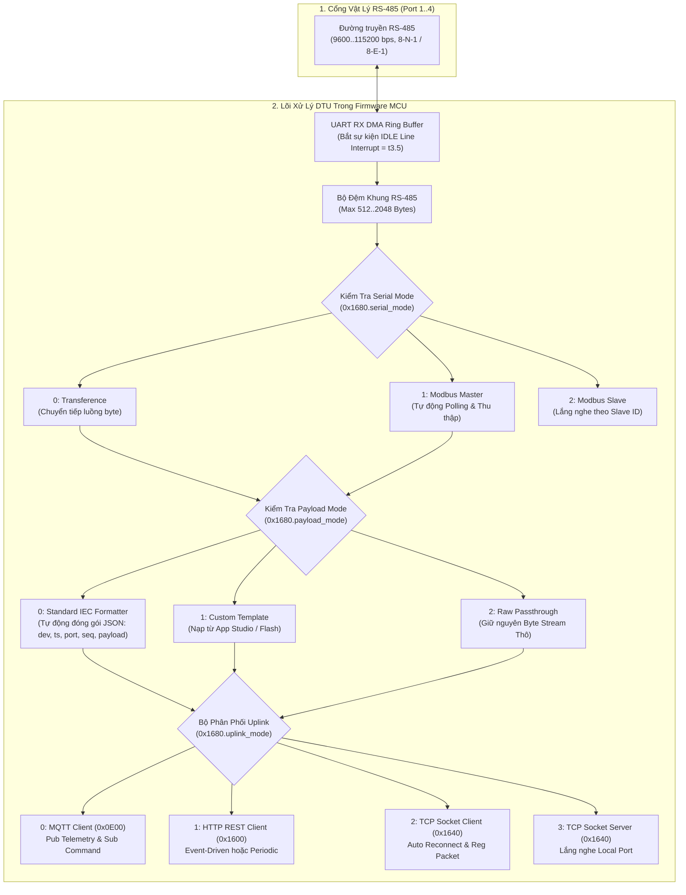
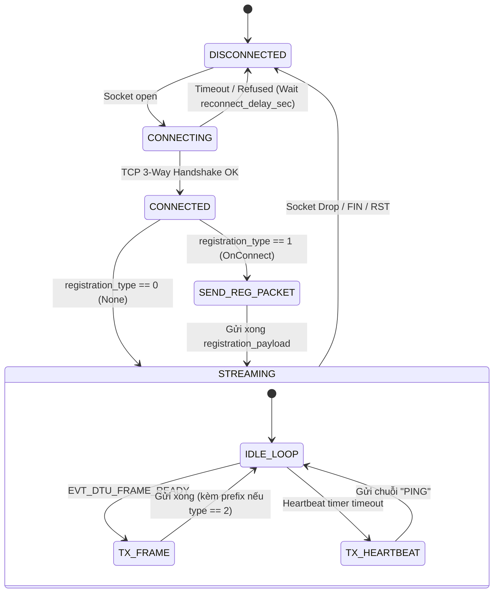

# TÀI LIỆU ĐẶC TẢ GIAO DIỆN PHẦN CỨNG & PHẦN SỤN (ICD)
## SPLC-SPEC-DTU-001: ĐẶC TẢ TRUYỀN THÔNG DTU GATEWAY, ĐỊNH TUYẾN DỮ LIỆU & BẢN ĐỒ THANH GHI CẤU HÌNH (0x1600 - 0x16BF)

**Mã tài liệu:** `SPLC-SPEC-DTU-001`  
**Phiên bản:** `v2.0.0` (Phân hệ DTU Gateway Đa Kênh, 3 Chế độ Định dạng Dữ liệu Standard/Custom/Raw, Ngắt khung UART DMA t3.5)  
**Ngày phát hành:** `2026-10-29`  
**Trạng thái:** `APPROVED / AUTHORITATIVE SPECIFICATION`  
**Phạm vi áp dụng:** Firmware vi điều khiển SynaptiX (STM32H5/G4/F4, ESP32-S3, RP2040, GD32), SynaptiX IDE Studio, Bo mạch Smart Controller & DTU Gateway (`SYNX-DTU-485`).

---

### 1. Tổng Quan Kiến Trúc (Architecture Overview)

**SynaptiX DTU Subsystem** là phân hệ định tuyến dữ liệu công nghiệp nhúng bên trong firmware vi điều khiển, đảm nhiệm vai trò cầu nối thông minh 2 chiều giữa mạng bus trường nối tiếp (**RS-485**) và mạng truyền thông thượng tầng (**MQTT, HTTP REST, TCP Socket Client/Server**).



---

### 1.1. Định Danh Thiết Bị & Hồ Sơ Tự Mô Tả DTU Trên MCU (0x0000..0x0009 & 0x0020..0x0029)

Khi thiết bị là **DTU Gateway chuyên dụng**, firmware MCU cần khai báo các thanh ghi định danh và tài nguyên tự mô tả để SynaptiX IDE nhận diện tự động và kích hoạt giao diện cấu hình DTU:

1. **Khối Định Danh Thiết Bị (`0x0000..0x0009`, `SPLC_DeviceDescriptor_t`, 10 regs = 20 Bytes):**
   - `device_class` (`+0`): **`5`** (`SPLC_DEV_CLASS_DTU`).
   - `device_variant` (`+1`): **`1`** (`SPLC_DTU_VARIANT_RS485_NET` - Gateway RS-485 to Network).
   - `protocol_version` (`+8`): **`2`** (Wire Protocol V2.0).
   - `rule_format_version` (`+9`): **`7`** (Rule Format V7).

2. **Hồ Sơ Tài Nguyên Tự Mô Tả (`0x0020..0x0029`, `SPLC_DeviceResourceInfo_t`, 10 regs = 20 Bytes):**
   - `wire_profile` (`+0`): **`2`** (Wire Profile V2).
   - `max_rules` (`+1`): **`50`** (Số rule phụ trợ tối đa).
   - `runtime_tag_count` (`+2`): **`100`** (Tổng số Tag hoạt động).
   - `di_count` (`+3`): **`0`** (DTU thuần không có DI vật lý).
   - `do_count` (`+4`): **`0`** (DTU thuần không có DO vật lý).
   - `ai_count` (`+5`): **`0`** (DTU thuần không có AI vật lý).
   - `vflag_count` (`+6`): **`32`** (VFLAG0..VFLAG31).
   - `vreg_count` (`+7`): **`32`** (VREG0..VREG31).
   - `vreg_retain_count` (`+8`): **`32`** (RETAIN0..RETAIN31 Flash).
   - `counter_count` (`+9`): **`4`** (COUNTER0..COUNTER3).

3. **Cờ Năng Lực Phần Cứng (`0x0A08..0x0A09`, `SPLC_HardwareCapabilities_t`, 2 regs = 4 Bytes):**
   - Bắt buộc bật các bit cờ năng lực:
     - `SPLC_CAP_TRANSPARENT_STREAM` (`0x2000`): Luồng truyền thông suốt byte-stream.
     - `SPLC_CAP_HTTP_CLIENT` (`0x1000`): HTTP REST Client.
     - `SPLC_CAP_MODBUS_MASTER` (`0x0100`): Thu thập Modbus Master qua RS-485.
     - `SPLC_CAP_MQTT_PUB` (`0x0010`): Xuất bản viễn trắc MQTT.
     - `SPLC_CAP_MQTT_SUB` (`0x0020`): Nhận lệnh điều khiển MQTT.
     - `SPLC_CAP_ETH` (`0x0008`) hoặc `SPLC_CAP_WIFI` (`0x0200`): Kết nối mạng vật lý.

4. **Số Cổng RS-485 Vật Lý Khả Dụng (`0x0A0A`, 1 reg = 2 Bytes):**
   - Trả về số cổng RS-485 thực tế trên bo mạch: `1`, `2`, hoặc `4`.

---

### 2. Quy Hoạch Vùng Nhớ Modbus Wire (Holding Registers 0x1600..0x16BF)

Toàn bộ thông số của phân hệ DTU được nạp xuống và quản lý qua 192 thanh ghi Holding Registers (mỗi thanh ghi 16-bit, tổng cộng 384 Bytes), tuân thủ nghiêm ngặt chuẩn **Big-Endian (Network Byte Order)**:

| Dải Địa Chỉ Wire | Số Lượng Regs | Kích Thước | Cấu Trúc Nhị Phân C | Chức Năng |
| :--- | :---: | :---: | :--- | :--- |
| **`0x1600 - 0x163F`** | 64 | 128 Bytes | `splc_dtu_http_config_t` | Cấu hình HTTP REST Client (URL, Method, Headers, Timeout, Trigger Mode) |
| **`0x1640 - 0x167F`** | 64 | 128 Bytes | `splc_dtu_tcp_config_t` | Cấu hình TCP Socket Client / Server, Heartbeat, Registration Packet |
| **`0x1680 - 0x16BF`** | 64 | 128 Bytes | `splc_dtu_routing_config_t` | Cấu hình Định tuyến Cổng, Serial Mode, Uplink Mode, Ngắt khung và Payload Mode |

---

### 3. Chi Tiết Cấu Trúc Nhị Phân C & Ánh Xạ Thanh Ghi

#### 3.1. Cấu hình HTTP REST Client (`0x1600 - 0x163F`, 128 Bytes)

```c
typedef struct __attribute__((packed)) {
    uint8_t  enabled;           /* +0x00: 0 = Tắt, 1 = Bật */
    uint8_t  method;            /* +0x01: 0 = POST, 1 = PUT */
    uint16_t timeout_sec;       /* +0x02..0x03: Thời gian chờ phản hồi HTTP (mặc định 10s) */
    uint16_t interval_sec;      /* +0x04..0x05: Chu kỳ gửi định kỳ (khi trigger_mode = 1) */
    uint8_t  trigger_mode;      /* +0x06: 0 = OnDataReceived (Sự kiện), 1 = Periodic (Chu kỳ) */
    uint8_t  reserved0;         /* +0x07: Đệm căn lề 16-bit */
    char     url[64];           /* +0x08..0x47: Endpoint URL dạng chuỗi kết thúc NULL */
    char     headers[56];       /* +0x48..0x7F: Custom Headers (VD: Authorization: Bearer ...) */
} splc_dtu_http_config_t;
```

#### 3.2. Cấu hình TCP Socket Client / Server (`0x1640 - 0x167F`, 128 Bytes)

```c
typedef struct __attribute__((packed)) {
    uint8_t  enabled;                 /* +0x00: 0 = Tắt, 1 = Bật */
    uint8_t  socket_mode;             /* +0x01: 0 = Client, 1 = Server */
    uint16_t remote_port;             /* +0x02..0x03: Cổng máy chủ từ xa (khi Mode = Client) */
    uint16_t local_port;              /* +0x04..0x05: Cổng lắng nghe cục bộ (khi Mode = Server) */
    uint16_t reconnect_delay_sec;     /* +0x06..0x07: Thời gian thử lại kết nối khi đứt socket (s) */
    uint16_t heartbeat_interval_sec;  /* +0x08..0x09: Chu kỳ gửi gói tin giữ phiên PING (s) */
    uint16_t registration_type;       /* +0x0A..0x0B: 0 = None, 1 = OnConnect, 2 = PrependToEveryPacket */
    uint16_t reserved[2];             /* +0x0C..0x0F: Đệm căn lề 16-bit (4 bytes) */
    char     remote_host[64];         /* +0x10..0x4F: IP hoặc Domain máy chủ từ xa (64 bytes ASCII) */
    char     heartbeat_payload[16];   /* +0x50..0x5F: Chuỗi ký tự Heartbeat (16 bytes ASCII, mặc định "PING") */
    char     registration_payload[32];/* +0x60..0x7F: Chuỗi định danh báo danh (32 bytes ASCII, VD: "ID:STATION_01") */
} splc_dtu_tcp_config_t;
```

#### 3.3. Cấu hình Định Tuyến & Ngắt Khung (`0x1680 - 0x16BF`, 128 Bytes)

```c
typedef struct __attribute__((packed)) {
    uint8_t  enabled;           /* +0x00: 0 = Tắt, 1 = Bật chế độ DTU */
    uint8_t  port_index;        /* +0x01: Cổng RS-485 áp dụng (0 = Port 1, 1 = Port 2...) */
    uint8_t  serial_mode;       /* +0x02: 0 = Transference, 1 = ModbusMaster, 2 = ModbusSlave */
    uint8_t  uplink_mode;       /* +0x03: 0 = MQTT, 1 = HTTP, 2 = TCP Client, 3 = TCP Server */
    uint16_t frame_timeout_ms;  /* +0x04..0x05: Delimiter Timeout (t3.5), mặc định 20ms */
    uint16_t max_packet_size;   /* +0x06..0x07: Kích thước tối đa bộ đệm gói tin (512..2048) */
    uint8_t  payload_mode;      /* +0x08: 0 = Standard IEC, 1 = Custom, 2 = Raw Passthrough */
    uint8_t  payload_flags;     /* +0x09: Mặt nạ cờ các trường JSON đính kèm trong Standard Mode */
    uint8_t  reserved[118];     /* +0x0A..0x7F: Dự phòng mở rộng tương lai */
} splc_dtu_routing_config_t;
```

##### Định nghĩa Mặt Nạ Cờ `payload_flags` (1 Byte - 8 Bits):
* **Bit 0 (`0x01`):** `INCLUDE_DEVICE_ID` — Kèm trường `"device_id": "..."`
* **Bit 1 (`0x02`):** `INCLUDE_TIMESTAMP` — Kèm trường `"timestamp": "YYYY-MM-DDTHH:mm:ssZ"`
* **Bit 2 (`0x04`):** `INCLUDE_PORT` — Kèm trường `"port": 1`
* **Bit 3 (`0x08`):** `INCLUDE_SEQUENCE` — Kèm trường `"seq": 1042` (bộ đếm tăng đơn điệu)
* **Bit 4 (`0x10`):** `INCLUDE_HEX_STREAM` — Kèm trường `"hex": "48454C4C4F..."`
* **Bit 5 (`0x20`):** `INCLUDE_PAYLOAD_LEN` — Kèm trường `"len": 18`
* **Bit 6..7:** Dự phòng (`0`).

---

### 4. Thuật Toán Xử Lý Chi Tiết Trong Firmware MCU

#### 4.1. Ngắt Khung UART IDLE Line DMA ($t_{3.5}$)
Để đảm bảo hiệu năng cao nhất và **Zero CPU Overhead** trên vi điều khiển:
1. Firmware cấu hình UART RX ở chế độ **Circular DMA**.
2. Kích hoạt ngắt phần cứng **UART IDLE Interrupt** (phát hiện khi đường truyền không có tín hiệu chuyển mức trong khoảng $1$ khung ký tự).
3. Khi ngắt IDLE kích hoạt, firmware khởi động Hardware Timer đếm lùi theo giá trị `frame_timeout_ms` (mặc định $20\text{ms}$).
4. Nếu sau thời gian này không có byte mới xuất hiện:
   - Đọc con trỏ DMA, ngắt khung và chuyển toàn bộ dữ liệu vào `g_dtu_rx_frame`.
   - Đặt cờ sự kiện `EVT_DTU_FRAME_READY`.

```c
/* Mã C tham khảo xử lý ngắt IDLE trên STM32 */
void USART_DTU_IRQHandler(void) {
    if (__HAL_UART_GET_FLAG(&huart_dtu, UART_FLAG_IDLE)) {
        __HAL_UART_CLEAR_IDLEFLAG(&huart_dtu);
        /* Kích hoạt timer đếm khoảng lặng t3.5 */
        splc_dtu_arm_delimiter_timer(g_dtu_routing.frame_timeout_ms);
    }
}
```

#### 4.2. Xử Lý 3 Chế Độ Định Dạng Dữ Liệu (Payload Mode Engine)

Khi cờ `EVT_DTU_FRAME_READY` bật:
* **Trường hợp A: `payload_mode == SPLC_DTU_PAYLOAD_RAW (2)`**
  - Giữ nguyên con trỏ mảng byte thô `g_dtu_rx_frame.data` và độ dài `g_dtu_rx_frame.len`.
  - Bỏ qua hoàn toàn việc tạo chuỗi JSON.
  - Chuyển thẳng xuống tầng Uplink tương ứng.
* **Trường hợp B: `payload_mode == SPLC_DTU_PAYLOAD_STANDARD (0)`**
  - Tự động đóng gói chuỗi JSON chuẩn IEC vào bộ đệm `g_dtu_tx_json` dựa trên các bit trong `payload_flags`:
    ```json
    {
      "device_id": "SYNX-DTU-01",
      "timestamp": "2026-10-29T09:15:00.000Z",
      "port": 1,
      "seq": 105,
      "payload": "<Chuỗi dữ liệu nhận được>",
      "status": "OK"
    }
    ```
  - Tự động tăng biến đếm toàn cục `g_dtu_packet_seq++`.
* **Trường hợp C: `payload_mode == SPLC_DTU_PAYLOAD_CUSTOM (1)`**
  - Sử dụng template do SynaptiX Studio biên dịch sẵn hoặc thay thế các macro cơ bản tại MCU.

#### 4.3. Máy Trạng Thái Kênh TCP Socket & Gói Tin Báo Danh (Registration Packet)



---

### 5. Tiêu Chuẩn Nghiệm Thu & Kiểm Thử Hợp Chuẩn (Conformance Testing)

Để một phiên bản firmware MCU được chứng nhận hợp chuẩn **SynaptiX DTU Certified**, bo mạch phải vượt qua các bài kiểm thử:
1. **Kiểm thử Ngắt Khung:** Độ trễ ngắt khung RS-485 phải đạt độ chính xác $\pm 2\text{ms}$ so với giá trị `frame_timeout_ms` đã cài đặt.
2. **Kiểm thử Gói Báo Danh:** Khi mở socket TCP tới Server, bản tin đầu tiên nhận được tại Server phải trùng khớp 100% với chuỗi `registration_payload`.
3. **Kiểm thử Raw Passthrough:** So sánh kiểm tra mã băm SHA-256 giữa luồng byte phát ra từ Master RS-485 và luồng byte nhận được tại SCADA TCP Server phải trùng khớp hoàn toàn (không mất byte, không thêm ký tự kết thúc lạ).
