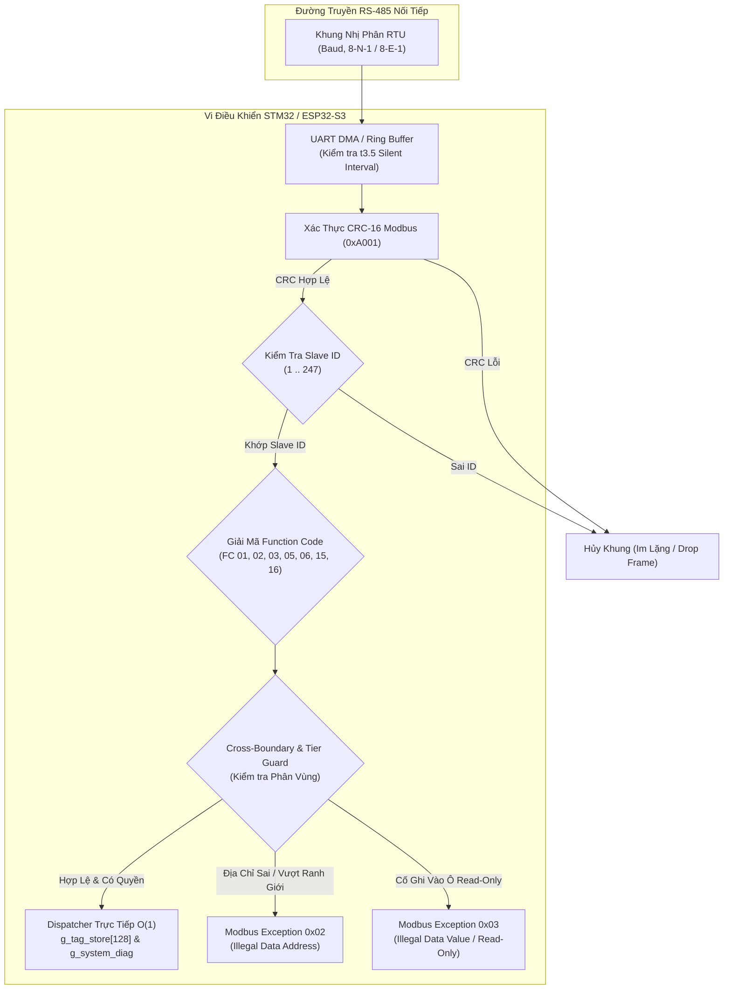

# TÀI LIỆU ĐẶC TẢ GIAO DIỆN PHẦN CỨNG & PHẦN SỤN (ICD)
## SPLC-SPEC-SLAVE-001: ĐẶC TẢ TRUYỀN THÔNG MODBUS RTU SLAVE & BẢN ĐỒ ĐỊA CHỈ BỘ NHỚ CỐ ĐỊNH (FIXED MEMORY MAP)

**Mã tài liệu:** `SPLC-SPEC-SLAVE-001`  
**Phiên bản:** `v2.12.0` (Chuẩn hóa Bản đồ Địa chỉ Cố định Factory-Fixed, Moxa-style Navigation, Zero 0x1500 Mapping Table)  
**Ngày phát hành:** `2026-10-29`  
**Trạng thái:** `APPROVED / AUTHORITATIVE SPECIFICATION`  
**Phạm vi áp dụng:** Firmware vi điều khiển SynaptiX (STM32H5/G4/F4, ESP32-S3, RP2040, GD32), SynaptiX IDE Studio, Bo mạch Smart Controller & IIoT Gateway.

---

### 1. Tổng Quan Kiến Trúc (Architecture Overview - 100% Zero Legacy)

Khi một cổng RS-485 vật lý được cấu hình sang chế độ **Modbus RTU Slave (Server)** (`PORT_ROLE = 1` tại offset `+14`), firmware vi điều khiển vận hành một luồng lắng nghe độc lập (Non-blocking UART Interrupt / DMA Listener), tiếp nhận các bản tin truy vấn từ hệ thống SCADA/HMI thượng tầng và phản hồi với hiệu năng cực cao:

1. **Truy xuất trực tiếp $O(1)$ vào RAM (Zero Legacy - Bỏ hẳn bảng 0x1500):**
   - **Tuyệt đối không duy trì bảng ánh xạ trung gian 0x1500:** Toàn bộ bảng 0x1500 bị loại bỏ hoàn toàn khỏi bộ nhớ MCU và quá trình Deploy của Studio. Không còn khái niệm nạp ánh xạ động.
   - Địa chỉ Modbus wire được giải mã trực tiếp thành con trỏ bộ nhớ RAM (`g_tag_store`) hoặc thanh ghi hệ thống (`g_system_diag`) chỉ trong vài chu kỳ lệnh CPU.
2. **Loại bỏ tham số vô hiệu của Slave (+5, +6, +7):**
   - Cổng Slave hoạt động theo cơ chế bị động (Passive Listener), phản hồi ngay sau khoảng lặng bus $t_{3.5}$.
   - Các trường `RESPONSE_TIMEOUT_MS` (+5), `INTER_FRAME_DELAY_MS` (+6), `RETRY_COUNT` (+7) hoàn toàn vô nghĩa đối với Slave. Firmware MCU bỏ qua (Don't care), và giao diện SynaptiX Studio tự động ẩn hoàn toàn các ô nhập liệu này khi cổng ở vai trò Slave.
3. **Chặn xung đột Master/Slave ngay từ khâu Biên dịch (Compile-time Error):**
   - Nếu dự án có bất kỳ khối `MB_READ` hoặc `MB_WRITE` nào trỏ vào một cổng đang cấu hình vai trò `Slave`, trình biên dịch SynaptiX Compiler lập tức báo lỗi đỏ (**Compile Error - HasErrors = true**), ngăn chặn hoàn toàn việc nạp xuống thiết bị. Không bao giờ phát sinh tình huống âm thầm vô hiệu khối Master.
2. **Hỗ trợ truy cập kép (Dual-Access Architecture):**
   - **Cấp Bit (Bit-Level Access):** Hỗ trợ FC 01, FC 05, FC 15 cho Coils (`00001..00016` cho DO, `00101..00132` cho VFLAG) và FC 02 cho Discrete Inputs (`10001..10016` cho DI).
   - **Cấp Word (Word-Level Access):** Hỗ trợ FC 03, FC 06, FC 16 cho Holding Registers (`40001..40256`).
3. **Cơ chế Bảo vệ Ranh giới Phân vùng (Boundary Protection):**
   - **Tier 1 (Restricted System Area):** Tuyệt đối cô lập SCADA với vùng nạp Rule (`0x9000`), lệnh chốt COMMIT (`0xA000`), và cấu hình Wi-Fi/MQTT. Yêu cầu ngoài bản đồ trả về **Modbus Exception 0x02 (Illegal Data Address)**.
   - **Tier 2 (Read-Only Sensors & Inputs):** Khóa cứng quyền chỉ đọc đối với `DI_WORD`, `AI0..AI3`, `SYS_DIAG`, và các chân ngõ vào vật lý `DI0..DI15`. Cố tình ghi sẽ bị từ chối và phản hồi **Modbus Exception 0x03 (Illegal Data Value / Access Denied)**.
   - **Tier 3 (Safe Read/Write Area):** Cho phép đọc/ghi an toàn vào `DO_WORD`, `VFLAG_DWORD`, `VREG`, `VREG_R`, `COUNTER` với cơ chế bảo vệ Atomic 32-bit tại ranh giới chu kỳ quét 10ms.
   - **Cross-Boundary Guard:** Nghiêm cấm frame đọc/ghi trải dài chéo qua 2 phân vùng chức năng khác nhau. Vi phạm trả về **Modbus Exception 0x02**.



---

### 2. Bản Đồ Địa Chỉ Bộ Nhớ Cố Định (Fixed Memory Map)

#### 2.1. Thanh Ghi Giữ (Holding Registers - 4xxxx) - Wire 0-based
| Offset Wire (Hex) | Địa chỉ Modbus (1-based) | Tag Thiết Bị | Kiểu Dữ Liệu | Quyền | Kích thước | Diễn Giải & Phân Bổ Byte |
|:---:|:---|:---|:---:|:---:|:---:|:---|
| `0x0000` | **40001** | `DI_WORD` | UINT16 | RO | 1 reg | Gom 16 ngõ vào số `DI0..DI15` dạng bitmask (Bit 0 = DI0, Bit 15 = DI15). |
| `0x0001` | **40002** | `DO_WORD` | UINT16 | RW | 1 reg | Gom 16 ngõ ra Relay `DO0..DO15` dạng bitmask. |
| `0x0002..0x0003` | **40003 .. 40004** | `VFLAG_DWORD` | UINT32 | RW | 2 regs | Gom 32 cờ logic `VFLAG0..VFLAG31` (Bitmask 32-bit, High Word trước). |
| `0x0010..0x0017` | **40017 .. 40024** | `AI0 .. AI3` | FLOAT32 | RO | 8 regs | 4 ngõ vào tương tự Float32 IEEE-754 (**High Word First**):<br>• `AI0`: 40017-40018 (`0x0010`)<br>• `AI1`: 40019-40020 (`0x0012`)<br>• `AI2`: 40021-40022 (`0x0014`)<br>• `AI3`: 40023-40024 (`0x0016`) |
| `0x0020..0x005F` | **40033 .. 40096** | `VREG0 .. VREG31` | INT32 / FLOAT32 | RW | 64 regs | 32 biến tính toán nội vi (2 thanh ghi/biến, High Word First).<br>Công thức: $\text{Wire} = 0\text{x}0020 + (\text{Index} \times 2)$. |
| `0x0060..0x009F` | **40097 .. 40160** | `VREG_R0 .. VREG_R31` | INT32 / FLOAT32 | RW | 64 regs | 32 biến lưu giữ Retentive Flash không mất khi mất điện.<br>Công thức: $\text{Wire} = 0\text{x}0060 + (\text{Index} \times 2)$. |
| `0x00A0..0x00AF` | **40161 .. 40176** | `COUNTER0 .. COUNTER7` | INT32 | RW | 16 regs | 8 bộ đếm sự kiện / xung tốc độ cao (2 thanh ghi/bộ).<br>Công thức: $\text{Wire} = 0\text{x}00A0 + (\text{Index} \times 2)$. |
| `0x00F0..0x00FF` | **40241 .. 40256** | `SYS_DIAG` | UINT16 | RO | 16 regs | Vùng chẩn đoán hệ thống:<br>• `0x00F0..0x00F1`: `uptime_s` (UINT32, giây)<br>• `0x00F2`: `scan_time_ms` (UINT16, ms)<br>• `0x00F3`: `status_flags` (UINT16, mã trạng thái)<br>• `0x00F5..0x00FA`: RTC (Năm, Tháng, Ngày, Giờ, Phút, Giây) |

#### 2.2. Vùng Truy Xuất Cấp Bit (Discrete Inputs & Coils) - Wire 0-based
| Offset Wire (Hex) | Địa chỉ Modbus (1-based) | Phân Loại | Tag Thiết Bị | Mã Hàm Hỗ Trợ | Quyền | Diễn Giải Kỹ Thuật |
|:---:|:---|:---:|:---|:---:|:---:|:---|
| `0x0000..0x000F` | **10001 .. 10016** | **Discrete Inputs** | `DI0 .. DI15` | **FC 02** | RO | Đọc trực tiếp trạng thái logic của 16 chân ngõ vào số vật lý. |
| `0x0000..0x000F` | **00001 .. 00016** | **Coils** | `DO0 .. DO15` | **FC 01, 05, 15** | RW | Đọc và đóng/ngắt trực tiếp 16 Relay ngõ ra vật lý. |
| `0x0064..0x0083` | **00101 .. 00132** | **Coils** | `VFLAG0 .. VFLAG31` | **FC 01, 05, 15** | RW | Đọc và ghi 32 cờ logic trung gian nội vi phục vụ điều khiển. |

---

### 3. Cấu Trúc Dữ Liệu Mã Nguồn C Mẫu Cho Kỹ Sư Firmware (`simpleplc_modbus_slave.h`)

```c
/**
 * @file simpleplc_modbus_slave.h
 * @brief Định nghĩa hằng số và bộ điều phối Modbus RTU Slave cố định (SPLC-SPEC-SLAVE-001).
 */

#ifndef SPLC_MODBUS_SLAVE_H
#define SPLC_MODBUS_SLAVE_H

#include <stdint.h>
#include <stdbool.h>

#ifdef __cplusplus
extern "C" {
#endif

/* 1. Hằng số Địa chỉ Wire Holding Registers */
#define SPLC_MB_SLAVE_ADDR_DI_WORD          0x0000
#define SPLC_MB_SLAVE_ADDR_DO_WORD          0x0001
#define SPLC_MB_SLAVE_ADDR_VFLAG_DWORD      0x0002
#define SPLC_MB_SLAVE_REGS_VFLAG_DWORD      2
#define SPLC_MB_SLAVE_ADDR_AI_BASE          0x0010
#define SPLC_MB_SLAVE_REGS_AI_TOTAL         8   /* 4 kênh x 2 thanh ghi */
#define SPLC_MB_SLAVE_ADDR_VREG_BASE        0x0020
#define SPLC_MB_SLAVE_REGS_VREG_TOTAL       64  /* 32 biến x 2 thanh ghi */
#define SPLC_MB_SLAVE_ADDR_VREG_R_BASE      0x0060
#define SPLC_MB_SLAVE_REGS_VREG_R_TOTAL     64  /* 32 biến x 2 thanh ghi */
#define SPLC_MB_SLAVE_ADDR_COUNTER_BASE     0x00A0
#define SPLC_MB_SLAVE_REGS_COUNTER_TOTAL    16  /* 8 bộ đếm x 2 thanh ghi */
#define SPLC_MB_SLAVE_ADDR_SYS_DIAG_BASE    0x00F0
#define SPLC_MB_SLAVE_REGS_SYS_DIAG_TOTAL   16

/* 2. Hằng số Địa chỉ Wire Coils & Discrete Inputs */
#define SPLC_MB_SLAVE_ADDR_BIT_DI_BASE      0x0000
#define SPLC_MB_SLAVE_COUNT_BIT_DI          16
#define SPLC_MB_SLAVE_ADDR_BIT_DO_BASE      0x0000
#define SPLC_MB_SLAVE_COUNT_BIT_DO          16
#define SPLC_MB_SLAVE_ADDR_BIT_VFLAG_BASE   0x0064  /* 100 thập phân */
#define SPLC_MB_SLAVE_COUNT_BIT_VFLAG       32

/* 3. Mã Ngoại Lệ Modbus Chuẩn (Modbus Exception Codes) */
#define SPLC_MB_EXC_ILLEGAL_FUNCTION        0x01
#define SPLC_MB_EXC_ILLEGAL_DATA_ADDRESS    0x02
#define SPLC_MB_EXC_ILLEGAL_DATA_VALUE      0x03
#define SPLC_MB_EXC_SLAVE_DEVICE_FAILURE    0x04

/* 4. Khai báo hàm Dispatcher xử lý khung tin */
uint16_t SPLC_ModbusSlave_ReadHoldingRegister(uint16_t wire_addr, uint8_t *exc_code);
bool     SPLC_ModbusSlave_WriteHoldingRegister(uint16_t wire_addr, uint16_t value, uint8_t *exc_code);

bool     SPLC_ModbusSlave_ReadDiscreteInput(uint16_t bit_addr, uint8_t *exc_code);
bool     SPLC_ModbusSlave_ReadCoil(uint16_t bit_addr, uint8_t *exc_code);
bool     SPLC_ModbusSlave_WriteCoil(uint16_t bit_addr, bool bit_val, uint8_t *exc_code);

#ifdef __cplusplus
}
#endif

#endif /* SPLC_MODBUS_SLAVE_H */
```

#### Mã nguồn Triển khai Dispatcher C Cấp thấp:

```c
#include "simpleplc_modbus_slave.h"

extern uint32_t g_tag_store[128]; // Tag Store nội vi 32-bit của vi điều khiển
extern uint32_t g_uptime_s;
extern uint16_t g_scan_time_ms;
extern uint16_t g_sys_status;

uint16_t SPLC_ModbusSlave_ReadHoldingRegister(uint16_t wire_addr, uint8_t *exc_code)
{
    *exc_code = 0;

    /* Truy xuất dựa trên cấu trúc Dynamic Tag Layout (Mục 4 MCU Conformance Spec) */
    // 0x0000: DI_WORD (Chân không có phần cứng vật lý trả về 0)
    if (wire_addr == SPLC_MB_SLAVE_ADDR_DI_WORD) {
        uint16_t di_word = 0;
        for (int i = 0; i < 16; i++) {
            if (i < g_layout.di_count && g_tag_store[g_layout.di_base + i] != 0) {
                di_word |= (1 << i);
            }
        }
        return di_word;
    }

    // 0x0001: DO_WORD (Chân không có phần cứng vật lý trả về 0)
    if (wire_addr == SPLC_MB_SLAVE_ADDR_DO_WORD) {
        uint16_t do_word = 0;
        for (int i = 0; i < 16; i++) {
            if (i < g_layout.do_count && g_tag_store[g_layout.do_base + i] != 0) {
                do_word |= (1 << i);
            }
        }
        return do_word;
    }

    // 0x0002..0x0003: VFLAG_DWORD (High Word First)
    if (wire_addr == 0x0002) {
        uint32_t vflags = 0;
        for (int i = 0; i < 32; i++) {
            if (i < g_layout.vflag_count && g_tag_store[g_layout.vflag_base + i] != 0) {
                vflags |= (1UL << i);
            }
        }
        return (uint16_t)(vflags >> 16); // High Word
    }
    if (wire_addr == 0x0003) {
        uint32_t vflags = 0;
        for (int i = 0; i < 32; i++) {
            if (i < g_layout.vflag_count && g_tag_store[g_layout.vflag_base + i] != 0) {
                vflags |= (1UL << i);
            }
        }
        return (uint16_t)(vflags & 0xFFFF); // Low Word
    }

    // 0x0010..0x0017: AI0..AI3 Float32 IEEE-754 (High Word First, kênh vượt phần cứng trả về 0)
    if (wire_addr >= SPLC_MB_SLAVE_ADDR_AI_BASE && wire_addr < SPLC_MB_SLAVE_ADDR_AI_BASE + SPLC_MB_SLAVE_REGS_AI_TOTAL) {
        int offset = wire_addr - SPLC_MB_SLAVE_ADDR_AI_BASE;
        int ch = offset / 2;
        int reg = offset % 2;
        if (ch >= g_layout.ai_count) return 0;
        uint32_t raw_float = g_tag_store[g_layout.ai_base + ch];
        return (reg == 0) ? (uint16_t)(raw_float >> 16) : (uint16_t)(raw_float & 0xFFFF);
    }

    // 0x0020..0x005F: VREG0..VREG31 (Biến vượt tài nguyên trả về 0)
    if (wire_addr >= SPLC_MB_SLAVE_ADDR_VREG_BASE && wire_addr < SPLC_MB_SLAVE_ADDR_VREG_BASE + SPLC_MB_SLAVE_REGS_VREG_TOTAL) {
        int offset = wire_addr - SPLC_MB_SLAVE_ADDR_VREG_BASE;
        int idx = offset / 2;
        int reg = offset % 2;
        if (idx >= g_layout.vreg_count) return 0;
        uint32_t val = g_tag_store[g_layout.vreg_base + idx];
        return (reg == 0) ? (uint16_t)(val >> 16) : (uint16_t)(val & 0xFFFF);
    }

    // 0x00F0..0x00FF: SYS_DIAG
    if (wire_addr == 0x00F0) return (uint16_t)(g_uptime_s >> 16);
    if (wire_addr == 0x00F1) return (uint16_t)(g_uptime_s & 0xFFFF);
    if (wire_addr == 0x00F2) return g_scan_time_ms;
    if (wire_addr == 0x00F3) return g_sys_status;

    // Ngoài bản đồ -> Modbus Exception 0x02
    *exc_code = SPLC_MB_EXC_ILLEGAL_DATA_ADDRESS;
    return 0;
}

bool SPLC_ModbusSlave_WriteHoldingRegister(uint16_t wire_addr, uint16_t value, uint8_t *exc_code)
{
    *exc_code = 0;

    // Vùng Cấm Ghi Tier 2 (DI_WORD, AI, SYS_DIAG) -> Modbus Exception 0x03
    if (wire_addr == SPLC_MB_SLAVE_ADDR_DI_WORD ||
        (wire_addr >= SPLC_MB_SLAVE_ADDR_AI_BASE && wire_addr < SPLC_MB_SLAVE_ADDR_AI_BASE + SPLC_MB_SLAVE_REGS_AI_TOTAL) ||
        (wire_addr >= SPLC_MB_SLAVE_ADDR_SYS_DIAG_BASE && wire_addr < SPLC_MB_SLAVE_ADDR_SYS_DIAG_BASE + SPLC_MB_SLAVE_REGS_SYS_DIAG_TOTAL)) {
        *exc_code = SPLC_MB_EXC_ILLEGAL_DATA_VALUE; // Quyền Read-Only bị từ chối
        return false;
    }

    // Ghi DO_WORD (0x0001) - Chỉ ghi vào các kênh phần cứng thực tế có
    if (wire_addr == SPLC_MB_SLAVE_ADDR_DO_WORD) {
        for (int i = 0; i < 16; i++) {
            if (i < g_layout.do_count) {
                g_tag_store[g_layout.do_base + i] = (value & (1 << i)) ? 1 : 0;
            }
        }
        return true;
    }

    // Ghi VREG0..VREG31 (0x0020..0x005F) - FC 06 cập nhật nửa thanh ghi 16-bit tương ứng
    // Khuyến nghị SCADA dùng FC 16 (2 thanh ghi) để cập nhật nguyên tử 32-bit
    if (wire_addr >= SPLC_MB_SLAVE_ADDR_VREG_BASE && wire_addr < SPLC_MB_SLAVE_ADDR_VREG_BASE + SPLC_MB_SLAVE_REGS_VREG_TOTAL) {
        int offset = wire_addr - SPLC_MB_SLAVE_ADDR_VREG_BASE;
        int idx = offset / 2;
        int reg = offset % 2;
        if (idx >= g_layout.vreg_count) {
            *exc_code = SPLC_MB_EXC_ILLEGAL_DATA_ADDRESS;
            return false;
        }
        if (reg == 0) {
            g_tag_store[g_layout.vreg_base + idx] = ((uint32_t)value << 16) | (g_tag_store[g_layout.vreg_base + idx] & 0x0000FFFF);
        } else {
            g_tag_store[g_layout.vreg_base + idx] = (g_tag_store[g_layout.vreg_base + idx] & 0xFFFF0000) | (uint32_t)value;
        }
        return true;
    }

    // Địa chỉ ngoài bản đồ -> Modbus Exception 0x02
    *exc_code = SPLC_MB_EXC_ILLEGAL_DATA_ADDRESS;
    return false;
}
```

---

### 4. Định Thời Bus RTU ($t_{3.5}$ Silent Interval)

Để tuân thủ hoàn toàn đặc tả kỹ thuật Modbus RTU của Modbus-IDA:
- Giữa 2 khung tin truyền nhận trên bus RS-485, đường truyền phải ở trạng thái nghỉ (Silent Interval) ít nhất **$3.5$ ký tự thời gian ($t_{3.5}$)**.
- Khi Baud Rate $\le 19200$ bps:
  $$t_{3.5} = \frac{3.5 \times 11 \text{ bits}}{\text{Baud Rate}} \quad (\text{Ví dụ ở 9600 bps: } t_{3.5} \approx 4.01\text{ ms})$$
- Khi Baud Rate $> 19200$ bps:
  Theo quy chuẩn Modbus-IDA, $t_{3.5}$ cố định là **$1.75\text{ ms}$** và khoảng cách giữa các ký tự trong một frame $t_{1.5} = 0.75\text{ ms}$.
- **Firmware MCU tự động sử dụng Hardware Timer để phát hiện ranh giới frame thông qua ngắt UART Idle Line Detection / Receiver Timeout (RTO)** mà không phụ thuộc vào tham số cài đặt thủ công từ người dùng trên giao diện máy tính.

---

### 5. Tiêu Chuẩn Nghiệm Thu Conformance Cho Firmware (Checklist)

- [ ] **CHKL-SLAVE-01 (Station ID Filter):** Firmware chỉ phản hồi khi khung RTU có `SlaveId == ConfiguredSlaveId` (hoặc Broadcast `0x00` đối với lệnh ghi). Khung sai ID phải bị bỏ qua trong im lặng (Silent drop).
- [ ] **CHKL-SLAVE-02 (CRC-16 Validation):** Khung bị sai mã CRC-16 phải bị drop ngay lập tức, không phản hồi Exception để tránh nhiễu bus.
- [ ] **CHKL-SLAVE-03 (Direct RAM O(1)):** Đọc/ghi các địa chỉ trong bản đồ hoàn tất trong $< 100\,\mu\text{s}$, không tạo độ trễ cho chu kỳ quét 10ms của bộ điều khiển.
- [ ] **CHKL-SLAVE-04 (Boundary Protection 0x02):** Request đọc/ghi vượt ranh giới (ví dụ: request 2 thanh ghi từ `0x0001` sang `0x0002`) phản hồi đúng **Exception Code 0x02**.
- [ ] **CHKL-SLAVE-05 (Read-Only Protection 0x03):** Lệnh FC05/06/15/16 vào các phân vùng chỉ đọc (`DI_WORD`, `AI`, `SYS_DIAG`, `DI0..DI15`) phản hồi đúng **Exception Code 0x03**.
