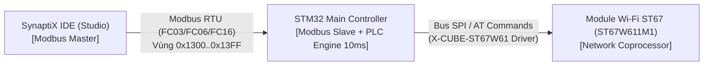

# ĐẶC TẢ GIAO DIỆN TRUYỀN THÔNG (ICD): PHÂN HỆ WI-FI ST67 (ST67W611M1)
**Mã tài liệu:** `SPLC-SPEC-WIFI-004-ICD`  
**Phiên bản:** `2.0`  
**Tiêu chuẩn áp dụng:** SynaptiX Industrial Automation Platform V2.0 / Modbus Application Protocol V1.1b3  
**Phần cứng mục tiêu:** STM32 Main Controller kết hợp Module Wi-Fi 6 ST67 (STMicroelectronics ST67W / ST67W611M1)  
**Phạm vi bộ nhớ:** `0x1300 .. 0x13FF` (256 Holding Registers = 512 Bytes)

---

## 1. TỔNG QUAN & NGUYÊN LÝ KIẾN TRÚC

### 1.1. Bối cảnh & Mục đích
Tài liệu này định nghĩa chi tiết Hợp đồng Giao tiếp Nhị phân (Wire Contract) giữa Máy tính điều khiển Host (**SynaptiX IDE Studio**) và Vi điều khiển trung tâm (**Main MCU - STM32**) kết hợp với Module truyền thông không dây **ST67W611M1 (ST67)**.

Module ST67 hoạt động theo mô hình **Network Coprocessor (NCP)** với gói mở rộng `X-CUBE-ST67W61` hoặc tập lệnh AT (firmware T01). STM32 giao tiếp với ST67 qua bus SPI tốc độ cao (hoặc UART) và đóng vai trò Modbus RTU Slave đối với Host qua giao diện USB CDC / RS-485.



### 1.2. Các Nguyên Tắc Bất Biến (Architectural Invariants)
1. **Tính Không Nghẽn Thời Gian Thực (Non-Blocking PLC Scan Invariant):**
   - Quá trình quét mạng Wi-Fi (Scan) và bắt tay WPA2/WPA3 của ST67 mất từ 1.5 đến 3 giây.
   - Trên STM32, toàn bộ tương tác với ST67 **bắt buộc** phải được thực thi trong một FreeRTOS Worker Task nền riêng biệt (`wifi_mgmt_task`).
   - Task PLC Logic quét 10ms và Task Modbus RTU tuyệt đối không được gọi hàm blocking chờ ST67. Các lệnh từ Host chỉ đổi cờ trong RAM; Task Modbus phản hồi ngay lập tức với thời gian trễ $< 10$ms.
2. **Khai Báo Năng Lực Phần Cứng (Hardware Capabilities):**
   - MCU có tích hợp ST67 bật bit `SPLC_CAP_WIFI = 0x0200` (Bit 9) trong thanh ghi `0x0A08`. Host đọc thanh ghi này khi kết nối để tự động kích hoạt tính năng cấu hình Wi-Fi trên IDE.
3. **Lưu Trữ Bền Vững (Power-Loss Persistence):**
   - Sau khi kết nối thành công, STM32 lưu cấu hình SSID và Password vào bộ nhớ Flash/NVS nội bộ. Khi khởi động lại hoặc mất nguồn đột ngột, STM32 tự động kết nối lại mạng (`Auto-Reconnect`) mà không cần Host can thiệp.

---

## 2. BẢN ĐỒ BỘ NHỚ THANH GHI MODBUS (MEMORY MAP: 0x1300 - 0x13FF)

Toàn bộ phân hệ Wi-Fi được gói gọn trong **256 Holding Registers (512 Bytes)**:

| Vùng Holding Registers | Tên phân vùng | Chiều | Mã hàm | Kích thước | Mô tả kỹ thuật |
| :--- | :--- | :---: | :---: | :---: | :--- |
| **`0x1300 .. 0x133F`** | **Wi-Fi Config & Live Status** | R/W | FC03 / FC16 | 64 regs (128 B) | Cấu hình mạng (SSID, Password, DHCP/Static IP) và phản hồi Live Status (Status, RSSI, IP, MAC). |
| **`0x1340 .. 0x134F`** | **Wi-Fi Command & Scan Control** | R/W | FC03 / FC06 / FC16 | 16 regs (32 B) | Bắt tay lệnh: START_SCAN (`0x0001`), CONNECT (`0x0002`), DISCONNECT (`0x0003`), FORGET (`0x0004`), phản hồi tiến độ Scan và số lượng AP. |
| **`0x1350 .. 0x13FF`** | **Wi-Fi Scan Results Buffer** | R | FC03 | 176 regs (352 B) | Danh sách tối đa **8 Access Points** quét được từ ST67 (mỗi AP chiếm 22 registers = 44 bytes). |

---

## 3. ĐẶC TẢ CHI TIẾT CẤU TRÚC THANH GHI

### 3.1. Phân vùng Cấu hình & Giám sát (`0x1300 .. 0x133F`, 64 thanh ghi = 128 Bytes)
Cấu trúc nhị phân C tương ứng: `SPLC_WifiConfig_t`.

| Offset | Địa chỉ Modbus | Tên trường | Kiểu dữ liệu | Chiều | Mô tả chi tiết |
| :---: | :---: | :--- | :---: | :---: | :--- |
| **+0** | `0x1300` | `control_flags` | `uint16_t` | R/W | **Bitmask điều khiển:**<br>• Bit 0: `Enable` (1 = Bật Wi-Fi, 0 = Tắt Wi-Fi)<br>• Bit 1..2: `Mode` (0 = Station/STA, 1 = SoftAP, 2 = STA+AP)<br>• Bit 3: `DHCP Enable` (1 = Tự động nhận IP qua DHCP, 0 = Dùng Static IP bên dưới)<br>• Bit 4: `Auto-Reconnect` (1 = Tự động kết nối lại khi mất sóng) |
| **+1..+16**| `0x1301..0x1310`| `ssid[32]` | `char[32]` | R/W | Tên mạng Wi-Fi (Tối đa 31 ký tự ASCII + null-terminator `0x00`, 2 ký tự/thanh ghi, Big-Endian). |
| **+17..+48**| `0x1311..0x1330`| `password[64]`| `char[64]` | R/W | Mật khẩu Wi-Fi WPA2/WPA3 (Tối đa 63 ký tự ASCII + null-terminator `0x00`). |
| **+49..+50**| `0x1331..0x1332`| `static_ip` | `uint32_t` | R/W | Địa chỉ IP tĩnh khi tắt DHCP (2 regs, Big-Endian: vd `192.168.1.100` = `0xC0A80164`). |
| **+51..+52**| `0x1333..0x1334`| `static_subnet`| `uint32_t` | R/W | Subnet Mask (vd `255.255.255.0` = `0xFFFFFF00`). |
| **+53..+54**| `0x1335..0x1336`| `static_gateway`|`uint32_t` | R/W | Default Gateway (vd `192.168.1.1` = `0xC0A80101`). |
| **+55..+56**| `0x1337..0x1338`| `static_dns` | `uint32_t` | R/W | Primary DNS Server (vd `8.8.8.8` = `0x08080808`). |
| **+57** | `0x1339` | `conn_status` | `uint16_t` | RO | **Trạng thái kết nối thực tế từ ST67:**<br>• `0`: `DISCONNECTED` (Chưa kết nối / Tắt mạng)<br>• `1`: `CONNECTING` (Đang bắt tay kết nối)<br>• `2`: `CONNECTED` (Đã liên kết tầng sóng Wi-Fi)<br>• `3`: `GOT_IP` (Đã nhận IP thành công - Sẵn sàng truyền thông)<br>• `4`: `AUTH_FAILED` (Sai mật khẩu Wi-Fi)<br>• `5`: `SSID_NOT_FOUND` (Không tìm thấy Access Point)<br>• `6`: `AP_MODE_ACTIVE` (Đang phát SoftAP) |
| **+58** | `0x133A` | `rssi_dbm` | `int16_t` | RO | Cường độ sóng Wi-Fi thực tế tính theo dBm (số nguyên có dấu, ví dụ `-55` dBm). Trả về `-100` nếu mất kết nối. |
| **+59..+60**| `0x133B..0x133C`| `current_ip` | `uint32_t` | RO | Địa chỉ IPv4 thực tế MCU đang hoạt động (do DHCP cấp hoặc gán tĩnh, Big-Endian). |
| **+61..+63**| `0x133D..0x133F`| `mac_addr[6]` | `uint8_t[6]`| RO | Địa chỉ MAC vật lý của chip ST67 (3 thanh ghi = 6 bytes, ví dụ `00:80:E1:xx:xx:xx`). |

---

### 3.2. Phân vùng Bắt tay Lệnh & Điều khiển Quét sóng (`0x1340 .. 0x134F`, 16 thanh ghi = 32 Bytes)
Cấu trúc nhị phân C tương ứng: `SPLC_WifiScanControl_t`.

| Offset | Địa chỉ Modbus | Tên trường | Kiểu dữ liệu | Chiều | Mô tả chi tiết |
| :---: | :---: | :--- | :---: | :---: | :--- |
| **+0** | `0x1340` | `command` | `uint16_t` | R/W | **Thanh ghi phát lệnh:**<br>• `0x0000`: `IDLE` (Nghỉ)<br>• `0x0001`: `START_SCAN` (Yêu cầu quét danh sách Wi-Fi lân cận)<br>• `0x0002`: `CONNECT` (Yêu cầu kết nối với SSID/Password tại `0x1300`)<br>• `0x0003`: `DISCONNECT` (Yêu cầu ngắt kết nối mạng hiện tại)<br>• `0x0004`: `FORGET` (Xóa cấu hình Wi-Fi trong Flash/NVS)<br>*(MCU sau khi tiếp nhận lệnh sẽ tự động trả về `0x0000`)*. |
| **+1** | `0x1341` | `scan_state` | `uint16_t` | RO | **Tiến độ quét sóng của ST67:**<br>• `0`: `IDLE` (Chưa quét / Sẵn sàng)<br>• `1`: `SCANNING` (Đang tiến hành dò sóng)<br>• `2`: `COMPLETED` (Quét hoàn tất, kết quả có tại `0x1350`)<br>• `3`: `FAILED` (Quét thất bại hoặc timeout) |
| **+2** | `0x1342` | `ap_found_count`| `uint16_t`| RO | Số lượng mạng Wi-Fi hợp lệ tìm thấy (tối đa 8 mạng: `0 .. 8`). |
| **+3** | `0x1343` | `error_code` | `uint16_t` | RO | Mã lỗi chi tiết: `0` = None, `1` = Busy, `2` = Timeout, `3` = Driver Error, `4` = HW Not Ready. |
| **+4..+15**| `0x1344..0x134F`| `reserved[24]` | `uint8_t[24]`| RO | Dự phòng (luôn trả về 0). |

---

### 3.3. Phân vùng Danh sách Mạng Quét được (`0x1350 .. 0x13FF`, 176 thanh ghi = 352 Bytes)
Chứa tối đa **8 bản ghi** mạng Wi-Fi lân cận (`SPLC_WifiApInfo_t`). Mỗi bản ghi chiếm đúng **22 thanh ghi (44 bytes)**:

$$ \text{Địa chỉ cơ sở bản ghi } i = 0x1350 + (i \times 22) \quad (i = 0 .. 7) $$

| Offset trong bản ghi | Tên trường | Kiểu dữ liệu | Kích thước | Mô tả kỹ thuật |
| :---: | :--- | :---: | :---: | :--- |
| **+0 .. +15** | `ssid[32]` | `char[32]` | 16 regs (32 B) | Tên mạng Wi-Fi (ASCII null-terminated). |
| **+16** | `rssi_dbm` | `int16_t` | 1 reg (2 B) | Cường độ tín hiệu phát hiện được (vd `-45` dBm = rất mạnh, `-85` dBm = yếu). |
| **+17 (Byte cao)** | `auth_mode` | `uint8_t` | 0.5 reg (1 B) | **Chuẩn bảo mật:**<br>• `0`: Open (Không mật khẩu)<br>• `1`: WEP<br>• `2`: WPA_PSK<br>• `3`: WPA2_PSK (Chuẩn công nghiệp phổ biến)<br>• `4`: WPA_WPA2_MIXED<br>• `5`: WPA2_ENTERPRISE<br>• `6`: WPA3_PSK (Bảo mật cao Wi-Fi 6) |
| **+17 (Byte thấp)**| `channel` | `uint8_t` | 0.5 reg (1 B) | Kênh phát sóng vô tuyến (`1 .. 14`). |
| **+18 .. +20** | `bssid[6]` | `uint8_t[6]` | 3 regs (6 B) | Địa chỉ MAC vật lý của trạm phát AP/Router. |
| **+21** | `reserved` | `uint16_t` | 1 reg (2 B) | Padding căn chỉnh byte-exact 44 bytes. |

---

## 4. BẢNG ÁNH XẠ LỆNH VÀ THƯ VIỆN ST67 (API & AT MAPPING)

Dưới đây là bảng tra cứu chính xác dành cho kỹ sư Firmware để ánh xạ thanh ghi Modbus sang API của bộ phần mềm `X-CUBE-ST67W61` hoặc tập lệnh AT của ST67:

| Tính năng | Thanh ghi Modbus tác động | Thao tác trên STM32 (X-CUBE-ST67W61 API) | Tương đương AT Commands (firmware T01) |
| :--- | :--- | :--- | :--- |
| **Khởi tạo Wi-Fi** | Đọc `0x1300` khi boot | `ST67_Wifi_Init()`, cấu hình mode STA (`WIFI_MODE_STA`) | `AT+CWMODE=1` |
| **Yêu cầu Quét mạng** | Ghi `0x0001` vào `0x1340` | Gọi `ST67_Wifi_ScanAsync()` (kích hoạt quét ngầm). Set `scan_state = 1`. | Gửi lệnh: `AT+CWLAP` |
| **Phản hồi Quét mạng** | Đọc `0x1341` và `0x1350` | Hàm callback/ngắt nhận danh sách AP: Parse SSID, RSSI, AuthMode, copy tối đa 8 AP vào RAM `0x1350`. Set `scan_state = 2`, `ap_found_count = N`. | Bóc tách từng dòng `+CWLAP:(<auth>,<ssid>,<rssi>,<mac>,<channel>)` từ UART/SPI response. |
| **Yêu cầu Kết nối** | Ghi `0x0002` vào `0x1340` | Đọc `ssid`, `password` từ `0x1302..0x1331`. Gọi `ST67_Wifi_ConnectAsync(ssid, password)`. Set `conn_status = 1 (CONNECTING)`. | Gửi lệnh: `AT+CWJAP="SSID_NAME","PASSWORD"` |
| **Xử lý Khi Có IP** | Cập nhật `0x133A`, `0x133C` | Netif callback: Khi có IP từ DHCP hoặc gán tĩnh, gán `current_ip`, set `conn_status = 3 (GOT_IP)`. Ghi cấu hình vào Flash. | Nhận URC: `WIFI CONNECTED` & `WIFI GOT IP`. Kiểm tra lại bằng `AT+CIPSTA?`. |
| **Cập nhật Live RSSI** | Cập nhật `0x133B` | Định kỳ mỗi 2000ms: Gọi `ST67_Wifi_GetRssi(&rssi)` ghi vào `0x133B`. | Gửi lệnh: `AT+CWJAP?` hoặc `AT+CSQ`. |
| **Yêu cầu Ngắt kết nối**| Ghi `0x0003` vào `0x1340` | Gọi `ST67_Wifi_Disconnect()`. Set `conn_status = 0 (DISCONNECTED)`. | Gửi lệnh: `AT+CWQAP`. |
| **Xóa cấu hình** | Ghi `0x0004` vào `0x1340` | Xóa sector chứa SSID/Password trong NVS/Flash, ngắt kết nối. | Xóa NVS record và gửi `AT+CWQAP`. |

---

## 5. HƯỚNG DẪN TRIỂN KHAI PHÍA FIRMWARE (C IMPLEMENTATION GUIDELINES)

### 5.1. Mô hình Phân tách Đa nhiệm FreeRTOS
Để không bao giờ vi phạm chu kỳ quét thời gian thực 10ms của PLC logic:

```c
/* ========================================================================= */
/* st67_wifi_manager.c - Triển khai luồng điều khiển ST67 không nghẽn        */
/* ========================================================================= */
#include "simpleplc_protocol_v2_0.h"
#include "FreeRTOS.h"
#include "task.h"
#include "queue.h"

/* Bộ nhớ chia sẻ RAM Holding Registers */
extern SPLC_WifiConfig_t      g_wifi_config;
extern SPLC_WifiScanControl_t g_wifi_control;
extern SPLC_WifiApInfo_t      g_wifi_scan_table[SPLC_WIFI_MAX_SCAN_APS];

typedef enum {
    WIFI_EVT_START_SCAN = 1,
    WIFI_EVT_CONNECT    = 2,
    WIFI_EVT_DISCONNECT = 3
} wifi_worker_event_t;

static QueueHandle_t s_wifi_queue = NULL;

/* 1. Hàm Modbus Callback khi Host ghi vào thanh ghi 0x1340 */
void splc_wifi_on_command_write(uint16_t cmd) {
    if (s_wifi_queue == NULL) return;
    wifi_worker_event_t evt = (wifi_worker_event_t)cmd;
    xQueueSendFromISR(s_wifi_queue, &evt, NULL);
    g_wifi_control.command = SPLC_WIFI_CMD_IDLE; /* Reset lệnh về Idle ngay */
}

/* 2. Worker Task xử lý giao tiếp ST67 (Priority: Normal, KHÔNG chạy ở Realtime) */
void st67_wifi_worker_task(void *pvParameters) {
    s_wifi_queue = xQueueCreate(4, sizeof(wifi_worker_event_t));
    wifi_worker_event_t evt;

    /* Khởi tạo phần cứng ST67 */
    st67_hardware_init();

    /* Tự động kết nối lại nếu có cấu hình lưu trong Flash */
    if (nvs_load_wifi_credentials(g_wifi_config.ssid, g_wifi_config.password)) {
        g_wifi_config.conn_status = SPLC_WIFI_CONN_CONNECTING;
        st67_connect(g_wifi_config.ssid, g_wifi_config.password);
    }

    TickType_t last_rssi_tick = xTaskGetTickCount();

    for (;;) {
        /* Chờ sự kiện lệnh từ Host trong tối đa 1000ms */
        if (xQueueReceive(s_wifi_queue, &evt, pdMS_TO_TICKS(1000)) == pdPASS) {
            switch (evt) {
                case WIFI_EVT_START_SCAN:
                    g_wifi_control.scan_state = SPLC_WIFI_SCAN_STATE_SCANNING;
                    g_wifi_control.ap_found_count = 0;
                    
                    /* Thực hiện quét qua ST67 */
                    uint16_t count = 0;
                    if (st67_perform_scan(g_wifi_scan_table, SPLC_WIFI_MAX_SCAN_APS, &count)) {
                        g_wifi_control.ap_found_count = count;
                        g_wifi_control.scan_state = SPLC_WIFI_SCAN_STATE_COMPLETED;
                    } else {
                        g_wifi_control.scan_state = SPLC_WIFI_SCAN_STATE_FAILED;
                        g_wifi_control.error_code = 2; /* Timeout */
                    }
                    break;

                case WIFI_EVT_CONNECT:
                    g_wifi_config.conn_status = SPLC_WIFI_CONN_CONNECTING;
                    if (st67_connect(g_wifi_config.ssid, g_wifi_config.password)) {
                        g_wifi_config.conn_status = SPLC_WIFI_CONN_GOT_IP;
                        g_wifi_config.current_ip = st67_get_assigned_ip();
                        nvs_save_wifi_credentials(g_wifi_config.ssid, g_wifi_config.password);
                    } else {
                        g_wifi_config.conn_status = SPLC_WIFI_CONN_AUTH_FAILED;
                    }
                    break;

                case WIFI_EVT_DISCONNECT:
                    st67_disconnect();
                    g_wifi_config.conn_status = SPLC_WIFI_CONN_DISCONNECTED;
                    break;
            }
        }

        /* Định kỳ mỗi 2 giây: Cập nhật cường độ sóng RSSI */
        if ((xTaskGetTickCount() - last_rssi_tick) > pdMS_TO_TICKS(2000)) {
            last_rssi_tick = xTaskGetTickCount();
            if (g_wifi_config.conn_status == SPLC_WIFI_CONN_GOT_IP) {
                g_wifi_config.rssi_dbm = st67_get_rssi_dbm();
            } else {
                g_wifi_config.rssi_dbm = -100;
            }
        }
    }
}
```

---

## 6. TIÊU CHÍ NGHIỆM THU TƯƠNG THÍCH (CONFORMANCE ACCEPTANCE CRITERIA)

| Mã tiêu chí | Hạng mục kiểm tra | Tiêu chuẩn đạt |
| :--- | :--- | :--- |
| **CHKL-WIFI-01** | Khai báo năng lực `0x0A08` | Đọc FC03 tại `0x0A08` trả về `0x0200` (`SPLC_CAP_WIFI` bật). |
| **CHKL-WIFI-02** | Byte-Exact Memory Alignment | Kích thước nhị phân đúng tuyệt đối: Config 128B (64 regs), Control 32B (16 regs), ScanTable 352B (176 regs). |
| **CHKL-WIFI-03** | Khởi động Quét mạng Non-blocking | Ghi `0x0001` vào `0x1340`: MCU phản hồi Modbus trong $< 10$ms, `scan_state` chuyển sang `1`. |
| **CHKL-WIFI-04** | Trả kết quả Quét mạng | Khi quét xong, `scan_state` chuyển sang `2`, `ap_found_count` phản ánh đúng số AP (tối đa 8). Đọc vùng `0x1350` có tên mạng, RSSI và Auth Mode chính xác. |
| **CHKL-WIFI-05** | Kết nối mạng & Cấp phát IP | Ghi SSID/Pass vào `0x1300`, ghi `0x0002` vào `0x1340`: MCU kết nối thành công, `conn_status` đạt `3 (GOT_IP)`, IP hiển thị chuẩn xác tại `0x133C`. |
| **CHKL-WIFI-06** | Báo lỗi Sai Mật khẩu | Nạp sai mật khẩu: `conn_status` chuyển thành `4 (AUTH_FAILED)` trong vòng 5000ms. |
| **CHKL-WIFI-07** | Không vi phạm chu kỳ PLC | Trong toàn bộ quá trình Scan và Connect Wi-Fi, thời gian chu kỳ quét scan pass của PLC (`0x0806`) luôn duy trì ổn định $\le 10$ms. |
| **CHKL-WIFI-08** | Khôi phục sau mất nguồn | Tắt nguồn MCU và bật lại: MCU tự động kết nối lại Wi-Fi và đạt `GOT_IP` mà không cần Host cấu hình lại. |
