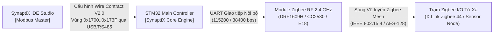
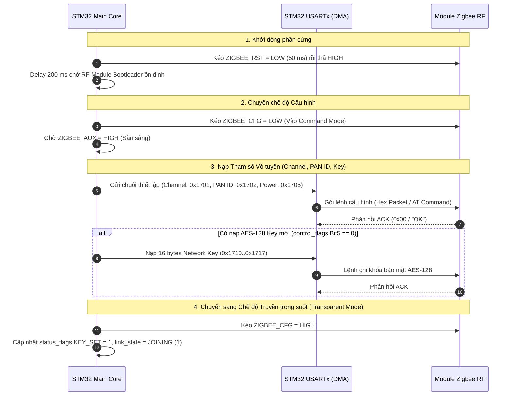

# ĐẶC TẢ GIAO DIỆN TRUYỀN THÔNG (ICD): PHÂN HỆ ZIGBEE WIRELESS MODBUS
**Mã tài liệu:** `SPLC-SPEC-ZIGBEE-006-ICD`  
**Phiên bản:** `2.0.0` (Bản chuẩn chính thức - Authoritative Standard)  
**Tiêu chuẩn áp dụng:** SynaptiX Industrial Automation Platform V2.0 / IEEE 802.15.4 / IEC 62443-4-2 / IEC 61131-3  
**Phần cứng mục tiêu:** STM32 Main Controller kết hợp Module Zigbee RF (DRF1609H / CC2530 / E18) — Thiết bị tiêu biểu: **X.Link Zigbee 44**, **SX-DTU-485**  
**Phạm vi bộ nhớ:** `0x1700 .. 0x173F` (64 Holding Registers = 128 Bytes)

---

## 1. TỔNG QUAN & NGUYÊN TẮC KIẾN TRÚC

### 1.1. Bối cảnh & Phạm vi
Tài liệu này định nghĩa chi tiết Hợp đồng Giao tiếp Nhị phân (Wire Contract V2.0) giữa Máy tính điều khiển Host (**SynaptiX IDE Studio**) và Vi điều khiển trung tâm (**Main MCU - STM32**) kết hợp với Module truyền thông không dây Zigbee.

Module Zigbee hoạt động như một bus truyền thông **Modbus over Zigbee (Wireless Transport)** ở chế độ trong suốt (Transparent Mode), thay thế cho cáp nối tiếp RS-485 truyền thống.



### 1.2. Các Nguyên Tắc Kiến Trúc Bất Biến (Architectural Invariants)
1. **Phân Định Bản Chất Giao Diện (Visual Truth Invariant - Axiom 2):**
   - Zigbee là một **Loại giao tiếp không dây riêng (`Interface Type: Wireless Modbus Transport`)**, tuyệt đối không đồng nhất thành "Cổng RS-485 số 5" trên giao diện người dùng. Thiết bị X.Link 44 chỉ có 1 cổng RS-485 vật lý và 1 anten sóng.
   - Trong các khối logic FBD (`MB_READ` / `MB_WRITE`), cổng Zigbee được mã hóa với giá trị thô: **`PortIndex = 4`** (0-based: `0..3` cho RS-485 Port 1..4, `4` cho Zigbee Wireless).
2. **Khai Báo Năng Lực Phần Cứng (Hardware Capabilities):**
   - MCU có tích hợp module Zigbee phải bật cờ **`SPLC_CAP_ZIGBEE = 0x8000`** (Bit 15) trong thanh ghi `0x0A08`.
   - SynaptiX Studio đọc thanh ghi này để tự động hiển thị tab cấu hình Zigbee và tùy chọn `Zigbee (Wireless)` trong các khối logic. Thiết bị không có cờ này sẽ ẩn hoàn toàn.
3. **Bảo Vệ Phân Vùng Nhạy Cảm (Sandbox Security):**
   - Phân hệ Zigbee chỉ đóng vai trò Slave dữ liệu I/O qua bản đồ cố định `SLAVE-001` (DI, DO, VFLAG, VREG, COUNTER).
   - **Tuyệt đối KHÔNG mở quyền nạp Rule Table (`0x0000..0xA001`) qua sóng không dây** để phòng ngừa tấn công chiếm quyền điều khiển nhà máy.
4. **Bảo Mật Khóa Mạng AES-128 (Write-Only Key Protection):**
   - Khóa mạng 16 byte (`0x1710..0x1717`) là **Write-Only (Chỉ ghi)**, đọc lại qua Modbus luôn trả về `0x00` để chống trích xuất khóa qua sóng RF.
   - Hỗ trợ cờ điều khiển `PRESERVE_KEY` (Bit 5 tại `+0`) khi Deploy logic mà không đổi key và cờ trạng thái `KEY_SET` (Bit 0 tại `+36`) báo trạng thái đã lưu key trong Flash.

---

## 2. BẢN ĐỒ BỘ NHỚ THANH GHI MODBUS (0x1700 .. 0x173F)

Toàn bộ cấu hình và viễn trắc của phân hệ Zigbee được gói gọn trong **64 Holding Registers (128 Bytes)**:

| Vùng Holding Registers | Tên phân vùng | Chiều | Mã hàm | Kích thước | Mô tả kỹ thuật |
| :--- | :--- | :---: | :---: | :---: | :--- |
| **`0x1700 .. 0x170F`** | **RF Parameters & Modbus Setup** | R/W | FC03 / FC16 | 16 regs (32 B) | Cấu hình cờ điều khiển, kênh sóng, PAN ID, địa chỉ mạng, ăng-ten, và Slave ID. |
| **`0x1710 .. 0x1717`** | **AES-128 Network Security Key** | **WO** | FC16 | 8 regs (16 B) | 16 byte khóa bí mật AES-128 (Write-Only, đọc luôn trả `0x00`). |
| **`0x1718 .. 0x171F`** | **Device Node Name (ASCII)** | R/W | FC03 / FC16 | 8 regs (16 B) | Tên gợi nhớ của nút (tối đa 15 ký tự ASCII + null-terminator). |
| **`0x1720 .. 0x1723`** | **Reserved Config** | R/W | FC03 / FC16 | 4 regs (8 B) | Dự phòng mở rộng tham số cấu hình. |
| **`0x1724 .. 0x173F`** | **Live Telemetry & Diagnostics** | **RO** | FC03 | 28 regs (56 B) | Viễn trắc thời gian thực: Link State, RSSI, LQI, bộ đếm gói TX/RX, mã lỗi. |

---

## 3. ĐẶC TẢ CHI TIẾT CẤU TRÚC THANH GHI

Cấu trúc nhị phân C tương ứng: `SPLC_ZigbeeConfigRecord_t` (chuẩn hóa 128 bytes, đóng gói `packed`).

| Offset | Địa chỉ Modbus | Tên trường | Kiểu dữ liệu | Quyền | Mô tả chi tiết kỹ thuật |
| :---: | :---: | :--- | :---: | :---: | :--- |
| **+0** | `0x1700` | `control_flags` | `uint16_t` | R/W | **Bitmask điều khiển phân hệ:**<br>• Bit 0: `ENABLE` (1 = Bật Zigbee, 0 = Tắt)<br>• Bit 1: `ROLE` (0 = Master/Coordinator, 1 = Slave/Router)<br>• Bit 2: `FRAMING` (0 = RTU nhị phân, 1 = ASCII — hiện chỉ nhận 0)<br>• Bit 3: `SECURITY_ENABLE` (1 = Bật mã hóa AES-128 CCM*)<br>• Bit 4: `ANTENNA` (0 = On-board PCB, 1 = External SMA)<br>• Bit 5: `PRESERVE_KEY` (1 = Giữ nguyên key cũ trong Flash khi commit)<br>• Bit 6..15: Bắt buộc ghi 0 |
| **+1** | `0x1701` | `channel` | `uint16_t` | R/W | Kênh tần số RF (11 .. 26, tương ứng 2405 .. 2480 MHz). Khuyến nghị: 15, 20, 25, 26 (tránh trùng kênh Wi-Fi 1, 6, 11). |
| **+2** | `0x1702` | `pan_id` | `uint16_t` | R/W | Mã định danh mạng vô tuyến (0x0001 .. 0xFFFE). |
| **+3** | `0x1703` | `local_addr` | `uint16_t` | R/W | Địa chỉ ngắn nội bộ trong mạng Zigbee (0x0000 .. 0xFFFD). Thường Coordinator là `0x0000`. |
| **+4** | `0x1704` | `dest_addr` | `uint16_t` | R/W | Địa chỉ đích khi phát (0x0000 Coordinator, 0xFFFF Broadcast). |
| **+5** | `0x1705` | `power_level` | `uint16_t` | R/W | Mức công suất phát RF (0 = Min, 4 = Max +20 dBm). |
| **+6** | `0x1706` | `baud_rate_idx` | `uint16_t` | R/W | Tốc độ UART nội bộ MCU-RF (0=9600, 1=19200, 2=38400, 3=57600, 4=115200). |
| **+7** | `0x1707` | `parity` | `uint16_t` | R/W | Chẵn lẻ UART (0 = None, 1 = Even, 2 = Odd). |
| **+8** | `0x1708` | `data_bits` | `uint16_t` | R/W | Số bit dữ liệu (Cố định 8). |
| **+9** | `0x1709` | `stop_bits` | `uint16_t` | R/W | Số bit dừng (1 hoặc 2). |
| **+10** | `0x170A` | `response_timeout_ms`| `uint16_t` | R/W | Thời gian chờ phản hồi khung Modbus qua sóng (Khuyến nghị: 1500 .. 2000 ms cho mạng Mesh). |
| **+11** | `0x170B` | `inter_frame_delay_ms`| `uint16_t` | R/W | Khoảng cách trễ giữa hai khung truyền (Khuyến nghị: 150 .. 200 ms). |
| **+12** | `0x170C` | `retry_count` | `uint16_t` | R/W | Số lần thử lại khi mất gói vô tuyến (0 .. 5 lần). |
| **+13** | `0x170D` | `slave_id` | `uint16_t` | R/W | **Địa chỉ trạm Modbus (1 .. 247).**<br>🚨 **CẤM:** ID `236 (0xEC)` và `237 (0xED)` vì trùng byte lệnh cấu hình nội bộ của module RF. |
| **+14..+15**| `0x170E..0x170F`| `reserved1[2]` | `uint16_t[2]`| R/W | Dự phòng căn lề cấu hình (ghi 0). |
| **+16..+23**| `0x1710..0x1717`| `network_key[16]`| `uint8_t[16]`| **WO** | 16 byte khóa bí mật AES-128. Đọc qua Modbus luôn trả về 0x00. |
| **+24..+31**| `0x1718..0x171F`| `network_name[16]`| `char[16]` | R/W | Tên thân thiện của nút (tối đa 15 ký tự ASCII + null). |
| **+32..+35**| `0x1720..0x1723`| `reserved2[4]` | `uint16_t[4]`| R/W | Dự phòng mở rộng (ghi 0). |
| **+36** | `0x1724` | `status_flags` | `uint16_t` | **RO** | **Cờ trạng thái viễn trắc:**<br>• Bit 0: `KEY_SET` (1 = Đã có khóa AES hợp lệ trong Flash, 0 = Chưa có khóa). |
| **+37** | `0x1725` | `link_state` | `uint16_t` | **RO** | Trạng thái mạng: `0 = DISCONNECTED`, `1 = JOINING`, `2 = LINK_UP (Hoạt động)`, `3 = ERROR`. |
| **+38** | `0x1726` | `rssi_dbm` | `int16_t` | **RO** | Cường độ tín hiệu nhận được tính bằng dBm có dấu (ví dụ: `-64`). |
| **+39** | `0x1727` | `lqi` | `uint16_t` | **RO** | Chỉ số chất lượng đường truyền (0 .. 255). |
| **+40** | `0x1728` | `tx_packets` | `uint16_t` | **RO** | Bộ đếm gói tin đã truyền thành công. |
| **+41** | `0x1729` | `rx_packets` | `uint16_t` | **RO** | Bộ đếm gói tin đã nhận thành công. |
| **+42** | `0x172A` | `tx_errors` | `uint16_t` | **RO** | Bộ đếm lỗi phát gói tin. |
| **+43** | `0x172B` | `rx_errors` | `uint16_t` | **RO** | Bộ đếm lỗi nhận gói (CRC / Timeout). |
| **+44** | `0x172C` | `error_code` | `uint16_t` | **RO** | Mã lỗi phần cứng chuẩn hóa (`0 = NONE`, `1 = TIMEOUT`, `2 = INVALID_RF_PARAM`, `3 = RESTRICTED_ID`, `4 = JOIN_FAILED`, `5 = KEY_REJECTED`, `6 = HW_FAULT`). |
| **+45..+63**| `0x172D..0x173F`| `reserved3[19]`| `uint16_t[19]`| **RO** | Dự phòng viễn trắc tương lai. |

---

## 4. ĐẶC TẢ C/C++ HEADER CHO EMBEDDED FIRMWARE

Định nghĩa struct chuẩn C99/C11 khớp 1:1 trong [`simpleplc_protocol_v2_0.h`](file:///g:/HoaNV/Projects/SimplePLC/src/SimplePLC.Protocol/Firmware/simpleplc_protocol_v2_0.h):

```c
#pragma pack(push, 1)

typedef struct SPLC_PACKED {
    uint16_t control_flags;         /* +0: Bit 0=En, 1=Role(0=M,1=S), 2=Framing(0=RTU), 3=SecEn, 4=Ant(0=PCB,1=Ext), 5=PreserveKey */
    uint16_t channel;               /* +1: RF Channel (11..26) */
    uint16_t pan_id;                /* +2: PAN ID (0x0001..0xFFFE) */
    uint16_t local_addr;            /* +3: Local Short Address (0x0000..0xFFFD) */
    uint16_t dest_addr;             /* +4: Destination Short Address (0x0000..0xFFFF) */
    uint16_t power_level;           /* +5: Transmit Power Level (0..4) */
    uint16_t baud_rate_idx;         /* +6: Module UART Baud Index (0..4) */
    uint16_t parity;                /* +7: Parity (0=None, 1=Even, 2=Odd) */
    uint16_t data_bits;             /* +8: Data Bits (8) */
    uint16_t stop_bits;             /* +9: Stop Bits (1..2) */
    uint16_t response_timeout_ms;   /* +10: Response Timeout ms (50..5000) */
    uint16_t inter_frame_delay_ms;  /* +11: Inter-frame Delay ms (10..500) */
    uint16_t retry_count;           /* +12: Retries (0..5) */
    uint16_t slave_id;              /* +13: Modbus Slave ID (1..247, cấm 236/237) */
    uint16_t reserved1[2];          /* +14..15: Reserved (4 bytes) */
    uint8_t  network_key[16];       /* +16..23: AES-128 Encryption Key (Write-Only, reads 0) */
    char     network_name[16];      /* +24..31: Network Name ASCII (16 bytes) */
    uint16_t reserved2[4];          /* +32..35: Reserved (8 bytes) */
    
    /* Telemetry & Diagnostics Section (Read-Only) */
    uint16_t status_flags;          /* +36: Bit 0 = KEY_SET */
    uint16_t link_state;            /* +37: 0=Disconnected, 1=Joining, 2=Up, 3=Error */
    int16_t  rssi_dbm;              /* +38: Last packet RSSI in dBm */
    uint16_t lqi;                   /* +39: Link Quality Indicator (0..255) */
    uint16_t tx_packets;            /* +40: TX Packet Counter */
    uint16_t rx_packets;            /* +41: RX Packet Counter */
    uint16_t tx_errors;             /* +42: TX Error Counter */
    uint16_t rx_errors;             /* +43: RX Error Counter */
    uint16_t error_code;            /* +44: 0=None, 1=Timeout, 2=InvalidRF, 3=RestrictedId, 4=JoinFail, 5=KeyFail, 6=HwFault */
    uint16_t reserved3[19];         /* +45..63: Reserved (38 bytes) */
} SPLC_ZigbeeConfigRecord_t;

#pragma pack(pop)

/* Kiểm tra kích thước chính xác tại compile-time */
_Static_assert(sizeof(SPLC_ZigbeeConfigRecord_t) == 128, "ZigbeeConfigRecord must be 128 bytes (64 regs)");
```

---

## 5. HAI (02) QUY TẮC BẮT BUỘC FIRMWARE PHẢI TUÂN THỦ

1. 🚨 **Bắt Buộc Mặt Nạ (Mask) `rule_count & 0x00FF` khi Trả Về Modbus:**
   - Firmware có cơ chế lưu cờ *"Có dùng Zigbee"* vào **Bit 8 của `rule_count`** trong Flash nội.
   - **Bắt buộc:** Khi trả lời các Function Code Modbus đọc `rule_count` (`0x0A00` hoặc header `0x9000`), Firmware **phải thực hiện: `rule_count & 0x00FF`** trước khi gửi ra wire. Tuyệt đối không để lộ Bit 8 ra ngoài, nếu không Studio đọc về `rule_count > 256` sẽ làm sập bộ nhớ và Rule Table parser.
2. 🚨 **Độc Lập Phân Hệ Giữa Deploy và Clear Rules:**
   - Lệnh `CLEAR_RULES` **giữ nguyên cấu hình Zigbee**; chỉ lệnh `FACTORY_RESET` mới xóa Zigbee về mặc định.
   - Khi Deploy logic FBD mới mà không thay đổi Zigbee, Studio sẽ không ghi vùng `0x1700`; nếu thay đổi tham số mà không đổi key, Studio sẽ set cờ `PRESERVE_KEY = 1` để Firmware không ghi đè mất khóa trong Flash.

---

## 6. SƠ ĐỒ KẾT NỐI PHẦN CỨNG STM32 VỚI MODULE ZIGBEE RF

### 6.1. Sơ đồ chân tín hiệu (Hardware Pinout)

Vi điều khiển STM32 kết nối với Module Zigbee (DRF1609H / CC2530 / E18) thông qua cổng USART chuyên dụng và các chân GPIO điều khiển logic:

| Tên chân Module | Tên chân STM32 | Hướng | Chế độ GPIO / Ngoại vi | Chức năng kỹ thuật |
| :--- | :--- | :---: | :--- | :--- |
| **VCC** | `+3.3V` | Nguồn | Cung cấp nguồn sạch | Điện áp hoạt động 3.0V – 3.6V, đỉnh dòng phát RF $\le 120$ mA. |
| **GND** | `GND` | Nguồn | Mặt mass chung | Nối mass đồng nhất với bo mạch vi điều khiển. |
| **RXD** | `USARTx_TX` | Out | Alternate Function Push-Pull | STM32 truyền dữ liệu và lệnh cấu hình sang module RF. |
| **TXD** | `USARTx_RX` | In | Alternate Function Floating/Pull-up | STM32 nhận khung Modbus và phản hồi viễn trắc từ module. |
| **RESET** | `ZIGBEE_RST` | Out | GPIO Output Push-Pull | Kéo mức Thấp (LOW) tối thiểu 50 ms để Reset cứng module. |
| **SET / CFG** | `ZIGBEE_CFG` | Out | GPIO Output Push-Pull | Mức CAO: Chế độ truyền trong suốt (Transparent Data).<br>Mức THẤP: Chế độ nạp tham số cấu hình AT/Hex. |
| **AUX / LINK**| `ZIGBEE_AUX` | In | GPIO Input Pull-up | Trạng thái bận của bộ đệm RF (Mức THẤP: Module đang phát sóng; Mức CAO: Nhàn rỗi, sẵn sàng nhận dữ liệu tiếp theo). |

---

## 7. GIAO THỨC ĐIỀU KHIỂN & BẢNG LỆNH CẤU HÌNH MODULE RF

### 7.1. Giải thích Lý do Cấm Trạm Modbus ID 236 (`0xEC`) và 237 (`0xED`)
Trong các module Zigbee công nghiệp họ DRF1609H / DTK-ZIGBEE:
- Byte tiền tố **`0xEC`** là mã lệnh đọc tham số nội bộ: `[0xEC, CMD, LEN, CRC]`.
- Byte tiền tố **`0xED`** là mã lệnh ghi tham số mạng: `[0xED, CMD, LEN, DATA..., CRC]`.

Nếu một thiết bị Modbus Slave được cấu hình mang địa chỉ trạm `236 (0xEC)` hoặc `237 (0xED)`, khi khung Modbus RTU được phát ra UART, module Zigbee sẽ nhận nhầm byte địa chỉ trạm thành byte lệnh cấu hình module, dẫn tới việc rớt mạng, treo vi điều khiển module RF hoặc cấu hình sai kênh sóng. Do đó, trường `slave_id` tại thanh ghi `0x170D` **tuyệt đối cấm** hai giá trị này.

### 7.2. Trình tự Khởi tạo & Cấu hình Module khi Khởi động (Boot Sequence)



---

## 8. ĐỊNH TUYẾN KHUNG TRUYỀN MODBUS TRONG EMBEDDED FIRMWARE

### 8.1. Luồng Nhận Khung Không Dây (Inbound Modbus Slave Bridge)
Khi thiết bị hoạt động ở chế độ Slave (mạng Mesh thu thập dữ liệu về bộ điều khiển trung tâm):
1. STM32 mở cổng nhận UART ngắt luồng thông qua **DMA Circular Buffer kết hợp ngắt Idle Line (`IDLEIE`)**.
2. Khi có khoảng lặng trên đường truyền vượt quá thời gian 3.5 ký tự ($t_{3.5}$ theo chuẩn Modbus RTU), ngắt `USARTx_IRQHandler` kích hoạt:
   - Vi điều khiển kiểm tra byte đầu tiên (Slave Address):
     - Nếu khớp với `slave_id` (tại `0x170D`) hoặc địa chỉ Broadcast `0x00`: Khung được chuyển sang hàm phân tích cú pháp cố định `splc_modbus_slave_process_frame(rx_buf, rx_len)`.
     - Nếu không khớp: Khung bị loại bỏ ngay lập tức (zero-copy drop) để tiết kiệm thời gian chu kỳ quét PLC.
3. Khi hàm xử lý Modbus Slave hoàn tất, khung phản hồi Modbus RTU được nạp vào bộ đệm phát DMA và bắn trực tiếp ra `USARTx_TX` về module Zigbee để phát sóng vô tuyến.
4. Cập nhật bộ đếm viễn trắc: tăng `rx_packets` (hoặc `rx_errors` nếu kiểm tra CRC-16 thất bại) và tăng `tx_packets` sau khi gửi phản hồi xong.

### 8.2. Luồng Phát Lệnh Không Dây (Outbound Modbus Master Bridge)
Khi bộ điều khiển logic FBD thực thi khối phát lệnh đọc/ghi mạng không dây:
- Khối **`MB_READ`** hoặc **`MB_WRITE`** được nạp tham số với giá trị cờ cổng:
  $$\mathbf{PortIndex = 4} \quad (\text{Quy ước: } 0..3 = \text{RS-485 \#1..\#4}, \; 4 = \text{Zigbee Wireless})$$
- Task Modbus Master của Firmware nhận lệnh:
  1. Kiểm tra bit `control_flags.ENABLE` tại `0x1700`. Nếu phân hệ đang tắt (`ENABLE = 0`), khối FBD lập tức báo lỗi ngõ ra `ERROR = TRUE`, `STATUS = 0x0004` (Cổng chưa sẵn sàng).
  2. Kiểm tra tín hiệu chân `ZIGBEE_AUX`. Nếu module đang bận phát sóng (mức THẤP), chờ tối đa theo `response_timeout_ms` (`0x170A`).
  3. Đóng gói khung Modbus RTU và phát qua kênh DMA của cổng USART kết nối module Zigbee.
  4. Lắng nghe phản hồi từ trạm tớ từ xa qua sóng vô tuyến. Nếu quá thời gian `response_timeout_ms` mà không có phản hồi, thử lại tối đa `retry_count` (`0x170C`) lần trước khi đánh cờ lỗi truyền thông.

---

## 9. QUẢN LÝ LƯU TRỮ FLASH VÀ BẢO VỆ KHÓA BẢO MẬT AES-128

### 9.1. Phân vùng Flash NVS dành cho Zigbee
Để đảm bảo sau khi mất điện hệ thống tự động tái lập mạng Mesh mà không cần nạp lại từ máy tính:
- Toàn bộ cấu trúc `SPLC_ZigbeeConfigRecord_t` (128 bytes) được lưu trữ tại một Sector NVS chuyên biệt trong Flash nội của STM32 (tách biệt hoàn toàn với vùng chứa Rule Table logic `0x9000`).
- Khi khởi động, Firmware đọc cấu hình từ Flash vào vùng nhớ RAM ánh xạ Holding Registers `0x1700..0x173F`.

### 9.2. Quy tắc Xử lý Cờ `PRESERVE_KEY` (Bit 5) & `KEY_SET` (Bit 0 tại `+36`)
1. **Bảo mật tuyệt đối (Write-Only):**
   - Vùng 16 bytes `network_key` (`0x1710..0x1717`) là vùng chỉ ghi.
   - Khi Master phát hàm `FC03` đọc vùng này, MCU bắt buộc điền toàn bộ byte trả về là `0x00`.
2. **Cờ `PRESERVE_KEY` (Bit 5 của `control_flags` tại `+0`):**
   - Khi kỹ sư nạp lại chương trình FBD mới hoặc thay đổi các thông số RF (Channel, Baud rate) mà không thay đổi mật mã mạng, Studio sẽ bật bit `PRESERVE_KEY = 1`.
   - Khi nhận được bit này, trình ghi Flash của Firmware **chỉ cập nhật 112 bytes tham số thông thường**, giữ nguyên 16 bytes khóa AES-128 đang có trong Flash, tránh việc người dùng vô tình ghi đè khóa làm mất liên kết của toàn mạng Mesh.
3. **Cờ `KEY_SET` (Bit 0 của `status_flags` tại `+36`):**
   - Nếu trong Flash đã có khóa AES hợp lệ (khác toàn bộ 0xFF hoặc toàn bộ 0x00), Firmware set `KEY_SET = 1`.
   - Studio dựa vào cờ này để hiển thị thông báo trạng thái `[ ĐÃ BẢO VỆ BẰNG KHÓA AES ]` cho người dùng mà không cần biết nội dung thô của khóa.

---
*Tài liệu này là căn cứ kỹ thuật chính thức duy nhất cho cả Đội ngũ Firmware và Đội ngũ SynaptiX Studio.*
