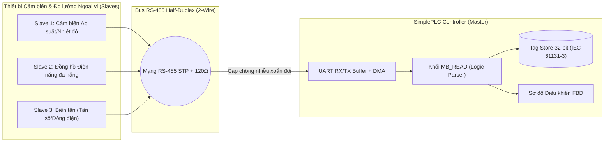
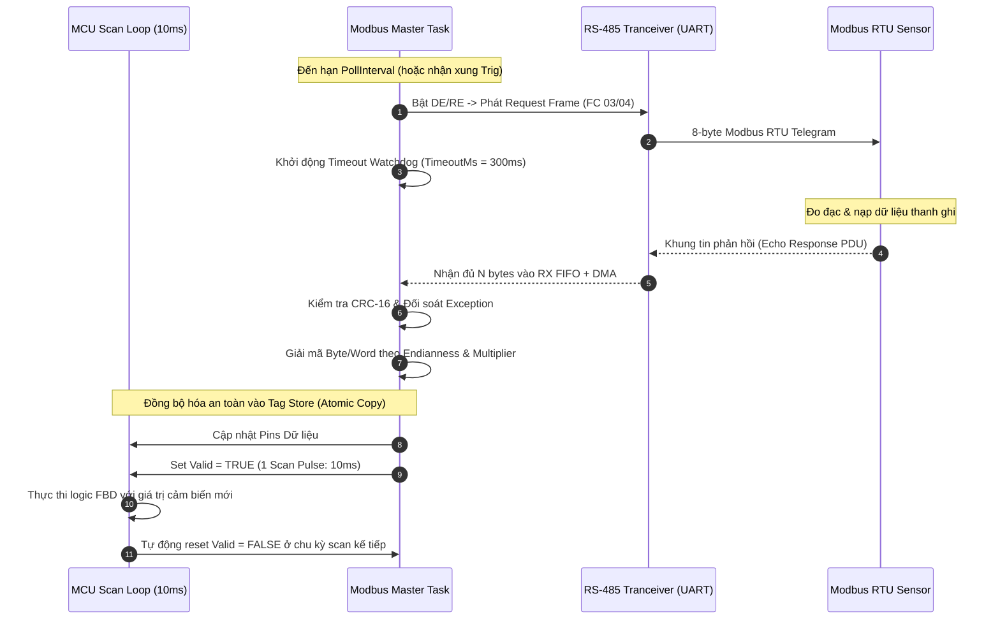
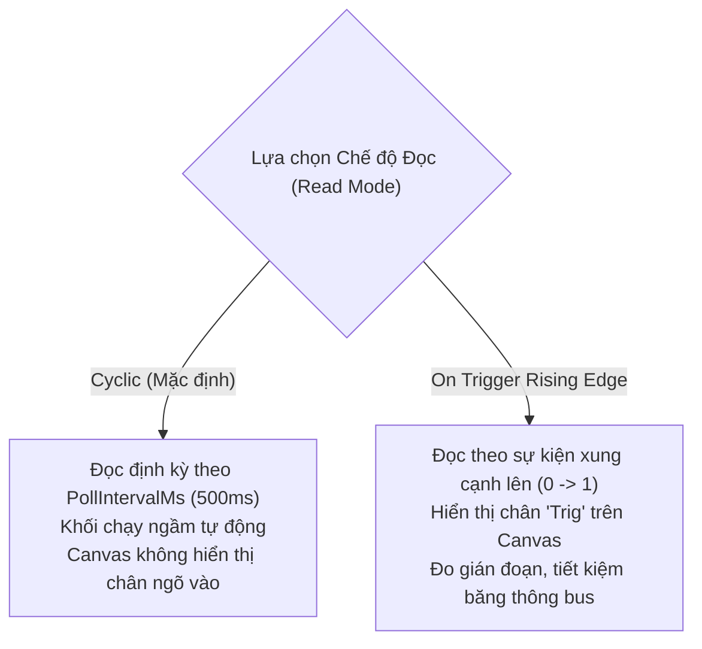

# CẨM NANG KỸ THUẬT & HƯỚNG DẪN SỬ DỤNG KHỐI CHỨC NĂNG MB_READ
## Modbus RTU Master Sensor Poller Function Block User Manual & Engineering Guide

**Mã tài liệu:** `MAN-SPLC-MBR-2026-V2.0`  
**Phiên bản áp dụng:** `SimplePLC / SynaptiX IDE v2.6.0+`  
**Tiêu chuẩn quốc tế tham chiếu:** 
- **IEC 61131-3:2013** (Programmable controllers — Programming languages — Function Blocks)
- **PLCopen TC5 Communication** (Communication Function Blocks for IEC 61131-3)
- **Modbus Application Protocol Specification V1.1b3** (Modbus-IDA)
- **Modbus over Serial Line Specification and Implementation Guide V1.02**
- **ISA-101.01-2015** (Human-Machine Interfaces for Process Automation Systems)

---

## 1. TỔNG QUAN & NGUYÊN LÝ HOẠT ĐỘNG (OVERVIEW & PRINCIPLES)

Khối chức năng **`MB_READ`** (Modbus Master Read) là khối giao tiếp thu thập dữ liệu cấp trường, cho phép bộ điều khiển SimplePLC đóng vai trò **Modbus RTU Master** chủ động gửi yêu cầu đọc (Request PDU) qua mạng truyền thông công nghiệp nối tiếp RS-485 (hoặc Modbus TCP/USB CDC) tới các thiết bị ngoại vi (Slave Devices) như:
- **Cảm biến công nghiệp:** Đo nhiệt độ, độ ẩm, áp suất đường ống, mức bồn bể, cảm biến đo lưu lượng (Flow Meter).
- **Đồng hồ đo điện năng đa năng (Multifunction Energy Meters):** Đọc điện áp 3 pha ($U_{AN}, U_{BN}, U_{CN}$), dòng điện ($I_A, I_B, I_C$), công suất tác dụng ($P$), hệ số công suất ($\cos\varphi$), điện năng tiêu thụ ($kWh$).
- **Biến tần (VFD):** Giám sát tần số thực tế ngõ ra, dòng tải động cơ, điện áp DC bus, nhiệt độ IGBT và mã lỗi vận hành.
- **Bộ điều khiển nhiệt độ PID & Cân điện tử (Load Cells / Weighing Indicators):** Giám sát giá trị biến đo tức thời (Process Value - PV).



---

## 2. GIẢI PHẪU CHÂN GIAO TIẾP TRÊN CANVAS FBD (CONNECTOR TOPOLOGY)

Khối **`MB_READ`** tuân thủ nghiêm ngặt tiêu chuẩn **PLCopen Communication TC5** và ngôn ngữ đồ họa công nghiệp **TIA Portal / Industrial Slate Gray**:

### 2.1. Sơ đồ Chân trên Canvas FBD

```
┌────────────────────────────────────────────────────────┐
│ Chế độ 1: Cyclic Mode (Mặc định)                       │
│ - Tự động quét ngầm theo chu kỳ PollIntervalMs (500ms) │
│ - Ngõ vào để trống hoàn toàn (Canvas gọn gàng, sạch sẽ)│
├────────────────────────────────────────────────────────┤
│                       ┌──────────────────────┐         │
│                       │       MB_READ        │         │
│                       │  [ID: 1 | FC: 04]    │         │
│                       │  [Cyclic (500ms)]    │         │
│                       │                 Valid├─► Pulse │
│                       │                 Error├─► Latch │
│                       │               ErrCode├─► Word  │
│                       │              Pressure├─► Real  │
│                       │           Temperature├─► Real  │
│                       └──────────────────────┘         │
└────────────────────────────────────────────────────────┘

┌────────────────────────────────────────────────────────┐
│ Chế độ 2: On Trigger Mode                              │
│ - Kích hoạt 1 lần khi có xung cạnh lên (0 -> 1)        │
│ - Hiển thị chân ngõ vào Trig để nối dây logic điều khiển│
├────────────────────────────────────────────────────────┤
│                       ┌──────────────────────┐         │
│                       │       MB_READ        │         │
│                       │  [ID: 2 | FC: 03]    │         │
│                       │  [On Trig]           │         │
│        (BOOL)  Trig ──┤► [Trig]         Valid├─► Pulse │
│                       │                 Error├─► Latch │
│                       │               ErrCode├─► Word  │
│                       │                Weight├─► Real  │
│                       │               Tare_OK├─► Bool  │
│                       └──────────────────────┘         │
└────────────────────────────────────────────────────────┘
```

### 2.2. Cổng vào Điều khiển (Control Inputs)

| Chân tín hiệu | Kiểu dữ liệu | Đặc tính kỹ thuật | Điều kiện hiển thị trên Canvas |
| :--- | :--- | :--- | :--- |
| **`Trig`** | `BOOL` (Event) | **Xung kích hoạt đọc:** Khi nhận cạnh lên ($0 \rightarrow 1$), khối lập tức tạo khung Request đọc Modbus và phát ra bus RS-485. | **Chỉ xuất hiện** khi `ReadMode = OnTriggerRisingEdge`. Khi ở chế độ `Cyclic` (chu kỳ), ngõ vào hoàn toàn để trống để tránh gây hiểu nhầm logic. |

> [!NOTE]
> **Quy tắc công thái học (Industrial Ergonomics):** Ở chế độ `Cyclic`, MCU tự động chạy bộ định thời ngầm định (Timer). Việc ẩn hoàn toàn chân ngõ vào giúp Canvas FBD luôn thông thoáng, tránh việc kỹ sư nối nhầm dây hoặc băn khoăn "có cần phải nối nguồn TRUE vào chân EN để khối chạy hay không".

### 2.3. Cổng ra Trạng thái & Bắt tay (Handshaking Outputs)

| Chân tín hiệu | Kiểu dữ liệu | Đặc tính kỹ thuật |
| :--- | :--- | :--- |
| **`Valid`** | `BOOL` (Event) | **Dữ liệu mới hợp lệ:** Phát xung logic $1$ kéo dài đúng 1 chu kỳ quét scan ($10\text{ms}$) ngay khi khung phản hồi từ Slave được kiểm tra CRC-16 thành công và toàn bộ dữ liệu đã được giải mã ghi vào bộ đệm. |
| **`Error`** | `BOOL` (Latch) | **Báo lỗi giao tiếp:** Bật lên `TRUE` khi gặp sự cố (Timeout không phản hồi, sai mã CRC-16, Slave trả về Exception Code). Tự động xóa về `FALSE` ở lần đọc thành công tiếp theo. |
| **`ErrCode`**| `UINT16` | **Mã lỗi chẩn đoán:** Tra cứu nguyên nhân sự cố theo chuẩn PLCopen: `1` = Timeout, `2` = Sai CRC-16, `3` = Lỗi Ngoại lệ Modbus, `4` = Khung tin hỏng (Malformed). |

### 2.4. Cổng ra Dữ liệu Động (Dynamic Data Output Pins)

Các chân dữ liệu ngõ ra được sinh tự động theo danh sách **Pins** cấu hình trong hộp thoại:
- Hỗ trợ tối đa **4 chân dữ liệu động** trên mỗi khối Modbus Master.
- Tự động chuyển đổi từ dữ liệu thô (Raw Registers) sang kiểu dữ liệu tự nhiên (`BOOL`, `INT16`, `UINT16`, `INT32`, `UINT32`, `REAL` IEEE 754).
- Tự động áp dụng hệ số nhân tuyến tính `Multiplier` trước khi xuất ra chân cắm Canvas và cập nhật vào `Tag Store`.

---

## 3. MÁY TRẠNG THÁI & BIỂU ĐỒ BẮT TAY THỜI GIAN (TIMING DIAGRAM)

Khối `MB_READ` thực thi bất đồng bộ trên một Task RTOS độc lập (`mb_master_task`) của vi điều khiển, đảm bảo không bao giờ chặn (non-blocking) chu kỳ quét scan 10ms của Logic Engine:



---

## 4. BỐN MÃ HÀM MODBUS ĐƯỢC HỖ TRỢ (FUNCTION CODES)

Khối **`MB_READ`** hỗ trợ đầy đủ 4 mã hàm đọc tiêu chuẩn của giao thức Modbus Application Protocol V1.1b3:

| Mã hàm (FC) | Tên tiêu chuẩn | Vùng nhớ Modbus | Ứng dụng công nghiệp thực tế |
| :---: | :--- | :---: | :--- |
| **`FC 01`** | **Read Coils** | `0x` | Đọc trạng thái bit logic đóng/ngắt (Rơ-le, van điện từ, cờ sự cố) có quyền Đọc/Ghi. |
| **`FC 02`** | **Read Discrete Inputs** | `1x` | Đọc trạng thái tiếp điểm số vật lý (Cảm biến quang, công tắc hành trình, nút nhấn khẩn cấp) - Chỉ Đọc (Read-Only). |
| **`FC 03`** | **Read Holding Registers** | `4x` | Đọc các thanh ghi giữ 16-bit cấu hình và tham số vận hành (Biến tần, đồng hồ đo điện năng, bộ điều khiển PID). |
| **`FC 04`** | **Read Input Registers** | `3x` | Đọc các thanh ghi dữ liệu ngõ vào đo lường từ cảm biến Analog (Áp suất, nhiệt độ, lưu lượng) - Chỉ Đọc (Read-Only). |

---

## 5. HỆ THỐNG KIỂU DỮ LIỆU, ENDIANNESS & HỆ SỐ NHÂN (MULTIPLIER)

### 5.1. Bảng Kiểu Dữ Liệu Hỗ Trợ (IEC 61131-3)

| Kiểu dữ liệu | Kích thước | Số thanh ghi Modbus | Diễn giải kỹ thuật |
| :--- | :---: | :---: | :--- |
| **`BOOL`** | 1 bit | 1 thanh ghi / 1 coil | Logic $0$ (False) hoặc $1$ (True). |
| **`INT16`** | 16 bit | 1 thanh ghi | Số nguyên có dấu ($-32,768 .. +32,767$). |
| **`UINT16`** | 16 bit | 1 thanh ghi | Số nguyên không dấu ($0 .. 65,535$). |
| **`INT32`** | 32 bit | 2 thanh ghi liên tiếp | Số nguyên có dấu 32-bit ($-2,147,483,648 .. +2,147,483,647$). |
| **`UINT32`** | 32 bit | 2 thanh ghi liên tiếp | Số nguyên không dấu 32-bit ($0 .. 4,294,967,295$). |
| **`REAL`** | 32 bit | 2 thanh ghi liên tiếp | Số thực dấu chấm động chuẩn **IEEE 754 Float32** ($-3.4028 \times 10^{38} .. +3.4028 \times 10^{38}$). |

### 5.2. Chuyển Đổi Thứ Tự Byte & Word (Endianness)

Với các kiểu dữ liệu 32-bit (`REAL`, `INT32`, `UINT32`) chiếm 2 thanh ghi liên tiếp ($R_0$ và $R_1$), các nhà sản xuất thiết bị công nghiệp sử dụng các quy ước sắp xếp byte khác nhau:

```
Thanh ghi R0: Byte A (High), Byte B (Low)
Thanh ghi R1: Byte C (High), Byte D (Low)
```

| Tên Endianness | Thứ tự Byte | Độ phổ biến | Thiết bị tiêu biểu |
| :--- | :---: | :---: | :--- |
| **`Word-Swap (CDAB)`** | `C - D - A - B` | **Phổ biến nhất (>70%)** | Schneider PM2200, Biến tần INVT, ABB, Delta, Chint |
| **`Big-Endian (ABCD)`** | `A - B - C - D` | Chuẩn mạng Internet | Siemens PAC3200, Yokogawa, Honeywell |
| **`Little-Endian (DCBA)`**| `D - C - B - A` | Chuẩn vi xử lý ARM/x86 | Một số dòng cảm biến vi cơ điện tử MEMS, bo nhúng |
| **`Byte-Swap (BADC)`** | `B - A - D - C` | Hiếm gặp | Một số bộ RTU chuyên ngành thủy lợi / khí tượng cũ |

### 5.3. Hệ Số Nhân Tuyến Tính (Multiplier / Scaling)

Nhiều cảm biến Modbus công nghiệp truyền giá trị đo lường dưới dạng số nguyên cố định có phóng đại (Fixed-Point Integer) để tránh truyền số thực cồng kềnh. Khối `MB_READ` cung cấp trường `Multiplier` để tự động khôi phục về đơn vị thực tế:

$$\text{Giá trị hiển thị trên FBD} = \text{Giá trị thanh ghi Modbus thô} \times \text{Multiplier}$$

**Ví dụ thực tế:**
- Cảm biến áp suất trả về số nguyên `253` (tương ứng $25.3\text{ bar}$): Cài đặt `Multiplier = 0.1` $\rightarrow$ Ngõ ra nhận `25.3`.
- Cảm biến nhiệt độ Pt100 trả về `1005` (tương ứng $100.5^\circ\text{C}$): Cài đặt `Multiplier = 0.1` $\rightarrow$ Ngõ ra nhận `100.5`.
- Đồng hồ đo điện áp trả về `2200` (tương ứng $220.0\text{V}$): Cài đặt `Multiplier = 0.1` $\rightarrow$ Ngõ ra nhận `220.0`.
- Biến tần trả về tần số dạng $0.01\text{Hz}$ (`5000` = $50.00\text{Hz}$): Cài đặt `Multiplier = 0.01` $\rightarrow$ Ngõ ra nhận `50.0`.

---

## 6. HAI CHẾ ĐỘ ĐỌC (READ MODES)



### 6.1. Chế độ 1: `Cyclic` (Đọc Tuần Hoàn Chu Kỳ - Mặc Định)
- **Cơ chế:** Khối tự động gửi lệnh Request sau mỗi khoảng thời gian `PollIntervalMs` (mặc định $500\text{ms}$, phạm vi $50\text{ms} .. 60,000\text{ms}$).
- **Trình bày trên Canvas:** Không hiển thị chân ngõ vào nào (0 inputs).
- **Ứng dụng:** Giám sát thời gian thực các thông số biến thiên liên tục (Áp suất trạm bơm, nhiệt độ lò nhiệt, điện áp/dòng điện hệ thống điện động lực).

### 6.2. Chế độ 2: `On Trigger Rising Edge` (Đọc Theo Xung Kích Hoạt)
- **Cơ chế:** Khối chỉ gửi đúng 1 lệnh Request duy nhất khi nhận được xung cạnh lên ($0 \rightarrow 1$) tại chân `Trig`.
- **Trình bày trên Canvas:** Hiển thị chân ngõ vào **`Trig`** ở cạnh trái.
- **Ứng dụng:** 
  - Cân kiểm tra tải trọng (Checkweigher) chỉ đọc khối lượng khi cảm biến quang xác nhận gói hàng đã vào đúng bàn cân.
  - Trạm đọc mã vạch / RFID chỉ truy vấn dữ liệu khi có tín hiệu kích hoạt từ công tắc hành trình.
  - Giảm thiểu lưu lượng truyền thông trên các tuyến bus RS-485 dài hoặc có nhiều Slave dùng chung một cặp dây.

---

## 7. QUY TRÌNH CẤU HÌNH TRÊN SYNAPTIX IDE

### 7.1. Thao tác trên Sidebar Inspector (Thanh Bên Phải)

Khi nhấp chuột chọn khối `MB_READ` trên Canvas FBD, vùng **Inspector** bên phải hiển thị bảng tóm tắt cấu hình hiện tại:
- **Mã thiết bị (Slave ID):** `ID: x`
- **Mã hàm đọc (Function Code):** `FC 03 (Read Holding Registers)` hoặc `FC 04 (Read Input Registers)`
- **Chế độ đọc:** `Cyclic (500ms)` hoặc `On Trig`
- **Địa chỉ bắt đầu & Số lượng:** `Start Addr: x` | `Reg Count: y`
- **Số chân ngõ ra:** `x Chân ngõ ra`
- **Nút CTA:** Nhấp nút **`[ ⚙ Cấu hình Modbus Read... ]`** để mở hộp thoại cấu hình chuyên sâu.

### 7.2. Thao tác trong Hộp thoại Cấu hình (Modal Dialog `1040 x 660`)

Hộp thoại cấu hình được thiết kế theo chuẩn công thái học đối xứng 2 cột:
- **Cột Trái (Parameters & Pins Table):**
  1. **Mã trạm (Slave ID):** Nhập địa chỉ trạm ngoại vi ($1 .. 247$).
  2. **Chế độ đọc (Read Mode):** Chọn `Cyclic (Định kỳ)` hoặc `On Trigger (Kích hoạt)`.
  3. **Mã hàm (Function Code):** Chọn `FC 01`, `FC 02`, `FC 03`, hoặc `FC 04`.
  4. **Địa chỉ thanh ghi bắt đầu (Start Address):** Nhập địa chỉ thanh ghi Modbus đầu tiên ($0 .. 65,535$).
  5. **Số lượng thanh ghi đọc (Quantity):** Số thanh ghi/coil cần đọc đồng thời trong một Request ($1 .. 125$).
  6. **Thời gian chờ (Timeout ms):** Cài đặt từ $50\text{ms}$ đến $5000\text{ms}$ (mặc định $300\text{ms}$).
  7. **Chu kỳ đọc (Poll Interval ms):** Chỉ xuất hiện khi ở chế độ `Cyclic` (mặc định $500\text{ms}$).
  8. **Bảng Chân Ngõ Ra Động (Pins Table):**
     - Nhấp nút **`[ + Thêm Chân ]`** để bổ sung một ngõ ra dữ liệu.
     - Điền **Tên chân (Pin Name)** (ví dụ: `Pressure`, `FlowRate`).
     - Điền **Reg Offset** (khoảng cách thanh ghi tính từ Start Address, ví dụ `0`, `1`, `2`).
     - Chọn **Kiểu dữ liệu (Data Type):** `INT16`, `UINT16`, `INT32`, `UINT32`, `REAL`, `BOOL`.
     - Chọn **Thứ tự Byte (Endianness):** `Word-Swap (CDAB)`, `Big-Endian (ABCD)`, v.v.
     - Điền **Multiplier:** Hệ số nhân tỷ lệ (ví dụ `0.1`, `0.01`, `1.0`).
- **Cột Phải (Live Hex Simulation & Frame Inspector):**
  - Khung **Request Frame Preview** hiển thị toàn bộ chuỗi Byte Hex thực tế sẽ phát ra bus (bao gồm Slave ID, FC, Start Address, Quantity, và mã kiểm tra CRC-16 chuẩn Modbus).
  - Khung **Response Frame Simulation** cho phép kỹ sư nhập chuỗi Byte phản hồi giả lập để kiểm tra thuật toán giải mã và kiểm tra mã CRC-16 trực tiếp mà không cần cắm phần cứng thật.

---

## 8. BẢNG MÃ LỖI CHẨN ĐOÁN & QUY TRÌNH KHẮC PHỤC SỰ CỐ (TROUBLESHOOTING)

| Mã lỗi (`ErrCode`) | Định danh sự cố | Nguyên nhân kỹ thuật phổ biến | Biện pháp xử lý khuyến nghị |
| :---: | :--- | :--- | :--- |
| **`0`** | `ERR_NONE` | Giao tiếp bình thường, dữ liệu mới đã được nạp thành công. | Hệ thống hoạt động tốt. |
| **`1`** | `ERR_TIMEOUT` | Đã hết thời gian `TimeoutMs` ($300\text{ms}$) mà MCU không nhận được bất kỳ byte phản hồi nào từ đường truyền RS-485. | 1. Kiểm tra nguồn cấp $24\text{VDC}$ cho cảm biến Slave.<br>2. Kiểm tra dây truyền thông RS-485 (cực `A/+` và `B/-` có bị đấu chéo ngược không).<br>3. Kiểm tra đúng địa chỉ `Slave ID` và tốc độ baud rate/parity của cảm biến (ví dụ: 9600-8-N-1).<br>4. Tăng `TimeoutMs` lên $500\text{ms} - 1000\text{ms}$ nếu cảm biến đo phản hồi chậm. |
| **`2`** | `ERR_CRC` | Nhận được khung tin phản hồi nhưng mã kiểm tra CRC-16 tính lại không khớp với 2 byte CRC ở cuối bản tin. | 1. Cáp truyền thông bị nhiễu do đi song song máng dây động lực biến tần $\rightarrow$ Thay bằng cáp xoắn đôi chống nhiễu (STP).<br>2. Tuyến bus RS-485 dài bị phản xạ sóng $\rightarrow$ Lắp thêm điện trở kết thúc $120\Omega$ ở hai đầu xa nhất của tuyến bus.<br>3. Nối vỏ giáp chống nhiễu (Shield) của cáp xuống cọc tiếp địa an toàn (PE) tại một điểm duy nhất bên tủ điều khiển. |
| **`3`** | `ERR_EXCEPTION` | Thiết bị Slave gửi về bản tin báo lỗi ngoại lệ Modbus: `0x01` (Illegal Function), `0x02` (Illegal Data Address), `0x03` (Illegal Data Value). | 1. Tra cứu tài liệu của Slave xem mã hàm (FC 03 hay FC 04) có được hỗ trợ hay không.<br>2. Kiểm tra lại địa chỉ thanh ghi (quy ước 0-based hay 1-based; thử dịch chuyển $\pm 1$ địa chỉ thanh ghi).<br>3. Kiểm tra xem số lượng thanh ghi `RegCount` có vượt quá giới hạn cho phép đọc của Slave không. |
| **`4`** | `ERR_MALFORMED` | Khung tin nhận về có độ dài không đúng chuẩn Modbus (ngắn hơn 5 bytes hoặc không khớp với trường Byte Count). | Kiểm tra lại chất lượng đầu cos nối dây, hiện tượng lỏng tiếp xúc cơ khí hoặc nhiễu điện áp xung tức thời trên cổng UART. |

---

## 9. CÁC TÌNH HUỐNG ỨNG DỤNG MẪU (FIELD APPLICATIONS)

### Ví dụ 1: Trạm Giám Sát Áp Suất & Nhiệt Độ Đường Ống Nước (FC 04, 2 biến REAL, Cyclic 500ms)
- **Thiết bị:** Cảm biến đo áp suất & nhiệt độ tích hợp RS-485 (Slave ID = 1).
- **Thanh ghi:** Bắt đầu từ địa chỉ `0x0000`, 4 thanh ghi Input Registers (`3x`), kiểu Float32 Word-Swap `CDAB`.
  - Offset `+0..+1`: Áp suất nước đường ống (bar).
  - Offset `+2..+3`: Nhiệt độ nước đường ống ($^\circ\text{C}$).
- **Cấu hình khối `MB_READ`:**
  - Function Code: `FC 04 (Read Input Registers)`
  - Start Address: `0`
  - Quantity: `4`
  - Read Mode: `Cyclic`
  - Poll Interval: `500 ms`
  - Timeout: `300 ms`
  - Pin 0: `Pressure` (Offset 0, DataType: `Real`, Endianness: `Word-Swap CDAB`, Multiplier: `1.0`)
  - Pin 1: `Temperature` (Offset 2, DataType: `Real`, Endianness: `Word-Swap CDAB`, Multiplier: `1.0`)
- **Kết quả:** Trên Canvas FBD, ngõ vào để trống hoàn toàn; các chân ra `Pressure` và `Temperature` liên tục cập nhật giá trị số thực chính xác $0.1\text{ bar}$ và $0.1^\circ\text{C}$ sau mỗi nửa giây.

---

### Ví dụ 2: Giám Sát Điện Năng Tủ Động Lực Với Schneider PM2200 (FC 03, Cyclic 1000ms)
- **Thiết bị:** Đồng hồ đo điện năng đa năng Schneider Acti9 PM2200 (Slave ID = 2).
- **Thanh ghi:** Đọc điện áp pha trung bình và dòng điện pha tổng:
  - Địa chỉ `3028` (Offset 0..1): Điện áp trung bình $V_{\text{avg}}$ (Float32, V).
  - Địa chỉ `3000` (Offset 0..1): Dòng điện tổng $I_{\text{total}}$ (Float32, A).
- **Cấu hình khối `MB_READ`:**
  - Function Code: `FC 03 (Read Holding Registers)`
  - Start Address: `3028`
  - Quantity: `2`
  - Read Mode: `Cyclic (1000 ms)`
  - Pin 0: `Voltage_Avg` (Offset 0, DataType: `Real`, Endianness: `Word-Swap CDAB`, Multiplier: `1.0`)
- **Kết quả:** Bộ điều khiển SimplePLC tự động đồng bộ điện áp lưới vào Tag Store để thực hiện thuật toán bảo vệ quá áp / thấp áp liên động ngắt rơ-le DO.

---

### Ví dụ 3: Trạm Cân Băng Tải Kích Hoạt Theo Sự Kiện Sensor Phát Hiện (FC 03, On Trigger)
- **Thiết bị:** Đầu hiển thị cân điện tử công nghiệp Yaohua XK3190 (Slave ID = 5).
- **Thanh ghi:** Địa chỉ `0x0001`, thanh ghi Holding Register lưu khối lượng thô dạng số nguyên (kg $\times 10$).
- **Cấu hình khối `MB_READ`:**
  - Function Code: `FC 03 (Read Holding Registers)`
  - Start Address: `1`
  - Quantity: `1`
  - Read Mode: `On Trigger Rising Edge`
  - Timeout: `200 ms`
  - Pin 0: `Weight_Kg` (Offset 0, DataType: `Int16`, Multiplier: `0.1`)
- **Kết nối FBD:**
  - Chân `Trig` của khối `MB_READ` được nối với ngõ ra của cảm biến quang phát hiện kiện hàng `DI0` (thông qua khối `TON` trễ $200\text{ms}$ để chờ kiện hàng dừng yên trên bàn cân).
  - Chân `Valid` nối vào khối chốt dữ liệu và so sánh khối lượng với ngưỡng tiêu chuẩn.
- **Kết quả:** Bus RS-485 hoàn toàn yên lặng trong thời gian băng tải chạy không tải. Chỉ khi kiện hàng vào đúng vị trí bàn cân, đúng 1 khung Request được phát đi, đọc kết quả cân chính xác và phân loại hàng hóa tức thì.
