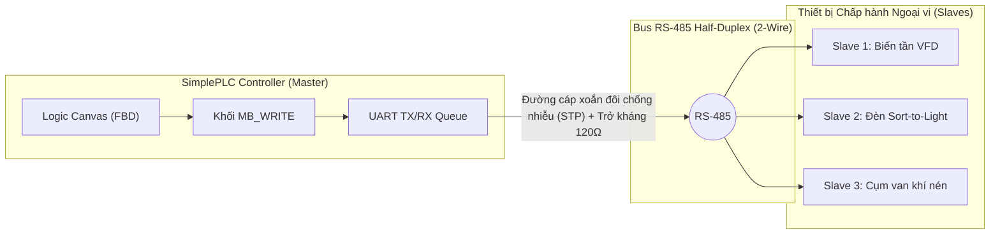
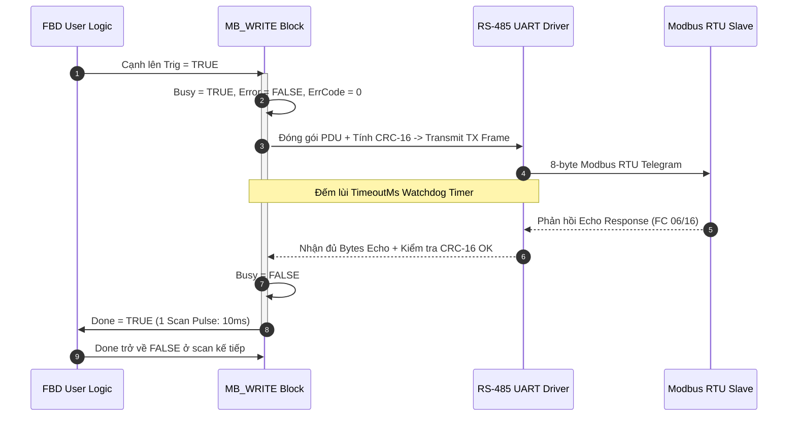
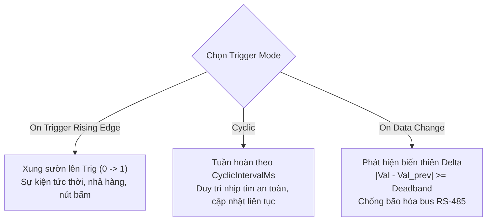

# CẨM NANG KỸ THUẬT & HƯỚNG DẪN SỬ DỤNG KHỐI CHỨC NĂNG MB_WRITE
## Modbus RTU Master Actuator Controller Function Block User Manual & Engineering Guide

**Mã tài liệu:** `MAN-SPLC-MBW-2026-V2.0`  
**Phiên bản áp dụng:** `SimplePLC / SynaptiX IDE v2.6.0+`  
**Tiêu chuẩn quốc tế tham chiếu:** 
- **IEC 61131-3:2013** (Programmable controllers — Programming languages — Function Blocks)
- **PLCopen TC5 Communication** (Communication Function Blocks for IEC 61131-3)
- **Modbus Application Protocol Specification V1.1b3** (Modbus-IDA)
- **Modbus over Serial Line Specification and Implementation Guide V1.02**
- **ISA-101.01-2015** (Human-Machine Interfaces for Process Automation Systems)
- **IEC 60870-5-104 / DNP3** (Change-of-Value Deadband Transmission Standard)

---

## 1. TỔNG QUAN & NGUYÊN LÝ HOẠT ĐỘNG (OVERVIEW & PRINCIPLES)

Khối chức năng **`MB_WRITE`** (Modbus Master Write) là khối giao tiếp cấp chấp hành, cho phép bộ điều khiển SimplePLC chủ động phát lệnh điều khiển qua mạng truyền thông công nghiệp nối tiếp RS-485 (hoặc Modbus TCP/USB CDC) tới các thiết bị ngoại vi (Slave Actuators) như:
- **Biến tần (VFD):** Cài đặt tần số hoạt động, lệnh chạy/dừng/đảo chiều, đặt giới hạn dòng tải.
- **Hệ thống chia chọn bưu kiện Sort-to-Light / Pick-to-Light:** Kích hoạt đèn chỉ thị vị trí ô hàng và đổi màu LED RGB.
- **Cụm van khí nén (Valve Manifolds):** Điều khiển cụm 8..24 van điện từ tập trung qua 1 bus duy nhất.
- **Module Rơ-le mở rộng & Bộ điều khiển nhiệt độ (PID Temperature Controllers):** Thay đổi giá trị đặt Setpoint (SP) và ngưỡng cảnh báo.



---

## 2. GIẢI PHẪU CHÂN GIAO TIẾP TRÊN CANVAS FBD (CONNECTOR TOPOLOGY)

Khối **`MB_WRITE`** tuân thủ triệt để tiêu chuẩn **PLCopen Communication TC5**, đảm bảo tính toàn vẹn trạng thái trong các ứng dụng điều khiển thời gian thực:

```
                  ┌──────────────────────┐
                  │       MB_WRITE       │
                  │  [ID: 1 | FC: 06]    │
   (BOOL)  Trig ──┤► [Trig]         Done ├─► (BOOL) Pulse
 (UINT16)  Chan ──┤  Channel        Busy ├─► (BOOL) Level
 (UINT16)   Cmd ──┤  Command       Error ├─► (BOOL) Latch
 (UINT32) Param ──┤  Param       ErrCode ├─► (UINT16) Word
                  └──────────────────────┘
                   (Chế độ Channel-Indexed)
```

```
                  ┌──────────────────────┐
                  │       MB_WRITE       │
                  │  [ID: 2 | FC: 16]    │
   (BOOL)  Trig ──┤► [Trig]         Done ├─► (BOOL) Pulse
   (REAL)   IN0 ──┤  Freq_SP        Busy ├─► (BOOL) Level
   (REAL)   IN1 ──┤  Ramp_Time     Error ├─► (BOOL) Latch
 (UINT16)   IN2 ──┤  Control_Word ErrCode├─► (UINT16) Word
                  └──────────────────────┘
                   (Chế độ Direct Registers)
```

### 2.1. Cổng vào Điều khiển & Sự kiện (Event Inputs)

| Chân tín hiệu | Kiểu dữ liệu | Vai trò | Điều kiện hiển thị |
| :--- | :--- | :--- | :--- |
| **`Trig`** | `BOOL` (Event) | **Xung kích hoạt lệnh:** Khi nhận cạnh lên ($0 \rightarrow 1$), khối lập tức đóng gói PDU và phát lệnh ghi qua bus. | **Chỉ hiển thị** khi `TriggerMode = OnTriggerRisingEdge`. Ẩn đi khi ở chế độ `Cyclic` hoặc `OnDataChange` để tránh nhầm lẫn logic. |

### 2.2. Cổng vào Dữ liệu (Data Inputs)

* **Khi hoạt động ở chế độ `Channel-Indexed Target`:**
  * **`Channel` (`UINT16`):** Chỉ số kênh mục tiêu cần điều khiển ($1 \le \text{Channel} \le \text{ChannelCount}$, ví dụ ô 1 đến 18).
  * **`Command` (`UINT16`):** Mã lệnh thực thi ($0$ = Tắt/Hủy, $1$ = Bật/Sáng, $2$ = Nhấp nháy,...).
  * **`Param` (`UINT32`):** Tham số mở rộng (ví dụ mã màu 24-bit RGB `0x00RRGGBB`, thời gian trễ ms, hoặc tỷ lệ mở van).
* **Khi hoạt động ở chế độ `Direct Registers`:**
  * **`IN0` .. `IN3`:** Các chân nhận giá trị số động theo số lượng Pin được định nghĩa trong hộp thoại cấu hình. Tương thích với tất cả kiểu dữ liệu `BOOL`, `INT16`, `UINT16`, `INT32`, `UINT32`, `REAL` (Float32).

### 2.3. Cổng ra Trạng thái & Bắt tay (Handshaking Outputs)

| Chân tín hiệu | Kiểu dữ liệu | Đặc tính kỹ thuật |
| :--- | :--- | :--- |
| **`Done`** | `BOOL` (Event) | **Hoàn tất thành công:** Phát xung logic $1$ kéo dài đúng 1 chu kỳ quét scan ($10\text{ms}$) ngay khi nhận được bản tin Echo phản hồi hợp lệ từ Slave. Dùng để kích hoạt bước tiếp theo trong chuỗi tuần tự (Sequential Function Chart). |
| **`Busy`** | `BOOL` (Level) | **Đang bận giao dịch:** Giữ mức `TRUE` từ thời điểm gửi byte đầu tiên cho đến khi nhận xong phản hồi hoặc hết thời gian Timeout. Dùng để khóa liên động (Interlock) ngăn gửi đè lệnh mới. |
| **`Error`** | `BOOL` (Latch) | **Báo lỗi:** Bật lên `TRUE` khi giao dịch thất bại. Tự động xóa về `FALSE` ở lần kích hoạt thành công tiếp theo. |
| **`ErrCode`**| `UINT16` | **Mã chẩn đoán:** Tra cứu trực tiếp nguyên nhân lỗi theo bảng mã PLCopen tiêu chuẩn. |

---

## 3. MÁY TRẠNG THÁI & BIỂU ĐỒ BẮT TAY THỜI GIAN (TIMING DIAGRAM)



> [!IMPORTANT]
> **Khuyến nghị Interlocking:** Trong môi trường RS-485 bán song công (Half-Duplex), tại một thời điểm chỉ có 1 giao dịch được phép tồn tại trên bus. Luôn sử dụng cờ `!Busy` của khối ghi trước khi cấp xung `Trig` cho khối ghi kế tiếp để tránh va chạm khung tin (Arbitration Collision).

---

## 4. CHI TIẾT HAI CHẾ ĐỘ GHI (WRITE MODES)

### 4.1. Chế độ 1: `Direct Registers` (Ghi Thanh Ghi Trực Tiếp)

Phù hợp cho các thiết bị Modbus tiêu chuẩn với cấu trúc thanh ghi cố định.

* **Hỗ trợ 4 mã hàm Modbus chuẩn:**
  * **FC 05 (Write Single Coil):** Ghi trạng thái logic bật/tắt (ON = `0xFF00`, OFF = `0x0000`) vào 1 cuộn dây tại địa chỉ `StartAddress`.
  * **FC 06 (Write Single Register):** Ghi 1 thanh ghi giữ 16-bit (`4x`).
  * **FC 15 (Write Multiple Coils):** Ghi liên tiếp $N$ cuộn dây số (`PointCount`).
  * **FC 16 (Write Multiple Registers):** Ghi liên tiếp $N$ thanh ghi giữ 16-bit (`PointCount`).
* **Hệ thống Chuyển đổi Kiểu dữ liệu & Endianness:**
  * **`INT16` / `UINT16`:** Chiếm 1 thanh ghi (16-bit).
  * **`REAL` (Float32 IEEE 754) / `INT32` / `UINT32`:** Chiếm 2 thanh ghi liên tiếp (32-bit). Hỗ trợ 4 định dạng hoán vị byte/word:
    * `Big-Endian (ABCD)`: Chuẩn mạng truyền thống (High Word first, High Byte first).
    * `Word-Swap (CDAB)`: **Phổ biến nhất trong thiết bị công nghiệp** (Low Word first, High Byte first).
    * `Byte-Swap (BADC)`: Hoán vị byte nội bộ.
    * `Little-Endian (DCBA)`: Chuẩn x86/ARM thuần.
  * **`Multiplier` (Hệ số tỷ lệ):** Áp dụng công thức chuyển đổi trước khi truyền:
    $$\text{Giá trị ghi thanh ghi} = \text{Giá trị đầu vào} \times \text{Multiplier}$$
    *(Ví dụ: Muốn gửi setpoint nhiệt độ $25.5^\circ\text{C}$ xuống thanh ghi số nguyên với đơn vị $0.1^\circ\text{C}$, điền Multiplier = `10.0` để gửi giá trị số nguyên `255`)*.

---

### 4.2. Chế độ 2: `Channel-Indexed Target` (Điều Khiển Theo Chỉ Số Kênh Chấp Hành)

Được thiết kế chuyên biệt cho hệ thống có **nhiều kênh chấp hành cùng loại** nằm trên một Slave ID (Sort-to-Light, Pick-to-Light, Cụm van khí nén, Tháp đèn tín hiệu).

#### Thuật toán tính toán địa chỉ tự động:
1. **Thanh ghi Lệnh (Command Register):**
   $$\text{Addr}_{\text{Command}} = \text{BaseAddressCommand} + (\text{Channel} - 1)$$
   *Giao thức sử dụng:* **FC 06 (Write Single Register)**.
2. **Thanh ghi Tham số (Parameter / RGB Color Register):**
   $$\text{Addr}_{\text{Param}} = \text{BaseAddressParam} + (\text{Channel} - 1) \times 2$$
   *Giao thức sử dụng:* **FC 16 (Write Multiple Registers, 2 thanh ghi 32-bit: High Word + Low Word)**.

#### Bảng Ánh xạ Kênh Minh họa (Base Cmd = `0x0100`, Base Param = `0x0120`):
| Chỉ số kênh | Địa chỉ Thanh ghi Lệnh (FC06) | Địa chỉ Thanh ghi Tham số (FC16) | Diễn giải chức năng |
| :---: | :---: | :---: | :--- |
| **CH 01** | `0x0100` | `0x0120 .. 0x0121` | Điều khiển ô hàng số 1 / Van 1 |
| **CH 02** | `0x0101` | `0x0122 .. 0x0123` | Điều khiển ô hàng số 2 / Van 2 |
| **CH 03** | `0x0102` | `0x0124 .. 0x0125` | Điều khiển ô hàng số 3 / Van 3 |
| ... | ... | ... | ... |
| **CH 18** | `0x0111` | `0x0142 .. 0x0143` | Điều khiển ô hàng số 18 / Van 18 |

#### Cơ chế Độc quyền Kênh (`ExclusiveChannel Arbiter`):
Khi cờ **ExclusiveChannel** được bật:
- Khi một kênh mới (ví dụ Kênh 5) được kích hoạt lệnh Bật (`Command = 1`), bộ điều khiển tự động gửi lệnh xóa (`Command = 0`) tới tất cả các kênh khác đang sáng trước đó.
- **Lợi ích an toàn công nghiệp:** Ngăn chặn tuyệt đối tình trạng nhân viên kho bị phân tâm hoặc nhặt nhầm hàng do có 2 đèn cùng sáng đồng thời.

---

## 5. BA CHẾ ĐỘ KÍCH HOẠT (TRIGGER MODES) & QUẢN TRỊ LƯU THÔNG BUS



### 5.1. `On Trigger Rising Edge` (Theo Sự Kiện Cạnh Lên)
- **Hành vi:** Lệnh ghi chỉ phát ra 1 lần duy nhất khi chân `Trig` chuyển từ 0 lên 1.
- **Ứng dụng tối ưu:** Kích hoạt theo nút bấm, cảm biến quang phát hiện sản phẩm qua miệng máng, hoặc chỉ thị từ bản tin `MQTT_SUB`.

### 5.2. `Cyclic (Periodic)` (Ghi Tuần Hoàn Chu Kỳ)
- **Hành vi:** Lệnh ghi được tự động phát lại định kỳ sau mỗi khoảng thời gian `CyclicIntervalMs` (mặc định 500ms, phạm vi 50..60000ms).
- **Ứng dụng tối ưu:** Gửi nhịp tim (Heartbeat Watchdog) tới biến tần hoặc cơ cấu chấp hành yêu cầu phải có tín hiệu làm mới liên tục để không kích hoạt dừng khẩn cấp (Fail-safe timeout).

### 5.3. `On Data Change` với COV Deadband ($\Delta$) (Theo Sự Biến Thiên Dữ Liệu)
- **Hành vi:** Lệnh ghi tự động kích hoạt ngay khi giá trị ngõ vào thay đổi.
- **Thuật toán Ngưỡng Lọc Biến Thiên (Deadband Algorithm):**
  $$\left| \text{Giá trị hiện thời} - \text{Giá trị đã gửi gần nhất} \right| \ge \text{Deadband}$$
- **Tầm quan trọng sống còn:** Với các biến đo từ cảm biến áp suất, nhiệt độ hoặc biến tần, nhiễu analog luôn gây ra dao động nhỏ ở hàng thập phân (ví dụ: $49.99 \leftrightarrow 50.01\text{Hz}$). Nếu không có Deadband, MCU sẽ liên tục phát lệnh ghi ở mọi chu kỳ scan 10ms, làm nghẽn bus RS-485 100% khiến các tác vụ khác không thể giao tiếp.

---

## 6. QUY TRÌNH THAO TÁC CẤU HÌNH TRÊN SYNAPTIX IDE

### 6.1. Thao tác trên Sidebar Inspector (Thanh Bên Phải)
1. Nhấp chuột chọn khối `MB_WRITE` trên Canvas FBD.
2. Vùng **Inspector** bên phải hiển thị bảng tóm tắt cấu hình hiện tại:
   - **Thiết bị:** `ID: x`
   - **Chế độ ghi:** `Direct Registers` hoặc `Channel-Indexed Target`
   - **Chế độ kích hoạt:** `Cyclic (500 ms)` hoặc `On Data Change (Δ0.50)` hoặc `On Rising Edge (Trig)`
   - **Số chân/kênh:** Tóm tắt số cổng đang dùng
3. Nhấp nút **`[ ⚙ Cấu hình khối Modbus... ]`** để mở hộp thoại cấu hình chuyên sâu.

### 6.2. Thao tác trong Hộp thoại Cấu hình (Popup Modal)
1. **Thiết lập Nhận diện & Truyền thông:**
   - **Mã thiết bị (Slave ID):** Nhập ID của trạm Slave ($1..247$).
   - **Thời gian chờ phản hồi (Timeout ms):** Cài đặt từ $50\text{ms}$ đến $5000\text{ms}$ (mặc định $300\text{ms}$).
2. **Lựa chọn Phương thức & Kích hoạt:**
   - Chọn **Write Mode**: `Channel-Indexed Target` hoặc `Direct Registers`.
   - Chọn **Trigger Mode**: `On Rising Edge`, `On Data Change` hoặc `Cyclic`.
   - Cài đặt tham số động tương ứng (`CyclicIntervalMs` hoặc `Deadband Δ`).
3. **Cấu hình Địa chỉ:**
   - Với **Direct Mode**: Chọn Function Code (FC 05/06/15/16), Start Address và thêm các chân Pin dữ liệu (đặt Label, Kiểu dữ liệu, Multiplier).
   - Với **Channel-Indexed Mode**: Nhập Base Command Addr, Base Param Addr, Số kênh và tick chọn `Exclusive Channel`. Kiểm tra lại bảng **Actuator Channel Mappings** bên dưới.
4. **Kiểm tra Gói tin Mô phỏng (Simulated TX Frame):**
   - Chọn thử một kênh và lệnh để hệ thống tự động sinh chuỗi Byte Hex kèm mã kiểm tra CRC-16.
   - Quan sát bảng phân tích từng trường byte (Device ID, Function Code, Register Address, Payload, CRC).
5. Nhấp **`Áp dụng`** để lưu cấu hình.

---

## 7. BẢNG MÃ LỖI CHẨN ĐOÁN & QUY TRÌNH XỬ LÝ SỰ CỐ (TROUBLESHOOTING)

| Mã lỗi (`ErrCode`) | Định danh sự cố | Nguyên nhân kỹ thuật | Hướng khắc phục khuyến nghị |
| :---: | :--- | :--- | :--- |
| **`0`** | `ERR_NONE` | Giao dịch thành công hoàn toàn. | Bình thường. |
| **`1`** | `ERR_TIMEOUT` | Slave không phản hồi trong ngưỡng `TimeoutMs`. | 1. Kiểm tra nguồn cấp cho thiết bị Slave.<br>2. Kiểm tra dây tín hiệu RS-485 (cực A/B có bị đảo chiều không).<br>3. Kiểm tra đúng Slave ID và tốc độ Baud Rate (9600/19200/115200 bps).<br>4. Tăng thời gian `TimeoutMs` lên $500\text{ms} - 1000\text{ms}$ nếu Slave phản hồi chậm. |
| **`2`** | `ERR_CRC` | Khung tin phản hồi sai mã kiểm tra CRC-16. | 1. Đường dây RS-485 bị nhiễu do đi chung máng dây động lực biến tần.<br>2. Bổ sung điện trở đầu cuối $120\Omega$ ở hai đầu tuyến bus.<br>3. Đấu nối vỏ giáp chống nhiễu (Shield) của cáp STP xuống đất (PE) tại 1 điểm duy nhất. |
| **`3`** | `ERR_EXCEPTION` | Slave trả về mã ngoại lệ Modbus: `0x01` (Illegal Function), `0x02` (Illegal Address), `0x03` (Illegal Data). | 1. Tra cứu tài liệu của Slave xem địa chỉ thanh ghi đang ghi có được hỗ trợ ghi không (Read-Only register).<br>2. Kiểm tra lại địa chỉ 0-based vs 1-based (thử dịch chuyển $\pm 1$ địa chỉ).<br>3. Kiểm tra xem giá trị ghi có vượt quá giới hạn Min/Max của thiết bị không. |
| **`4`** | `ERR_BUS_BUSY` | Đường truyền RS-485 đang bị chiếm giữ bởi khối khác. | Sử dụng cờ `!Busy` để khóa liên động (Interlock) giữa các khối truyền thông trên cùng một cổng serial. |
| **`5`** | `ERR_CHANNEL_OUT_OF_BOUNDS` | Giá trị tại chân `Channel` vượt quá `ChannelCount`. | Kiểm tra lại logic cấp chỉ số kênh trong chương trình FBD, đảm bảo $1 \le \text{Channel} \le \text{ChannelCount}$. |

---

## 8. CÁC TÌNH HUỐNG ỨNG DỤNG MẪU (FIELD APPLICATION EXAMPLES)

### Ví dụ 1: Điều khiển Tốc độ Biến tần VFD (FC 06, On Data Change với Deadband)
- **Thiết bị:** Biến tần INVT / Schneider ATV310 (Slave ID = 1).
- **Thanh ghi tần số đặt:** `0x2001` (đơn vị $0.01\text{Hz}$, ví dụ $50.00\text{Hz} = 5000$).
- **Cấu hình khối `MB_WRITE`:**
  - Write Mode: `Direct Registers`
  - Function Code: `FC 06 (Write Single Register)`
  - Start Address: `0x2001`
  - Trigger Mode: `On Data Change`
  - Deadband: `0.5` ($0.5\text{Hz}$)
  - Pin 0: `Freq_SP`, Kiểu dữ liệu: `REAL`, Multiplier = `100.0`.
- **Kết quả:** Biến tần cập nhật tốc độ êm ái theo áp suất đường ống mà không làm nghẽn bus RS-485.

### Ví dụ 2: Trạm Phân Loại Hàng Hóa Sort-to-Light 18 Ô (Channel-Indexed, Exclusive)
- **Thiết bị:** Bo điều khiển LED 18 ô phân loại (Slave ID = 2).
- **Thanh ghi cơ sở:** `BaseCommand = 0x0100`, `BaseParam = 0x0120`.
- **Cấu hình khối `MB_WRITE`:**
  - Write Mode: `Channel-Indexed Target`
  - Channel Count: `18`
  - Exclusive Channel: `Bật (TRUE)`
  - Trigger Mode: `On Trigger Rising Edge`
- **Kết nối FBD:**
  - Chân `Trig`: Nối với cờ có hàng mới từ `MQTT_SUB`.
  - Chân `Channel`: Nối với mã ô `bin_id` ($1..18$).
  - Chân `Command`: Cố định giá trị `1` (Sáng đèn).
  - Chân `Param`: Nối với mã màu `0x00FF00` (Xanh lục).
- **Kết quả:** Mỗi lần có bưu kiện mới, đúng 1 ô hàng chỉ định phát sáng màu xanh, 17 ô còn lại tự động tắt hoàn toàn.
