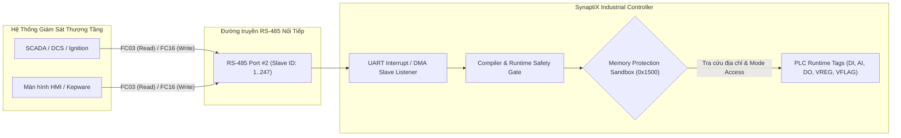

# Hướng Dẫn Tích Hợp Cổng RS-485 Modbus RTU Slave & Bảng Ánh Xạ Vùng Nhớ An Toàn Cho SCADA / HMI

**Tài liệu chuẩn kỹ thuật (Interface Control Document - SPLC-SPEC-SLAVE-001)**  
*Áp dụng từ phiên bản Firmware V2.0 & Synaptix IDE 2.12+*

---

## 1. Giới Thiệu & Kiến Trúc Tổng Quan

Trong các ứng dụng tự động hóa công nghiệp và Gateway IIoT (SynaptiX Industrial Controller), thiết bị không chỉ đóng vai trò **Modbus Master** (chủ động quét cảm biến) mà còn có thể cấu hình linh hoạt từng cổng RS-485 thành **Modbus RTU Slave (Server)**. 

Khi ở chế độ Slave, thiết bị đóng vai trò trạm ngoại vi hiện trường (Field Station) với mã trạm (Slave ID từ `1..247`), sẵn sàng đáp ứng các truy vấn đọc/ghi từ hệ thống SCADA tổng, DCS, PLC thượng tầng hoặc màn hình HMI công nghiệp (Ignition, Kepware, WinCC, WebAccess, Pro-face, Weintek).



---

## 2. Cơ Chế Bảo Vệ Vùng Nhớ 3 Cấp Độ (Memory Protection Sandbox)

Để ngăn ngừa triệt để nguy cơ thiết bị SCADA bên ngoài làm xáo trộn vùng nhớ hệ thống hoặc phá hỏng logic PLC đang chạy, firmware SynaptiX thiết lập kiến trúc **Sandbox 3 Cấp độ**:

| Cấp độ | Tên Phân Vùng | Quy Tắc Bảo Vệ | Phản Hồi Khi Vi Phạm |
|:---:|:---|:---|:---|
| 🔴 **Tier 1** | **Vùng Cấm Tuyệt Đối (Restricted System Area)** | Tuyệt đối cô lập SCADA với các vùng nạp rule logic (`0x9000`), lệnh chốt Flash COMMIT (`0xA000`), và thông tin bảo mật Wi-Fi / MQTT. | **Modbus Exception 0x02** (`Illegal Data Address`) |
| 🟡 **Tier 2** | **Vùng Cấm Ghi (Read-Only Sensors & Inputs)** | Ngõ vào số vật lý (`DI0..DI7`), ngõ vào tương tự (`AI0..AI3`), kết quả đo từ cảm biến `MB_READ`. Khóa cứng quyền `ReadOnly` trên cả IDE và Firmware. | **Modbus Exception 0x03** (`Illegal Data Value / Access Denied`) |
| 🟢 **Tier 3** | **Vùng Cho Phép Can Thiệp (Safe R/W Sandbox)** | Cờ lệnh điều khiển (`VFLAG0..VFLAG31`), thanh ghi tham số (`VREG0..VREG31`, `VREG_RETAIN0..VREG_RETAIN31`), ngõ ra rơ-le (`DO0..DO7`). Người dùng chọn quyền `ReadOnly` hoặc `ReadWrite`. | Ghi dữ liệu thành công với cơ chế bảo vệ Atomic 32-bit |

> [!IMPORTANT]
> **Khóa An Toàn Trình Biên Dịch (Compiler Safety Gate):**  
> Khi một cổng RS-485 đã được đặt sang vai trò **Slave (Server)**, trình biên dịch `RuleCompiler` sẽ tự động kích hoạt chốt chặn an toàn: Nếu trong sơ đồ Logic xuất hiện khối `MB_READ` hoặc `MB_WRITE` định tuyến vào cổng này, quá trình biên dịch sẽ bị **chặn đứng ngay lập tức** kèm thông báo lỗi `ERR_MB_SLAVE_PORT_CONFLICT`. Điều này ngăn chặn việc 2 luồng Master/Slave tranh chấp cùng một chip thu phát RS-485 vật lý.

---

## 3. Cấu Hình Cổng Trên Giao Diện Synaptix IDE

Giao diện cấu hình RS-485 được thiết kế theo quy chuẩn công nghiệp hiện đại (kích thước tối ưu `1020 x 680`, hỗ trợ thu nhỏ độc lập xuống Taskbar và đa ngôn ngữ Anh - Việt đồng bộ 100%):

```
+-------------------------------------------------------------------------------------------------------+
| ⚡ RS-485 MODBUS PORTS CONFIGURATION                                                       -  □  ✕  |
+-------------------------------------------------------------------------------------------------------+
|  [Danh sách cổng]    |  Port 1: RS-485 #1                       [↺ Khôi phục mặc định] [✔ Kích hoạt]  |
|                      |  ---------------------------------------------------------------------------  |
|  ┌────────────────┐  |  Port Role:  ( ) Modbus RTU Master    (●) Modbus RTU Slave (Server)           |
|  │ Port 1: RS-485 │  |  ┌─────────────────────────────────────────────────────────────────────────┐  |
|  │ [ACTIVE] SLAVE │  |  │ Tên cổng    Baud Rate     Data Bits   Parity                            │  |
|  │ 9600·8-N-1·ID:1│  |  │ RS-485 #1   9600          8           None                              │  |
|  ├────────────────┤  |  │ Stop Bits   Slave ID      Độ trễ (ms) Vùng Sandbox                      │  |
|  │ Port 2: RS-485 │  |  │ 1           1             20          0x1500 .. 0x1600                  │  |
|  │ [ACTIVE] MASTER│  |  └─────────────────────────────────────────────────────────────────────────┘  |
|  │ 19200·8-E-1    │  |  BẢNG ÁNH XẠ SLAVE (0x1500) [🛡️ Sandbox an toàn] [⚡Nạp mẫu] [➕Thêm] [📋Xuất] |
|  └────────────────┘  |  ┌─────────────────────────────────────────────────────────────────────────┐  |
|                      |  │ Địa chỉ  Tag PLC   Kiểu          Quyền (Mode)     Mô tả            Xóa  │  |
|                      |  │ 0        DI0       BOOL (1-bit)  [🔒 ReadOnly ]   Emergency Stop    ✕   │  |
|                      |  │ 8        AI0       REAL (Float)  [🔒 ReadOnly ]   Pressure Sensor   ✕   │  |
|                      |  │ 12       DO0       BOOL (1-bit)  [▼ ReadWrite ]   Main Pump Relay   ✕   │  |
|                      |  │ 20       VREG0     INT32 (2 Reg) [▼ ReadWrite ]   Speed Setpoint    ✕   │  |
|                      |  └─────────────────────────────────────────────────────────────────────────┘  |
+-------------------------------------------------------------------------------------------------------+
```

### Bước 1: Mở Hộp Thoại & Chọn Cổng
1. Trên thanh menu chính, chọn **Cài đặt (Settings)** $\rightarrow$ **Cấu hình Cổng RS-485 Modbus...**.
2. Chọn cổng RS-485 vật lý ở danh sách bên trái (ví dụ `Cổng 1: RS-485 #1`).

### Bước 2: Thiết Lập Thông Số Cổng Slave
1. Tại mục **Vai trò cổng (Port Role)**, chọn **Modbus RTU Slave (Server)**.
2. Thiết lập thông số truyền thông UART tại lưới 2 hàng gọn gàng:
   - **Tên cổng:** Đặt tên logic gợi nhớ (tối đa 12 ký tự, ví dụ `SCADA_BUS`).
   - **Baud Rate:** `9600`, `19200`, `38400`, `57600`, hoặc `115200 bps`.
   - **Framing:** Data Bits (8), Parity (None/Even/Odd), Stop Bits (1 hoặc 2).
   - **Modbus Slave ID (1..247):** Mã trạm Slave của thiết bị trên tuyến bus (ví dụ: `1`).
   - **Độ trễ khung truyền (Inter-frame Delay):** Mặc định `20ms` để ổn định đường dây.
   - **Vùng nhớ Sandbox:** Hiển thị trực quan địa chỉ phân vùng an toàn `0x1500 .. 0x1600`.

### Bước 3: Thiết Lập Bảng Ánh Xạ Vùng Nhớ (Slave Memory Mapping)
1. Bấm **`[⚡ Nạp mẫu]` (Populate)**: Hệ thống tự động phân tích Tag Catalog của dự án và khởi tạo danh mục ánh xạ tiêu chuẩn.
2. **Chọn chế độ truy cập (Access Mode) linh hoạt:**
   - Với **VREG, VFLAG, DO**: Cột `Quyền (Access)` hiển thị **Dropdown ComboBox** cho phép chọn trực tiếp:
     - `ReadOnly`: Chỉ đọc (SCADA chỉ giám sát, không thể ghi đè).
     - `ReadWrite`: Đọc và Ghi (SCADA có thể gửi điểm đặt Setpoint hoặc lệnh điều khiển xuống).
   - Với **DI, AI**: Tự động khóa an toàn dạng **`🔒 ReadOnly`** với Tooltip giải thích an toàn công nghiệp.
3. Bấm **`[➕ Thêm hàng]` (Add Row)**: Bổ sung thêm địa chỉ ánh xạ thủ công khi cần mở rộng.
4. Bấm **`[✕]`**: Xóa từng hàng ánh xạ không sử dụng.

### Bước 4: Xuất Bảng Ánh Xạ Ra File (Zero-Lag Export)
1. Bấm **`[📋 Xuất bảng]` (Export)**: Hộp thoại `SaveFileDialog` của Windows lập tức xuất hiện (đã tối ưu hóa mở tức thì, không giật lag):
   - Chọn định dạng: **`Bảng tính CSV (Excel / SCADA) (*.csv)`** *(Mặc định)* hoặc **`Tài liệu Markdown (*.md)`**.
   - Tên file gợi ý tự động: `SimplePLC_ModbusSlaveMap_Port1.csv`.
   - File CSV được ghi mã hóa **UTF-8 with BOM**, đảm bảo mở trực tiếp trên Excel hiển thị sắc nét tiếng Việt, không lỗi font.
2. Sau khi lưu, thông báo thành công xuất hiện kèm nút **`[📁 Mở thư mục]`**: Bấm vào để mở ngay Windows Explorer tại đúng file vừa xuất.

### Bước 5: Áp Dụng & Nạp Xuống Thiết Bị
- Bấm **`[ Áp dụng cấu hình ]`** để lưu lại vào tệp dự án.
- Bấm **`Nạp (Deploy)`** trên thanh công cụ để đồng bộ cấu hình cổng và bảng 0x1500 xuống Flash/RAM vi điều khiển.

---

## 4. Đặc Tả Khế Ước Giao Tiếp SCADA (Holding Registers Address Map)

Khi hệ thống SCADA truy vấn PLC qua cổng Slave bằng lệnh **FC03 (Read Holding Registers)** hoặc **FC16 (Write Multiple Registers)**, bảng địa chỉ tham chiếu chuẩn như sau:

| Địa chỉ Modbus (Dec) | Địa chỉ Modbus (Hex) | Tag Nội Bộ | Kiểu Dữ Liệu | Số Thanh Ghi | Quyền (Access Mode) | Ứng Dụng Thực Tế |
|:---:|:---:|:---|:---:|:---:|:---:|:---|
| **0** | `0x0000` | **DI0** | BOOL (Bit 0) | 1 | 🔒 Read-Only | Trạng thái cảm biến hành trình 0 |
| **1** | `0x0001` | **DI1** | BOOL (Bit 0) | 1 | 🔒 Read-Only | Trạng thái nút bấm dừng khẩn cấp E-Stop |
| **2..7** | `0x0002..0x0007` | **DI2..DI7** | BOOL (Bit 0) | 1 | 🔒 Read-Only | Các ngõ vào số cảm biến còn lại |
| **8** | `0x0008` | **AI0** | REAL (Float32) | 2 | 🔒 Read-Only | Áp suất đường ống chính (Bar) |
| **10** | `0x000A` | **AI1** | REAL (Float32) | 2 | 🔒 Read-Only | Lưu lượng tức thời (m³/h) |
| **12..19** | `0x000C..0x0013` | **DO0..DO7** | BOOL (Bit 0) | 1 | 🎛️ ReadOnly / ReadWrite | Bật/tắt rơ-le bơm, van điện từ |
| **20..27** | `0x0014..0x001B` | **VFLAG0..VFLAG7**| BOOL (Bit 0) | 1 | 🎛️ ReadOnly / ReadWrite | Lệnh điều khiển Start / Stop / Reset từ SCADA |
| **28** | `0x001C` | **VREG0** | INT32 | 2 | 🎛️ ReadOnly / ReadWrite | Cài đặt tốc độ biến tần (RPM Setpoint) |
| **30** | `0x001E` | **VREG1** | INT32 | 2 | 🎛️ ReadOnly / ReadWrite | Cài đặt ngưỡng cảnh báo áp suất cao |

---

## 5. Quy Chuẩn Đấu Nối Cáp RS-485 Chuẩn Công Nghiệp

```
[SCADA / HMI Master]                             [SynaptiX PLC (RS-485 Slave)]
    +----------+                                         +----------+
    |  D+ (A)  | --------------------------------------- |  D+ (A)  |
    |  D- (B)  | --------------------------------------- |  D- (B)  |
    |   GND    | --------------------------------------- |   GND    |
    +----------+                                         +----------+
         |                                                    |
         +=========== Cáp xoắn đôi chống nhiễu (STP) =========+
```

> [!TIP]
> - **Cáp truyền thông:** Sử dụng cáp xoắn đôi chống nhiễu chuyên dụng (Shielded Twisted Pair - STP, chuẩn AWG 22..24).
> - **Điện trở đầu cuối:** Tại 2 điểm nút vật lý xa nhất của tuyến bus dài (> 100m), bật điện trở đầu cuối **120 $\Omega$** (Termination Resistor) để triệt tiêu sóng phản xạ.
> - **Nối đất:** Nối vỏ bọc chống nhiễu (Shield) tại 1 điểm duy nhất (Single-point Grounding) để tránh dòng lặp đất (Ground Loop).

---

## 6. Tổng Hợp Kiểm Thử & Xác Thực Toàn Diện (Test Suite Summary)

Tính năng Modbus Master & Slave được bảo vệ bởi hệ thống kiểm thử tự động đa tầng với **100% tỷ lệ vượt qua (Pass Rate)**:

| Tầng kiểm thử | Dự án Test | Số bài Test | Phạm vi xác thực |
|:---|:---|:---:|:---|
| **Giao diện & ViewModel** | `SimplePLC.Studio.Tests` | **109** | Chuyển đổi vai trò Master/Slave, nạp mẫu, chọn quyền qua ComboBox, xuất CSV UTF-8 BOM, không treo UI |
| **Khế ước Giao thức** | `SimplePLC.Protocol.Tests` | **63** | Đóng gói/giải mã cấu hình cổng (0x0500) và bảng ánh xạ Slave (0x1500), bảo toàn cờ ReadOnly |
| **Trình Biên Dịch Logic** | `SimplePLC.Application.Tests` | **17** | Khóa an toàn trình biên dịch: Chặn đứng `MB_READ`/`MB_WRITE` định tuyến vào cổng Slave |
| **Mô Phỏng Vi Điều Khiển** | `SimplePLC.Infrastructure.Tests` | **36** | Mô phỏng vi điều khiển: Chặn ghi vào Tier 2 (Exception 0x03), chặn truy cập Tier 1 (Exception 0x02) |
| **Mô hình Miền** | `SimplePLC.Domain.Tests` | **2** | Khởi tạo mô hình cổng và tính toàn vẹn thuộc tính Modbus |
| **TỔNG CỘNG HỆ THỐNG** | Toàn bộ Solution | **1,513 / 1,513 Tests PASS (100%)** | Toàn diện tất cả các khối logic, compiler, simulator và giao diện người dùng |
