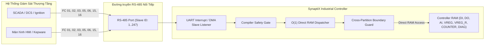

# Hướng Dẫn Tích Hợp Cổng RS-485 Modbus RTU Slave & Bản Đồ Địa Chỉ Bộ Nhớ Cố Định Cho SCADA / HMI

**Tài liệu chuẩn kỹ thuật (Interface Control Document - SPLC-SPEC-SLAVE-001)**  
*Áp dụng từ phiên bản Firmware V2.0 & SynaptiX IDE 2.12+*

---

## 1. Giới Thiệu & Kiến Trúc Tổng Quan

Trong các ứng dụng tự động hóa công nghiệp và Gateway IIoT (SynaptiX Industrial Controller / Smart Gateway), thiết bị không chỉ đóng vai trò **Modbus Master** (chủ động quét các cảm biến hiện trường) mà còn có thể cấu hình linh hoạt từng cổng RS-485 thành **Modbus RTU Slave (Server)**.

Khi ở chế độ Slave, thiết bị hoạt động như một trạm ngoại vi hiện trường (Field Station) với mã trạm (Slave ID từ `1..247`), sẵn sàng đáp ứng các truy vấn đọc/ghi từ hệ thống SCADA tổng, DCS, bộ điều khiển thượng tầng hoặc màn hình HMI công nghiệp (Ignition, Kepware, WinCC, WebAccess, Pro-face, Weintek).

Thiết bị tuân thủ **chuẩn địa chỉ bộ nhớ cố định (Industrial Fixed Memory Map)** được cấu hình sẵn từ nhà máy (tương tự các dòng RTU / Gateway công nghiệp chuẩn quốc tế của Advantech ADAM, Moxa ioLogik, Schneider Electric):
* **Truy xuất trực tiếp $O(1)$ vào RAM:** Không sử dụng bảng ánh xạ trung gian thủ công, triệt tiêu hoàn toàn độ trễ giải mã.
* **Hỗ trợ đồng thời 2 cấp độ truy cập (Dual-Access):** Cho phép truy xuất cấp bit (Coils FC 01/05/15, Discrete Inputs FC 02) và truy xuất gom cấp Word (Holding Registers FC 03/06/16) giúp tối ưu hóa băng thông đường truyền RS-485.



---

## 2. Cơ Chế Bảo Vệ Phân Vùng & Kiểm Tra Ranh Giới (Boundary Protection)

Để đảm bảo tính toàn vẹn và độ ổn định cao nhất theo tiêu chuẩn **IEC 61508-3**, firmware SynaptiX thiết lập cơ chế kiểm soát ranh giới phân vùng nghiêm ngặt:

| Cấp độ | Vùng Bộ Nhớ | Quy Tắc Kiểm Soát | Phản Hồi Khi Vi Phạm |
|:---:|:---|:---|:---|
| 🔴 **Tier 1** | **Vùng Cấm Hệ Thống (Restricted System Area)** | Tuyệt đối cô lập SCADA với các vùng nạp rule logic (`0x9000`), lệnh chốt Flash COMMIT (`0xA000`), thông tin bảo mật Wi-Fi / MQTT và các vùng nhớ ngoài bản đồ. | **Modbus Exception 0x02** (`Illegal Data Address`) |
| 🟡 **Tier 2** | **Vùng Cấm Ghi (Read-Only Sensors & Inputs)** | Ngõ vào số gom `DI_WORD`, ngõ vào tương tự `AI0..AI3`, chẩn đoán `SYS_DIAG`, và các chân ngõ vào số vật lý `DI0..DI15`. Khóa cứng quyền chỉ đọc trên firmware. | **Modbus Exception 0x03** (`Illegal Data Value / Access Denied`) |
| 🟢 **Tier 3** | **Vùng Đọc / Ghi An Toàn (Safe Read/Write Area)** | Ngõ ra rơ-le (`DO_WORD`, `DO0..DO15`), cờ logic (`VFLAG_DWORD`, `VFLAG0..VFLAG31`), thanh ghi số (`VREG0..VREG31`), thanh ghi lưu giữ không mất điện (`VREG_R0..VREG_R31`), và bộ đếm (`COUNTER0..COUNTER7`). | Ghi dữ liệu thành công với cơ chế bảo vệ Atomic 32-bit |
| 🛡️ **Cross-Boundary** | **Ranh Giới Phân Vùng (Partition Boundaries)** | Cấm tuyệt đối một request Modbus duy nhất đọc/ghi chéo qua 2 phân vùng chức năng khác nhau (ví dụ: request đọc từ `0x0050` đến `0x0070` trải dài qua cả VREG và VREG_R). | **Modbus Exception 0x02** (`Illegal Data Address`) |

> [!IMPORTANT]
> **Khóa An Toàn Trình Biên Dịch (Compiler Safety Gate):**  
> Khi một cổng RS-485 được cấu hình sang vai trò **Slave (Server)**, trình biên dịch `RuleCompiler` sẽ tự động kích hoạt chốt chặn an toàn: Nếu trong sơ đồ Logic xuất hiện khối `MB_READ` hoặc `MB_WRITE` định tuyến vào cổng này, quá trình biên dịch sẽ bị **chặn đứng ngay lập tức** kèm mã lỗi `ERR_MB_SLAVE_PORT_CONFLICT`. Điều này ngăn ngừa xung đột 2 luồng Master/Slave trên cùng một chip thu phát RS-485 vật lý.

---

## 3. Cấu Hình Cổng Trên Giao Diện SynaptiX IDE

Giao diện cấu hình cổng RS-485 được thiết kế theo quy chuẩn công nghiệp **Microsoft Fluent 2 Desktop** kết hợp bảng mật độ cao **IBM Carbon Density** (kích thước tối ưu, font hệ thống `Segoe UI` đồng bộ, căn lề trái chuẩn xác và hỗ trợ đa ngôn ngữ Anh - Việt):

```
+-------------------------------------------------------------------------------------------------------------------------------+
|  RS-485 MODBUS PORTS CONFIGURATION                                                                                 -  □  ✕  |
+-------------------------------------------------------------------------------------------------------------------------------+
|  [Danh sách cổng]    |  Port 1: RS-485 #1                                                             [✔ Kích hoạt]           |
|                      |  ---------------------------------------------------------------------------------------------------  |
|  ┌────────────────┐  |  Vai trò cổng:   ( ) Modbus RTU Master    (●) Modbus RTU Slave (Server)                               |
|  │ Port 1: RS-485 │  |  ┌─────────────────────────────────────────────────────────────────────────────────────────────┐      |
|  │ [ACTIVE] SLAVE │  |  │ Tên cổng       Baud Rate     Data Bits     Parity                                           │      |
|  │ 9600·8-N-1·ID:1│  |  │ RS-485 #1      9600          8             None                                             │      |
|  ├────────────────┤  |  │ Stop Bits      Slave ID                                                                     │      |
|  │ Port 2: RS-485 │  |  │ 1              1                                                                            │      |
|  │ [ACTIVE] MASTER│  |  └─────────────────────────────────────────────────────────────────────────────────────────────┘      |
|  │ 19200·8-E-1    │  |                                                                                                       |
|  └────────────────┘  |  BẢN ĐỒ ĐỊA CHỈ MODBUS SLAVE CỐ ĐỊNH [CỐ ĐỊNH TỪ NHÀ MÁY]                             [⤓ Xuất tài liệu] |
|                      |  ┌─────────────────────────────────────────────────────────────────────────────────────────────┐      |
|                      |  │ [ Tất cả (11) ]  [ Holding Registers 4xxxx (8) ]  [ Coils 0xxxx (2) ]  [ Discrete Inputs 1xxxx (1) ] │      |
|                      |  ├─────────────────────────────────────────────────────────────────────────────────────────────┤      |
|                      |  │ Modbus Address  Device Tag        Data Type     Access    Description                               │      |
|                      |  │ 40001           DI_WORD           [ UINT16 ]    [ RO ]    Gom 16 ngõ vào số DI0..DI15 (Bitmask)     │      |
|                      |  │ 40002           DO_WORD           [ UINT16 ]    [ RW ]    Gom 16 ngõ ra Relay DO0..DO15             │      |
|                      |  │ 40003 .. 40004  VFLAG_DWORD       [ UINT32 ]    [ RW ]    Gom 32 cờ logic VFLAG0..VFLAG31           │      |
|                      |  │ 40017 .. 40024  AI0 .. AI3        [ FLOAT32 ]   [ RO ]    4 ngõ vào tương tự (High Word First)      │      |
|                      |  │ 40033 .. 40096  VREG0 .. VREG31   [ INT32 ]     [ RW ]    32 biến tính toán (40033 + Index * 2)     │      |
|                      |  │ 40097 .. 40160  VREG_R0 .. VREG_R31 [ INT32 ]   [ RW ]    32 biến lưu giữ Retentive (Pin/Flash)     │      |
|                      |  │ 40161 .. 40176  COUNTER0..COUNTER7[ INT32 ]     [ RW ]    8 bộ đếm sự kiện (40161 + Index * 2)      │      |
|                      |  │ 40241 .. 40256  SYS_DIAG          [ UINT16 ]    [ RO ]    Chẩn đoán: Uptime, Scan ms, Status, RTC   │      |
|                      |  └─────────────────────────────────────────────────────────────────────────────────────────────┘      |
+-------------------------------------------------------------------------------------------------------------------------------+
```

### Các Bước Cấu Hình Nhanh:

1. **Chọn vai trò Slave:** Trong hộp thoại Cấu hình Cổng RS-485, tích chọn **Modbus RTU Slave (Server)**.
2. **Cài đặt thông số truyền thông:** Nhập Baud rate, Framing (Data Bits, Parity, Stop Bits) và **Slave ID (1..247)**. Các thông số nội bộ (Inter-frame Delay tự động theo $t_{3.5}$ RTU và dải Sandbox) đã được tự động quản lý ngầm, giao diện hoàn toàn tinh gọn.
3. **Tra cứu phân vùng theo Tabs Moxa:** 
   * Bấm các nút Tab phân vùng phía trên để lọc nhanh nhóm thanh ghi cần tích hợp vào SCADA.
   * Rê chuột (Hover) vào ô địa chỉ Modbus để xem popup Tooltip hiển thị: `Protocol Wire Offset: 0x... (Hex) | Modbus Function Code: FC ...`.
4. **Xuất tài liệu (Export Datasheet):** Bấm nút **"Xuất tài liệu"** để lưu bảng địa chỉ ra file CSV (chuẩn UTF-8 with BOM mở trực tiếp trên Excel) hoặc Markdown để bàn giao cho đội ngũ lập trình SCADA/HMI.

---

## 4. Bảng Tra Cứu Bộ Nhớ Cố Định (Fixed Memory Map Datasheet)

### 4.1. Vùng Thanh Ghi Giữ (Holding Registers - 4xxxx)

Các thanh ghi này được truy vấn thông qua hàm **FC 03** (Read Holding Registers), **FC 06** (Write Single Register) và **FC 16** (Write Multiple Registers).

| Địa chỉ Modbus (1-based) | Địa chỉ Wire (Hex) | Tag Thiết Bị | Kiểu Dữ Liệu | Quyền | Quy Ước & Diễn Giải Chi Tiết |
|:---|:---:|:---|:---:|:---:|:---|
| **40001** | `0x0000` | **`DI_WORD`** | UINT16 | RO | Gom trạng thái 16 ngõ vào số vật lý `DI0..DI15` dạng bitmask (Bit 0 = DI0, Bit 15 = DI15). |
| **40002** | `0x0001` | **`DO_WORD`** | UINT16 | RW | Gom trạng thái 16 ngõ ra Relay `DO0..DO15` dạng bitmask. Ghi giá trị để điều khiển bật/tắt đồng thời. |
| **40003 .. 40004** | `0x0002 .. 0x0003` | **`VFLAG_DWORD`** | UINT32 | RW | Gom 32 cờ logic trung gian nội bộ `VFLAG0..VFLAG31` (32-bit bitmask, Big-Endian). |
| **40017 .. 40024** | `0x0010 .. 0x0017` | **`AI0 .. AI3`** | FLOAT32 | RO | 4 ngõ vào tương tự 0..10V / 4..20mA (2 thanh ghi/kênh, định dạng IEEE-754 **High Word First**):<br>• `AI0`: 40017-40018 (`0x0010`)<br>• `AI1`: 40019-40020 (`0x0012`)<br>• `AI2`: 40021-40022 (`0x0014`)<br>• `AI3`: 40023-40024 (`0x0016`) |
| **40033 .. 40096** | `0x0020 .. 0x005F` | **`VREG0 .. VREG31`** | INT32 / FLOAT32 | RW | 32 biến tính toán nội vi (2 thanh ghi/biến, Big-Endian).<br>**Công thức tính:** $\text{Address} = 40033 + (\text{Index} \times 2)$. |
| **40097 .. 40160** | `0x0060 .. 0x009F` | **`VREG_R0 .. VREG_R31`** | INT32 / FLOAT32 | RW | 32 biến lưu giữ Retentive trong bộ nhớ Non-Volatile (không mất khi cúp điện).<br>**Công thức tính:** $\text{Address} = 40097 + (\text{Index} \times 2)$. |
| **40161 .. 40176** | `0x00A0 .. 0x00AF` | **`COUNTER0 .. COUNTER7`**| INT32 | RW | 8 bộ đếm sự kiện / xung tốc độ cao (2 thanh ghi/bộ, Big-Endian).<br>**Công thức tính:** $\text{Address} = 40161 + (\text{Index} \times 2)$. |
| **40241 .. 40256** | `0x00F0 .. 0x00FF` | **`SYS_DIAG`** | UINT16 | RO | Vùng chẩn đoán hệ thống thiết bị:<br>• `40241 .. 40242` (`0x00F0`): `SYS_UPTIME` (UINT32, thời gian hoạt động tính bằng giây)<br>• `40243` (`0x00F2`): `SYS_SCANTIME` (UINT16, chu kỳ quét logic thực tế tính bằng ms)<br>• `40244` (`0x00F3`): `SYS_STATUS` (UINT16, mã trạng thái và cờ lỗi thiết bị)<br>• `40245 .. 40250` (`0x00F5`): `SYS_RTC` (6 words: Năm, Tháng, Ngày, Giờ, Phút, Giây) |

---

### 4.2. Vùng Truy Xuất Cấp Bit (Discrete Inputs & Coils)

Hỗ trợ SCADA/HMI đọc và điều khiển trực tiếp từng điểm I/O đơn lẻ:

| Địa chỉ Modbus (1-based) | Địa chỉ Wire (Hex) | Phân Loại | Tag Thiết Bị | Mã Hàm Hỗ Trợ | Quyền | Mô Tả Chức Năng |
|:---|:---:|:---|:---|:---:|:---:|:---|
| **10001 .. 10016** | `0x0000 .. 0x000F` | **Discrete Inputs** | `DI0 .. DI15` | **FC 02** | RO | Đọc trạng thái tín hiệu thời gian thực của các ngõ vào số vật lý. |
| **00001 .. 00016** | `0x0000 .. 0x000F` | **Coils** | `DO0 .. DO15` | **FC 01, 05, 15** | RW | Đọc và đóng/ngắt trực tiếp các rơ-le ngõ ra vật lý của thiết bị. |
| **00101 .. 00132** | `0x0064 .. 0x0083` | **Coils** | `VFLAG0 .. VFLAG31` | **FC 01, 05, 15** | RW | Đọc và ghi các cờ logic trung gian nội bộ phục vụ bắt tay (handshake) với SCADA. |

---

## 5. Quy Chuẩn Đấu Nối Cáp RS-485

```
[SCADA / HMI Master]                             [SynaptiX Controller (RS-485 Slave)]
    +----------+                                         +----------+
    |  D+ (A)  | --------------------------------------- |  D+ (A)  |
    |  D- (B)  | --------------------------------------- |  D- (B)  |
    |   GND    | --------------------------------------- |   GND    |
    +----------+                                         +----------+
         |                                                    |
         +=========== Cáp xoắn đôi chống nhiễu (STP) =========+
```

> [!TIP]
> - **Chống nhiễu:** Luôn sử dụng cáp xoắn đôi có vỏ bọc chống nhiễu (Shielded Twisted Pair - STP, AWG 22..24).
> - **Điện trở đầu cuối:** Khi chiều dài tuyến cáp lớn (> 100m) hoặc hoạt động trong môi trường có biến tần công suất lớn, gạt công tắc kích hoạt điện trở đầu cuối **120 $\Omega$** tại 2 đầu mút của mạng.
> - **Tiếp địa:** Chỉ nối vỏ chống nhiễu cáp (Shield) xuống đất tại một điểm duy nhất (Single-point Grounding) ở tủ trung tâm để tránh dòng lặp đất.

---

## 6. Tổng Hợp Kết Quả Kiểm Thử (Verification Summary)

Toàn bộ hệ thống truyền thông Modbus Slave và bảng địa chỉ cố định được bảo vệ bởi bộ kiểm thử tự động đạt **100% tỷ lệ vượt qua (Pass Rate)**:

| Dự Án Kiểm Thử | Số Bài Test | Phạm Vi Xác Thực | Trạng Thái |
|:---|:---:|:---|:---:|
| **`SimplePLC.Studio.Tests`** | **967** | Lọc Tab Moxa, kiểm tra Tooltip địa chỉ, căn lề trái Segoe UI, xuất file CSV UTF-8 BOM / Markdown không chứa từ "PLC", chuyển đổi song ngữ VI/EN tức thì, xử lý tab fallback an toàn. | ✅ PASS (100%) |
| **`SimplePLC.Protocol.Tests`** | **215** | Khế ước địa chỉ `ModbusSlaveFixedMap`, kiểm tra bất biến không đè lấn ranh giới wire, công thức offset, mã hóa giải mã DTO. | ✅ PASS (100%) |
| **`SimplePLC.Infrastructure.Tests`** | **179** | Bộ kiểm thử Triad IEC 61508-3: Happy Path đọc/ghi RAM $O(1)$ VREG/VREG_R/COUNTER/DIAG, kiểm tra ranh giới phân vùng (Exception 0x02), bảo vệ ghi vào ô Read-Only (Exception 0x03). | ✅ PASS (100%) |
| **`SimplePLC.Application.Tests`** | **231** | Khóa an toàn trình biên dịch: Chặn khối `MB_READ`/`MB_WRITE` định tuyến vào cổng Slave (`ERR_MB_SLAVE_PORT_CONFLICT`). | ✅ PASS (100%) |
| **`SimplePLC.Domain.Tests`** | **54** | Tính toán miền logic và bất biến trạng thái hệ thống. | ✅ PASS (100%) |
| **TỔNG CỘNG HỆ THỐNG** | **1,646 / 1,646 Tests** | **Toàn diện 100% các tầng từ Domain, Protocol, Simulator đến UI Studio.** | **✅ 100% PASS** |
