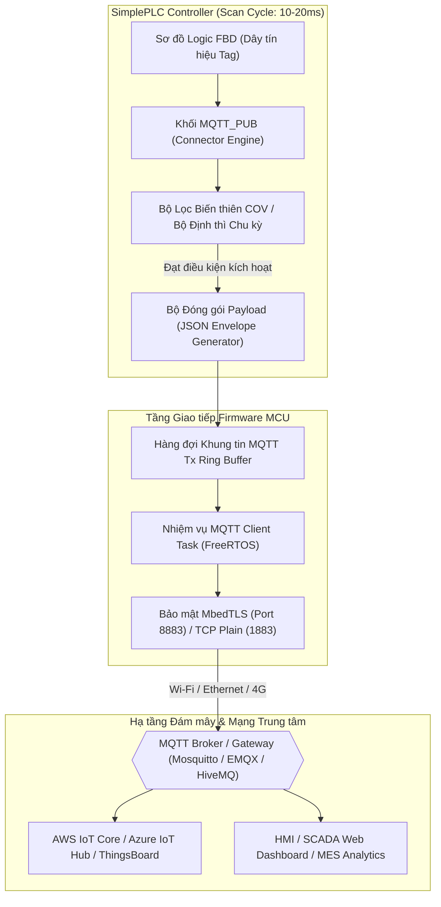

# CẨM NANG KỸ THUẬT & HƯỚNG DẪN SỬ DỤNG KHỐI CHỨC NĂNG MQTT_PUB
## MQTT IIoT Telemetry Publisher Function Block User Manual & Engineering Guide

**Mã tài liệu:** `MAN-SPLC-MQTPUB-2026-V2.0`  
**Phiên bản áp dụng:** `SimplePLC / SynaptiX IDE v2.6.0+`  
**Tiêu chuẩn quốc tế tham chiếu:** 
- **IEC 61131-3:2013** (Programmable controllers — Programming languages — Function Blocks)
- **OASIS MQTT V3.1.1 / V5.0** (Message Queuing Telemetry Transport Specification)
- **ISO/IEC 20922:2016** (Information technology — Message Queuing Telemetry Transport)
- **ISA-101.01-2015** (Human-Machine Interfaces for Process Automation Systems)
- **RFC 8259** (The JavaScript Object Notation - JSON Data Interchange Format)
- **SPLC-SPEC-MQTT-001** (SimplePLC Telemetry & Broker Interface Control Document)

---

## 1. TỔNG QUAN & NGUYÊN LÝ HOẠT ĐỘNG (OVERVIEW & PRINCIPLES)

Khối chức năng **`MQTT_PUB`** (MQTT Telemetry Publisher) là khối giao tiếp cấp cao dành cho Internet vạn vật công nghiệp (IIoT) và Công nghiệp 4.0 (Industry 4.0). Khối cho phép bộ điều khiển SimplePLC đóng vai trò là một **MQTT Client** chủ động thu thập các giá trị đo lường, trạng thái vận hành hoặc bản tin cảnh báo từ lõi điều khiển logic PLC, sau đó tự động đóng gói theo định dạng chuẩn (JSON hoặc bản mẫu người dùng) và xuất bản (Publish) lên **MQTT Broker** trung tâm hoặc nền tảng đám mây (Cloud IoT Platforms).

### 1.1. Ứng dụng Điển hình
- **Giám sát Viễn trắc Năng lượng & Môi trường:** Đẩy số liệu điện áp, dòng điện, công suất, nhiệt độ, áp suất lên SCADA Cloud / ThingsBoard / Grafana.
- **Hệ thống Quản lý Vận hành & Cảnh báo (MES / OEE):** Phát cảnh báo tức thời khi máy gặp sự cố (E-Stop, quá nhiệt, áp suất vượt ngưỡng) tới máy chủ ứng dụng hoặc thông báo Telegram/Zalo qua Webhook.
- **Quan trắc Trạm Bơm & Nguồn nước Phân tán:** Truyền dữ liệu định kỳ hoặc khi biến thiên qua mạng 4G/LTE/NB-IoT với chi phí dung lượng tối thiểu.
- **Tích hợp Đa nền tảng:** Kết nối trơn tru với AWS IoT Core, Microsoft Azure IoT Hub, Google Cloud IoT, HiveMQ, EMQX và Mosquitto.

### 1.2. Kiến trúc Luồng Dữ liệu Phân tầng (Architecture Pipeline)



---

## 2. GIẢI PHẪU CHÂN GIAO TIẾP TRÊN CANVAS FBD (CONNECTOR TOPOLOGY)

Khối **`MQTT_PUB`** áp dụng thiết kế tiêu chuẩn **Industrial Slate Gray** với chiều rộng cố định **`220px`** (Golden Template) giúp hiển thị đầy đủ tên Topic và nhãn của các trường dữ liệu mà không bị cắt chữ.

### 2.1. Sơ đồ Chân trên Canvas FBD

#### A. Khi ở chế độ Kích hoạt theo sự kiện (Event Mode / On Trigger)
```
┌────────────────────────────────────────────────────────┐
│ 📡 MQTT PUB                                      [PUB] │
├────────────────────────────────────────────────────────┤
│ (BOOL)  Trig ──►                                       │
│ (ANY)   Val  ──►                                       │
│        (hoặc)           synaptix/factory/press         │
│ (REAL)  Temp ──►               On Trig                 │
│ (REAL)  Pres ──►          ┌───────────────┐            │
│ (BOOL)  Pump ──►          │ ● Ready       │            │
│                           └───────────────┘            │
│                                                ►── Done│ (BOOL)
│                                                ►── Err │ (BOOL)
└────────────────────────────────────────────────────────┘
```

#### B. Khi ở chế độ Định kỳ (Periodic) hoặc Biến thiên (COV)
> [!NOTE]
> Khi chuyển sang chế độ **Periodic** (chu kỳ định thì tự động) hoặc **COV** (tự động theo dõi biến thiên độ lệch), chân **`Trig`** sẽ **tự động ẩn** khỏi khối để tránh gây rối mắt và loại bỏ hoàn toàn các lỗi nối dây thừa trên bản vẽ logic.

```
┌────────────────────────────────────────────────────────┐
│ 📡 MQTT PUB                                      [PUB] │
├────────────────────────────────────────────────────────┤
│ (ANY)   Val  ──►        synaptix/telemetry/data        │
│        (hoặc)                   1000ms                 │
│ (REAL)  Temp ──►          ┌───────────────┐            │
│ (REAL)  Pres ──►          │ ● Sent: 142 msgs│          │
│                           └───────────────┘            │
│                                                ►── Done│ (BOOL)
│                                                ►── Err │ (BOOL)
└────────────────────────────────────────────────────────┘
```

### 2.2. Bảng Đặc tả Chân Tín hiệu (Pin Definitions)

| Tên Chân | Chiều | Kiểu Dữ Liệu | Chế độ Hoạt động | Mô Tả Chức Năng & Hành Vi Kỹ Thuật |
| :--- | :---: | :---: | :---: | :--- |
| **`Trig`** | Vào (IN) | `BOOL` | Chỉ hiện ở `Event` | Xung kích hoạt xuất bản. Tại cạnh lên (`0` lên `1`), khối lập tức lấy mẫu các giá trị đầu vào và đẩy bản tin vào hàng đợi phát tin. |
| **`Val`** | Vào (IN) | `ANY_NUM` / `BOOL` | Khi chưa có Fields | Chân dữ liệu ngõ vào đơn biến mặc định. Khi không sử dụng bảng Fields, giá trị nối vào chân này sẽ được đóng gói vào đối tượng `values` hoặc thay thế vào thẻ `{val}`. |
| **`[FieldKey]`** | Vào (IN) | Tự suy luận từ Tag | Khi có Fields | Các chân dữ liệu động tương ứng với từng trường JSON được định nghĩa trong Visual Field Builder (ví dụ: `temperature`, `flow_rate`, `status`). |
| **`Done`** | Ra (OUT) | `BOOL` | Mọi chế độ | Xung báo thành công (One-Shot Pulse). Tích cực mức cao (`TRUE`) trong đúng 1 chu kỳ quét logic (Scan Pass) ngay sau khi bản tin được phát đi thành công hoặc nhận được `PUBACK` (đối với QoS 1/2). |
| **`Err`** | Ra (OUT) | `BOOL` | Mọi chế độ | Tín hiệu báo lỗi (Latching Error Flag). Tích cực mức cao (`TRUE`) nếu kết nối Broker bị gián đoạn, hàng đợi phát tin bị đầy (Queue Overflow) hoặc định dạng JSON vượt quá dung lượng. |

---

## 3. CÁC CHẾ ĐỘ KÍCH HOẠT XUẤT BẢN (PUBLISH TRIGGER MODES)

Khối **`MQTT_PUB`** cung cấp 3 cơ chế xuất bản tối ưu hóa cho từng tình huống công nghiệp:

### 3.1. Kích hoạt theo Sự kiện (Event Mode / On Trigger)
- **Mã định danh firmware:** `PublishMode = 0`
- **Nguyên lý:** Khối chỉ phát bản tin khi chân **`Trig`** nhận được sườn xung dương (`R_TRIG`).
- **Ứng dụng:**
  - Báo động khẩn cấp (Emergency Stop tripped, nhiệt độ quá cao).
  - Bản ghi kiểm toán (Audit Trail, đổi mẻ sản xuất, công nhân quẹt thẻ RFID).
  - Bản tin bắt tay phản hồi lệnh điều khiển từ SCADA.

### 3.2. Xuất bản Định kỳ theo Chu kỳ (Periodic / Cyclic Mode)
- **Mã định danh firmware:** `PublishMode = 2`
- **Thông số cấu hình:** `IntervalMs` (50ms .. 60,000ms, mặc định `1000ms`).
- **Nguyên lý:** Bộ đếm thời gian phần cứng trên vi điều khiển hoạt động độc lập, tự động phát bản tin telemetry đều đặn sau mỗi khoảng thời gian `IntervalMs` mà không cần nối thêm khối Timer `TON` bên ngoài.
- **Ứng dụng:** Giám sát điện năng định kỳ (mỗi 5 giây), nhật ký nhiệt độ môi trường buồng lạnh (mỗi 10 giây).

### 3.3. Xuất bản theo Ngưỡng Biến thiên (Change of Value - COV)
- **Mã định danh firmware:** `PublishMode = 1`
- **Thông số cấu hình:** `Deadband` ($\Delta$, ví dụ `0.5 bar`, `1.0 °C`).
- **Nguyên lý:** Tại mỗi chu kỳ quét, firmware MCU so sánh giá trị tức thời của từng Tag được liên kết với giá trị lần xuất bản trước đó:
  $$\Delta V = |V_{\text{hien_tai}} - V_{\text{da_phat}}|$$
  Nếu $\Delta V \ge \text{Deadband}$ trên bất kỳ biến nào, khối sẽ lập tức kích hoạt phát bản tin mới và cập nhật lại mốc so sánh.
- **Lợi ích vượt trội:** Giảm tới **85% - 95%** lưu lượng truyền dẫn và tiêu thụ điện năng cho các trạm quan trắc vận hành bằng năng lượng mặt trời truyền qua mạng di động 4G / NB-IoT / Vệ tinh.

---

## 4. CƠ CHẾ ĐÓNG GÓI PAYLOAD DỮ LIỆU (PAYLOAD ENCODING ENGINE)

Khối hỗ trợ 2 chế độ đóng gói linh hoạt thông qua hộp thoại cấu hình:

### 4.1. Bảng Trường Trực quan Không Cần Viết Code (Visual Field Builder)
Chế độ mặc định được khuyến nghị cho các dự án IIoT tiêu chuẩn. Người dùng chỉ cần khai báo tên khóa (`Key`) và chọn biến nguồn (`Tag`) trong dự án, hệ thống sẽ tự động sinh cấu trúc JSON chuẩn công nghiệp:

```json
{
  "device": "SynaptiX_PLC_01",
  "ts": 1729505420,
  "values": {
    "temperature": 45.8,
    "pressure": 3.42,
    "pump_run": true
  }
}
```

- **Tự động suy luận kiểu dữ liệu:** `BOOL` hiển thị dạng boolean (`true`/`false`), số nguyên hiển thị dạng số nguyên (`DINT`), số thực hiển thị với dấu chấm thập phân (`REAL`).
- **Dung lượng tối đa:** Hỗ trợ liên kết tối đa 8 biến đồng thời trong một khối xuất bản.

### 4.2. Mẫu JSON Tự do & Tự Động Sinh Chân Động (Custom Template & Hybrid Auto-Parsing)
Dành cho các hệ thống yêu cầu cấu trúc gói tin đặc thù (ví dụ: giao thức Sparkplug B rút gọn, ThingsBoard Attributes, REST/MQTT Webhook API hoặc định dạng riêng của nhà máy):

```json
{
  "device": "{device}",
  "ts": {ts},
  "data": {
    "speed": {speed},
    "pressure": {pressure}
  }
}
```

#### A. Cơ Chế Bóc Tách Tự Động Ra Chân Input (Hybrid Auto-Parsing - Phương Án 3)
Kể từ phiên bản v2.6.0+, SynaptiX IDE áp dụng cơ chế **Hybrid Auto-Parsing**:
1. **Trích xuất Token Thông minh:** Khi kỹ sư nhập bản mẫu Custom JSON, hệ thống tự động bóc tách các token giá trị (ví dụ `{speed}`, `{pressure}`, `{val1}`..`{val8}`), tự động loại trừ các trường hệ thống (`{device}`, `{ts}`, `{tag}`, `{unit}`).
2. **Tự Động Sinh Chân Input trên Canvas FBD:** Ngay lập tức trên khối `MQTT_PUB`, thay vì một chân `Val` đơn điệu, khối sẽ xuất hiện các chân Input tương ứng với đúng tên token:
   ```
   ┌────────────────────────────────────────┐
   │ 📡 MQTT PUB                      [PUB] │
   ├────────────────────────────────────────┤
   │ (BOOL)  Trig     ──►                   │
   │ (REAL)  speed    ──► (Kéo dây từ AI0)  │
   │ (REAL)  pressure ──► (Kéo dây từ AI1)  │
   │                                        │
   │                 synaptix/station/data  │
   │                        1000ms          │
   │                                ►── Done│
   │                                ►── Err │
   └────────────────────────────────────────┘
   ```
3. **Kéo Nối Dây Trực Tiếp (Zero-Config Mapping):** Kỹ sư chỉ cần kéo dây từ cảm biến/Tag bất kỳ vào chân ngõ vào tương ứng. Trình biên dịch [RuleCompiler.cs](file:///g:/HoaNV/Projects/SimplePLC/SimplePLC.Studio/Services/RuleCompiler.cs) sẽ tự động ánh xạ Tag đó vào `BOUND_TAGS[0..7]` và nạp xuống MCU mà không cần phải chọn lại Tag trong bảng cấu hình.

#### B. Bảng Biến Động Hỗ Trợ Thay Thế:
| Biến Thay Thế | Dữ Liệu Tự Động Điền & Hành Vi Trên FBD | Ví Dụ Đầu Ra |
| :--- | :--- | :--- |
| `{val}` | Giá trị đo lường đơn biến (sinh chân `Val` trên khối) | `24.5` |
| `{speed}`, `{temp}`, `{p1}`... | Token tùy chỉnh (tự động sinh chân Input tên tương ứng trên Canvas) | `1450`, `65.2` |
| `{val1}` .. `{val8}` | Giá trị số thứ tự (tự động sinh các chân `val1` .. `val8`) | `100`, `3.14` |
| `{val1:2}` | Giá trị định dạng làm tròn 2 chữ số thập phân | `3.14` |
| `{tag}` | Tên định danh của Tag đang liên kết | `"AI0_NhietDo"` |
| `{ts}` | Dấu thời gian Unix Epoch hệ thống (giây) | `1729505420` |
| `{device}` | Client ID định danh của bộ điều khiển | `"SynaptiX_Controller"` |
| `{TAG_NAME}` | Đọc trực tiếp Tag tĩnh trong dự án (ví dụ `{DI0}`, `{VREG1}`) | `true`, `125` |

> [!WARNING] Giới hạn Phần cứng MCU
> Firmware MCU STM32/ESP32 cấp phát bộ đệm bản mẫu 128 Bytes (tương đương 64 thanh ghi Modbus). Trình biên soạn cấu hình tích hợp sẵn bộ đếm ký tự thời gian thực (`CustomTemplateCounterText`). Nếu vượt quá 128 ký tự, hệ thống sẽ cảnh báo đỏ và ngăn không cho nạp nhằm bảo đảm an toàn bộ nhớ RTOS.

---

## 5. MỨC ĐỘ DỊCH VỤ TRUYỀN TIN (QoS) & CỜ LƯU TRỮ (RETAIN)

### 5.1. Bảng So sánh Mức Dịch vụ QoS (Quality of Service)

| Mức QoS | Tên gọi Kỹ thuật | Cơ chế Bắt tay | Khuyến nghị Ứng dụng |
| :---: | :--- | :--- | :--- |
| **QoS 0** | *At most once* (Nhiều nhất 1 lần) | Không xác nhận (Fire & Forget), gửi gói `PUBLISH` thẳng đi. | Dữ liệu viễn trắc định kỳ chu kỳ nhanh (100ms - 1s). Mất một bản tin không ảnh hưởng đến an toàn hệ thống. |
| **QoS 1** | *At least once* (Ít nhất 1 lần) | Broker phản hồi gói `PUBACK`. Nếu quá timeout MCU sẽ phát lại. | Bản tin cảnh báo lỗi thiết bị, sự kiện bật/tắt động cơ, báo động dừng khẩn cấp. |
| **QoS 2** | *Exactly once* (Chính xác 1 lần) | Bắt tay 4 bước (`PUBLISH` $\rightarrow$ `PUBREC` $\rightarrow$ `PUBREL` $\rightarrow$ `PUBCOMP`). | Dữ liệu kiểm toán sản lượng, chốt công tơ điện năng thanh toán, mẻ cân định lượng. |

### 5.2. Cờ Lưu trữ Bản tin (Retain Flag)
- Khi bật **`Retain: ON`**, MQTT Broker sẽ lưu giữ bản tin cuối cùng của Topic này vào bộ nhớ đệm vĩnh cửu.
- Khi một ứng dụng HMI/Web hoặc App di động kết nối tới Broker và Subscribe Topic, Broker sẽ **lập tức gửi ngay bản tin Retain này** mà không cần đợi bộ điều khiển phát chu kỳ tiếp theo.
- **Ứng dụng:** Trạng thái trực tuyến của máy (`device/status = "ONLINE"`), phiên bản firmware, cấu hình tham số máy.

---

## 6. HƯỚNG DẪN CẤU HÌNH TRÊN SYNAPTIX STUDIO (STEP-BY-STEP)

### Bước 1: Thêm Khối vào Bản vẽ FBD
1. Mở trình biên tập **Logic Editor**.
2. Tại thanh công cụ **Toolbox** bên trái, mở nhóm **TRUYỀN THÔNG MẠNG (MQTT)**.
3. Kéo thả khối **📡 MQTT Publish** thả vào vùng vẽ Canvas.

### Bước 2: Xem Thông tin Tóm tắt tại Inspector Bên Phải
- Khi chọn khối, panel bên phải hiển thị thẻ tóm tắt kỹ thuật:
  - **Topic:** Đường dẫn chủ đề (ví dụ `synaptix/telemetry/data`).
  - **Publish Mode:** Chế độ phát (`On Trig`, `1000ms`, hoặc `COV (Δ0.5)`).
  - **QoS / Retain:** `QoS 0 · Retain: OFF`.
  - **Format / Source:** `JSON · 3 Tags`.
- Nhấn nút màu xanh công nghiệp: **`[ ⚙ Cấu hình MQTT Publish... ]`**.

### Bước 3: Thiết lập Thông số trong Hộp thoại Cấu hình (MqttConfigDialog)
Hộp thoại chuẩn kích thước công nghiệp **`1040 x 660`** mở ra với 2 cột trực quan:

```
┌────────────────────────────────────────────────────────────────────────────────────────┐
│ 📡 Cấu hình MQTT Payload & Visual Field Builder                       [—] [□] [✕]      │
├────────────────────────────────────────────────────────┬───────────────────────────────┤
│ THÔNG SỐ GIAO TIẾP & KÍCH HOẠT (MQTT COMMUNICATION)    │ XEM TRƯỚC BẢN TIN JSON        │
│ Topic: [ synaptix/factory/press                      ] │ ┌───────────────────────────┐ │
│ Chế độ: [ Định kỳ (Periodic) ▼ ] Chu kỳ: [ 1000 ] ms   │ │ {                         │ │
│ QoS: [ 0 ] [ 1 ] [ 2 ]           Retain: [x]           │ │   "device": "SynaptiX",   │ │
│                                                        │ │   "ts": 1729505420,       │ │
│ CẤU HÌNH PAYLOAD DỮ LIỆU                               │ │   "values": {             │ │
│ Định dạng: [ Chọn Danh Sách Tag (Visual Fields)     ▼ ] │ │     "temp": 45.8,         │ │
│                                                        │ │     "pres": 3.42          │ │
│ ┌────────────────────────────────────────────────────┐ │ │   }                       │ │
│ │ Khóa JSON    │ Biến nguồn (Tag) │ Kiểu DL │ Xóa    │ │ │ }                         │ │
│ ├──────────────┼──────────────────┼─────────┼────────┤ │ └───────────────────────────┘ │
│ │ temp         │ AI0_NhietDo      │ REAL    │  [✕]   │ │                               │
│ │ pres         │ AI1_ApSuat       │ REAL    │  [✕]   │ │ ▌ Bản tin Tiêu chuẩn Sẵn sàng │
│ └────────────────────────────────────────────────────┘ │ │ Bản tin JSON trên sẽ được │
│ [+ Thêm biến]                                          │ │ gửi định kỳ 1000ms.       │
├────────────────────────────────────────────────────────┴───────────────────────────────┤
│ Topic: synaptix/factory/press   [ 1000ms ]                               [ Áp dụng ]   │
└────────────────────────────────────────────────────────────────────────────────────────┘
```

1. **Thiết lập Topic:** Nhập đường dẫn MQTT hợp lệ (nhấn nút 🧹 để tự động chuẩn hóa loại bỏ dấu cách hoặc ký tự tiếng Việt không hợp lệ).
2. **Chọn Chế độ Xuất bản:** Kích hoạt (`Event`), Định kỳ (`Periodic`) kèm thời gian chu kỳ ms, hoặc Biến thiên (`COV`) kèm độ lệch Deadband.
3. **Chọn Mức QoS & Cờ Retain:** Chọn QoS 0, 1 hoặc 2 và tích chọn Retain nếu muốn lưu trạng thái mới nhất.
4. **Cấu hình Trường Payload:** Nhấn **`+ Thêm biến`**, nhập tên thuộc tính JSON và chọn Tag tương ứng trong dự án.
5. **Kiểm tra Live Preview:** Cửa sổ bên phải cập nhật trực quan bản tin JSON tức thời. Thanh trạng thái phía dưới hiển thị dải màu xanh `Ready to Publish` xác nhận bản tin hợp lệ.
6. **Nhấn `[ Áp dụng ]`:** Toàn bộ thông số được lưu vào khối và các chân Connector trên canvas tự động cập nhật đồng bộ.

---

## 7. KỊCH BẢN ỨNG DỤNG CÔNG NGHIỆP THỰC TẾ

### Kịch bản 1: Giám sát Trạm Bơm Cấp Nước Tự Động (Periodic Telemetry)
- **Yêu cầu:** Gửi lưu lượng (`flow`), áp suất ngõ ra (`pressure`), dòng động cơ (`current`) lên Dashboard giám sát trung tâm mỗi **2 giây một lần**.
- **Cấu hình:**
  - Topic: `water/pump_station_01/telemetry`
  - Mode: `Periodic` với `IntervalMs = 2000`
  - QoS: `0`
  - Retain: `OFF`
  - Fields: `flow` $\rightarrow$ `AI0`, `pressure` $\rightarrow$ `AI1`, `current` $\rightarrow$ `AI2`.

### Kịch bản 2: Cảnh báo Nhiệt độ Quá Ngưỡng Lò Nhiệt (Critical Alarm Event)
- **Yêu cầu:** Khi nhiệt độ lò vượt quá $500^\circ\text{C}$, khối so sánh `CMP` bật mức cao, kích hoạt khối `MQTT_PUB` gửi cảnh báo khẩn cấp lên Broker.
- **Cấu hình:**
  - Topic: `factory/furnace/alarm`
  - Mode: `Event (On Trigger)`
  - QoS: `1` (Bảo đảm Broker đã nhận được bản tin)
  - Retain: `ON`
  - Chân `Trig`: Nối với ngõ ra của khối `CMP (AI0 > 500.0)`.

### Kịch bản 3: Giám sát Mức Bồn Dầu Xa Tiết Kiệm Băng Thông 4G (COV Telemetry)
- **Yêu cầu:** Trạm bồn dầu đặt tại vùng đồi núi sử dụng modem di động 4G trả trước. Chỉ gửi dữ liệu khi mức dầu thay đổi quá $\pm 0.2\text{ m}$.
- **Cấu hình:**
  - Topic: `depot/tank_04/level`
  - Mode: `COV (Change of Value)` với `Deadband = 0.2`
  - QoS: `1`
  - Retain: `ON`
  - Tag liên kết: `AI0_Level`.

---

## 8. MA TRẬN CHẨN ĐOÁN LỖI & KHẮC PHỤC SỰ CỐ (TROUBLESHOOTING)

| Hiện tượng | Nguyên nhân Gốc rễ | Biện pháp Khắc phục Kỹ thuật |
| :--- | :--- | :--- |
| Chân **`Err`** bật mức cao (`TRUE`), chân **`Done`** không có xung | Mất kết nối tới MQTT Broker (Cáp mạng đứt, sai địa chỉ IP, sai Port 1883/8883 hoặc thông tin đăng nhập User/Pass bị từ chối). | 1. Kiểm tra cấu hình kết nối Broker tại Menu `Hệ thống > Cấu hình MQTT Broker (0x0E00)`.<br>2. Kiểm tra ping IP máy chủ từ gateway.<br>3. Kiểm tra Firewall cho phép mở Port 1883/8883. |
| Không thấy chân **`Trig`** trên khối | Khối đang đặt ở chế độ **`Periodic`** (chu kỳ định thì) hoặc **`COV`** (biến thiên tự động). | Đây là tính năng công thái học chuẩn. Chân `Trig` chỉ xuất hiện khi chọn chế độ **`Event (On Trigger)`**. |
| Dữ liệu trên Broker không cập nhật khi ở chế độ COV | Độ lệch biến thiên tín hiệu ngõ vào chưa vượt quá giá trị ngưỡng **`Deadband`**. | Hạ giá trị Deadband trong hộp thoại cấu hình (ví dụ từ `1.0` xuống `0.1` hoặc `0.05`). |
| Xuất hiện cảnh báo đỏ: *Bản mẫu JSON vượt quá giới hạn 128 ký tự* | Chuỗi bản mẫu Custom JSON quá dài, vượt kích thước bộ nhớ đệm firmware MCU. | Rút ngắn tên thuộc tính trong bản mẫu JSON (ví dụ thay vì `"ambient_temperature"` dùng `"temp"`). |
| Ký tự Topic bị đổi hoặc cảnh báo đỏ | Topic chứa khoảng trắng hoặc ký tự đặc biệt không được phép trong tiêu chuẩn OASIS MQTT (`+`, `#`, ký tự có dấu tiếng Việt). | Nhấn nút chiếc chổi **🧹** bên cạnh ô Topic để hệ thống tự động làm sạch và chuyển về định dạng chuẩn. |

---

## 9. THÔNG SỐ KỸ THUẬT TỔNG HỢP (TECHNICAL SPECIFICATIONS)

| Đặc tính Kỹ thuật | Thông số Quy chuẩn |
| :--- | :--- |
| **Số khối MQTT_PUB tối đa trên PLC** | 4 khối độc lập (`Block 0 .. Block 3`) |
| **Vùng nhớ Holding Register MCU** | `0x0C00 .. 0x0D7F` (384 Registers = 768 Bytes) |
| **Dung lượng mỗi khối** | 96 Registers = 192 Bytes |
| **Độ dài Topic tối đa** | 32 Bytes (Packed ASCII) |
| **Độ dài Template JSON tối đa** | 128 Bytes (64 Registers) |
| **Số lượng biến liên kết tối đa (Field Keys)** | 8 Tags / khối |
| **Mức QoS hỗ trợ** | QoS 0 (At most once), QoS 1 (At least once), QoS 2 (Exactly once) |
| **Thời gian chu kỳ định thì tối thiểu** | 50 ms |
| **Tiêu chuẩn giao thức mạng** | OASIS MQTT v3.1.1 & v5.0 (Plain TCP & TLS/SSL) |
| **Thời gian phản hồi chân Done** | 1 chu kỳ quét logic PLC (10 - 20 ms) |
