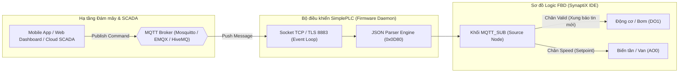

# CẨM NANG KỸ THUẬT & HƯỚNG DẪN SỬ DỤNG KHỐI CHỨC NĂNG MQTT_SUB
## MQTT IIoT Inbound Subscriber Function Block User Manual & Engineering Guide

**Mã tài liệu:** `MAN-SPLC-MQTSUB-2026-V2.0`  
**Phiên bản áp dụng:** `SimplePLC / SynaptiX IDE v2.6.0+`  
**Tiêu chuẩn quốc tế tham chiếu:** 
- **IEC 61131-3:2013** (Programmable controllers — Programming languages — Function Blocks)
- **OASIS MQTT V3.1.1 / V5.0** (Message Queuing Telemetry Transport Specification)
- **ISO/IEC 20922:2016** (Information technology — Message Queuing Telemetry Transport)
- **ISA-101.01-2015** (Human-Machine Interfaces for Process Automation Systems)
- **RFC 8259** (The JavaScript Object Notation - JSON Data Interchange Format)
- **SPLC-SPEC-MQTT-002** (SimplePLC Inbound Subscription & Wire Protocol ICD)

---

## 1. TỔNG QUAN & NGUYÊN LÝ HOẠT ĐỘNG (OVERVIEW & PRINCIPLES)

Khối chức năng **`MQTT_SUB`** (MQTT Inbound Subscriber) là khối giao tiếp nhận dữ liệu cấp cao dành cho ứng dụng Điều khiển Thông minh và IoT Công nghiệp (IIoT). Khối cho phép bộ điều khiển SimplePLC đăng ký (Subscribe) lắng nghe một **Topic** cụ thể trên **MQTT Broker** trung tâm hoặc máy chủ đám mây, tự động trích xuất các trường dữ liệu từ chuỗi JSON nhận được và cập nhật trực tiếp vào các Tag nội bộ của PLC hoặc xuất tín hiệu ra các chân ngõ ra (Output Pins) trên sơ đồ đồ họa FBD.

### 1.1. Cơ chế Lắng Nghe Bất Đồng Bộ Thường Trực (Background Event-Driven Listener)
Khác với khối đọc Modbus (`MB_READ`) hoạt động theo nguyên lý Polling (hỏi - đáp định kỳ), `MQTT_SUB` hoạt động theo cơ chế **thường trực (Always-on Daemon)**:
- **Khởi tạo kết nối:** Khi PLC khởi động và thiết lập liên kết mạng (Ethernet/Wi-Fi), nhiệm vụ MQTT Client ngầm tự động gửi bản tin `SUBSCRIBE` đăng ký Topic với Broker.
- **Lắng nghe sự kiện:** Bất cứ khi nào Broker có bản tin mới đẩy xuống (Push event), tầng Firmware MCU đón nhận gói tin socket TCP, bóc tách chuỗi JSON theo các khóa đã định nghĩa.
- **Cập nhật dữ liệu:** Các giá trị trích xuất được đưa ngay vào vùng nhớ đệm, sẵn sàng cho chu kỳ quét logic (PLC Scan Cycle 10-20ms) đọc và điều khiển thiết bị chấp hành.



---

## 2. GIẢI PHẪU CHÂN GIAO TIẾP TRÊN CANVAS FBD (CONNECTOR TOPOLOGY)

Khối **`MQTT_SUB`** áp dụng thiết kế tiêu chuẩn **Industrial Slate Gray** với chiều rộng cố định **`220px`** (Golden Template) giúp hiển thị trọn vẹn Topic và tên các chân bóc tách.

### 2.1. Cấu Trúc Khối Nguồn (Pure Source Node)
Vì là tiến trình lắng nghe thường trực 24/7 của hệ điều hành nhúng, khối `MQTT_SUB` được chuẩn hóa thành **Khối Nguồn thuần túy (Source Node)**:
- **Cạnh Trái (Inputs):** **Không có chân vào `EN`** (Loại bỏ hoàn toàn chân kích hoạt thừa, loại bỏ lỗi thắc mắc nối dây logic).
- **Cạnh Phải (Outputs):** Bao gồm 2 chân trạng thái cố định và tối đa 4 chân dữ liệu động trích xuất từ bản tin JSON.

```
┌────────────────────────────────────────────────────────┐
│ 📥 MQTT SUB                                      [SUB] │
├────────────────────────────────────────────────────────┤
│                         synaptix/commands/inbound      │
│                         QoS 1 · 2 Pins                 │
│                         ┌───────────────┐              │
│                         │ ● READY       │              │
│                         └───────────────┘              │
│                                               ►── Valid│ (BOOL)
│                                               ►── Err  │ (BOOL)
│                                               ►── Start│ (BOOL)
│                                               ►── Speed│ (REAL)
└────────────────────────────────────────────────────────┘
```

### 2.2. Chi Tiết Các Chân Ngõ Ra (Output Connectors)

| Chân Ra | Kiểu Dữ Liệu | Vai Trò & Hành Vi Kỹ Thuật | Ứng Dụng Điển Hình |
| :--- | :---: | :--- | :--- |
| **`Valid`** | `BOOL` | **Xung báo nhận tin mới (New Data Received - NDR):** Nhấp nháy mức `1` trong đúng **1 chu kỳ quét logic (10-20ms)** ngay khi giải mã thành công một bản tin JSON hợp lệ. | Bật đèn nhấp nháy trên tủ điện, kích hoạt bộ đếm mẻ sản phẩm, chốt cờ bắt đầu chu trình máy. |
| **`Err`** | `BOOL` | **Báo lỗi giao tiếp / định dạng:** Bật mức `1` khi gặp lỗi: mất kết nối Broker, quá hạn Fail-Safe Timeout, hoặc bản tin JSON nhận được bị hỏng cú pháp / thiếu khóa bắt buộc. | Hú còi cảnh báo sự cố, ngắt an toàn liên động (Interlock Safety E-Stop). |
| **`[Field1]` .. `[Field4]`** | `BOOL` / `INT` / `REAL` | **Chân dữ liệu trích xuất:** Xuất giá trị tức thời tương ứng với khóa JSON bóc tách được từ bản tin (ví dụ chân `StartCmd`, `TargetSpeed`, `SetpointTemp`). | Kéo dây trực tiếp sang khối đầu ra chấp hành `DO`, `AO`, hoặc các khối logic so sánh `CMP`, tính toán `MATH`. |

---

## 3. THÔNG SỐ VẬN HÀNH & HÀNG ĐỢI (COMMUNICATION PARAMETERS)

### 3.1. Mức Độ Dịch Vụ Truyền Tin (QoS)
- **QoS 0 (At most once):** Nhận tin không phản hồi, phù hợp cho dữ liệu phát quảng bá liên tục không yêu cầu độ tin cậy tuyệt đối.
- **QoS 1 (At least once - Mặc định khuyến nghị):** Broker bảo đảm gửi ít nhất 1 lần, MCU phản hồi gói `PUBACK`. Tránh mất lệnh điều khiển từ xa.
- **QoS 2 (Exactly once):** Bắt tay 4 bước bảo đảm lệnh không bao giờ bị xử lý trùng lặp.

### 3.2. Chế Độ Hàng Đợi Bản Tin (Queue Mode)
Khi mạng Internet gửi nhiều bản tin dồn dập đến cùng một topic trong khi PLC đang bận thực hiện chu kỳ quét, MCU hỗ trợ 2 chế độ xử lý tại thanh ghi `0x0D80`:
1. **Latest Message (Chỉ lấy tin mới nhất - Mặc định):**
   - Bộ điều khiển tự động ghi đè và **chỉ giữ lại bản tin mới nhất** để nạp vào các chân ngõ ra.
   - Thích hợp cho 95% bài toán điều khiển tự động (nhận Setpoint nhiệt độ, lệnh bật/tắt thiết bị, trạng thái vận hành).
2. **FIFO (Xếp hàng tuần tự từng tin):**
   - Các bản tin được đưa vào hàng đợi đệm (Buffer tối đa 16 tin).
   - Mỗi chu kỳ quét logic của PLC sẽ bốc lần lượt một bản tin ra xử lý theo đúng thứ tự thời gian.
   - Thích hợp cho nhận dữ liệu mã vạch (Barcode), danh sách lệnh sản xuất tuần tự (Queue Execution).

---

## 4. HƯỚNG DẪN CẤU HÌNH TRÊN SYNAPTIX STUDIO (STEP-BY-STEP)

### Bước 1: Thêm Khối vào Bản Vẽ FBD
1. Mở **Logic Editor Canvas**.
2. Tại thanh công cụ **Toolbox** (nhóm MQTT), kéo thả khối **📥 MQTT Subscribe** vào vùng vẽ.
3. Khối hiển thị dưới dạng Source Node nằm ở mép trái bản vẽ.

### Bước 2: Mở Hộp Thoại Cấu Hình Chi Tiết
- Chọn khối `MQTT_SUB` trên Canvas $\rightarrow$ Panel **Inspector** bên phải hiển thị thẻ tóm tắt kỹ thuật:
  - **Topic:** Đường dẫn chủ đề (mặc định: `synaptix/commands/inbound`).
  - **Chế độ hàng đợi:** `Chế độ hàng đợi: Latest Message`.
  - **QoS:** `QoS 1`.
  - **Số chân ngõ ra:** `2 chân ngõ ra`.
- Nhấp nút: **`[ ⚙ Cấu hình MQTT Subscribe... ]`**.

### Bước 3: Thiết Lập Trong Hộp Thoại Golden Template (1040 x 660)

```
┌────────────────────────────────────────────────────────────────────────────────────────┐
│ 📥 Cấu hình MQTT Subscribe & Field Extractor (0x0D80)                  [—] [□] [✕]      │
├────────────────────────────────────────────────────────┬───────────────────────────────┤
│ THÔNG SỐ GIAO TIẾP & KÍCH HOẠT (MQTT SUB PARAMETERS)   │ THỬ NGHIỆM BẢN TIN (TEST)     │
│ Topic: [ synaptix/commands/inbound                 ] 🧹│ Dán bản tin JSON mẫu để test: │
│ Mức QoS: [ QoS 0 ] [ QoS 1 ] [ QoS 2 ]                 │ ┌───────────────────────────┐ │
│ Chế độ hàng đợi: [ Latest (Chỉ lấy tin mới nhất) ▼ ]   │ │ {                         │ │
│                                                        │ │   "start": true,          │ │
│ TRÍCH XUẤT CÁC CHÂN NGÕ RA (FIELD EXTRACTOR)           │ │   "speed": 1450           │ │
│ ┌────────────────────────────────────────────────────┐ │ │ }                         │ │
│ │ Tên chân (Pin) │ Khóa JSON (Path) │ Kiểu DL │ Xóa  │ │ └───────────────────────────┘ │
│ ├────────────────┼──────────────────┼─────────┼──────┤ │ [ Tạo lại mẫu ]             │ │
│ │ StartCmd       │ start            │ BOOL    │ [✕]  │ │ [ ▶ Thử nghiệm đọc dữ liệu ]│ │
│ │ SpeedSet       │ speed            │ INT     │ [✕]  │ │                               │
│ └────────────────────────────────────────────────────┘ │ Kết quả trích xuất:          │
│ [+ Thêm trường ngõ ra] (Tối đa 4 chân/khối)           │ • StartCmd: TRUE              │
│                                                        │ • SpeedSet: 1450              │
├────────────────────────────────────────────────────────┴───────────────────────────────┤
│ Topic: synaptix/commands/inbound   [ QoS 1 ]   [ 2 Pins ]                  [ Áp dụng ] │
└────────────────────────────────────────────────────────────────────────────────────────┘
```

1. **Nhập Topic:** Nhập đường dẫn MQTT cần lắng nghe (nhấn nút 🧹 để tự động chuẩn hóa ký tự).
2. **Chọn QoS:** Nhấp chọn QoS 0, 1 hoặc 2.
3. **Thêm Chân Trích Xuất (Fields):** Nhấn **`+ Thêm trường ngõ ra`**, nhập tên chân hiển thị trên Canvas (`Pin Label`), tên trường tương ứng trong chuỗi JSON (`JsonPath`), và chọn kiểu dữ liệu (`BOOL`, `INT`, hoặc `FLOAT`).
4. **Thử Nghiệm Bóc Tách (Payload Test):** Dán một chuỗi JSON mẫu từ thực tế vào khung bên phải và nhấn **`▶ Thử nghiệm đọc dữ liệu`**. Hệ thống sẽ kiểm tra cú pháp và hiển thị ngay giá trị các chân ngõ ra.
5. **Nhấn `[ Áp dụng ]`:** Khối trên Canvas tự động cập nhật đầy đủ các chân ngõ ra mới để bạn nối dây trực tiếp.

---

## 5. KỊCH BẢN ỨNG DỤNG CÔNG NGHIỆP THỰC TẾ

### Kịch bản 1: Điều Khiển Bơm Từ Xa Qua App Mobile
- **Mục tiêu:** Nhận lệnh bật/tắt bơm cấp nước từ ứng dụng điện thoại qua Cloud.
- **Bản tin JSON Cloud gửi xuống:**
  ```json
  { "pump_enable": true, "target_rpm": 2800 }
  ```
- **Cấu hình khối `MQTT_SUB`:**
  - Topic: `spx/station_01/pump_ctrl`
  - QoS: `1`
  - Pin 1: Tên chân `PumpRun`, JsonPath `pump_enable`, Kiểu `BOOL` $\rightarrow$ Nối vào ngõ ra `DO1`.
  - Pin 2: Tên chân `PumpSpeed`, JsonPath `target_rpm`, Kiểu `INT` $\rightarrow$ Nối vào bộ biến tần `AO0`.

### Kịch bản 2: Đồng Bộ Lệnh Sản Xuất Theo Ca (Manufacturing Recipe Dispatch)
- **Mục tiêu:** Hệ thống MES trung tâm gửi chỉ tiêu mẻ trộn (thời gian trộn và nhiệt độ yêu cầu).
- **Cấu hình:**
  - Topic: `factory/line_1/recipe`
  - Chân `Valid`: Kéo dây kích hoạt chân Start của khối Timer trộn `TON`.
  - Chân `MixTime`: Nối vào thời gian đặt `PT` của khối Timer.
  - Chân `TempLimit`: Nối vào ngưỡng so sánh của khối `CMP`.

---

## 6. MA TRẬN CHẨN ĐOÁN LỖI & KHẮC PHỤC SỰ CỐ (TROUBLESHOOTING)

| Hiện tượng | Nguyên nhân Gốc rễ | Biện pháp Khắc phục Kỹ thuật |
| :--- | :--- | :--- |
| Broker đã gửi tin nhưng chân `Valid` không nháy, chân ra không đổi giá trị | Sai đường dẫn Topic (chú ý phân biệt chữ hoa/thường: `Cmd` khác `cmd`) hoặc chuỗi JSON thiếu trường dữ liệu. | 1. Dùng MQTT Explorer kiểm tra chính xác Topic và định dạng payload gửi đến Broker.<br>2. Dán payload vào khung **Thử nghiệm** trong Dialog để xác minh parser. |
| Chân **`Err`** bật mức `1` liên tục | Mất kết nối tới Broker hoặc mạng Wi-Fi/Ethernet bị gián đoạn. | Kiểm tra dây mạng, cấu hình IP/DNS tại Menu Hệ thống và xác nhận trạng thái cổng COM/mạng của PLC. |
| Giá trị số thực nhận về bị sai lệch lớn | Sai kiểu dữ liệu khai báo (khai báo `INT` trong khi dữ liệu là số thực dấu chấm động `FLOAT`). | Chuyển Kiểu dữ liệu trong hộp thoại cấu hình sang `FLOAT`. |
| Cảnh báo: *Vượt quá giới hạn 4 chân trên 1 khối* | Phần cứng MCU giới hạn tối đa 4 chân bóc tách trên một khối Subscribe (để tiết kiệm RAM thanh ghi Modbus 0x0D80). | Nếu cần bóc tách nhiều hơn 4 trường, hãy thêm khối `MQTT_SUB` thứ 2 với cùng Topic để bóc tách các trường còn lại. |

---

## 7. THÔNG SỐ KỸ THUẬT TỔNG HỢP (TECHNICAL SPECIFICATIONS)

| Đặc tính Kỹ thuật | Thông số Quy chuẩn |
| :--- | :--- |
| **Số khối MQTT_SUB tối đa trên PLC** | 2 khối độc lập (`Block 0` và `Block 1`) |
| **Vùng nhớ Holding Register MCU** | `0x0D80 .. 0x0DFF` (128 Registers = 256 Bytes) |
| **Dung lượng mỗi khối** | 64 Registers = 128 Bytes |
| **Độ dài Topic tối đa** | 32 Bytes (Packed ASCII) |
| **Số chân bóc tách tối đa mỗi khối** | 4 Dynamic Pins / block |
| **Độ dài tên khóa JSON (JsonPath) tối đa** | 12 Bytes ASCII |
| **Kiểu dữ liệu ngõ ra hỗ trợ** | `BOOL` (1 bit), `INT` (16/32-bit), `FLOAT` (IEEE 754 32-bit) |
| **Thời gian duy trì xung chân Valid** | 1 chu kỳ quét logic PLC (10 - 20 ms) |
| **Chế độ hàng đợi hỗ trợ** | Latest Message (Chỉ lấy tin mới nhất) & FIFO (Bộ đệm tuần tự) |
