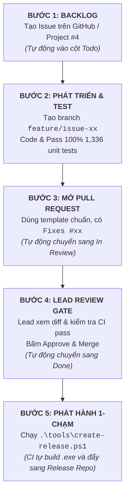

# Quy Trình Phát Triển & Phát Hành Phần Mềm SynaptiX IDE (End-to-End Workflow)

Tài liệu này chuẩn hóa quy trình kỹ thuật khép kín từ khâu tiếp nhận yêu cầu trên Backlog, phát triển mã nguồn, kiểm thử tự động, đến khâu Tech Lead phê duyệt và tự động hóa phát hành phiên bản mới cho **SynaptiX IDE** (kho mã nguồn `SynaptiXCompany/AppPLCSimple`).

---

## 1. NGUYÊN TẮC CỐT LÕI (CORE PRINCIPLES)

1. **Tech Lead là Chốt Chặn Chất Lượng Duy Nhất (Single Quality Gate):**
   - Chỉ có Tech Lead mới có quyền phê duyệt (Approve & Merge) các Pull Request vào nhánh chính (`dev` / `main`).
   - Chỉ có Tech Lead mới có thẩm quyền gắn Release Tag (`v*.*.*`) để kích hoạt phát hành ra công chúng.
2. **Bảo Toàn Hợp Đồng Dữ Liệu & Test 100% (Zero Regression):**
   - Mọi thay đổi không được phép làm gãy 1,336+ bài unit tests.
   - Các cấu trúc Wire Format C11 (`simpleplc_protocol_v2_0.h`) phải duy trì kích thước byte bất biến (`_Static_assert`).
3. **Tự Động Hóa Tối Đa (Maximum Automation):**
   - Mọi thao tác chuyển thẻ trên [Project #4 (Backlog)](https://github.com/orgs/SynaptiXCompany/projects/4/views/1) diễn ra tự động theo vòng đời của mã nguồn, giải phóng thời gian cho kỹ sư.

---

## 2. VÒNG ĐỜI PHÁT TRIỂN 5 BƯỚC (5-STAGE LIFECYCLE)



---

### Bước 1: Tiếp nhận / Tạo Task trên Backlog
- Khi có tính năng mới hoặc lỗi phát sinh, tạo Issue trên GitHub bằng mẫu chuẩn:
  - **Feature Request:** [`.github/ISSUE_TEMPLATE/feature_request.md`](file:///g:/HoaNV/Projects/SimplePLC/.github/ISSUE_TEMPLATE/feature_request.md)
  - **Bug Report:** [`.github/ISSUE_TEMPLATE/bug_report.md`](file:///g:/HoaNV/Projects/SimplePLC/.github/ISSUE_TEMPLATE/bug_report.md)
- **Tự động hóa:** Workflow [`.github/workflows/project-automation.yml`](file:///g:/HoaNV/Projects/SimplePLC/.github/workflows/project-automation.yml) sẽ tự động đưa Issue vào [Project #4](https://github.com/orgs/SynaptiXCompany/projects/4/views/1) và xếp vào cột **`Todo`**.

---

### Bước 2: Phát triển và Kiểm thử cục bộ
1. Tạo nhánh tính năng từ `dev`:
   ```bash
   git checkout dev
   git pull origin dev
   git checkout -b feature/issue-12-modbus-tcp
   ```
2. Thực hiện sửa đổi mã nguồn.
3. Chạy toàn bộ test suite để đảm bảo không hồi quy:
   ```bash
   dotnet test SimplePLC.sln --configuration Release
   ```

---

### Bước 3: Mở Pull Request (PR)
1. Commit và push nhánh lên GitHub:
   ```bash
   git push origin feature/issue-12-modbus-tcp
   ```
2. Trên GitHub, mở Pull Request vào nhánh `dev`.
3. Điền thông tin theo biểu mẫu chuẩn [`.github/pull_request_template.md`](file:///g:/HoaNV/Projects/SimplePLC/.github/pull_request_template.md):
   ```markdown
   Fixes #12
   - [x] Đã hoàn thành Modbus TCP client & simulator.
   - [x] Đã pass 1,336/1,336 tests.
   ```
4. **Tự động hóa:** Thẻ trên Project #4 lập tức tự động nhảy sang cột **`In Review`**.

---

### Bước 4: Tech Lead Review & Merge
1. Tech Lead mở giao diện PR trên GitHub:
   - Đọc bản tóm tắt thay đổi.
   - Xem qua diff mã nguồn.
   - Xác nhận CI test xanh 100%.
2. Tech Lead nhấn **Approve** và **Merge Pull Request**.
3. **Tự động hóa:**
   - Mã nguồn được gộp an toàn vào nhánh `dev`.
   - Issue liên quan được tự động đóng lại.
   - Thẻ trên Project #4 tự động chuyển sang cột **`Done`**.
   - *Lưu ý: Tại bước này, hệ thống CHƯA phát hành ra ngoài.*

---

### Bước 5: Phát hành phiên bản mới 1-Chạm (One-Click Release)
Khi các tính năng trong milestone đã hoàn thành và được kiểm nghiệm trên phần cứng thực tế (COM7/COM9), Tech Lead kích hoạt phát hành bằng 1 lệnh duy nhất:

```powershell
.\tools\create-release.ps1 -Version "2.7.0" -Notes "Bổ sung Modbus TCP và đồng bộ chế độ khối truyền thông"
```

**Kịch bản `create-release.ps1` sẽ tự động thực hiện:**
1. Kiểm tra trạng thái git sạch sẽ.
2. Chạy lại 1,336 unit tests tự động để đảm bảo an toàn tuyệt đối.
3. Tạo git tag `v2.7.0` và push lên GitHub.
4. Kích hoạt GitHub Actions CI/CD ([`.github/workflows/ci.yml`](file:///g:/HoaNV/Projects/SimplePLC/.github/workflows/ci.yml)):
   - Biên dịch bản Windows x64 Single-File Standalone: `SimplePLC.Studio.exe`.
   - Đẩy trực tiếp gói phát hành và ghi chú sang kho lưu trữ công khai: [`hoanv-synaptix/SynaptiX-IDE-Releases`](https://github.com/hoanv-synaptix/SynaptiX-IDE-Releases).

---

## 3. CHECKLIST THIẾT LẬP DỰ ÁN (SETUP REQUIREMENTS)

| Hạng mục | Vị trí | Mô tả | Trạng thái |
|---|---|---|:---:|
| **Automation Workflow** | `.github/workflows/project-automation.yml` | Tự động đồng bộ thẻ Issue/PR với Project #4 | ✅ Đã sẵn sàng |
| **PR Template** | `.github/pull_request_template.md` | Biểu mẫu chuẩn và checklist kiểm duyệt của Lead | ✅ Đã sẵn sàng |
| **Issue Templates** | `.github/ISSUE_TEMPLATE/` | Biểu mẫu chuẩn hóa Feature & Bug Report | ✅ Đã sẵn sàng |
| **Release Script** | `tools/create-release.ps1` | Công cụ tự động test & phát hành 1-chạm cho Lead | ✅ Đã sẵn sàng |
| **Secret `PROJECT_PAT`** | GitHub Repo Settings | Token có quyền `project` & `repo` để Action cập nhật Board Org | ⚙️ Cần thêm vào repo |
| **Branch Protection** | GitHub Repo Settings | Khóa nhánh `main` và `dev`, yêu cầu Lead Approve trước khi merge | ⚙️ Bật trên Settings |
