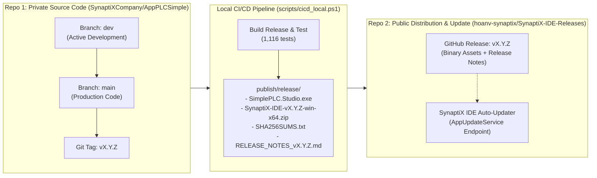

# QUY TRÌNH CHUẨN PHÁT HÀNH PHIÊN BẢN (STANDARD RELEASE PROCEDURE - SOP)
**Mã tài liệu:** `SPLC-SOP-REL-001`  
**Áp dụng cho:** SynaptiX IDE / SimplePLC Studio & Firmware Subsystem  
**Phạm vi:** Toàn bộ vòng đời phát hành qua kiến trúc 2 Repository: Private Source Code & Public Distribution/Update.

---

## 1. KIẾN TRÚC 2 REPOSITORY (DUAL-REPOSITORY ARCHITECTURE)

Hệ thống SynaptiX IDE áp dụng kiến trúc phân tách độc lập giữa Mã nguồn nội bộ và Phân phối bản dựng công khai:



| Tiêu chí | **Repo 1: Private Source Code** | **Repo 2: Public Release / Update** |
| :--- | :--- | :--- |
| **Tên GitHub** | `SynaptiXCompany/AppPLCSimple` | `hoanv-synaptix/SynaptiX-IDE-Releases` |
| **Quyền truy cập** | **Private** (Nội bộ tổ chức) | **Public** (Công khai cho người dùng/kỹ sư) |
| **Nội dung lưu trữ** | Toàn bộ mã nguồn, Unit tests, Firmware headers, Lịch sử Git | Chỉ chứa các bản nhị phân đóng gói, ZIP, Checksum, Release Notes |
| **Mục đích** | Phát triển, kiểm soát phiên bản mã nguồn, bảo vệ bí mật công nghệ | Phục vụ người dùng tải ứng dụng và làm endpoint cho tính năng **Auto-Updater** (`AppUpdateService.cs`) |

---

## 2. QUY TRÌNH PHÁT HÀNH CHI TIẾT

Quy trình phát hành một phiên bản mới `vX.Y.Z` (ví dụ `v2.5.0`) gồm 2 giai đoạn liên hoàn:
- **Giai đoạn A:** Đóng gói bản dựng & Cập nhật Repo 1 (Private Source Code).
- **Giai đoạn B:** Xuất bản Release lên Repo 2 (Public Release phục vụ Auto-Updater).

---

### GIAI ĐOẠN A: ĐÓNG GÓI & CẬP NHẬT REPO 1 (PRIVATE SOURCE CODE)

#### Bước 1: Kiểm thử toàn diện giải pháp (Pre-flight Validation)
Đảm bảo 100% các bài kiểm thử tự động đều PASS trước khi thực hiện bất kỳ bước đóng gói nào:
```powershell
dotnet test SimplePLC.sln -c Release --nologo
```
*Yêu cầu bắt buộc:* Toàn bộ bài test trên 5 dự án test (`Domain.Tests`, `Protocol.Tests`, `Application.Tests`, `Infrastructure.Tests`, `Studio.Tests`) đều **PASS**, 0 Failed, 0 Error.

#### Bước 2: Nâng phiên bản (Bump Version) & Cập nhật tài liệu
1. **Cập nhật File Project Studio:**
   Mở file [`SimplePLC.Studio/SimplePLC.Studio.csproj`](file:///g:/HoaNV/Projects/SimplePLC/SimplePLC.Studio/SimplePLC.Studio.csproj), sửa:
   ```xml
   <Version>X.Y.Z</Version>
   <AssemblyVersion>X.Y.Z.0</AssemblyVersion>
   <FileVersion>X.Y.Z.0</FileVersion>
   ```
2. **Cập nhật Trang Chủ Dự Án:**
   Mở file [`README.md`](file:///g:/HoaNV/Projects/SimplePLC/README.md), cập nhật phiên bản:
   ```markdown
   | **vX.Y.Z (Latest)** | Windows x64 (.exe) | [**Download `SimplePLC.Studio.exe`**](https://github.com/hoanv-synaptix/SynaptiX-IDE-Releases/releases/latest/download/SimplePLC.Studio.exe) | ... |
   ```
3. **Cập nhật Nhật Ký Nền Tảng (Changelog):**
   Mở file [`docs/platform/SimplePLC_Contract_Changelog.md`](file:///g:/HoaNV/Projects/SimplePLC/docs/platform/SimplePLC_Contract_Changelog.md), thêm mục phiên bản mới theo chuẩn *Keep a Changelog* (`Added`, `Changed`, `Fixed`).
4. **Cập nhật Đặc Tả Kỹ Thuật MCU:**
   Mở file [`docs/firmware/MCU_CONFORMANCE_SPECIFICATION_V2_0.md`](file:///g:/HoaNV/Projects/SimplePLC/docs/firmware/MCU_CONFORMANCE_SPECIFICATION_V2_0.md) và cập nhật nếu có thay đổi liên quan đến cấu trúc thanh ghi hoặc hồ sơ thiết bị.

#### Bước 3: Thực thi Local CI/CD Pipeline (Build & Đóng gói)
```powershell
powershell -ExecutionPolicy Bypass -File scripts\cicd_local.ps1 -Version X.Y.Z
```
Script sẽ tự động:
- Biên dịch giải pháp ở cấu hình Release.
- Chạy toàn bộ test suite kiểm tra độ tin cậy.
- Xuất bản file thực thi Portable `SynaptixIDE.exe` và `SimplePLC.Studio.exe`.
- Nén gói phân phối `SynaptiX-IDE-vX.Y.Z-win-x64.zip`.
- Tính mã băm `SHA256SUMS.txt`.
- Sinh ghi chú phát hành `RELEASE_NOTES_vX.Y.Z.md`.

*Kiểm tra thư mục đầu ra:* [`publish/release/`](file:///g:/HoaNV/Projects/SimplePLC/publish/release/) phải có đủ 4 file.

#### Bước 4: Commit & Gắn Git Tag trên nhánh `dev`
```powershell
# 1. Commit các thay đổi tài liệu và phiên bản
git commit -am "chore(release): bump version to X.Y.Z, update specs, changelog and release pipeline"

# 2. Gắn Annotated Git Tag
git tag -a vX.Y.Z -m "Release vX.Y.Z: [Tiêu đề bản phát hành]"

# 3. Đẩy nhánh dev lên remote private
git push origin dev
```

#### Bước 5: Đồng bộ nhánh `main` & Đẩy Tags lên Repo 1
```powershell
# 1. Chuyển sang nhánh main
git checkout main

# 2. Fast-forward merge từ dev (lịch sử thẳng, sạch sẽ)
git merge dev --ff-only

# 3. Đẩy nhánh main và Git Tag lên origin
git push origin main --tags

# 4. Trở lại nhánh làm việc hàng ngày dev
git checkout dev
```

---

### GIAI ĐOẠN B: XUẤT BẢN LÊN REPO 2 PHỤC VỤ UPDATE (PUBLIC RELEASE REPO)

Để ứng dụng SynaptiX IDE của người dùng có thể nhận diện được bản cập nhật mới thông qua dịch vụ `AppUpdateService` (`https://api.github.com/repos/hoanv-synaptix/SynaptiX-IDE-Releases/releases/latest`), bản phát hành phải được đưa lên **Repo 2** (`hoanv-synaptix/SynaptiX-IDE-Releases`).

Có 2 phương thức thực hiện:

#### Cách 1: Tự động hóa qua GitHub Token (Khuyến nghị)
Nếu đã thiết lập biến môi trường Personal Access Token (PAT) có quyền ghi vào repo `hoanv-synaptix/SynaptiX-IDE-Releases`:
```powershell
# Thiết lập token cho phiên làm việc
$env:RELEASE_TOKEN = "ghp_xxxxxxxxxxxxxxxxxxxx"

# Chạy lại script CI/CD (kèm switch -SkipTests để tái sử dụng build có sẵn)
powershell -ExecutionPolicy Bypass -File scripts\cicd_local.ps1 -Version X.Y.Z -SkipTests
```
Script sẽ tự động gọi REST API của GitHub để tạo Release `vX.Y.Z` trên `hoanv-synaptix/SynaptiX-IDE-Releases` và tải 3 file assets lên server:
- `SimplePLC.Studio.exe`
- `SynaptiX-IDE-vX.Y.Z-win-x64.zip`
- `SHA256SUMS.txt`

#### Cách 2: Tạo Release thủ công trên giao diện GitHub Web
Nếu chưa cấu hình token tự động, thực hiện tải tệp thủ công:
1. Mở trình duyệt truy cập: **`https://github.com/hoanv-synaptix/SynaptiX-IDE-Releases/releases/new`**
2. Điền thông tin phát hành:
   - **Choose a tag:** Gõ `vX.Y.Z` (ví dụ `v2.5.0`) ➔ Chọn *Create new tag: vX.Y.Z on publish*.
   - **Release title:** Gõ `SynaptiX IDE vX.Y.Z` (ví dụ `SynaptiX IDE v2.5.0`).
   - **Describe this release:** Sao chép toàn bộ nội dung từ file [`publish/release/RELEASE_NOTES_vX.Y.Z.md`](file:///g:/HoaNV/Projects/SimplePLC/publish/release/RELEASE_NOTES_v2.5.0.md) và dán vào ô mô tả.
3. **Đính kèm tệp nhị phân (Attach binaries):** Kéo và thả 3 tệp từ thư mục `publish/release/`:
   - `SimplePLC.Studio.exe` (Single-file Portable)
   - `SynaptiX-IDE-vX.Y.Z-win-x64.zip` (Gói phân phối đầy đủ)
   - `SHA256SUMS.txt` (Mã băm toàn vẹn)
4. Nhấn nút **Publish release**.

---

## 3. CHECKLIST KIỂM TRA TOÀN DIỆN TRƯỚC KHI BÀN GIAO

| STT | Hạng mục kiểm tra | Vị trí / Lệnh đối chiếu | Đã đạt |
| :---: | :--- | :--- | :---: |
| **A. Repo 1 (Private)** | | | |
| 1 | 100% Tests Pass | `dotnet test SimplePLC.sln` | [ ] |
| 2 | Sạch Warning & Linter | Release compile 0 Warning 0 Error | [ ] |
| 3 | Version csproj đã bump | `SimplePLC.Studio.csproj` | [ ] |
| 4 | Version README đã bump | `README.md` | [ ] |
| 5 | Nhật ký Changelog đầy đủ | `SimplePLC_Contract_Changelog.md` | [ ] |
| 6 | Đặc tả MCU Spec đồng bộ | `MCU_CONFORMANCE_SPECIFICATION_V2_0.md` | [ ] |
| 7 | Nhánh `dev` đã push lên origin | `git push origin dev` | [ ] |
| 8 | Nhánh `main` đã fast-forward & push | `git push origin main` | [ ] |
| 9 | Git Tag `vX.Y.Z` đã có trên origin | `git ls-remote --tags origin vX.Y.Z` | [ ] |
| **B. Repo 2 (Public Update)** | | | |
| 10 | Đã sinh tệp tại `publish/release/` | Đủ 4 tệp (exe, zip, sha256, md) | [ ] |
| 11 | Đã tạo Release trên Repo 2 | `https://github.com/hoanv-synaptix/SynaptiX-IDE-Releases/releases/tag/vX.Y.Z` | [ ] |
| 12 | Đã đính kèm tệp `SimplePLC.Studio.exe` | Asset có trong Release | [ ] |
| 13 | Đã đính kèm tệp `.zip` & `SHA256` | Asset có trong Release | [ ] |
| 14 | Auto-Updater kiểm tra nhận diện được | App gọi API `releases/latest` thấy version mới | [ ] |
