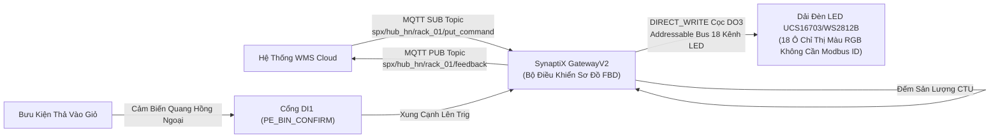

# Thư Viện Dự Án Mẫu SynaptiX IDE (SimplePLC Examples)

Thư mục này chứa các dự án mẫu (`.synx`) tiêu chuẩn công nghiệp được xây dựng sẵn cho nền tảng **SynaptiX IDE / SimplePLC**. Các dự án minh họa đầy đủ năng lực lập trình FBD, giao tiếp công nghiệp RS-485 Modbus RTU Master (Đọc/Ghi), tích hợp IIoT qua MQTT Broker, và xử lý thời gian thực theo chuẩn IEC 61131-3.

---

## Danh Mục Dự Án Mẫu

| Tên Tệp Dự Án | Lĩnh Vực / Ứng Dụng | Khối Chức Năng Nổi Bật | Thiết Bị Đích |
| :--- | :--- | :--- | :--- |
| [`SPX_Sort_To_Light_Logistics_Center.synx`](./SPX_Sort_To_Light_Logistics_Center.synx) | **Logistics / E-Commerce Fulfillment**<br>Hệ thống chia chọn bưu kiện Sort-to-Light 18 ô tại SPX Hub | `MQTT_SUB`, `DIRECT_WRITE` (Cọc DO3), `TON`, `CTU`, `MQTT_PUB` | SynaptiX GatewayV2 (SYNX-RIO-884) |
| [`Modbus_RTU_Master_VFD_And_Sensor_Loop.synx`](./Modbus_RTU_Master_VFD_And_Sensor_Loop.synx) | **Xử Lý Nước & Hạ Tầng Tự Động Hóa**<br>Trạm bơm điều áp biến tần khép kín qua RS-485 | `MB_READ` (FC04), `SCALE`, `MB_WRITE` (Direct FC06), Rules | SynaptiX SYNX-RIO-884 |
| [`IIoT_Cold_Chain_Smart_Gateway.synx`](./IIoT_Cold_Chain_Smart_Gateway.synx) | **Dược Phẩm Sinh Học / Chuỗi Cung Ứng Lạnh**<br>Giám sát kho lạnh vắc xin chuẩn GSP thời gian thực | `MQTT_PUB` (QoS 1 Cyclic), `MQTT_SUB`, `AI`, Interlocks | SynaptiX GatewayV2 (SYNX-RIO-884) |

---

## 1. Dự Án SPX Express: Hệ Thống Phân Loại Hàng Hóa Sort-to-Light

### 1.1. Bối Cảnh Thực Tế & Yêu Cầu Kỹ Thuật
Tại các Trung tâm Khai thác Phân loại (Fulfillment Center / SOC) của **SPX Logistics** (như Bắc Ninh SOC hoặc Hà Nội Hub), hàng nghìn bưu kiện thương mại điện tử cần được phân luồng vào 18 giỏ/túi đích với tốc độ cao và độ chính xác 99.99%. 

Hệ thống **Sort-to-Light** giải quyết bài toán hướng dẫn nhân viên bốc xếp thả đúng túi thông qua chỉ thị ánh sáng:
1. Máy quét mã vạch băng tải quét mã bưu kiện, hệ thống quản lý kho WMS phân tích tuyến phát và bắn lệnh JSON xuống thiết bị **SynaptiX GatewayV2** qua **MQTT SUB**.
2. Thiết bị Gateway biên nhận lệnh, kích hoạt khối **`DIRECT_WRITE` (Target Pin: DO3, Addressable Bus)** điều khiển dải đèn LED 18 ô (UCS16703/WS2812B) sáng màu quy định (xanh, vàng, tím) theo chỉ số ô đích (`bin_id` từ 1..18) xuất trực tiếp từ cọc phần cứng DO3 mà không cần Modbus Slave ID hay bo giao tiếp ngoài, đồng thời còi bíp định vị.
3. Nhân viên thả hàng vào ô; cảm biến quang điện thu phát hồng ngoại tại miệng giỏ (**DI1**) phát hiện bưu kiện rơi qua, kích hoạt khối **Bộ Đếm Sản Lượng `CTU`**.
4. Khối **`MQTT_PUB`** tự động đóng gói bản tin xác nhận nhả hàng gửi trả WMS để hoàn tất phiên phân loại.
5. Nếu quá 15 giây nhân viên không thả hàng, khối thời gian trễ **`TON`** phát cờ Timeout cảnh báo và bật đèn vàng lỗi.



### 1.2. Bảng Danh Mục Tag (Tag Catalog)

| Ký Hiệu Tag | Định Danh Nghiệp Vụ (Alias) | Nhóm Phân Loại | Kiểu Dữ Liệu | Diễn Giải Chi Tiết |
| :--- | :--- | :--- | :--- | :--- |
| `DI0` | `PE_PARCEL_ARRIVE` | Cảm Biến Hiện Trường | Boolean | Cảm biến quang phát hiện bưu kiện đến vị trí gắp trên băng tải |
| `DI1` | `PE_BIN_CONFIRM` | Cảm Biến Hiện Trường | Boolean | Cảm biến quang tại miệng giỏ xác nhận bưu kiện đã được thả thành công |
| `DI2` | `E_STOP_NC` | An Toàn Công Nghiệp | Boolean | Nút dừng khẩn cấp E-Stop (Thường đóng NC, 1 = Bình thường, 0 = Dừng khẩn) |
| `DO0` | `CONVEYOR_MOTOR` | Cơ Cấu Chấp Hành | Boolean | Khởi động từ điều khiển động cơ băng chuyền cấp phôi |
| `DO1` | `TOWER_GREEN_RUN` | Đèn Tháp Tín Hiệu | Boolean | Đèn xanh lục: Hệ thống đang sẵn sàng và vận hành bình thường |
| `DO2` | `TOWER_YELLOW_BUSY`| Đèn Tháp Tín Hiệu | Boolean | Đèn vàng: Đang trong chu trình chờ thả hàng hoặc cảnh báo trễ |
| `DO3` | `TOWER_RED_ALARM` | Đèn Tháp Tín Hiệu | Boolean | Đèn đỏ: Báo động sự cố hoặc quá thời gian nhả hàng (Timeout) |
| `DO4` | `SORT_BUZZER` | Cảnh Báo Âm Thanh | Boolean | Còi buzzer bíp ngắn xác nhận đã thả kiện chuẩn xác |
| `VREG0` | `TARGET_BIN_ID` | Tham Số WMS | Int32 | Mã số ô đích cần nhả hàng (Giá trị từ 1 đến 18) |
| `VREG1` | `LED_COLOR_RGB` | Tham Số WMS | Int32 | Mã màu 24-bit hiển thị dải LED (VD: 0x00FF00 = Xanh lá, 0xFFFF00 = Vàng) |
| `VREG2` | `PARCEL_SORTED_COUNT`| Thống Kê Sản Lượng | Int32 | Tổng số bưu kiện đã phân loại hợp lệ trong ca trực |
| `VFLAG0` | `SYS_READY_FLAG` | Khóa Liên Động Logic | Boolean | Cờ logic xác nhận hệ thống an toàn và sẵn sàng tiếp nhận bưu kiện mới |
| `RETAIN0` | `SHIFT_SORT_ACCUMULATOR`| Lưu Trữ Bền Vững | Int32 | Bộ tích lũy sản lượng lưu giữ sau khi mất điện nguồn |

### 1.3. Cấu Hình Các Khối Logic FBD Trên Canvas

1. **Khối Nhận Lệnh WMS (`node-mqtt-sub` - MqttSubscribe):**
   - **Topic:** `spx/hub_hn/rack_01/put_command` (QoS 1, Hàng đợi FIFO dung lượng 16 gói).
   - **Chân Trích Xuất Dữ Liệu (Payload Pins):**
     - Chân 1: JSON Path `bin_id` $\rightarrow$ Ánh xạ vào `VREG0` (`TARGET_BIN_ID`), giới hạn 1..18.
     - Chân 2: JSON Path `color_rgb` $\rightarrow$ Ánh xạ vào `VREG1` (`LED_COLOR_RGB`).
   - **Đầu Ra Kích Hoạt (Valid Out):** Phát xung logic 1 chu kỳ quét khi có bản tin hợp lệ đến chân `Trig` của khối `MB_WRITE`.

2. **Khối Điều Khiển LED Ô Chia Chọn (`node-dir-write` - DirectWrite):**
   - **Cọc Phần Cứng Đích (Target Pin):** `DO3` (Ngõ ra xuất xung trực tiếp cho dải LED UCS16703/WS2812B).
   - **Chế Độ Xuất (Mode):** `AddressableBus` (Ánh xạ theo chỉ số ô 1..18, không cần Modbus Slave ID).
   - **Số Lượng Kênh (Channel Count):** 18 kênh; Bật cờ `ExclusiveChannel = True` để hệ thống tự động xóa/tắt toàn bộ 17 ô còn lại khi kích hoạt 1 ô mới, triệt tiêu nguy cơ nhân viên nhìn nhầm hai ô sáng đồng thời.
   - **Mã Màu Mặc Định:** `0x00FF00` (Xanh lục chuẩn chỉ dẫn thả hàng).
   - **Chế Độ Kích Hoạt (Trigger Mode):** `OnTriggerRisingEdge` (Phát xung xuất lệnh khi nhận xung Valid từ `MQTT_SUB`).

3. **Khối Canh Chừng Thời Gian Thả Hàng (`node-timer-timeout` - Timer TON):**
   - **Chế Độ:** Trễ bật `TON`. Thời gian đặt: 15.0 giây (`PresetMs = 15000`).
   - **Đầu Ra:** Kích hoạt `DO3` (`TOWER_RED_ALARM`) nếu nhân viên không thực hiện nhả hàng trong vòng 15 giây.

4. **Khối Đếm Bưu Kiện (`node-counter-sorted` - Counter CTU):**
   - **Chế Độ:** Đếm tiến `CTU`. Giá trị đặt ca: 5.000 kiện (`PresetValue = 5000`).
   - **Đầu Vào CU:** Nhận tín hiệu xung từ chân Cạnh Lên (`ON_RISE`) của cảm biến quang `DI1`.
   - **Thanh Ghi Giá Trị Hiện Tại (CV):** Ánh xạ trực tiếp vào `VREG2` (`PARCEL_SORTED_COUNT`).

5. **Khối Truyền Dữ Liệu Đo Xa Đoạn Cuối (`node-mqtt-pub` - MqttPublish):**
   - **Topic:** `spx/hub_hn/rack_01/feedback` (QoS 1, Payload JSON).
   - **Chế Độ Xuất:** `Event` (Phát bản tin ngay khi khối đếm sản lượng ghi nhận bưu kiện mới).
   - **Trường Dữ Liệu:**
     ```json
     {
       "device_id": "spx-gw2-hn-rack01",
       "timestamp": "2026-10-16T17:30:00.000Z",
       "bin_id": 7,
       "sorted_count": 459,
       "status": true
     }
     ```

---

## 2. Dự Án Bơm Điều Áp Biến Tần Modbus RTU Master VFD

Tệp dự án: [`Modbus_RTU_Master_VFD_And_Sensor_Loop.synx`](./Modbus_RTU_Master_VFD_And_Sensor_Loop.synx)

- **Ứng Dụng:** Giám sát và điều khiển áp lực mạng lưới cấp nước sinh hoạt/công nghiệp.
- **Kiến Trúc Thu Thập & Điều Khiển:**
  - Khối **`MB_READ`**: Thăm dò cảm biến áp suất đường ống (Slave ID 2, Function Code 04 `ReadInputRegisters`, Địa chỉ thanh ghi `0x0000`, chu kỳ quét 250ms).
  - Khối **`SCALE`**: Chuẩn hóa tín hiệu số ADC/nguyên thành đơn vị đo thực tế (hệ số nhân $k = 0.01$, đơn vị `bar`, kẹp chặn an toàn trong khoảng `0.0 .. 10.0 bar`).
  - Khối **`MB_WRITE` (Direct Registers)**: Điều khiển biến tần (Slave ID 3, Function Code 06 `WriteSingleRegister`, Thanh ghi đích `40001`). Khi áp suất sụt giảm quá ngưỡng, bộ điều khiển tự động ghi lệnh tăng tốc độ biến tần lên 50.00 Hz (giá trị đặt 5000) với cơ chế liên động bảo vệ cạn nước (`DRY_RUN_SENSOR`).

---

## 3. Dự Án Giám Sát Kho Lạnh Dược Phẩm IIoT Cold Chain

Tệp dự án: [`IIoT_Cold_Chain_Smart_Gateway.synx`](./IIoT_Cold_Chain_Smart_Gateway.synx)

- **Ứng Dụng:** Giám sát liên tục nhiệt độ và độ ẩm kho bảo quản sinh phẩm, vắc xin tuân thủ tiêu chuẩn Thực hành tốt bảo quản thuốc (GSP) của Bộ Y Tế.
- **Tính Năng Chuyên Biệt:**
  - Thu thập đầu dò nhiệt độ chính xác cao PT100 qua kênh `AI0` và độ ẩm buồng qua kênh `AI1`.
  - Khối **`MQTT_PUB` (Cyclic Mode)**: Cứ mỗi 30 giây tự động đẩy bản tin đo xa kèm dấu thời gian chuẩn UTC và mã định danh trạm về trung tâm giám sát đám mây, mức dịch vụ tin cậy QoS 1 có cờ `Retain`.
  - Khối **`MQTT_SUB`**: Tiếp nhận ngưỡng cài đặt nhiệt độ cảnh báo động (`temp_high_limit`) từ trung tâm SCADA theo thời gian thực (chế độ hàng đợi `LatestWins`), tự động cập nhật liên tục vào hệ thống mà không cần nạp lại cấu hình phần cứng.

---

## 4. Hướng Dẫn Mở & Giả Lập Trên SynaptiX IDE

1. Khởi động **SynaptiX IDE** (`SimplePLC.Studio`).
2. Trên thanh menu, chọn **File** $\rightarrow$ **Open Project...** (hoặc tổ hợp phím `Ctrl + O`).
3. Điều hướng tới thư mục `examples/` trong mã nguồn và chọn tệp dự án mong muốn (ví dụ `SPX_Sort_To_Light_Logistics_Center.synx`).
4. Khám phá sơ đồ khối logic trực quan trên **FBD Canvas**; nhấn phím `Space` hoặc biểu tượng **Simulate** để kích hoạt chế độ mô phỏng vi điều khiển thời gian thực.
5. Trên bảng **Live Watch Table**, kỹ sư có thể giả lập thay đổi trạng thái chân `DI1` hoặc sửa đổi giá trị `VREG0` để quan sát dòng tín hiệu lan truyền trực quan trên dây nối đồ họa.
